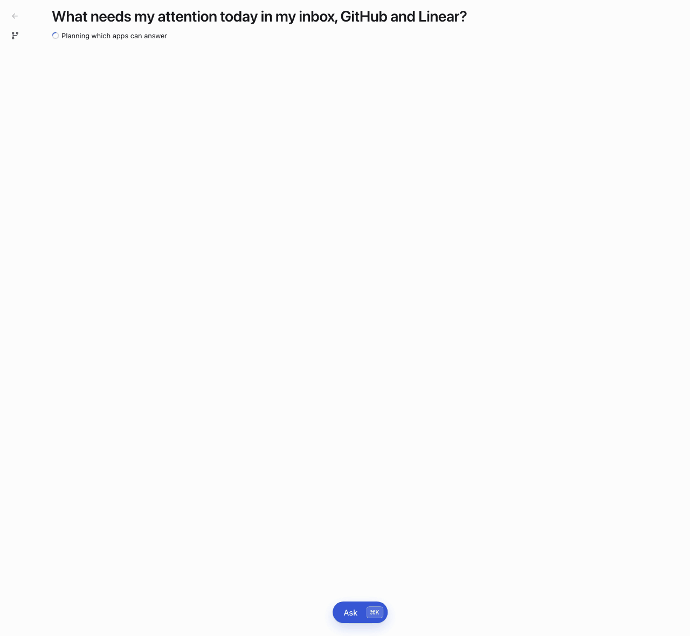
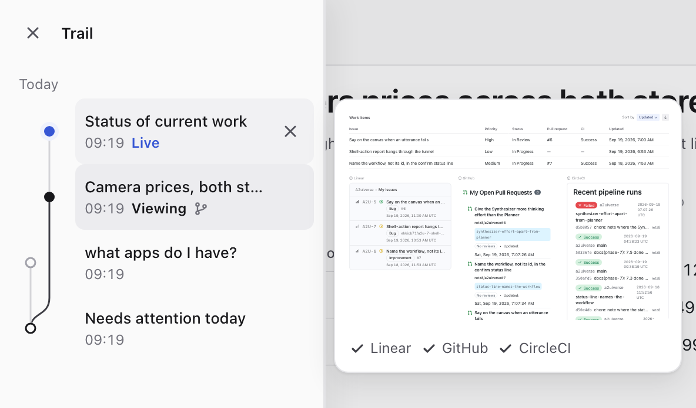
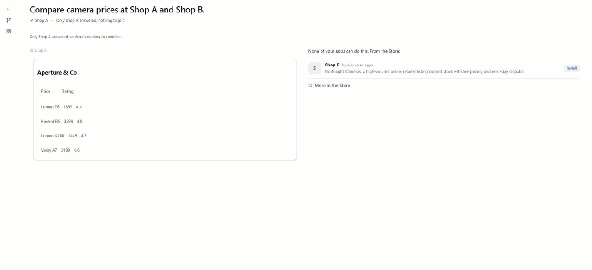
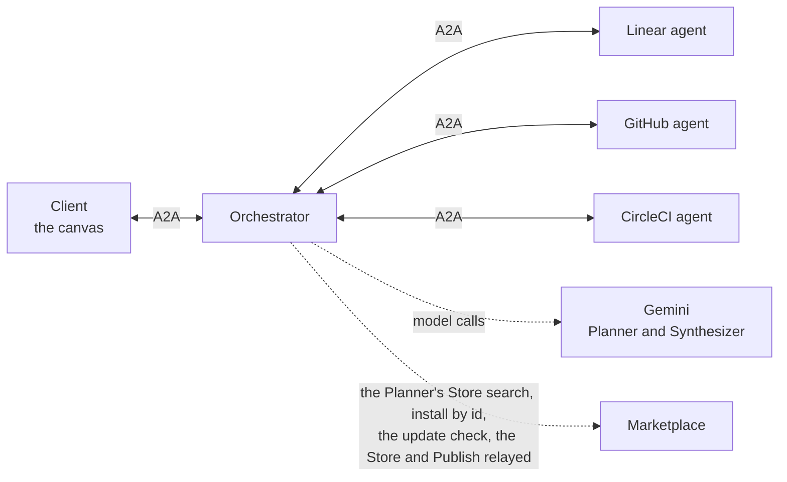

# A2UIVerse

> **The application ecosystem for A2UI agents.**

A2UIVerse is a semantic application runtime that composes independently-owned agent UIs into one persistent, interactive surface. It's built on **[A2UI](https://a2ui.org)** and **[A2A](https://github.com/a2aproject/A2A)**.

A2UI asks: _how does an agent express UI?_\
**A2UIVerse asks: how do the UI and data that many agents express become one application?**

Ask one question. Several agents answer at once, each painting its own interface, and you get **one screen**, not three chat replies.

<p align="center">
  
  <br>
  <em>"What needs my attention today in my inbox, GitHub and Linear?" The layout lands first, Gmail, GitHub and Linear each fill their slot in their own look, and the merged table on top puts them on one timeline. Replayed from a recording, with the waits shortened.</em>
</p>

## Try it

**A replay, with nothing to set up:**

```bash
pnpm install
pnpm --filter @a2uiverse/client preview:snapshot
```

Open **http://localhost:4173/?beat=27** for the session in the GIF above, replayed from a recording with no orchestrator, no apps and no model; the apps' catalogs come from the registry snapshot the command builds. `?beat=trail` replays four questions on two branches, `?beat=26` the way back inside an app, `?beat=31` an app offered from the Store in the slot that needs it, and `?page=store` opens the Store over a fixed world of the seven apps.

**For real**, with **Node 22** or newer (Corepack resolves the pinned pnpm), [uv](https://docs.astral.sh/uv/), a [Gemini API key](https://aistudio.google.com/apikey), and [`a2uiverse-apps`](https://github.com/retz8/a2uiverse-apps) checked out beside this repo:

```bash
git clone https://github.com/retz8/a2uiverse-apps ../a2uiverse-apps
pnpm install
echo "GOOGLE_API_KEY=<your key>" > apps/orchestrator/.env
pnpm dev:all        # the apps and the platform, the apps installed
```

Open **http://localhost:5173** and press `⌘K`. The apps start in `deterministic` mode, answering from recordings with no key of their own, while the Planner and the Synthesizer run live. The first time you ask something an app holds, its slot asks you to sign in, and the app's sign-in page offers made-up accounts. For real data, `pnpm dev:all --mode live`: each agent then needs a Gemini key in its own `.env`, and you sign in to each vendor in the browser — GitHub, and Gmail and Calendar together, through an OAuth client you register once; Linear and CircleCI need nothing set up. Each app's agent README has the steps.

<details>
<summary><b>Every command</b></summary>

```bash
pnpm dev:all          # the apps and the platform, the apps installed
pnpm dev              # the platform only: client, orchestrator, marketplace
pnpm dev:agents       # the apps only, installed into the running orchestrator: --tier mocks (or default,mocks), --only <ids>, --mode deterministic|stub|live, --agents-dir <path>, --no-install, --publish, --leave-uninstalled <ids>, --agent-state <dir>, --publisher-file <path>
pnpm agents:list      # what a launch would run, and what would stop it: --tier mocks (or default,mocks), --publish
pnpm dev:client       # one platform process, in its own terminal
pnpm dev:orch
pnpm dev:marketplace
pnpm verify           # build, typecheck, test, lint and format check
pnpm sweep:secrets    # after a sitting: the journal, the marketplace's state and captured output searched for every token and key the vault, the agents and the publisher files hold, counts only: --state-dir, --agents-dir, --marketplace-state, --dev-publisher, --publisher <file>, --logs <dir>
```

Ports: client `5173`, orchestrator `10001`, marketplace `10002`. The apps take `11001` and up, the mock stores `12001` and up; the orchestrator reaches them, and the browser only their sign-in pages.

</details>

<details>
<summary><b>The launcher</b></summary>

The launcher's roster, `scripts/dev-roster.mjs`, lists every app it starts from the `a2uiverse-apps` checkout: its id, its folder, its tier and its port. `--agents-dir <path>` or `A2UIVERSE_AGENTS_DIR` points it at another checkout; a new app joins the roster with the port its agent was scaffolded on.

- **A launch runs one tier, or several** joined by commas. The default tier is the five apps; the two mock stores, for testing the merged view, run in place of them under `--tier mocks`, or beside them under `--tier default,mocks`.
- **It installs what it runs.** It starts the agents and the platform together, builds each app's catalog package in the checkout, packs it with Stellify and, once the orchestrator answers, installs each app as its agent comes up. Then it uninstalls every roster app it did not install; an app you installed by hand that the roster doesn't name is left alone. `dev:agents` does the same against an orchestrator you started yourself; `--no-install` starts the agents only, for installing by hand with the orchestrator's `registry` command.
- **`--publish` takes every app through the marketplace instead**, so each counts as installed from it. It publishes to the marketplace the orchestrator installs from — `MARKETPLACE_URL`, `http://localhost:10002` by default — as the dev publisher `a2uiverse-apps`, claimed on the first launch, its token kept in `scripts/.state/stellify/publisher.json`, or the file `--publisher-file <path>` names, and never in your own Stellify publisher file; a marketplace whose state was wiped no longer knows the token, and the launcher claims the name again. `STELLIFY_HOME=scripts/.state/stellify` gives Stellify's command line the dev publisher by hand. Each app, once up: an app whose card requires sign-in is previewed first, signed in as the fake account its roster entry names, or with Shop B's demo key; then published; then installed by its id alone. Under `--mode live` the preview comes from a second copy of the agent in deterministic mode on a free port, stopped once it's taken, and the app is published with the live agent's card. When the marketplace never answers, holds the name under a token the launcher no longer has, or the publisher file names another marketplace, nothing is installed and the line says what to do. The launcher never unpublishes; the notices for the dev publisher's apps that are ahead of the Store and weren't published this launch print at the end. Publish with the same `A2UIVERSE_PUBLIC_URL` every time against one marketplace state: an app's card carries its addresses, and the marketplace refuses a changed card at a version it has already published — switching means wiping the marketplace's state, or moving the `version` in the agent's `app/config.py`. `--publish` is refused beside `--no-install`; with it, `agents:list` also names the marketplace, the publisher file's state and each preview's account. `--leave-uninstalled <ids>` publishes those apps and leaves them uninstalled, in the Store for a slot to offer (`pnpm dev:all --tier mocks --publish --leave-uninstalled shop-b`); it needs `--publish`, and an install of one an earlier launch left is taken out.
- **Agents' addresses and state.** Each agent starts with `--host localhost` and its roster port. `A2UIVERSE_PUBLIC_URL`, a pattern with a `{port}` slot such as `https://<tunnel-id>-{port}.asse.devtunnels.ms`, gives each agent as `--public-url` the address the browser reaches its sign-in pages at; `--agent-state <dir>` keeps each agent's sign-in store in `<dir>/<app id>` instead of its own `.state/`. The launcher hands no credential to an agent — each reads its own `agent/.env` — and under `--publish` holds only the dev publisher's token and each preview's credential, for that one preview.
- **Failures are named, never papered over.** An app that doesn't build, pack or come up, or is refused at preview, publish or install, is named with its reason and left out, uninstalled if an earlier launch installed it; the rest run. A roster app missing from the checkout is skipped. An unknown tier, an unknown `--only` id, or two apps of a tier on one port stop the launch. Stopping the launcher uninstalls nothing: the next launch sets the registry right.

</details>

## Why A2UIVerse?

**A2UIVerse = A2UI + Universe.** Rather than treating agents as features inside applications, A2UIVerse treats agents as **first-class, composable application primitives**, and explores what an application ecosystem looks like when AI agents can be packaged, discovered, installed, orchestrated and composed into interactive experiences.

**A2UIVerse is to A2UI agents what a browser is to websites.** A browser draws pages from any site, in markup it didn't write; A2UIVerse draws UI from any A2UI agent. But where a browser needs an address and shows one site at a time, A2UIVerse takes a question and puts every app that holds part of the answer on one screen.

| On the web                                | In A2UIVerse                                                         |
| ----------------------------------------- | -------------------------------------------------------------------- |
| A website                                 | An app: an A2A agent that answers with UI in A2UI                    |
| HTML and CSS                              | A2UI, drawn with the app's own catalog                               |
| Typing an address                         | Asking a question; A2UIVerse picks the apps                          |
| One site per tab                          | Several apps on one screen, each in its own look, and a merged view  |
| Tabs and a history stack                  | An answer per question, each still working, on a trail that branches |
| Permission prompts only the browser draws | Sign-in and consent only the shell draws, never an app               |
| An app store                              | A marketplace: publish once, and any A2UIVerse installs by name      |

The full design, from its axioms to its milestones, is in **[SPEC.md](SPEC.md)**.

## What it does

**One question, one screen.** Ask in words, from the palette (`⌘K`). A2UIVerse picks the apps that hold the answer, including ones you didn't name, lays out a screen, and asks them all at once. Each app fills its slot with UI it generates, in its own design system — GitHub in Primer, Gmail and Calendar in Material 3, CircleCI and Linear each in a catalog of its own. The shell names each app above its slot and never reaches inside it. [More in the client README](apps/client/README.md).

**A merged view across apps.** When the answers can be joined, a table on top brings them together: the morning's mail, issues and pull requests on one timeline, or each Linear issue on one row with its pull request in GitHub and its CI run in CircleCI. A model writes the table as formulas pointing into each app's data, never as copied values, and every claim that two entries are the same thing is checked against the data before it's accepted. The client computes the table and keeps it live as the apps' data changes, with no further model call; each value shows how sure it is, and clicking it jumps to where it came from. [One row merged, step by step](apps/orchestrator/README.md#merges-across-apps).

**Honest when apps are slow or fail.** One app failing never fails the rest: its slot says why and offers Retry, and its data leaves the merge. The merge doesn't wait on a straggler; a late app still fills its slot, and Include folds it in. Only the first merge is automatic — every later model call has a press behind it, so the merged view never changes without a visible reason.

**Every question kept.** Every question gets its own answer, and none is thrown away when the next is asked. A past answer still works like a browser tab: clicks and sorts land in it, and anything it was still loading keeps arriving. "Ask this again now" gets today's answer as a new one and leaves the past one as it was; asking from a past answer starts a branch, and the trail draws every question on the branch it grew from.

<p align="center">
  
  <br>
  <em>The trail: four questions on two branches. Hovering an entry previews its answer.</em>
</p>

**Sign-in the shell draws.** An app that needs you signed in never draws its own sign-in: its slot takes a tile the shell draws, saying what the app will be able to do in the words of its card, with one Sign in that opens the app's sign-in in a new window; the slot fills in place when you're done, and the rest of the screen never waits on it. An app that needs more access part-way asks on its name row, with Allow and Not now. An app can hold several accounts, each named on what it paints. No app can put a password, code or card field on the screen: a paint with one is refused, and if the app doesn't answer without it, its slot says why and offers to continue on the app's own site. The orchestrator keeps the sign-ins in its vault; no credential reaches the client or the models. [More in the authority design record](docs/design/authority.md).

**Back and forward inside each app.** Clicking into something inside an app, like a CI run, paints a new screen in its slot, with a back arrow beside the app's name. Each app keeps its own history, apart from the others, and drops nothing; going back restores the merged view too, from the wiring remembered for that combination of screens, with no model call.

<table>
  <tr>
    <td align="center" valign="top"></td>
    <td align="center" valign="top"></td>
  </tr>
  <tr>
    <td align="center"><em>CircleCI's slot: a run, its failing job, Back twice, the run opened again, then Back twice: the runs list, and the job left behind.</em></td>
    <td align="center"><em>The merged view at the same moments.</em></td>
  </tr>
</table>

**Any A2UI agent can join.** **App = MCP server + Agentic BFF + A2UI catalog.** Five apps — GitHub, Gmail, Google Calendar, CircleCI and Linear — live in [`a2uiverse-apps`](https://github.com/retz8/a2uiverse-apps), with a kit to build agents on and a scaffolder for new apps. On the way to the screen an app's A2UI is changed only where two apps could collide, so an A2UI agent takes part with no changes to its code. An app is installed from its agent card and its catalog, packed by Stellify; the client loads the catalog when it's first needed, and nothing in A2UIVerse's code names an app. Sign-in is read from the card too: A2UIVerse signs in to an app by the scheme its card declares, as any OAuth client would.

**A Store, an App Library and Publish.** Apps, under Back and Trail, opens one page over the canvas, leaving the canvas as it was: the Store, to search the marketplace, see an app's sample answer drawn live in its own look and install it; the App Library, for each installed app's updates in plain words, its accounts — permissions, rename, sign out, add account — and uninstall; and Publish, for a publisher who uses A2UIVerse too. Asking opens them as well, from a button in the answer. [More in the trusted page design record](docs/design/trusted-page.md).

**Installed where it's needed.** A question no installed app can answer doesn't stop at "no app can do this": the Planner searches the Store, and the slot that needs it offers the apps it found, each by name and publisher. Install, through the same consent card the Store uses, fills that slot in place with the app's answer, nothing else on the screen moving; the same app offered on another canvas turns to Show it here. An app that has changed since you installed it says so in its slot — needs an update, with Update, or waiting on its publisher — and an update never changes the look of what's already on screen. [More in the store loop design record](docs/design/store-loop.md).

<p align="center">
  
  <br>
  <em>"Compare camera prices at Shop A and Shop B." with Shop B not installed: offered in its slot, installed there, and taken into the merged view.</em>
</p>

**Published once, installed by name.** A vendor claims a publisher name, packs their catalog and publishes from its own checkout, or from Publish; the marketplace fetches the agent's card, checks the catalog as install would, asks the agent its first screen, and lists the app. Any A2UIVerse then installs it by its id alone, and tells when a newer version is waiting — a fixed build of a catalog installs itself; a new catalog, a changed card or a retired one waits for the person. [More in the marketplace design record](docs/design/marketplace.md).

## How it works



The client talks only to the orchestrator, and the orchestrator to the apps. One question goes like this:

1. **Router** ranks the installed apps' agent cards against the question, with a small embedding model, and hands a shortlist on.
2. **Planner**, the first model call, picks the apps, writes each one's request, and designs the layout. For what no installed app can do, it searches the Store and offers the apps it found in that slot. The layout reaches the client before any app is asked.
3. **Apps** are asked in parallel, and each answer is relayed into its slot as it arrives. The client draws it with that app's own catalog.
4. **Synthesizer**, the second model call, runs once the apps have answered, when the plan reserved a merged view. It writes the view as formulas over the apps' data.
5. **Client** evaluates the formulas, and again on every change, with no model call.

Before an app is asked, the orchestrator's **AuthVault** checks the app's card against the accounts it holds, and the request carries the account's credential as an HTTP header. An app you aren't signed in to isn't asked: its slot takes the sign-in tile, and signing in sends the request then. Nor is an app whose live card no longer names a look it's installed with: its slot takes the update tile.

| Part                                                        | What it is                                                                                                                                                                                                 |
| ----------------------------------------------------------- | ---------------------------------------------------------------------------------------------------------------------------------------------------------------------------------------------------------- |
| [`apps/client`](apps/client/)                               | The canvas: the palette, the composed screen, the merged view, the trail; and the page over it: the Store, the App Library, Publish. Vite and React                                                        |
| [`apps/orchestrator`](apps/orchestrator/)                   | The hub: an A2A agent server that picks the apps, plans the screen, relays the answers and writes the merge, and keeps the apps' sign-ins in its vault; it relays the Store and Publish to the marketplace |
| [`apps/marketplace`](apps/marketplace/)                     | Where apps are published and found: the index of published apps with its search, their catalogs hosted, and the publish step with its smoke test                                                           |
| [`packages/sdk`](packages/sdk/)                             | The contracts the parts agree on — the composition, the catalog artifact, the marketplace — and generic A2UI tools                                                                                         |
| [`packages/shell-catalog`](packages/shell-catalog/)         | The shell's own A2UI catalog: the basic catalog on Radix Themes, plus the components that compose a screen                                                                                                 |
| [`packages/stellify`](packages/stellify/)                   | Stellify, the pack and publish tool: turns a catalog package into the catalog artifact the registry installs, and takes an app to the marketplace                                                          |
| [`packages/embedder`](packages/embedder/)                   | The one embedding model the Router and the marketplace rank with                                                                                                                                           |
| [`packages/registry-snapshot`](packages/registry-snapshot/) | The catalog table and the seven catalog packages, packed, at one pinned commit, for the tests and replays                                                                                                  |
| [`a2uiverse-apps`](https://github.com/retz8/a2uiverse-apps) | The apps, their agent kit and the scaffolder, in their own repo                                                                                                                                            |

Going deeper: **[SPEC.md](SPEC.md)** is the full design, and [`docs/design/`](docs/design/) has a guide to each part — the [synthesis](docs/design/synthesis.md) behind the merged view, the [client](docs/design/client.md), the [orchestrator](docs/design/orchestrator.md), the [shell catalog](docs/design/shell-catalog.md), the [agent kit](docs/design/agent-kit.md), [app install](docs/design/app-install.md), the [marketplace](docs/design/marketplace.md), [authority](docs/design/authority.md): sign-in, accounts and the credential bar, the [trusted page](docs/design/trusted-page.md): the Store, the App Library and Publish, and the [store loop](docs/design/store-loop.md): an app offered, installed and updated in the slot that needs it.

<details>
<summary><b>Repository layout</b></summary>

```
apps/
  client/          the canvas and the page over it (Vite + React)
  orchestrator/    the A2A agent server: routing, planning, composition, the registry, the vault
  marketplace/     where apps are published and found: the index, the hosted catalogs, the publish step
packages/
  sdk/             @a2uiverse/sdk: the contracts the parts agree on
  shell-catalog/   the shell's own A2UI catalog: schema and React implementation
  stellify/        the pack and publish tool
  embedder/        the embedding model, shared by the orchestrator and the marketplace
  registry-snapshot/ the registry snapshot the tests and replays load
scripts/           the dev:agents launcher and its roster, the secret sweep
docs/
  design/          the design records: each part as built, its classes and flows
  images/          the screenshots in the READMEs
```

A pnpm workspace with Turborepo over it. Each package's README has its own commands and configuration.

</details>

## Built on

A2UIVerse speaks the A2UI protocol at v0.9.1, on the packages the A2UI project publishes:

| Package          | Version | Used by                                                                                                      |
| ---------------- | ------- | ------------------------------------------------------------------------------------------------------------ |
| `@a2ui/web_core` | 0.14.0  | the client, the shell catalog, the orchestrator, the sdk and Stellify; lent to the apps' catalogs at runtime |
| `@a2ui/react`    | 0.14.0  | the client and the shell catalog; lent to the apps' catalogs at runtime                                      |
| `a2ui-agent-sdk` | 0.9.0   | the agent kit in `a2uiverse-apps`                                                                            |
| `a2ui-core`      | 0.4.0   | the agent kit                                                                                                |
| `a2ui-a2a`       | 0.1.0   | the agent kit                                                                                                |

The two npm packages carry local patches, described in the [client README](apps/client/README.md#upstream-patches).

## Where it's headed

What's built so far is the composed screen; installing an app from its card and its packed catalog, or from the marketplace by its id alone; signing in to apps, with several accounts each; the marketplace an app is published to — its index with search, its hosted catalogs, the publish step that tries a new app by asking it to paint its first screen — and the orchestrator telling when a published update is waiting; the one page over the canvas — the Store, the App Library and Publish; and the store loop — a question no installed app can answer offering apps from the Store in its slot, installed there, and an app that has changed updated where it stands. Next:

- **Models beyond Gemini** tried on the apps' agents.
- **One sitting, end to end**: publish a new app, discover it, install it, compose it with an existing one, and act inside it, with no code changes.

## Feedback

A2UIVerse is in active development and isn't done. Feedback from anyone interested is welcome: ideas and questions in [Discussions](https://github.com/retz8/a2uiverse/discussions), bugs in [issues](https://github.com/retz8/a2uiverse/issues). [CONTRIBUTING](CONTRIBUTING.md) says more.

## License

MIT. See [LICENSE](LICENSE).

A2UIVerse is an independent project, not affiliated with or endorsed by GitHub, Google, Linear or CircleCI. Their product names identify the services the apps connect to and are trademarks of their owners.
