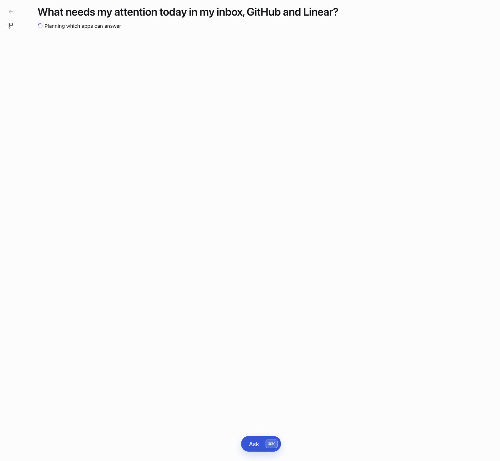
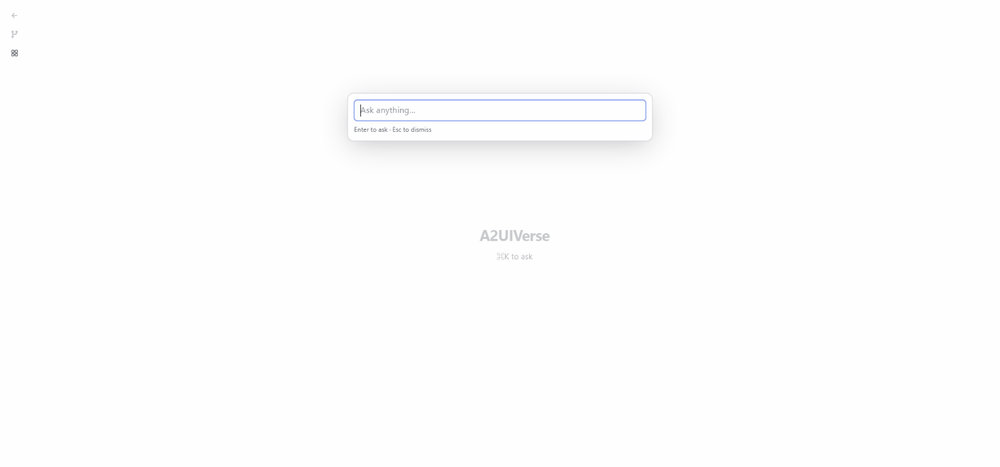
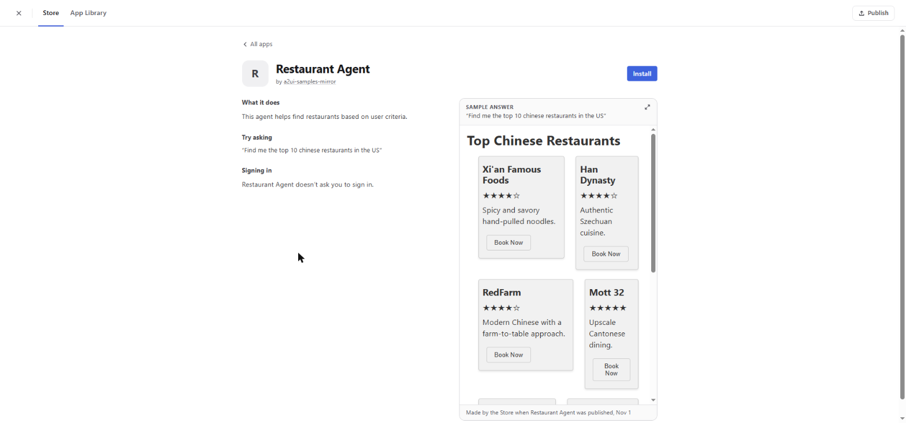
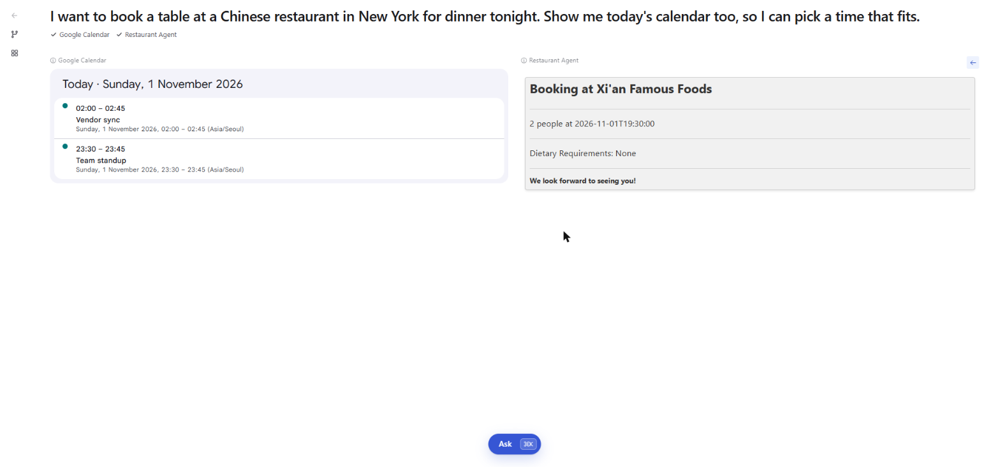
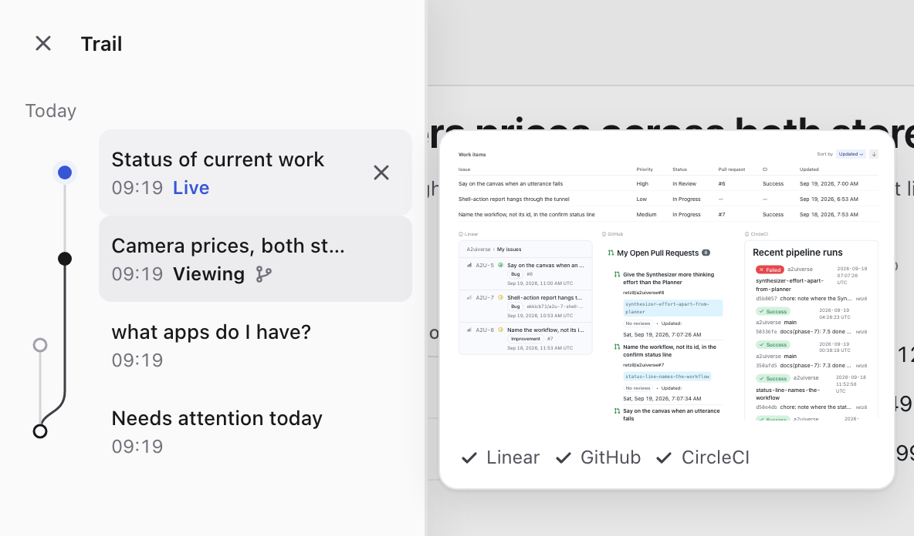
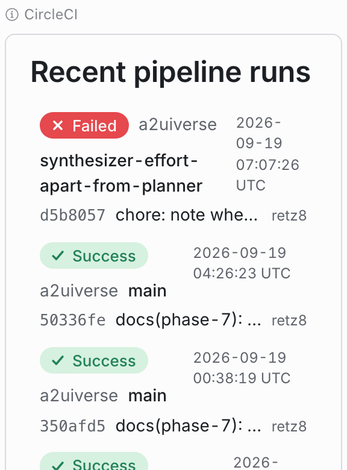
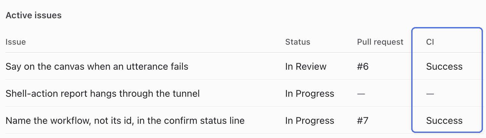
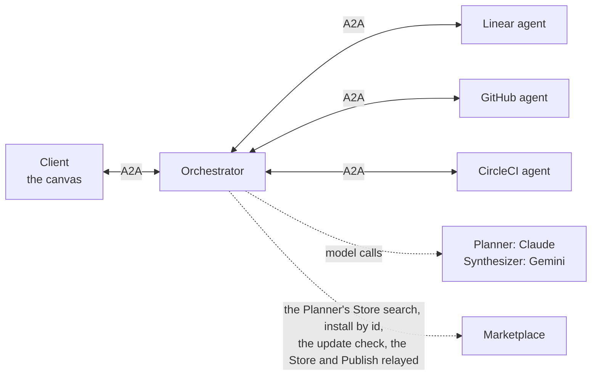

# A2UIVerse

> **The application ecosystem for A2UI agents.**

Ask one question. Several agents answer at once, each painting its own interface, and you get **one screen**, not three chat replies.

A2UI asks: _how does an agent express UI?_\
**A2UIVerse asks: how do the UI and data that many agents express become one application?**

Many agents on one UI, an agent marketplace, and full apps composed from agents: A2UIVerse runs all three today, built downstream of [A2UI](https://a2ui.org) and [A2A](https://github.com/a2aproject/A2A) as they stand.

<p align="center">
  
  <br>
  <em>"What needs my attention today in my inbox, GitHub and Linear?" The layout lands first, Gmail, GitHub and Linear each fill their slot in their own look, and the merged table on top puts them on one timeline. Replayed from a recording, with the waits shortened.</em>
</p>

**[Try it](#try-it)**: a replay in two commands, or the whole thing live.

## Your A2UI agent, unchanged

A2UI's [who-is-it-for page](https://a2ui.org/introduction/who-is-it-for/#3-platform-builders-sdk-creators) asks platform builders: "Do you ship your agent into other apps you don't necessarily control?" Here, upstream's own restaurant finder, run from A2UI's repository with no change to its code, was published to the Store, found from a question no installed app could answer, installed from the Store's offer, composed beside Google Calendar, and a table was booked inside it. Its card names no catalog of its own, so its card's address was all it took to publish and install it.

<p align="center">
  
  <br>
  <em>"I want to book a table at a Chinese restaurant in New York for dinner tonight. Show me today's calendar too, so I can pick a time that fits." No restaurant app is installed: Calendar answers in its slot, the Store's offer fills the other, and Install fills it with the restaurant finder's answer, with no second plan. Recorded live, the waits shortened.</em>
</p>

<table>
  <tr>
    <td align="center" valign="top"><a href="docs/images/ecosystem-run-publish.gif"></a></td>
    <td align="center" valign="top"><a href="docs/images/ecosystem-run-booking.gif"></a></td>
  </tr>
  <tr>
    <td align="center"><em>Published from its card, in the Store with its sample answer drawn live.</em></td>
    <td align="center"><em>The table booked inside its slot, beside Calendar.</em></td>
  </tr>
</table>

The five apps built for A2UIVerse — GitHub, Gmail, Google Calendar, CircleCI and Linear — live in [`a2uiverse-apps`](https://github.com/retz8/a2uiverse-apps) with the kit they're built on and a scaffolder for new ones, and [the sitting log](_dev/docs/phase-18-sitting-log.md) is the full account of this run.

## Why A2UIVerse?

**A2UIVerse = A2UI + Universe**: a world where A2UI agents share one screen, are found and installed like apps, and compose into full applications.

**Many agents on one UI.** Several apps answer one question on one screen: each paints its own surface into a slot of a layout drawn for the question, and a merged view joins their data. Each surface keeps its own data and look, its ids kept apart from every other app's, so no agent collides with another or reaches into it; only the shell draws across them.

**An agent marketplace.** An agent is published once from its agent card, tried before it's listed, and installed anywhere by its id, from the Store or from the slot of a question no installed app could answer.

**Full apps, composed from agents.** The composed screen is one working application, not a reply: clicks inside an app land in it, each app has its own back and forward, every past question still works like a tab, and sign-in and consent are the shell's, never an app's.

**A2UIVerse is to A2UI agents what a browser is to websites.** A browser draws pages from any site, in markup it didn't write; A2UIVerse draws UI from any A2UI agent. But where a browser needs an address and shows one site at a time, A2UIVerse takes a question and puts every app that holds part of the answer on one screen.

| On the web                                | In A2UIVerse                                                         |
| ----------------------------------------- | -------------------------------------------------------------------- |
| A website                                 | An app: an A2A agent that answers with UI in A2UI                    |
| HTML and CSS                              | A2UI, drawn with the app's own catalog                               |
| Typing an address                         | Asking a question; A2UIVerse picks the apps                          |
| One site per tab                          | Several apps on one screen, each in its own look, and a merged view  |
| Tabs and a history stack                  | An answer per question, each still working, on a trail that branches |
| Permission prompts only the browser draws | Sign-in and consent only the shell draws, never an app               |
| An app store                              | A marketplace: publish once, and any A2UIVerse installs by name      |

The full design, from its axioms to its milestones, is in **[SPEC.md](SPEC.md)**.

## What it does

**One question, one screen.** Ask in words, from the palette (`⌘K`): A2UIVerse picks the apps that hold the answer, including ones you didn't name, lays out a screen, and asks them all at once. Each app fills its slot with UI it generates, in its own design system — GitHub in Primer, Gmail and Calendar in Material 3, CircleCI and Linear each in a catalog of its own — its catalog installed with the app and loaded when it's first needed, never compiled into A2UIVerse. The shell names each app above its slot and never reaches inside it. [More in the client README](apps/client/README.md).

**A merged view across apps.** When the answers can be joined, a table on top brings them together: the morning's mail, issues and pull requests on one timeline, or each Linear issue on one row with its pull request in GitHub and its CI run in CircleCI. A model writes the table as formulas pointing into each app's data, never as copied values, and every claim that two entries are the same thing is checked against the data before it's accepted. The client keeps the table live as the apps' data changes, with no further model call, and each value shows how sure it is and jumps to where it came from. [One row merged, step by step](apps/orchestrator/README.md#merges-across-apps).

**Honest when apps are slow or fail.** One app failing never fails the rest: its slot says why and offers Retry, and its data leaves the merge. The merge doesn't wait on a straggler, which still fills its slot and joins the merge on Include; only the first merge is automatic, so the merged view never changes without a visible reason.

**Every question kept.** Every question gets its own answer, and a past answer still works like a browser tab: clicks and sorts land in it, and anything it was still loading keeps arriving. "Ask this again now" gets today's answer as a new one beside the past one, and asking from a past answer starts a branch on the trail.

<p align="center">
  
  <br>
  <em>The trail: four questions on two branches. Hovering an entry previews its answer.</em>
</p>

**Back and forward inside each app.** Clicking into something inside an app, like a CI run, paints a new screen in its slot, with a back arrow beside the app's name. Each app keeps its own history, apart from the others, and going back restores the merged view too, from the wiring remembered for that combination of screens, with no model call.

<table>
  <tr>
    <td align="center" valign="top"></td>
    <td align="center" valign="top"></td>
  </tr>
  <tr>
    <td align="center"><em>CircleCI's slot: a run, its failing job, Back twice, the run opened again, then Back twice: the runs list, and the job left behind.</em></td>
    <td align="center"><em>The merged view at the same moments.</em></td>
  </tr>
</table>

**Sign-in the shell draws.** An app never draws its own sign-in: its slot takes a tile the shell draws, in the words of the app's card, whose one press opens the app's sign-in in a new window, and the slot fills in place when you're done. A2UIVerse reads which sign-in an app needs from its agent card and signs in as any OAuth client would; an app can hold several accounts, and none can put a password, code or card field on the screen. The orchestrator keeps the sign-ins in its vault, and no credential reaches the client or the models. [More in the authority design record](docs/design/authority.md).

**Installed where it's needed.** A question no installed app can answer doesn't stop at "no app can do this": the Planner searches the Store, and the slot that needs it offers the apps it found, each by name and publisher. Install, through the same consent card the Store uses, fills that slot in place with the app's answer, nothing else on the screen moving; an app that has changed since you installed it says so in its slot, with Update. [More in the store loop design record](docs/design/store-loop.md).

**Publish once, install by name.** A publisher claims a name and publishes an app from its agent card and its packed catalog, from the command line or from Publish; the marketplace checks the catalog as install would, asks the agent its first screen, and lists the app with that answer. Apps, under Back and Trail, opens the Store, the App Library and Publish on one page over the canvas: search and install by id alone, each installed app's updates in plain words, its accounts, and uninstall. A fixed build of a catalog installs itself, and every other update waits for you. More in the [marketplace](docs/design/marketplace.md) and [trusted page](docs/design/trusted-page.md) design records.

## Try it

**A replay, with nothing to set up:**

```bash
pnpm install
pnpm --filter @a2uiverse/client preview:snapshot
```

Open **http://localhost:4173/?beat=27** for the session in the GIF at the top of this page, replayed from a recording with no orchestrator, no apps and no model; the apps' catalogs come from the registry snapshot the command builds. `?beat=trail` replays four questions on two branches, `?beat=26` the way back inside an app, `?beat=31` an app offered from the Store in the slot that needs it, and `?page=store` opens the Store over a fixed world of the seven apps.

**For real**, with **Node 22** or newer (Corepack resolves the pinned pnpm), [uv](https://docs.astral.sh/uv/), a [Claude API key](https://platform.claude.com/docs/en/get-api-key) and a [Gemini API key](https://aistudio.google.com/apikey), and [`a2uiverse-apps`](https://github.com/retz8/a2uiverse-apps) checked out beside this repo:

```bash
git clone https://github.com/retz8/a2uiverse-apps ../a2uiverse-apps
pnpm install
echo "ANTHROPIC_API_KEY=<your Claude key>" > apps/orchestrator/.env   # the Planner
echo "GOOGLE_API_KEY=<your Gemini key>" >> apps/orchestrator/.env     # the Synthesizer
pnpm dev:all        # the apps and the platform, the apps installed
```

Open **http://localhost:5173** and press `⌘K`. The apps start in `deterministic` mode, answering from recordings with no key of their own, while the Planner and the Synthesizer run live. The first time you ask something an app holds, its slot asks you to sign in, and the app's sign-in page offers made-up accounts. For real data, `pnpm dev:all --mode live`: each agent then needs a Gemini key in its own `.env`, and you sign in to each vendor in the browser — GitHub, and Gmail and Calendar together, through an OAuth client you register once; Linear and CircleCI need nothing set up. Each app's agent README has the steps.

<details>
<summary><b>Every command</b></summary>

```bash
pnpm dev:all          # the apps and the platform, the apps installed
pnpm dev              # the platform only: client, orchestrator, marketplace
pnpm dev:agents       # the apps only, installed into the running orchestrator
pnpm agents:list      # what a launch would run, and what would stop it
pnpm dev:client       # one platform process, in its own terminal
pnpm dev:orch
pnpm dev:marketplace
pnpm verify           # build, typecheck, test, lint and format check
pnpm sweep:secrets    # after a sitting: every token and key searched for in what it left, counts only
```

</details>

The launcher's flags, its roster and the ports: [scripts/README.md](scripts/README.md).

## How it works



The client talks only to the orchestrator, and the orchestrator to the apps. One question goes like this:

1. **Router** ranks the installed apps' agent cards against the question, with a small embedding model, and hands a shortlist on.
2. **Planner**, the first model call, picks the apps, writes each one's request, and designs the layout. For what no installed app can do, it searches the Store and offers the apps it found in that slot. Its answer is read as it's written: the apps are asked as soon as the plan names them, while the layout is still being written, and the layout reaches the client piece by piece, whole before any app's answer is shown.
3. **Apps** are asked in parallel, and each answer is relayed into its slot as it arrives. The client draws it with that app's own catalog.
4. **Synthesizer**, the second model call, runs once the apps have answered, when the plan reserved a merged view. It writes the view as formulas over the apps' data.
5. **Client** evaluates the formulas, and again on every change, with no model call.

Before an app is asked, the orchestrator's **AuthVault** checks the app's card against the accounts it holds, and the request carries the account's credential as an HTTP header. An app you aren't signed in to isn't asked: its slot takes the sign-in tile, and signing in sends the request then. Nor is an app whose live card no longer names a look it's installed with: its slot takes the update tile.

| Part                                                        | What it is                                                                                                                                                                                                 |
| ----------------------------------------------------------- | ---------------------------------------------------------------------------------------------------------------------------------------------------------------------------------------------------------- |
| [`apps/client`](apps/client/)                               | The canvas: the palette, the composed screen, the merged view, the trail; and the page over it: the Store, the App Library, Publish. Vite and React                                                        |
| [`apps/orchestrator`](apps/orchestrator/)                   | The hub: an A2A agent server that picks the apps, plans the screen, relays the answers and writes the merge, and keeps the apps' sign-ins in its vault; it relays the Store and Publish to the marketplace |
| [`apps/marketplace`](apps/marketplace/)                     | Where apps are published and found: the index of published apps with its search, their catalogs hosted, and the publish step with its smoke test                                                           |
| [`packages/sdk`](packages/sdk/)                             | The contracts the parts agree on — the composition, the catalog artifact, the marketplace — and generic A2UI tools                                                                                         |
| [`packages/shell-catalog`](packages/shell-catalog/)         | The shell's own A2UI catalog: the basic catalog on Radix Themes, plus the components that compose a screen                                                                                                 |
| [`packages/stellify`](packages/stellify/)                   | Stellify, the pack and publish tool: turns a catalog package into the catalog artifact the registry installs, and takes an app to the marketplace                                                          |
| [`packages/embedder`](packages/embedder/)                   | The one embedding model the Router and the marketplace rank with                                                                                                                                           |
| [`packages/registry-snapshot`](packages/registry-snapshot/) | The catalog table and the seven catalog packages, packed, at one pinned commit, for the tests and replays                                                                                                  |
| [`a2uiverse-apps`](https://github.com/retz8/a2uiverse-apps) | The apps, their agent kit and the scaffolder, in their own repo                                                                                                                                            |

Going deeper: **[SPEC.md](SPEC.md)** is the full design, and [`docs/design/`](docs/design/) has a guide to each part — the [synthesis](docs/design/synthesis.md) behind the merged view, the [client](docs/design/client.md), the [orchestrator](docs/design/orchestrator.md), the [shell catalog](docs/design/shell-catalog.md), the [agent kit](docs/design/agent-kit.md), [app install](docs/design/app-install.md), the [marketplace](docs/design/marketplace.md), [authority](docs/design/authority.md): sign-in, accounts and the credential bar, the [trusted page](docs/design/trusted-page.md): the Store, the App Library and Publish, and the [store loop](docs/design/store-loop.md): an app offered, installed and updated in the slot that needs it.

## How fast it answers

Each model and its effort is a default, set by a variable:

| Part        | Model              | Effort | Set by                                                        | Why                                                                           |
| ----------- | ------------------ | ------ | ------------------------------------------------------------- | ----------------------------------------------------------------------------- |
| Planner     | Claude Sonnet 5.5  | `low`  | `A2UIVERSE_PLANNER_MODEL`, `A2UIVERSE_PLANNER_EFFORT`         | [orchestrator](docs/design/orchestrator.md#model-seam-and-the-planners-model) |
| Synthesizer | `gemini-3.8-flash` | `low`  | `A2UIVERSE_SYNTHESIZER_MODEL`, `A2UIVERSE_SYNTHESIZER_EFFORT` | [synthesis](docs/design/synthesis.md#synthesizers-model-and-effort)           |
| The apps    | `gemini-3.8-flash` | `low`  | `MODEL_NAME`, `MODEL_EFFORT`, in each agent's `.env`          | [agent kit](docs/design/agent-kit.md#model-and-thinking-tier)                 |

`low` is the least thinking the model accepts. The Planner and the Synthesizer take any Gemini model, or any Claude model as `anthropic/<model>`: `A2UIVERSE_SYNTHESIZER_MODEL=anthropic/claude-sonnet-5-5` in the orchestrator's `.env` puts the Synthesizer on Claude, for one. The apps take any Gemini model; Claude runs on them with the limits [the kit's README](https://github.com/retz8/a2uiverse-apps/tree/main/agent-kit#quick-start) lists.

**In short:** six questions asked once on 2026-10-31, the apps live on real data: a plan in 2–8 s, the first app on screen at 10–75 s, the screen settled at 16–173 s, $2.53 for the six. The plan is fast and the apps are asked as soon as it names them, the merge's rows appear as the Synthesizer writes them, and what's left of the wait is the apps' own work.

[Every measured run, with its setup](_dev/docs/latency-and-token-experiment-results.md).

## Built on

A2UIVerse speaks the A2UI protocol at v0.9.1, on the packages the A2UI project publishes:

| Package          | Version | Used by                                                                                                      |
| ---------------- | ------- | ------------------------------------------------------------------------------------------------------------ |
| `@a2ui/web_core` | 0.14.0  | the client, the shell catalog, the orchestrator, the sdk and Stellify; lent to the apps' catalogs at runtime |
| `@a2ui/react`    | 0.14.0  | the client and the shell catalog; lent to the apps' catalogs at runtime                                      |
| `a2ui-agent-sdk` | 0.9.0   | the agent kit in `a2uiverse-apps`                                                                            |
| `a2ui-core`      | 0.4.0   | the agent kit                                                                                                |
| `a2ui-a2a`       | 0.1.0   | the agent kit                                                                                                |

The two npm packages carry local patches, described in the [client README](apps/client/README.md#upstream-patches).

## Where it's headed

- **A2UI v1.0**: a v1.0 agent accepted beside v0.9.1 ones, and the full move once upstream's React package ships its v1.0 entry.
- **A proposal to the A2UI community**: the deviations the [protocol delta register](SPEC.md#protocol-delta-register-seed) tags as upstream candidates, written up for upstream, with a guide to bringing your own agent.
- **The apps' agents on Claude**, once the kit's three limits on it are fixed.

## Feedback

A2UIVerse is in active development and isn't done. Feedback from anyone interested is welcome: ideas and questions in [Discussions](https://github.com/retz8/a2uiverse/discussions), bugs in [issues](https://github.com/retz8/a2uiverse/issues). [CONTRIBUTING](CONTRIBUTING.md) says more.

## License

MIT. See [LICENSE](LICENSE).

A2UIVerse is an independent project, not affiliated with or endorsed by GitHub, Google, Linear or CircleCI. Their product names identify the services the apps connect to and are trademarks of their owners.
