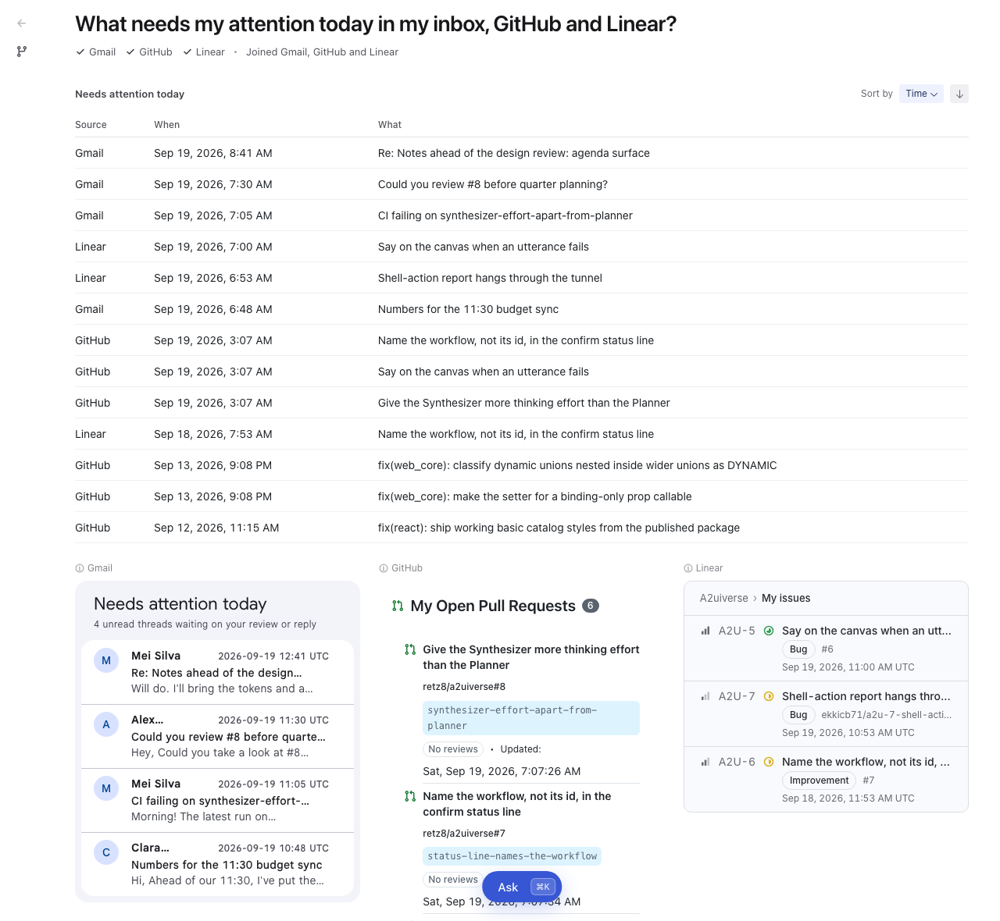
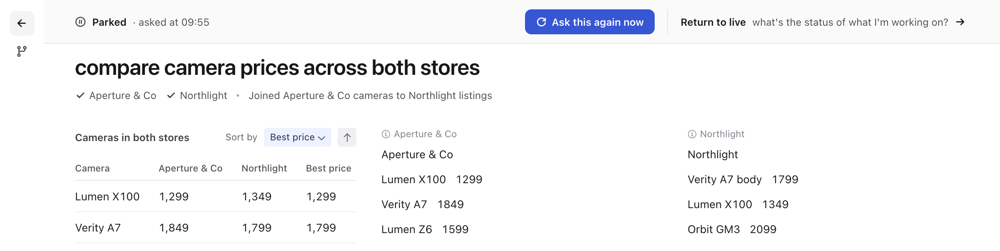
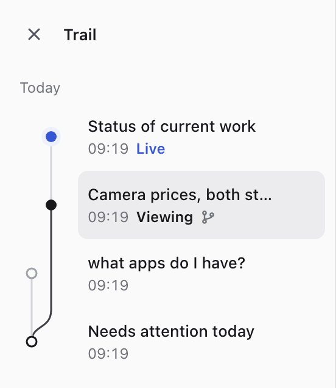
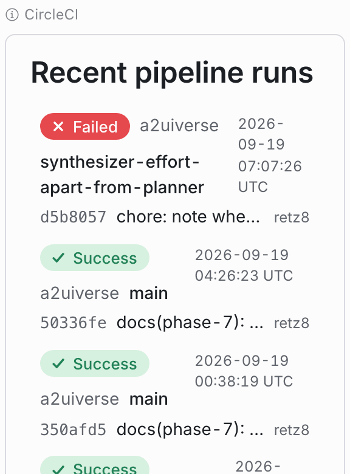
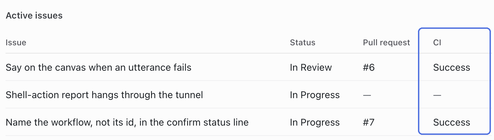

# @a2uiverse/client

The canvas: you ask in words, and the answer is a full screen of UI composed from several apps, each in its own design system and labelled with who painted it. Over it, one page holds the Store, the App Library and Publish. It talks only to the orchestrator, never to an app or the marketplace.

<p align="center">
  
  <br>
  <em>One question, answered by Gmail, GitHub and Linear, each in its own slot and look. The table on top is the merged view.</em>
</p>

## Running it

```bash
pnpm dev:client                                    # from the repo root: Vite on port 5173
pnpm --filter @a2uiverse/client build | typecheck | test | lint
pnpm --filter @a2uiverse/client preview:snapshot   # built against the registry snapshot, served on 4173, no orchestrator
pnpm --filter @a2uiverse/client test:e2e           # Playwright over preview:snapshot, compares screenshots
pnpm --filter @a2uiverse/client test:e2e:live      # the Store, an update, the accounts, Publish and a sign-in, on a real stack of its own
```

It sends to `VITE_ORCHESTRATOR_URL`, `http://localhost:10001` by default (see `.env.example`); when the orchestrator is somewhere else, set it in an uncommitted `.env.local`. It needs the orchestrator and the apps running too — `pnpm dev:all` from the root starts everything in order.

Playwright's browser installs separately (`pnpm exec playwright install chromium`). Its screenshots are taken at 1024×768 in UTC and aren't committed: on a fresh clone, run `test:e2e --update-snapshots` once.

`test:e2e:live` runs on a stack of its own on `localhost`, never touching yours. Everything it writes sits in a scratch folder, `a2uiverse-e2e-live` in the system's temp directory, wiped at each start but the two embedding models:

- its own marketplace on port 10082 and orchestrator on 10081, each on a scratch state directory;
- the launcher, in `deterministic` mode from the sibling `a2uiverse-apps` checkout, publishing GitHub, Gmail and Shop A under `--publish` and installing them from that marketplace — the dev publisher's file kept in the scratch folder (`--publisher-file`), each agent's sign-in store too (`--agent-state`) — and Shop B running, neither published nor installed;
- the client on 5183.

Its stories, each leaving the stack as it found it: Shop A found in the Store, installed and composed without a reload; a newer build of Shop A installed by the update check and drawn on the next canvas; Gmail's accounts signed in, renamed, a second added, each signed out; a name claimed on Publish publishing Shop B, refused a breaking schema and unpublishing; and one sign-in through the real window. What a story publishes is packed at run time from copies of the checkout's built catalogs, the checkout untouched. The Planner runs live on the orchestrator's `.env` key, and its ports and the four apps' must be free. It isn't part of `pnpm verify`.

## Working without a model

`?beat=<name>` replays a recorded or hand-built session through the whole canvas, with no model call and no app; `&instant` skips the recorded pacing. The catalogs it draws in still come from a registry: the live orchestrator's, or the registry snapshot with `preview:snapshot` and no orchestrator at all. `?beat=27&instant` is the answer above, `?beat=9&instant` the entity join, `?beat=trail` the trail, `?beat=26&instant` the way back. A beat's presses fire through the same handler the buttons call, answered from the beat itself; the tests and the screenshots in this README come from beats.

Under `preview:snapshot` the page over the canvas reads a fixed world shipped with the registry snapshot — the seven apps in the Store with their samples, six installed in six update states, a publisher signed in — so `?page=store`, `?page=library` and `?page=publish` open with content and no orchestrator; only the e2e tests answer its writes.

<details>
<summary><b>Recorded beats</b></summary>

Real output, captured through the orchestrator and kept as the stream it arrived as, in `recordings/beats/`:

| `?beat=`     | What it shows                                                                                                                                                                                                |
| ------------ | ------------------------------------------------------------------------------------------------------------------------------------------------------------------------------------------------------------ |
| `1` to `3`   | GitHub alone: a PR list, a PR, and a review composed and confirmed (replay `3` as `2,3`)                                                                                                                     |
| `4`          | Side by side: inbox and calendar in two slots, no merged view                                                                                                                                                |
| `5`          | The temporal merge: Google Calendar, Gmail, GitHub and Linear with the merged view                                                                                                                           |
| `6`          | A question about A2UIVerse itself, answered by the shell                                                                                                                                                     |
| `7`          | A capability gap: nothing installed can answer                                                                                                                                                               |
| `8`          | One app's slot and the shell's own words in one layout                                                                                                                                                       |
| `9`          | The entity join: Linear, GitHub and CircleCI merged, one row per issue                                                                                                                                       |
| `10` to `18` | Late answers and failures: Retry, Include, the home source straggling or failing, a broken stream, a paint the canvas can't draw, too few answers                                                            |
| `19` to `25` | Several answers: a tab finishing in the background, acting in a past answer, "Ask this again now", adding and dropping a source, stepping back with and without a remembered merge, closing a loading answer |
| `26`         | Back past a new run: the runs list visited again, then the failing job left behind, every arrow named                                                                                                        |
| `27`         | Gmail, GitHub and Linear on one timeline: the README's GIF                                                                                                                                                   |
| `28`         | "Is anything out of date?", answered from each installed app's update state, with a button into the App Library                                                                                              |
| `29`         | "How do I publish my app?", with a button landing on Publish                                                                                                                                                 |
| `30`         | Managing GitHub's accounts: a button opening the App Library on GitHub                                                                                                                                       |

Hand-built beats live in `src/beats/`: `syntheticBeats.ts`, `lateFailureBeats.ts` for late answers and failures, and `durableBeats.ts` for kept answers and the way back.

</details>

## What it does

### One screen, many design systems

Each app's UI renders with its own catalog — GitHub in Primer, Gmail and Calendar in Material 3, CircleCI and Linear each in a catalog of its own — side by side on one page. Every catalog keeps its styles inside its own slot, and the client's collision tests fail if any leak onto the page or into another app; an app's dialog covers its own slot, not the page. The shell draws everything around the apps in Radix Themes — the question, the progress line, the palette, Back and Trail, the layout, each app's name above its slot, the page over the canvas — and never reaches inside a slot.

### A merged view that stays live

The merged table isn't something a model drew. The orchestrator sends formulas pointing into each app's data; the client evaluates them itself, again on every change, with no model call, and sorting is local and free. Each value shows how sure it is by how strongly it's drawn, says where it came from on hover, and clicking it scrolls to the element it came from in that app's slot. Times are read and shown in your own time zone, as your browser reports it, in English.

### Paints as answers arrive, never half-drawn

The layout lands first, every slot waiting, and each app's UI fills its slot as it arrives; the line under the question says where things stand in the client's own words — a tick per app, then the merge, like "Joining Linear issues to GitHub PRs and CircleCI runs". A new paint over one already on screen is built and checked off screen, then swapped in whole. An app that fails shows a failure tile with Retry in its own slot, and nothing else moves. A paint that asks you something stays in its slot, and the progress line says the app needs your answer until you press inside it; a press into an app still working on an earlier one is held back, with a notice. Every message to the orchestrator carries your local time and time zone, so each app is told what "today" is for you.

### Sign-in in a window of its own

An app you aren't signed in to fills its slot with the shell's authority tile — what the app will be able to do, in the words of its card — and Sign in, which opens the app's sign-in in a new browser window, never a frame on the page; an app that takes a pasted key says Connect and opens a page to paste it, with an optional name for the account. While the window is open the tile says to finish there, with Open the sign-in again and Cancel. The window hands nothing back: the client polls the orchestrator for the outcome, then sends a Retry for the slot whose Sign in was pressed, which fills in place; another slot waiting on the same account loads on its own Sign in, with no window. After the first full tile for an app in a page load, its slots are one quiet line, "Not signed in · Sign in"; a sign-in that has run out says Sign in again; a kind A2UIVerse can't do says so, with Manage apps.

An app that needs more access part-way puts a "Needs access" chip on its name row, without moving the fragment, and a card over it listing what it asks: Allow opens the window and sends again the press that needed it, Not now drops that press. Asking to add an account draws the add-account tile — the accounts already added, what a new one lets the app do, Add account. Every fragment of an app with more than one account is labelled with its account, and a command for such an app that names no account asks which one, one press per account. A paint carrying a password, code or card field never reaches the screen; if the app doesn't answer again without it, its slot says why, with "Continue on" the app's own site and no Retry.

### Keeps every question

<p align="center">
  
  <br>
  <em>A past answer: parked, stamped with when it was asked, with Ask this again now and Return to live.</em>
</p>

Every question gets its own answer, and none is thrown away when the next one is asked. Going back to one shows it as it was left, under a band with the time it was asked, and it still works like a live tab: clicks, presses and sorts land in it, and anything it was still loading keeps arriving. "Ask this again now" asks its question again as a new answer and leaves this one as it was; "Return to live" goes to the newest. From a past answer the palette reads "Ask from this view": whatever you ask is a follow-up to it. It all lives in memory; a reload starts fresh.

### History that branches

<p align="center">
  
  <br>
  <em>The trail: four questions on two branches, the newest live.</em>
</p>

A browser keeps one history stack: go back a few pages and open something new, and everything ahead is gone. Here nothing is dropped. A question asked from an earlier answer starts a branch from it, the trail draws every question on the branch it grew from, and hovering an entry previews its answer. Back goes up the branch, not to the page before: above, "Camera prices" was asked from "Needs attention today" (the fork mark), though "what apps do I have?" came in between, so Back from "Camera prices" goes to "Needs attention today".

Inside each app's answer, its slot has its own Back and Forward at the right of its name, apart from the trail and the other apps, and like the trail it drops nothing: open a run and its failing job, go back to the list and open the run again, and Back still reaches the job. The merged view follows the step, restored with no model call from the wiring remembered for that combination of screens.

<table>
  <tr>
    <td align="center" valign="top"></td>
    <td align="center" valign="top"></td>
  </tr>
  <tr>
    <td align="center"><em>CircleCI's slot: a run, its failing job, Back twice, the run opened again, then Back twice: the runs list, and the job left behind.</em></td>
    <td align="center"><em>The merged view at the same moments: its CI column is empty while a run or its job is open, and fills in again on the runs list.</em></td>
  </tr>
</table>

### The Store, the App Library and Publish

Apps, under Back and Trail, opens one page over the canvas, which stays mounted beneath it as it was.

- **The Store** lists every app in the marketplace, or the ones a search matches. An app's view says what it does, the questions to try and what signing in will be, and draws its sample answer live in the app's own look. Install passes a consent card saying who publishes the app and what it will ask to sign in to; the next question can use it, with no reload. A publisher's name lists their apps.
- **The App Library** lists the installed apps, each with its update state in plain words, checked each time it opens, and Update where one waits; an update that asks for more passes the consent card. Each app's view holds its accounts — permissions in the card's words, rename, sign out, add account in the sign-in window with no canvas — and Uninstall, asked once.
- **Publish** is for a publisher who uses A2UIVerse too: claim a name or sign in with its secret; your apps, with a notice when one is ahead of the Store; publish from the folders Stellify packed, with its sample answer file; unpublish. The orchestrator holds the secret; the page never does.

The page lives in the address — `?page=store&q=<words>`, `?page=library&app=<id>`, `?page=publish` — so a link opens it, a reload lands on it over a fresh session, and browser Back goes back over it: from an app's view to its list, from a list to the canvas. The Planner opens it too, from a button in its answer. Every read it makes gets 10 seconds and is asked once more; a write left unanswered is never sent again — the page reads back what it was changing and says what happened.

## Catalogs

The client compiles no app's catalog in. It holds two of its own, the shell catalog and the standard basic catalog; every other catalog is loaded at runtime from the orchestrator's registry, as the artifact Stellify packed, inside the catalog's own Provider — an app's design system, Primer for GitHub, comes inside its artifact.

- At startup it registers the host-module interface — the one object an artifact reaches React, react-dom, `@a2ui/react`, `@a2ui/web_core` and zod through — and starts loading every catalog the registry lists, without waiting for it to render.
- A fragment in a catalog it doesn't hold yet waits, its slot loading, while that catalog loads; an app installed while the page is open is found without a reload.
- Every request of a load is bounded — no answer in 10 seconds, 30 for the artifact's entry — and asked once more, so a request lost in transit fails rather than leaving the slot loading for good. A catalog that won't load fails its slot: "Something went wrong loading this.", with Retry.
- Each build is loaded once per page, and its stylesheets are held to the surfaces drawn in it. A canvas keeps the builds it drew in; one opened after an update moved a catalog to a new build loads the new one, with no reload, and a catalog under a new id loads as its first paint arrives.
- A Store sample loads its builds through the same loader, from the marketplace's artifacts when the registry doesn't hold them.

The code is in `src/catalogs/`. The tests and e2e load the **registry snapshot**, generated by `packages/registry-snapshot` from the seven catalog packages at one pinned commit of the apps repo: the vitest suite through the real loader from disk, and Playwright from `preview:snapshot`, whose page is built against the preview's own origin and whose server serves the snapshot under `/registry`, and the page's fixed world beside it. Moving the snapshot to a newer apps commit is that package's job.

## Renderer patch

`@a2ui/react` is patched locally (`patches/@a2ui__react@0.10.2.patch`) with two fixes that only show when several apps share a page: `ChoicePicker`'s radio group name comes from `React.useId()` instead of the component id, so two fragments' pickers that share an id no longer join one group — reported upstream as [#2447](https://github.com/a2ui-project/a2ui/issues/2447), fixed in [PR #2449](https://github.com/a2ui-project/a2ui/pull/2449) — and the loading and unknown-component fallbacks draw as quiet, themed placeholders instead of hard-coded gray and red. `src/canvas/composition/rendererPatch.test.tsx` fails if a version bump drops either; regenerate the patch with `pnpm patch @a2ui/react@<version>`.

<details>
<summary><b>On-demand scripts</b></summary>

None of these are part of `pnpm verify`; each needs live processes.

**Re-record the beats**, through the orchestrator:

```bash
pnpm --filter @a2uiverse/client record:beats --model <model> --beats 1-9,27-30
pnpm --filter @a2uiverse/client record:beats --model <model> --beats 10-26 [--fault-port 10091]
```

Every orchestrator a beat runs through is signed in first, through the real sign-in: a canvas opened with a question about the platform, then each app that asks sign-in signed in from it as the fake account the agent's sign-in page offers it, named on its address instead of chosen — so the apps must be in `deterministic` or `stub` mode. A beat may name its own accounts; an account the orchestrator already holds is left as it is.

Beats 1 to 9 and 27 to 30 run against the apps you have running, 28 to 30 with the marketplace up. Beats 10 to 26 need the apps in `deterministic` mode (`pnpm dev:all`) and port 10091 free: the recorder starts its own orchestrator there for each, on a state directory of its own, with the case's faults and time limits and the Gemini key in the orchestrator's `.env`. It installs into it every app the orchestrator at `--url` has installed, reads the take's journal lines from its own journal, and retakes a take that doesn't show its case, up to three times. The orchestrator you run is left as it was.

> [!IMPORTANT]
> Start the Gmail agent with `A2UI_RECORD_DIR` set when recording. That's what makes it swap real mail for stand-ins, and the recorder can't tell whether that happened.

**Record the Store's captures**, each published app's card and sample answer, which the page's fixed world draws. Run it against a marketplace the launcher published the `deterministic` roster to under `--publish`, both tiers (`pnpm dev:all --tier default,mocks --publish`); it writes one file per app into `recordings/store/`. Record again when the registry snapshot's pin on the apps repo moves: the world refuses to build from captures that no longer match the snapshot.

```bash
pnpm --filter @a2uiverse/client record:store [--marketplace http://localhost:10002] [--out recordings/store]
```

**Check a fixture carries no real data**, the backstop for the above, over the beats and the Store's captures (`--dir` names other folders):

```bash
A2UI_FIXTURE_FORBIDDEN="<real address>,<real name>" pnpm --filter @a2uiverse/client check:fixtures
```

**Check the relay changes nothing but what it should.** Against `deterministic` apps, it sends one question through the orchestrator and the same requests straight to each app, and checks the two streams match once the orchestrator's own changes are undone. It signs both sides in first: the orchestrator as the recorder does, and each app straight at its own sign-in page, as the same account. It reaches every app the orchestrator has installed at its card URL, advertising the catalogs the orchestrator advertises to it; `--agents id=url,…` points one elsewhere.

```bash
pnpm --filter @a2uiverse/client check:transparency
```

</details>

<details>
<summary><b>Source map</b></summary>

```
src/
  canvas.tsx         the entry: the host interface, the catalog loader, the canvas
  orchestratorApi.ts the client's non-A2A channel to the orchestrator: the registry, the sign-in start and its outcome,
                     the page's reads and writes — the Store, the App Library, Publish
  catalogs/          the client's own catalogs, the host interface, the loader, the gate
  canvas/            the canvas and the page over it, with a short code guide
  a2a/               the A2A side: the agent card, each answer's session, sending, paintMeta, the person's clock
  a2ui/              applying streamed A2UI batches to a processor
  beats/             the beat format, replay, the synthetic beats
  shared/            error describers and the surface error boundary
tests/               integration tests over the canvas and the transport; the registry snapshot's loader
e2e/                 Playwright screenshot tests over preview:snapshot
e2e-live/            the live suite: its stack and its stories
recordings/          the recorded beats, and the Store's captures
```

</details>

## Further reading

- [`docs/design/client.md`](../../docs/design/client.md) — the canvas, end to end.
- [`docs/design/synthesis.md`](../../docs/design/synthesis.md) — the merged view and how it stays live.
- [`docs/design/authority.md`](../../docs/design/authority.md) — sign-in, end to end.
- [`docs/design/app-install.md`](../../docs/design/app-install.md) — one artifact from Stellify's pack to its first paint.
- [`docs/design/trusted-page.md`](../../docs/design/trusted-page.md) — the Store, the App Library and Publish, end to end.
