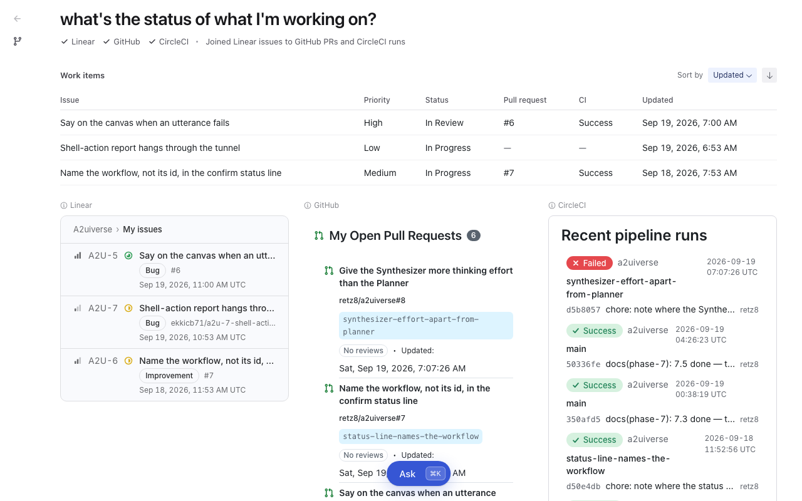
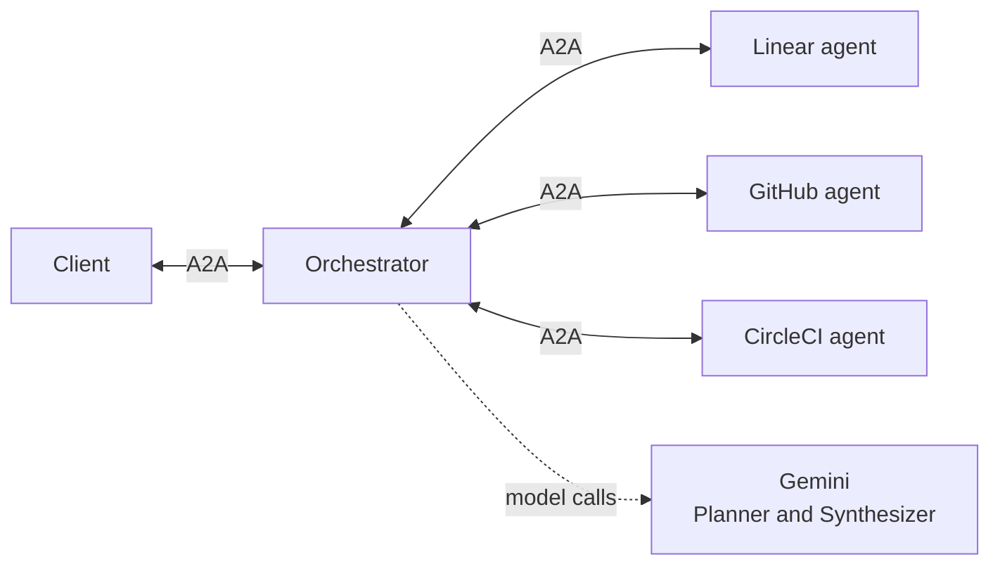

# @a2uiverse/orchestrator

The hub: an A2A agent server, and the only server the client talks to. It finds the apps that can answer a question, plans where their answers will sit, asks them in parallel, and relays what comes back as one composed screen; when the answers can be merged, a second model call writes the merged view. It keeps the registry of installed apps, their sign-ins and the journal, and relays the client's Store and Publish to the marketplace, holding the publisher's secret.

<p align="center">
  
  <br>
  <em>One question, answered by Linear, GitHub and CircleCI, each in its own slot and look. The table on top is the merged view.</em>
</p>



To the client it's one A2A agent that answers every question and every click; to each app it's an A2A client with a request. The client and the apps never talk to each other.

## Running it

```bash
echo "GOOGLE_API_KEY=<your key>" > apps/orchestrator/.env   # the Planner and the Synthesizer run on Gemini
pnpm dev:orch                                               # from the repo root; port 10001
pnpm --filter @a2uiverse/orchestrator build | typecheck | test | lint
```

It starts from whatever its registry holds — nothing, on a fresh state directory, which is a valid platform with only A2UIVerse's own card to answer. `pnpm dev:all` from the root starts it with the client, the marketplace and the apps, installed.

### Installing apps

With the app's agent running:

```bash
pnpm --filter @a2uiverse/orchestrator registry install github http://localhost:11001/.well-known/agent-card.json ../a2uiverse-apps/github/github-catalog/dist/artifact
pnpm --filter @a2uiverse/orchestrator registry install github     # from the marketplace, by id alone
pnpm --filter @a2uiverse/orchestrator registry uninstall github
pnpm --filter @a2uiverse/orchestrator registry list               # each app: its card URL, catalogs, and where it came from
pnpm --filter @a2uiverse/orchestrator registry updates            # each app's update state
```

| Verb                                            | What it takes                                                                                                                                                                                                                                            |
| ----------------------------------------------- | -------------------------------------------------------------------------------------------------------------------------------------------------------------------------------------------------------------------------------------------------------- |
| `install <app-id> <card-url> [<artifact-dir>…]` | The id, the card's full URL, and a folder per catalog the card names other than the basic catalog, as `stellify pack` wrote it. An id already installed is replaced                                                                                      |
| `install <app-id>`                              | From the marketplace: the entry read, the card fetched from the URL it names, only the artifact files not already held fetched. Refused in words that say the Store is behind the app when its live card declares a catalog or a version the Store lacks |
| `uninstall <app-id>`                            | The app's record and accounts go; an artifact goes once no installed app names it                                                                                                                                                                        |
| `list`                                          | Each installed app with its card URL, its catalogs, and `marketplace` or `local`                                                                                                                                                                         |
| `updates`                                       | Runs the update check and prints one line per app: the state, the installed and published versions, and the details                                                                                                                                      |

Install prints what it changed in one line; a refusal prints every finding and exits 1. A new build for a catalog other installed apps render in moves them with it, named on the line:

```text
installed github · card 0.1.0 · catalog sha256-muNbmR5m…
updated github · card 0.1.0 · catalog sha256-muNbmR5m… → sha256-bYxc_jOA…
reinstalled github · nothing changed · card 0.1.0 · catalog sha256-muNbmR5m…
updated linear · card 0.1.0 · catalog sha256-JvcQSoor… → sha256-zJbZyJNl… · linear-admin followed
```

```text
gmail  newer build  0.1.0  catalog https://…/gmail/catalog.json sha256-muNbmR5m… → sha256-bYxc_jOA…
github  major update  0.1.0 → 1.0.0  new catalog https://…/github/v2/catalog.json
linear  card update  0.1.0 → 0.2.0  asks signIn: issues.write
circleci  ahead of the Store  0.1.0  the Store lacks catalog https://…/circleci/v2/catalog.json
shop-a  not published  0.1.0
```

The command reads the write token the orchestrator puts in its state directory at startup, so it works only against an orchestrator on the same state directory.

**At startup** the orchestrator reads the registry, checks every artifact's files against their hashes, fetches each installed app's card, and runs the update check before it listens: a newer build of a marketplace app lands before any client preloads, and the boot log says what moved. An app whose agent is down stays installed but can't be routed to until a restart or a reinstall — the boot names it, so if nothing gets routed, read that line first. A marketplace that can't be reached is one line and every state unknown until the next check, never a failed boot. A damaged registry stops the startup with the file and the problem named.

### Routes

The registry's, under `/registry`:

| Route                       | What it is                                                                                                                    |
| --------------------------- | ----------------------------------------------------------------------------------------------------------------------------- |
| `GET apps.json`             | The installed apps, as the registry stores them, each saying whether this run reached its card                                |
| `GET catalogs.json`         | The catalog table: the client's own catalogs, then each installed artifact by its id                                          |
| `GET artifacts/<id>/<path>` | An artifact's files, served as immutable content                                                                              |
| `GET updates.json`          | Runs the update check — the newer builds of marketplace apps installing themselves on the way — and answers one state per app |
| `POST install`              | `{appId, cardUrl, catalogs: [{files: {<path>: <base64>}}]}`, or `{appId}` alone for the marketplace                           |
| `POST uninstall`            | `{appId}`; answers what became of each account's access                                                                       |

Every write is JSON. It needs no token from the browser at an allowed origin — localhost or 127.0.0.1 on any port, or the orchestrator's own dev tunnel on any port, the same list CORS admits — and takes the write token from anywhere else: the launcher and the registry command.

The sign-in's, under `/auth`, which the browser reaches with no write token. Each attempt is bound to the browser that started it by a cookie, beside `state`, PKCE and the `nonce`, and the token page's form is taken only from the orchestrator's own origins, its public one and `http://localhost:<PORT>`:

| Route                             | What it is                                                                                                                               |
| --------------------------------- | ---------------------------------------------------------------------------------------------------------------------------------------- |
| `GET client.json`                 | The vault's client ID metadata document                                                                                                  |
| `GET start?attempt&canvas&source` | Opened in the sign-in window: redirects to the authorization server, or to the token page; the bare app id as the source adds an account |
| `GET key?attempt`, `POST key`     | The token page, where a key or token is pasted with an optional name for a new account, and its form                                     |
| `GET callback`                    | The authorization server's return                                                                                                        |
| `GET attempts/<id>`               | The attempt's outcome, which the client polls                                                                                            |
| `GET accounts.json`               | Every installed app's accounts: label, permissions in the card's words, whether it must sign in again                                    |
| `POST rename`                     | `{source, label}`: the account's name, kept through every later sign-in; a write                                                         |
| `POST sign-out`                   | `{source}`: the account signed out, answering what became of its access; a write                                                         |

With no `canvas`, `start` is the App Library's: add an account, or sign in again on one that lapsed.

The marketplace's, under `/marketplace`: the Store's reads and the publisher's calls, relayed so the browser knows one address.

| Route                                | What it is                                                                                                                             |
| ------------------------------------ | -------------------------------------------------------------------------------------------------------------------------------------- |
| `GET index.json`                     | Every published app: `[{entry, installed, update?}]`, `update` the state as last computed                                              |
| `GET search?q=<words>`               | `{results: [{entry, score, installed, update?}]}`: the marketplace's matches, in its order                                             |
| `GET apps/<appId>/entry.json`        | One app, annotated the same way                                                                                                        |
| `GET apps/<appId>/preview.json`      | Its captured preview                                                                                                                   |
| `GET artifacts/<id>/<path>`          | A preview's artifact files: from the registry when it holds them, else from the marketplace, checked against their hashes first        |
| `GET publisher.json`                 | Who is signed in to Publish, and whether the marketplace still takes the token                                                         |
| `GET listings.json?publisher=<name>` | That publisher's apps, annotated the same way, each one's live card read first, 5 s each, so an app ahead of the Store says so at once |
| `POST claim`                         | `{publisher}`; the token shown once and kept                                                                                           |
| `POST sign-in`                       | `{publisher, token}`, checked at the marketplace before it is kept                                                                     |
| `POST sign-out`                      | Forgets the publisher here; the token stays the marketplace's                                                                          |
| `POST publish`, `POST unpublish`     | Stellify's bodies, relayed with the held token; the marketplace's answer as it came                                                    |

A read the marketplace can't answer says why: `503` unreached, `404` not published, `502` an answer that doesn't read. The writes pass the same guard as the registry's. One publisher at a time: a claim or a sign-in waits for sign-out.

### Configuration

| Variable                                | Default                                       | Meaning                                                                                                                                                                                 |
| --------------------------------------- | --------------------------------------------- | --------------------------------------------------------------------------------------------------------------------------------------------------------------------------------------- |
| `PORT`                                  | `10001`                                       | Listen port                                                                                                                                                                             |
| `BASE_URL`                              | `http://localhost:<PORT>`                     | The address its agent card advertises, and the vault's: its client ID metadata document and the return address an authorization server sends the browser to. The tunnel URL in a tunnel |
| `STATE_DIR`                             | `./.state`                                    | The registry, the vault (`vault/vault.json`), the publisher (`publisher/publisher.json`), the journal and the cached embedding model                                                    |
| `GOOGLE_API_KEY`                        | none                                          | The Gemini key. Without it, questions fail; actions inside fragments still work                                                                                                         |
| `A2UIVERSE_PLANNER_MODEL`               | `gemini-3.7-flash`                            | The Planner's model                                                                                                                                                                     |
| `A2UIVERSE_PLANNER_EFFORT`              | `low`                                         | `low` (no thinking) or `default`                                                                                                                                                        |
| `A2UIVERSE_SYNTHESIZER_MODEL`           | the Planner's if set, else `gemini-3.7-flash` | The Synthesizer's model                                                                                                                                                                 |
| `A2UIVERSE_SYNTHESIZER_EFFORT`          | `low`                                         | `low` or `default`                                                                                                                                                                      |
| `A2UIVERSE_SHORTLIST_CAP`               | `5`                                           | How many apps the Router hands the Planner                                                                                                                                              |
| `A2UIVERSE_SOFT_DEADLINE_SECONDS`       | `10`                                          | How long with no answer releases the merge without the late apps                                                                                                                        |
| `A2UIVERSE_HARD_CAP_SECONDS`            | `300`                                         | How long before an app's slot fails                                                                                                                                                     |
| `A2UIVERSE_HEARTBEAT_SECONDS`           | `30`                                          | How often a quiet stream sends an empty event, so a proxy's idle timeout never cuts it                                                                                                  |
| `MARKETPLACE_URL`                       | `http://localhost:10002`                      | The marketplace installs by id resolve through, the update check reads and reports to. Unreached: one boot line, every state unknown                                                    |
| `A2UIVERSE_MARKETPLACE_TIMEOUT_SECONDS` | `10`                                          | How long each request to the marketplace gets; a relayed publish gets 180                                                                                                               |
| `A2UIVERSE_DEBUG_IDS`                   | off                                           | `1` adds each app's own task and context ids to what it relays                                                                                                                          |
| `A2UIVERSE_FAULTS`                      | none                                          | Dev only: JSON making a source's answers slow, hang, break, refused, failed, invalid or carry a credential field, to test failures; a bare app id hits every account of the app         |

## What it does

### Knows what's installed

An app is an A2A agent, installed from its agent card. The registry in the state directory holds each app's card as fetched, the URL it came from, the catalogs it paints in and where the install came by. The orchestrator is its only writer, through install, uninstall and install-over, each live at once — the next question can route to the app.

- **Install checks everything the files can prove** — the card, the catalog artifacts Stellify packed, coverage between them — and refuses the whole app on any failure, listing every reason at once.
- **A catalog id is held at one build.** A new build for a catalog other installed apps render in moves the row and those apps follow, as long as the new build is an additive evolution of the one they render in: nothing removed, no type changed. An app alone on its row moves it freely.
- **It knows what's new.** At startup and whenever asked, it reads each installed app's marketplace entry and its live card and works out one update state per app: up to date; a newer build; a major update, suggested; a card update, with what it newly asks; an update required, the installed line retired; ahead of the Store, reported to the marketplace; no longer published; unknown, the marketplace unreached. A newer build of an app installed from the marketplace installs itself at once, journaled, unless the move would carry an app installed from a local pack; an app from a local pack is never moved. Every other update is the person's act.

### Picks the apps

The Router embeds the question and ranks every installed app's card against it, A2UIVerse's own among them — no list of intents, the match is on the skills each card describes — and hands a shortlist to the Planner. The Planner, one model call, decides who answers and what each is asked: a question about the state of your work, or what's waiting on you, goes to every app that holds part of it, named or not, signed in or not; a question inside one app goes to that app alone. The same rule holds over an app's accounts: a question about state gathers from every account, each a source of its own; a command naming no account, for an app with two or more, draws one press per account and waits. Each app receives the Planner's request written for it, with a sentence asking for no password, code or card field and, when the client sent it, your local time and time zone.

### Composes one screen

In the same call the Planner designs the layout — a surface in the shell's own catalog with a slot per app, a slot for the merged view when there is one, and any words of its own — and it reaches the client before any app is asked. Each app's UI fills its slot as it arrives, in the app's own design system, with the app's name above it; the name is the shell's, and the app can't hide it.

### Merges across apps

When the plan reserves a merged view and at least two apps answer, the Synthesizer, a second model call, writes the view as wiring rather than values: every cell a formula pointing into an app's data, which the client computes and keeps live as the data changes, with no further model call. When the merge is over one thing seen by several apps, the Synthesizer says which entries are the same thing, and each claim is checked against the data before it's accepted. Take the first row of the table at the top, issue A2U-5:

```text
Linear    issue A2U-5    title "Say on the canvas when an utterance fails"   status "In Review"
GitHub    PR #6          title "Say on the canvas when an utterance fails"   branch "ekkicb71/a2u-5-say-on-the-canvas-…"
CircleCI  run 6039cf16   status "Success"                                    branch "ekkicb71/a2u-5-say-on-the-canvas-…"
```

The Synthesizer writes the row as formulas pointing at those entries, with a match claim naming the facts that make them one work item:

```text
status   value(linear   /issues[id="A2U-5"]/status)
pr       value(github   /prs[repository="retz8/a2uiverse",number=6]/number)
ci       value(circleci /runs[id="6039cf16-…"]/status)

match
  same title    equal(linear …/title,   github …/title)
  same branch   equal(github …/branch,  circleci …/branch)
```

The orchestrator runs each fact against the apps' data before accepting the row; one that doesn't hold goes back to the Synthesizer with the values it found. The client then evaluates the formulas into In Review, #6 and Success, and again whenever the data they point at changes. A cell shows how sure it is and where it came from, and clicking it goes to the value in its app's slot.

### Stays honest when apps are slow or fail

- **One app failing never fails the rest.** Its slot says why — the app's own words, unreachable, timed out, a paint the client couldn't draw, a catalog it couldn't load, the app uninstalled since — and offers Retry, and its data leaves the merge. Retry sends again what failed: the click inside the app's answer when a click failed, otherwise the app's request from the plan; it also takes an app that answered in words alone. A paint in a catalog the app isn't entitled to fails its slot with no Retry, as does a paint carrying a credential field the app didn't repair.
- **One press at a time into an app's answer.** A press while one on that app still runs is refused and journaled, the app sent nothing.
- **The merge doesn't wait forever.** Once two apps have answered, 10 seconds with no further answer releases the merge over what arrived; a late app still fills its slot, and Include folds it in. After 300 seconds an app's slot fails, an answer arriving later kept until Retry. When the merge is built around one app's items, that app is always waited for.
- **Only the first merge is automatic.** Every later model call has a press behind it — Retry, Include or Try again — so the merged view never changes without a visible reason.

### Answers about itself

A question about A2UIVerse itself — which apps you have, what the screen can do — is answered by the Planner in the layout, with no app asked. It reads the platform's state through a small fixed set of readers, never an app's data: the installed apps list each app's accounts by label, never a credential, and its update state as last computed, in the App Library's words with how long ago — never a check run inside a plan. An answer can carry a button that opens the Store, the App Library on an app, or Publish. A need no installed app can meet gets a slot of its own: a tile that searches the Store for it.

### Signs in to apps

The **AuthVault** holds the apps' sign-ins, one entry per app and account, in an owner-only file in the state directory. A credential reaches an app only as an HTTP header on the request, as the card's scheme names it, and never reaches the client, the models, the journal or the logs.

- **The card is checked before every dispatch.** When no alternative of its `security` can be met from the vault, the slot takes the authority tile and the app isn't asked. The full tile shows once per app per page load; after that the app's slots are one quiet line.
- **Sign-in runs in a window the client opens** on the `/auth` routes. For OAuth or OpenID Connect the vault is a generic OAuth client — authorization code with PKCE at the server the card names, registering itself by its client ID metadata document where the server takes one, otherwise by dynamic registration. An `http` bearer or `apiKey` scheme is pasted on a token page the orchestrator serves, with the scheme's `description` and the card's `documentationUrl`. Any other scheme fills the slot with "not supported here" and Manage apps; the app stays installed. The client polls the attempt and, once signed in, sends a Retry for the slot whose Sign in was pressed.
- **Accounts.** An account's label comes from the ID token's display claims and its `sub` keeps one account signed in twice as one entry; without them it's the app's name and a number, "Gmail account 2". A key account takes the name typed on the token page, else the app's name, "Shop B", else that with the day it was connected, "Shop B · connected Oct 17". A source is the app id and the number, `gmail.2`. The add-account tile, placed when you ask to add an account, starts a sign-in for the next one.
- **Expiry is silent.** A token within a minute of expiry is refreshed before the dispatch, and once after a 401 the vault didn't predict; only a failed refresh asks to sign in again.
- **More access mid-task.** An app ending its task in `auth-required`, naming a scheme on its card and the missing scopes by their keys there, puts a request on its name row — before it has painted, its slot takes the tile asking for more access. Allow opens the sign-in for the missing scopes and sends again the press that needed them; Not now drops that press and later presses in the same fragment. A key the installed card doesn't declare makes the request invalid.
- **Sign-out and uninstall.** Signing an account out from the App Library drops it and revokes its tokens where the server advertises revocation, best-effort, answering what became of its access; uninstall does the same for every account of the app. Installing over keeps them.

**The credential bar.** No paint with a credential input reaches the screen: a paint whose components name a password, one-time code, PIN or card number — by their names or the option values their catalog declares — is refused whole, and what it had shown is taken down. The app is sent the reason once; if it doesn't repair, its slot fails with no Retry and a "Continue on" link to the card's `provider.url` or `documentationUrl`.

### Keeps every answer

Every question the client sends is an A2A context, and the orchestrator holds a composition for each — the layout, each app's slot and data, the merged view, each app's screen history — until the client closes it. A composition keeps running after the next question: its apps still answer and its merge still lands. A question can name a parent, the context it was asked from, so "add Linear to this" means that answer; each app gets its own conversation per context.

Clicking into something inside an app's answer paints a new screen in its slot, with a back arrow on its row. The orchestrator remembers the merged view for every combination of screens it has shown, so going back restores it with no model call; every screen keeps its number and none is dropped. A quick run of presses costs nothing for the screens it passes through: the check that may call the model waits until the pressing stops.

### Leaves apps' UI alone

Every app's UI passes through the orchestrator on its way to the screen, and every click back the same way, changed as little as it can be so any A2UI agent takes part as it is: surface ids are namespaced by source (`inbox` → `gmail:inbox`, or `gmail.2:inbox`), the one change inside an app's A2UI, undone on the way in; every event is stamped with the app that painted it; only the orchestrator ends a turn, each app's own "done" held back; each app sees only its own data when the client sends the screen's data back; and each app is told which catalogs it may paint in — those handed at its install plus the basic catalog — a paint in any other refused at the orchestrator.

<details>
<summary><b>Modules</b></summary>

| Module        | Where                 | What it does                                                                                                                                                                                                                                                                                                          |
| ------------- | --------------------- | --------------------------------------------------------------------------------------------------------------------------------------------------------------------------------------------------------------------------------------------------------------------------------------------------------------------- |
| Registry      | `src/registry/`       | The installed apps, their cards and the catalog table, persisted in the state directory; install — from a pack or from the marketplace by id — uninstall and their routes; the update check and the automatic build update; A2UIVerse's own card beside the apps                                                      |
| Embedder      | `@a2uiverse/embedder` | One small embedding model, in-process, no API key — the workspace package the marketplace's index ranks with too, so a question ranks the same against both                                                                                                                                                           |
| Router        | `src/router/`         | Ranks the apps against the question and returns a shortlist                                                                                                                                                                                                                                                           |
| Planner       | `src/planner/`        | The first model call: the layout, which apps to ask, a title for the answer. On demand it reads the installed apps, the composition the question was asked from and the questions before it, never app data                                                                                                           |
| Synthesizer   | `src/synthesizer/`    | The second model call: the merged view's wiring, validated, with one retry                                                                                                                                                                                                                                            |
| AuthVault     | `src/vault/`          | The sign-ins: the vault file, the generic OAuth client, the schemes it can do, the card checked before a dispatch, the header a dispatch carries, refresh, revocation, the sign-in routes and their pages                                                                                                             |
| Marketplace   | `src/marketplace/`    | The Store's reads relayed and annotated, the preview's artifact files checked on the way through, and the publisher Publish holds: its file, claim, sign-in, sign-out, publish and unpublish relayed with its token                                                                                                   |
| Accounts      | `src/accounts/`       | Each app's sources, one per account, and what each is called                                                                                                                                                                                                                                                          |
| Composition   | `src/composition/`    | One composition per context, the shell's own paints, the relay, each app's data, when to merge, the presses, the fragment histories, and which refs still hold                                                                                                                                                        |
| AgentsPool    | `src/agentsPool/`     | The connections to the apps: requests, time limits, cancel; the credential header, a 401 and an `auth-required`, and the credential bar over what they paint                                                                                                                                                          |
| IntentJournal | `src/journal/`        | One line per turn, one per install, uninstall or refusal, one per sign-in fact (started, signed in, failed, expired, refreshed, revoked, a request for more access, Not now, superseded, signed out, renamed), and one per publisher act, never a credential or a token, appended to `STATE_DIR/intent-journal.jsonl` |
| Executor      | `src/executor.ts`     | The A2A entry point that runs it all                                                                                                                                                                                                                                                                                  |

The Planner and the Synthesizer run on Gemini through the Vercel AI SDK.

</details>

## Further reading

- [`docs/design/orchestrator.md`](../../docs/design/orchestrator.md) — every step of a turn.
- [`docs/design/synthesis.md`](../../docs/design/synthesis.md) — the merged view.
- [`docs/design/authority.md`](../../docs/design/authority.md) — sign-in, accounts and the credential bar.
- [`docs/design/app-install.md`](../../docs/design/app-install.md) and [`docs/design/marketplace.md`](../../docs/design/marketplace.md) — install, from Stellify's pack to the client's load, and from the marketplace by id.
- [`docs/design/trusted-page.md`](../../docs/design/trusted-page.md) — the Store, the App Library and Publish over these routes.
