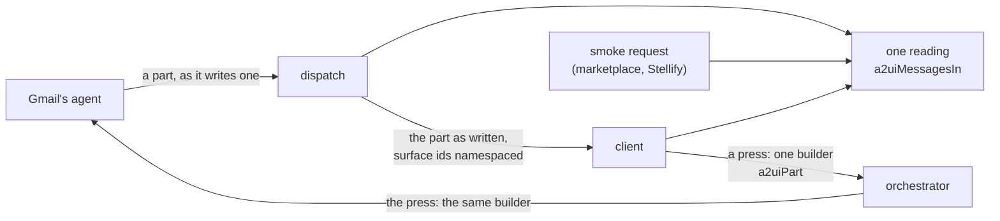

# A2UI on A2A: how A2UIVerse reads and writes an A2UI part

This guide explains how an app's interface travels inside A2A, and what A2UIVerse does at each end of that trip. It is written for a frontend engineer meeting A2UIVerse for the first time. It starts with the ideas, follows one press from a click to a repaint, then opens up the machinery, and ends with the design decisions and where the code is.

One example runs through the whole guide: Gmail, an app from the `a2uiverse-apps` repository, in its `deterministic` mode. You ask for your week, Gmail paints your inbox, you press a thread, Gmail asks for more access, you allow it, and the thread paints.

## Problem it solves

A2UI is a list of small JSON **messages**: `createSurface`, `updateComponents`, `updateDataModel`, `deleteSurface` from an agent, and `action` or `error` from a client. A2A is the protocol that carries them between processes. A2A carries content in **parts**, and an A2UI message rides in a **data part**, a part whose content is JSON.

That leaves four questions, and the sources do not give one answer to any of them.

1. How does a reader know a data part is A2UI? Upstream's A2UI extension specification says by a MIME type in the part's metadata. Every upstream agent read for this design takes a press by looking at what the data holds and reads no mark at all.
2. What does the part's `data` hold? The specification says a list of messages. Upstream's own Python helper writes one message per part, and upstream's agents read one.
3. What carries the part? A2A has two carriers, a message and an artifact. The specification names neither. Upstream's restaurant finders use a message, and agents on ADK's stock executor send the same parts in both.
4. A2A has two versions in use, and a part is not the same thing in each. A2A 1.0 gives every part a `mediaType` field and lets `data` be any JSON value. A2A 0.3 has no such field and types `data` as an object.

A2UIVerse reaches any agent on either A2A version, so each of these has to hold for both. Its answer has two halves. It reads every spelling an agent may use, through one function. It writes one spelling, through one builder.



## Six ideas to hold on to

### 1. A part is A2UI by what it holds

An A2UI message is a JSON object with a `version` string. A data part is A2UI when its `data` holds such a message. No reader in the platform looks at a part's MIME type, in its metadata or in `mediaType`: a part marked `application/a2ui+json`, one marked with the older `application/json+a2ui`, one marked something else and one with no mark are all read the same way.

### 2. `data` holds one message or a bare list

`{"version": "v0.9", "createSurface": {…}}` is read, and so is `[{…}, {…}]`. Each entry of a list is judged on its own: an entry that is not a message is passed over and the others are taken. An object that wraps a list, `{"messages": [...]}`, is not read. No upstream source defines that form as a part. A list an A2A 0.3 layer wrapped to send it, `{"value": [...]}`, is read when it arrives still wrapped, an object holding `value` and nothing else; that happens on the two paths where the flag that says so is lost (below).

### 3. A2UI rides a message, never an artifact

The platform reads A2UI from a bare message and from the status message of a task or a status update. It does not read an artifact's parts, in the client or in the orchestrator. An agent that sends the same parts in a status message and again in an artifact is painted once. An agent that puts A2UI in an artifact alone draws nothing.

### 4. The platform writes one spelling

Wherever the platform authors an A2UI part, it writes one message per part, marked `application/a2ui+json` in `metadata.mimeType` and in `mediaType`. That covers a press sent to an agent, the shell's own paints, the client's press and its error report.

### 5. The relay passes an agent's part as written

The orchestrator relays an agent's part to the client in the form the agent chose, one message or a list, and with whatever marks the agent gave it. It changes one thing inside: each surface id gains its source, so `inbox` becomes `gmail.1:inbox`.

### 6. Two parts sit beside A2UI, and one of them ends an answer

`paintMeta` names a paint, and the auth-required request says what access an agent is missing. Both are data parts that are not A2UI, and both are read by what they hold. An answer that reaches the auth-required state has ended when the state arrives, whether or not the agent closes its stream.

## One press, end to end

You asked "Show me one timeline of my week from Gmail, Google Calendar and GitHub", and Gmail's inbox is on the canvas. You press the first thread.

1. The client builds the press. `buildActionMessageParams` wraps the A2UI `action` with the client's A2UI version and hands it to `a2uiPart`, which returns the part in the A2A SDK's in-memory shape:

   ```ts
   {
     content: {$case: 'data', value: {version: 'v0.9', action: {name: 'open-thread', surfaceId: 'gmail.1:gmail-2', …}}},
     metadata: {mimeType: 'application/a2ui+json'},
     filename: '',
     mediaType: 'application/a2ui+json',
   }
   ```

2. The press crosses the private wire. The wire between the client and the orchestrator is A2A 1.0 over JSON-RPC, so both marks ride it.
3. The orchestrator finds the owner. `classifyTurn` reads the part by its `version` and `action` keys. The surface id's source, `gmail.1`, names the app and the account.
4. The orchestrator writes the press again for the agent. It takes the source off the surface id and builds a new part with the same `a2uiPart`, so what the agent receives never depends on what the client's part carried.
5. The A2A SDK writes the wire. Gmail's card lists JSON-RPC at A2A 0.3, so the SDK's 0.3 layer writes the part, and `mediaType` does not exist on that wire:

   ```jsonc
   {
     "kind": "data",
     "data": {"version": "v0.9", "action": {"name": "open-thread", "surfaceId": "gmail-2", …}},
     "metadata": {"mimeType": "application/a2ui+json"}
   }
   ```

   To an agent on A2A 1.0 the same part goes out with `"mediaType": "application/a2ui+json"` beside its metadata.

6. Gmail asks for more access. Opening a thread needs a scope the account does not hold, so Gmail's agent moves its task to `auth-required` with two parts on the status message: a line of text, and `{"security": [{"signIn": ["messages"]}]}`.
7. The dispatch ends there. It reads the request, hands it to the vault and stops reading the stream. The journal's record of the dispatch says it ended on `TASK_STATE_AUTH_REQUIRED`.
8. You press Allow, the sign-in window signs the account in with the extra scope, and the orchestrator sends the kept press again.
9. Gmail paints the thread. Its parts arrive marked as the agent kit marks them, and the relay passes them with those marks, the surface ids namespaced.
10. The client reads the event. `extractA2uiMessagesFromEvent` takes every message the status message's parts carry and hands them to the renderer.

## Inside the machinery

### What a part is on each A2A version

The A2A SDK holds one in-memory shape and writes a wire for each path from it. On A2A 1.0 the three bindings carry the same part; on A2A 0.3, JSON-RPC writes A2A 0.3's JSON and HTTP+JSON and gRPC write A2A 0.3's proto.

|                          | In memory, `@a2a-js/sdk` 1.x                                           | A2A 1.0, every binding                       | A2A 0.3 over JSON-RPC                          | A2A 0.3 over HTTP+JSON and gRPC |
| ------------------------ | ---------------------------------------------------------------------- | -------------------------------------------- | ---------------------------------------------- | ------------------------------- |
| A data part              | `{content: {$case: 'data', value}, metadata, filename: '', mediaType}` | `{"data": …, "metadata": …, "mediaType": …}` | `{"kind": "data", "data": {…}, "metadata": …}` | `{"data": {"data": {…}}}`       |
| `data`                   | any JSON value                                                         | any JSON value                               | an object only                                 | an object only                  |
| The part's own MIME type | `mediaType`                                                            | `mediaType`                                  | no field                                       | no field                        |
| `metadata.mimeType`      | kept                                                                   | kept                                         | kept                                           | dropped, both ways              |

An agent on A2A 1.0 can also be asked by a caller on A2A 0.3, through the 0.3 layer of its SDK. Two things happen to a data part on the way, in `@a2a-js/sdk` and in Python's `a2a-sdk` alike:

1. `mediaType` is dropped. A mark in `metadata.mimeType` survives.
2. A value that is not an object is wrapped: a list goes out as `{"value": [...]}` with `data_part_compat: true` in the part's metadata. The client of `@a2a-js/sdk` unwraps it, so the reading sees a bare list again.

Over HTTP+JSON and gRPC at A2A 0.3 the client of `@a2a-js/sdk` drops every part's `metadata`, both ways: it writes and reads those two wires with a codec from A2A `v0.3.0`, whose part has no `metadata` (`_dev/a2a-findings.md` 9). No mark reaches an agent there, and the flag of a wrapped list does not come back, so a list a 0.3 layer wrapped arrives as `{"value": [...]}`. The platform carries no patch for it: its readers read a part by what it holds, the reading takes the wrapped list as the list it wraps, and the agents it composes read a press by its content.

All of it is in the wires captured from a scratch agent on Python's `a2a-sdk` 1.3.0, under [`packages/smoke-transport/test/fixtures`](../../packages/smoke-transport/test/fixtures/README.md), over JSON-RPC and HTTP+JSON, and in a run against the same agent over gRPC. This is why the platform marks its own parts in both fields: `metadata.mimeType` reaches an agent on every path but A2A 0.3 over HTTP+JSON and gRPC, where no mark does.

### Reading

```ts
const isMessage = (value: unknown): value is A2uiMessage =>
  typeof value === 'object' &&
  value !== null &&
  !Array.isArray(value) &&
  typeof (value as A2uiMessage).version === 'string';

export function a2uiMessagesIn(data: unknown): A2uiMessage[] {
  if (Array.isArray(data)) return data.filter(isMessage);
  return isMessage(data) ? [data] : [];
}
```

`a2uiMessagesIn` lives in the platform sdk and takes a part's `data`, not the part, so the sdk needs no A2A package. Three readers go through it:

1. The client's `extractA2uiMessagesFromEvent`. It then keeps the messages whose `version` is one the platform speaks, `v0.9` or `v0.9.1`, and passes over the rest with nothing said, an entry of a list like a message alone.
2. The orchestrator. Its dispatch reads an agent's event for the catalog check, the credential bar and whether the answer painted. Once an event is relayed, the same reading feeds the journal's list of surfaces touched, the copy of each surface's data model, and the count of paints.
3. The smoke runner, for the marketplace's publish and Stellify's `preview`.

A message is a message because it carries a `version`. A `createSurface` with no `version` is not A2UI to any reader: the orchestrator relays the part untouched, checks nothing in it, and the client draws nothing from it.

### Rewriting through the same judgement

The relay has to change surface ids inside a part without deciding again what a message is. `withA2uiMessages(data, rewrite)` is the reading's counterpart: it hands each message in `data` to `rewrite` and returns the result in the form it came in. A list stays a list, and its other entries stay as they are. When nothing changed it returns `data` itself, so the relay keeps the agent's part object by identity.

```ts
function namespaceData(data: unknown, source: string): unknown {
  const namespaced = withA2uiMessages(data, message => namespaceMessage(message, source));
  if (namespaced !== data) return namespaced;
  // … a paintMeta part, read by its key
}
```

The part around the data is spread unchanged, so its `metadata` and its `mediaType` are the agent's.

### Writing

```ts
const marked = (data: Record<string, unknown>, mimeType: string): MarkedDataPart => ({
  content: {$case: 'data', value: data},
  metadata: {mimeType},
  filename: '',
  mediaType: mimeType,
});

export function a2uiPart(message: A2uiMessage): MarkedDataPart {
  return marked(message, A2UI_MIME_TYPE);
}

export function shellPart(data: Record<string, unknown>): MarkedDataPart {
  return marked(data, A2UI_SHELL_MIME_TYPE);
}
```

The builder is in the platform sdk beside the reading. It returns a plain object in the A2A SDK's in-memory shape, typed by the sdk's own `MarkedDataPart`, which TypeScript accepts wherever the A2A SDK's `Part` is asked for.

| Who | What | Builder |
| --- | --- | --- |
| Client | a press inside a fragment, an error report | `a2uiPart` |
| Client | a press on the composition: Retry, Include, Try again, a step, Not now, the close, an account chosen, an app used | `shellPart` |
| Orchestrator | a press sent on to its agent | `a2uiPart` |
| Orchestrator | the layout surface, the merged view, a surface taken down | `a2uiPart` |
| Orchestrator | the canvas's title, as `paintMeta` | `shellPart` |

The string is `application/a2ui+json` whatever A2UI version the message is stamped with. The marketplace and Stellify write no A2UI: the smoke request is one text part.

Three things around the part do not change. The A2A SDK spells the extensions header for each A2A version, `A2A-Extensions` to an agent on A2A 1.0 and `X-A2A-Extensions` to one on 0.3. `a2uiClientCapabilities` and `a2uiClientDataModel` ride on message metadata. A message's `extensions` field stays empty.

### Where a part is read from

| What an agent sends | Read for A2UI |
| --- | --- |
| A bare message | its parts |
| A task | its status message's parts |
| A status update | its status message's parts |
| An artifact update | nothing |

The orchestrator still relays an artifact update to the client as it arrived. Neither end reads it, so both count the same paints. That count matters: each `createSurface` an agent sends is one paint, numbered the same way on both sides, and the back and forward arrows on a fragment name paints by that number.

### `paintMeta`

A paint's title and whether it asks a question ride in a part of their own, ahead of the `createSurface` they name. This one is Linear's, from the [agent kit's record](agent-kit.md):

```json
{"paintMeta": {"surfaceId": "assigned-issues", "title": "Assigned Issues"}}
```

`readPaintMeta` reads it by its `paintMeta` key, whatever the part's mark, or with none. The orchestrator writes one for its own layout surface, carrying the Planner's title for the canvas, through `shellPart`, so it is marked `application/a2ui-shell+json` in both fields. The agent kit writes the older string, `application/json+a2ui-shell`, in `metadata.mimeType`, and its parts are read the same.

### Operation part

A press on the composition is the A2UIVerse extension's own part, `{version, operation}`. The client marks it `application/a2ui-shell+json`, and the orchestrator's `readOperation` reads it by its keys.

### Auth-required request

Neither A2A version names a field for the scheme or the scopes an agent needs part-way through a task. The platform's convention is a data part on the auth-required status message, carrying no mark, in one of two shapes:

```jsonc
// A2A 1.0's requirement shape
{"securityRequirements": [{"schemes": {"signIn": {"list": ["messages"]}}}]}
// A2A 0.3's requirement shape, which the agent kit writes today
{"security": [{"signIn": ["messages"]}]}
```

`readAuthRequired` reads either from an agent on either A2A version and returns one shape, A2A 1.0's. A part holding both keys is read by `securityRequirements` alone. A scheme that asks no scope may leave its `list` out, as ProtoJSON writes an empty list. A request is well formed when it has at least one alternative, each naming at least one scheme by a non-empty key, each scheme a list of distinct non-empty scopes.

Three readers take the result:

1. The vault, in the orchestrator. It checks each key against the installed card, read through the card's one reading (see [`card.md`](card.md)). A scheme or a scope the installed card does not declare makes the request invalid, the slot fails, and no consent is shown.
2. The marketplace's publish. A sign-in agent passes the smoke test by naming a scheme its card declares.
3. Stellify's `preview`, whose finding names what the agent asked for.

[`authority.md`](authority.md) follows the request from here to the Allow press.

### When an answer has ended

An agent's answer ends by its task's state, never by `final`:

| What the stream last said | The answer |
| --- | --- |
| A message, then the body ended | ended, completed |
| Completed, failed, canceled or rejected, then the body ended | ended on that state |
| Input-required, then the body ended | ended, waiting on the person |
| Auth-required | ended as soon as the state arrives |
| Anything else, then the body ended | never finished |

Auth-required is the one state that does not wait for the body. A2A 1.0 asks an agent that waits for a credential to keep its stream open after it sets the state, so a reader that waited for the body would wait out its own time limit. The dispatch and the smoke runner both stop reading at the state and leave the stream.

Leaving is cheap. The generator of the A2A SDK's client cancels the response body's reader when its consumer stops reading, and the smoke runner also aborts its request. Measured on Node 22.15.0, the agent saw the connection close about four seconds after the caller left.

## When things go wrong

| What happens | What the platform does |
| --- | --- |
| A part wraps its messages as `{"messages": [...]}` | Nothing is read from it. The part is relayed as written and the client draws nothing |
| An agent puts A2UI in an artifact alone | Nothing is painted. The dispatch completes as an answer with no interface |
| One entry of a list is in an A2UI version the platform does not speak | The client passes that entry over and draws the others |
| A message carries no `version` | It is not A2UI: relayed as written, checked by nothing, drawn by nothing |
| A surface in a list is created in a catalog outside the app's entitlement | The whole event is refused at the orchestrator, as for a part carrying one message |
| The auth-required part names a scheme the card does not declare | The request is invalid: the slot fails, and publish refuses the app with a finding |
| The auth-required status message carries no request | For an app whose card asks sign-in it is read as a plain refusal: the vault refreshes and the request is sent once more |
| An agent holds its stream open after auth-required | The answer ended at the state. The stream is left |
| An agent holds its stream open after any other last event | The dispatch waits to its hard cap, and the smoke request to its time limit |

## Design decisions

| Decision | What it buys | What it costs |
| --- | --- | --- |
| Read by content, never by mark | Every agent read so far composes, whichever string it writes and wherever it puts it | A data part that happens to hold a `version` string is read as A2UI |
| One message or a bare list | An agent that follows the specification's list and one that follows upstream's helper both paint | Two forms to carry through every rewrite |
| Never read an artifact | An answer sent in both carriers is painted once, and both ends count the same paints | An agent that uses an artifact alone draws nothing |
| Write one message per part | Every agent read takes the press, and none reads a list | It departs from the specification's text. It stands until a real agent is found that reads only a list |
| Mark in `metadata.mimeType` and in `mediaType` | The mark reaches an agent on either wire, and a reader on A2A 1.0 finds it where 1.0 puts it | The same string twice on the A2A 1.0 wire |
| The orchestrator writes a press again for its agent | What an agent receives is the platform's one spelling, whatever the client's part carried | A part object is rebuilt on every press |
| The reading and the builder in the platform sdk, typed structurally | One function for three packages, and the sdk still depends on no A2A package | The sdk's `MarkedDataPart` has to keep the shape of the A2A SDK's `Part` |
| End an answer at auth-required | A sign-in app on A2A 1.0 is published and dispatched without waiting out a time limit | An agent that goes on by itself after auth-required is not listened to |

## Known limits

1. Toward an agent on A2A 0.3 over HTTP+JSON and gRPC, no mark on a part arrives, and a list in one part a 0.3 layer wrapped arrives wrapped, read by the platform around the A2A SDK (`_dev/a2a-findings.md` 9).
2. No kit agent answers on A2A 1.0 yet. The A2A 1.0 paths are proven against the fake agent and against the captured Python wires.
3. The agent kit still writes the older `paintMeta` string and the request in A2A 0.3's shape. Both are read.

## Trying it without a model

The reading, the builder and the request's two shapes have unit tests in the platform sdk, and each reader has tests against two in-process agents, one on A2A 0.3 and one on A2A 1.0:

```bash
pnpm --filter @a2uiverse/sdk test
pnpm --filter @a2uiverse/smoke-transport test
pnpm --filter @a2uiverse/orchestrator test -- a2uiOnA2a
pnpm --filter @a2uiverse/client test -- messages
```

To read a part yourself, build the sdk and run a snippet from its folder:

```bash
pnpm --filter @a2uiverse/sdk build
cd packages/sdk/js
node --input-type=module -e "
import {a2uiMessagesIn, a2uiPart, readAuthRequired} from './dist/index.js';
const create = {version: 'v0.9', createSurface: {surfaceId: 's', catalogId: 'c'}};
console.log(a2uiMessagesIn([create, {note: 1}]), a2uiMessagesIn({messages: [create]}));
console.log(JSON.stringify(a2uiPart(create)));
console.log(JSON.stringify(readAuthRequired({security: [{signIn: ['messages']}]})));
"
```

To see the real wires again, capture them from the scratch agent on Python's `a2a-sdk`. It needs `uv` on the PATH and a build of the workspace:

```bash
cd packages/smoke-transport
node scripts/capture-fixtures.mjs
```

## Where the code is

| What | Where |
| --- | --- |
| The reading, its rewriting counterpart, the builder, the two MIME strings | [`packages/sdk/js/src/a2uiPart.ts`](../../packages/sdk/js/src/a2uiPart.ts) |
| `paintMeta`, the operation part, the auth-required request | [`packages/sdk/js/src/a2uiverse.ts`](../../packages/sdk/js/src/a2uiverse.ts) |
| The contract's text for the three parts | [`packages/sdk/contracts/a2uiverse.v0.9.json`](../../packages/sdk/contracts/a2uiverse.v0.9.json) |
| The client: its parts, and what it reads from an event | [`apps/client/src/a2a/messages.ts`](../../apps/client/src/a2a/messages.ts) |
| The dispatch: the catalog check, the request, the ending | [`apps/orchestrator/src/agentsPool/agentsPool.ts`](../../apps/orchestrator/src/agentsPool/agentsPool.ts) |
| The parts of an agent's event | [`apps/orchestrator/src/agentsPool/relay.ts`](../../apps/orchestrator/src/agentsPool/relay.ts) |
| The relay: namespacing inside a part | [`apps/orchestrator/src/composition/fragmentRelay.ts`](../../apps/orchestrator/src/composition/fragmentRelay.ts) |
| The shell's own parts | [`apps/orchestrator/src/composition/shellPainter.ts`](../../apps/orchestrator/src/composition/shellPainter.ts) |
| The press written again for its agent | [`apps/orchestrator/src/executor.ts`](../../apps/orchestrator/src/executor.ts) |
| The vault's reading of a request | [`apps/orchestrator/src/vault/vault.ts`](../../apps/orchestrator/src/vault/vault.ts) |
| The smoke runner | [`packages/smoke-transport/src/smokeRunner.ts`](../../packages/smoke-transport/src/smokeRunner.ts) |
| The two fake agents | [`packages/smoke-transport/src/testing`](../../packages/smoke-transport/src/testing) |
| The captured wires and how they are captured | [`packages/smoke-transport/test/fixtures`](../../packages/smoke-transport/test/fixtures/README.md), [`packages/smoke-transport/scripts`](../../packages/smoke-transport/scripts) |

## Words used in this guide

| Word | Meaning |
| --- | --- |
| A2UI message | One JSON object with a `version` and one operation, such as `createSurface` or `action` |
| Part | One piece of content in an A2A message or artifact: text, a file or data |
| Data part | A part whose content is JSON |
| Mark | The MIME type a data part carries, in its metadata as `mimeType` or in its own `mediaType` |
| Press | The A2UI `action` message the client sends when the person presses something inside a fragment |
| Status message | The message a task's status carries, on a task or on a status update |
| Artifact | A2A's carrier for a task's outputs, sent in artifact updates |
| 0.3 layer | The part of an A2A 1.x SDK that speaks A2A 0.3, on the client side or the server side |
| Private wire | The A2A 1.0 connection between the client and the orchestrator |
| `paintMeta` | A part naming a paint: its surface, a title, and whether it asks a question |
| Auth-required request | The data part on an auth-required status message that names the scheme and scopes an agent is missing |
| Interrupted state | A state where a task waits on the person: input-required or auth-required |
