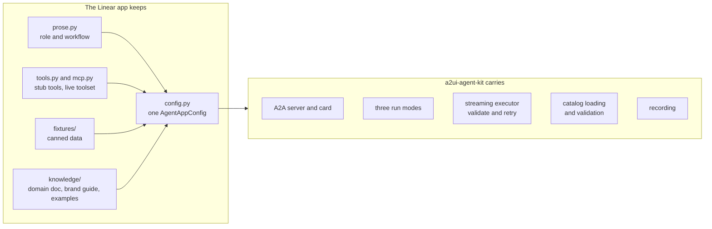
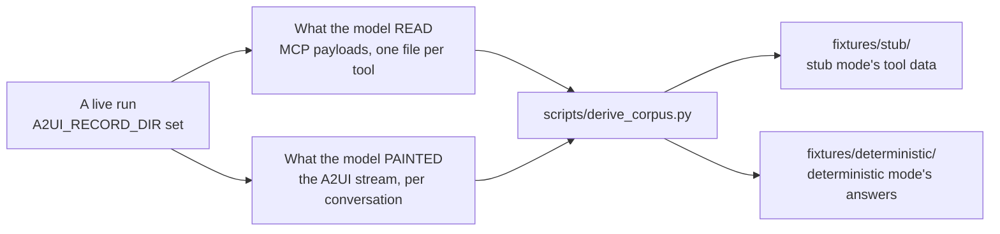
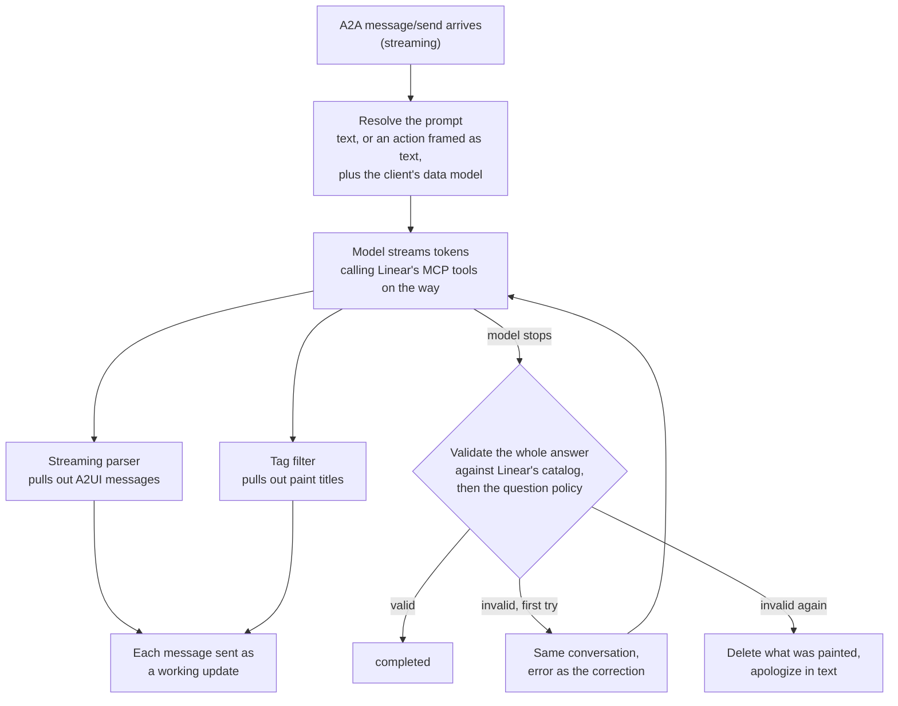
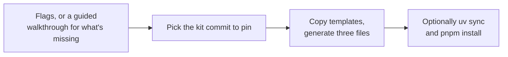

# Agent kit: how an app's agent is built

This guide explains **`a2ui-agent-kit`**, the Python kit every app's agent in [`a2uiverse-apps`](https://github.com/retz8/a2uiverse-apps) is built on, and **`create-a2ui-agent`**, the scaffolder that starts a new app on it. It's written for a frontend engineer meeting the agent side for the first time. It starts with the ideas, walks one question through an agent, then opens up the techniques inside, and ends with the design decisions and where the code lives.

One example runs through the whole guide: the **Linear agent** (`linear/agent/` in the apps repo) answering the request _"Show my in-progress and assigned issues as a compact list…"_. That's the request A2UIVerse's Planner wrote for Linear when you asked "what's the status of what I'm working on?", and the agent's answer is the Linear slot in the [synthesis guide](synthesis.md)'s screenshot. It's recorded, so every number below is real.

The kit speaks **A2UI and A2A and nothing else**. It knows nothing about A2UIVerse; any A2A client can talk to an agent built on it. The one place A2UIVerse shows up is optional, and it's covered in [Paint titles and question marks](#5-paint-titles-and-question-marks-are-tags-in-the-prose).

## Problem it solves

Every app in the apps repo has the same shape: **App = MCP server + Agentic BFF + A2UI catalog**. The agent is the Agentic BFF: an A2A server that takes a question, calls its vendor's MCP server, and answers with UI it generates in A2UI, drawn from its own catalog. There are five vendor apps (GitHub, Gmail, Google Calendar, CircleCI, Linear) and two mock stores.

Without a kit, every one of those agents would carry its own copy of the same hard parts:

- an A2A server and an agent card;
- streaming the model's A2UI to the client as it's written, so the UI assembles on screen instead of appearing all at once;
- checking the finished UI against the app's catalog, and asking the model to fix it when it's wrong;
- three ways to run: with no model at all, with a model over canned data, and with a model over the real service;
- recording live runs, so the canned data is real-shaped rather than invented.

The kit carries all of that. **An app keeps only what is its own**: its agent card, its prompt prose, its tools, its canned data, and what the model should know about the product.



## Five ideas to hold on to

### 1. An app is one config object

Everything the kit needs from an app is on **one frozen dataclass**, `AgentAppConfig`. The app builds it once, in `app/config.py`, and hands it to the kit. The kit never goes looking for anything; it is handed a config. Here's the Linear agent's, trimmed:

```python
# linear/agent/app/config.py (trimmed)
CONFIG = AgentAppConfig(
    name=APP_NAME,                       # the agent card
    skills=SKILLS,
    default_port=11005,
    catalog_path=_AGENT_DIR.parent / "linear-catalog" / "catalogs" / "v0.9.1" / "catalog.json",
    catalog_kind="custom",               # Linear's own catalog, in its design language
    role_description=prose.ROLE_DESCRIPTION,
    workflow_descriptions=(prose.WORKFLOW_DESCRIPTION, prose.SHELL_DESCRIPTION, prose.SCOPE_DESCRIPTION),
    domain_knowledge_path=_APP_PKG / "knowledge" / "linear-domain.md",
    build_response=build_response,       # deterministic mode: an action to canned A2UI
    build_text_response=build_text_response,  # deterministic mode: a question to canned A2UI
    question_policy=require_carries_action,
    stub_tools=STUB_TOOLS,               # stub mode: tools over canned data
    live_toolset_factory=_live_toolset,  # live mode: Linear's MCP server
    provider=AgentProvider(organization="Linear", url="https://linear.app"),  # the card: whose service it fronts
    documentation_url="https://github.com/retz8/a2uiverse-apps/blob/main/linear/agent/README.md",  # the card: its help page
)
```

`provider` and `documentation_url` go on the agent card as `provider` and `documentationUrl`: where a person finishes on the app's own side. Each vendor app names as its provider the vendor whose service it fronts, at the vendor's own site, and the mock stores a storefront of their own; each names its README in the apps repo as its help page. A client that can't draw something here links to them: A2UIVerse's "Continue on Linear" when it refused a paint, and the help link on the page where a key is pasted.

And the whole entrypoint:

```python
# linear/agent/app/__main__.py
from a2ui_agent_kit.cli import run
from app.config import CONFIG

run(CONFIG)
```

The config carries two kinds of thing: **data** (names, ports, paths, prose) and **callables** (the canned-response pair, the tools, the question policy). Passing behavior in as functions, instead of subclassing a base agent, keeps every app's differences in one readable place.

### 2. Three run modes on one port, with one agent card

Every agent runs in one of three modes, chosen by `--mode`:

| Mode            | Who answers                             | Needs                                    |
| --------------- | --------------------------------------- | ---------------------------------------- |
| `deterministic` | canned A2UI, no model                   | nothing                                  |
| `stub`          | the model, over canned tool data        | the model's key                          |
| `live`          | the model, over the vendor's MCP server | the model's key and the vendor's credential |

The modes differ in exactly one place. `deterministic` uses a different executor (no model at all). `stub` and `live` use the same model executor and differ only in **which tools** the model is handed: the config's `stub_tools`, or what `live_toolset_factory()` returns. Everything else, the server, the card, the port, the catalog, is identical.

That includes the **agent card**. One card describes the agent in every mode, because the mode is a launch detail. A card describing "the no-model demo harness" would describe something no user asks for, and A2UIVerse's Router, which ranks agents by their cards, would rank it against nothing.

The model defaults to `gemini-3.8-flash`, at the thinking tier `low`. The `MODEL_NAME` environment variable wins over the config's `model`, which wins over that default, and `MODEL_EFFORT` over the config's `effort` the same way; a Claude model is named `anthropic/<model>` ([Model and thinking tier](#model-and-thinking-tier)).

### 3. Model writes A2UI as text, streamed, then checked

In the model modes, the model answers in text: some prose, and A2UI messages inside `<a2ui-json>` blocks. The kit does three things with that text:

1. **Streams it.** As tokens arrive, a streaming parser pulls A2UI messages out of the partial text as they're written, and what's new of each is sent to the client right away, as an A2A `working` update. The client paints the surface as it's written.
2. **Checks it at the end.** Once the model stops, the whole answer is validated against the app's own catalog: known components, correct props, a `root`, everything reachable, every binding pointing at real data.
3. **Retries once.** If the check fails, the model is called again in the same conversation, with the error message as a correction.

In the recorded Linear turn, the first output arrived about 29 seconds in, after the model had read what it needed from Linear. The surface then streamed in 36 A2A updates over the next 7 seconds: one title, one `createSurface`, 14 data model updates and 20 component updates. The whole turn took 36.3 seconds.

### 4. One live run feeds all three modes

The canned data in `deterministic` and `stub` isn't written by hand. It's **derived from a recorded live run**, which is what keeps it real-shaped:



Setting `A2UI_RECORD_DIR` arms two recorders at once: one keeps every MCP result the model read, the other keeps every A2UI batch the agent streamed. The app's `scripts/record_beats.py` drives a fixed script of questions (the **beats**) against the running agent, and `scripts/derive_corpus.py` turns the recordings into both fixture folders. For Linear:

```bash
A2UI_RECORD_DIR=.recordings uv run python -m app --mode live --host localhost
uv run python scripts/record_beats.py --model gemini-3.8-flash
uv run python scripts/derive_corpus.py
```

Values stay real, with one exception each app decides for itself. Linear, for example, replaces the key owner's email with `me@example.com` in every tool result **before the model reads it**, so both the recorded payloads and the painted streams are clean.

### 5. Paint titles and question marks are tags in the prose

A2UI messages are sealed: the protocol's schema allows no extra fields, so an agent can't attach "this surface is called _Assigned Issues_" to a `createSurface`. The kit carries that kind of information **beside** the A2UI instead. The model writes a tag in its prose, right before the surface's A2UI block:

```text
<paint-title surface="assigned-issues">Assigned Issues</paint-title>
<a2ui-json>[{"version": "v0.9", "createSurface": {"surfaceId": "assigned-issues", …}}, …]</a2ui-json>
```

The kit strips the tag out of the prose and sends it as its own A2A data part, **`paintMeta`**, marked with the MIME type `application/json+a2ui-shell`, just ahead of the `createSurface` it names:

```json
{"paintMeta": {"surfaceId": "assigned-issues", "title": "Assigned Issues"}}
```

A surface that asks the user something the app can't go on without, such as which of two issues they mean, carries `kind="question"`: `{"surfaceId": "which-issue", "title": "Which issue?", "kind": "question"}`. A write the app drafts for the user to confirm, like Linear's proposal to move an issue to In Progress, is a **proposal**, not a question, and carries no kind: `{"surfaceId": "status-proposal", "title": "Move to In Progress"}`. And a turn that deliberately paints nothing (a change whose result is already on screen, a request outside the app, an action whose tool the agent doesn't hold) says so with `<no-surface/>`.

**This is optional and degrades cleanly.** A client that doesn't know `paintMeta` ignores the part. A2UIVerse's canvas is the client that reads it: the title names the app's back and forward arrows, and a question is said on the progress line as the app needing an answer, its paint drawn like any other (see [client.md](client.md#questions)). An app opts in by adding the prose block that teaches the model the tags (`SHELL_DESCRIPTION`) and choosing a question policy; `create-a2ui-agent --ecosystem` does both.

## One question, end to end

Here's the Linear agent in `live` mode, answering the Planner's request:



**1. The request arrives.** The kit's server is the A2A SDK's Starlette app with the kit's executor behind it. A streaming `message/send` reaches `LlmAgentExecutor.execute`, which opens an A2A task for the answer.

**2. The prompt is resolved.** Usually the message carries text: the Planner's request. When it carries a click instead (an A2UI action, like opening an issue), there's no text, so the kit frames one: _"The user activated the "open-issue" action on the current surface. Compose the next surface…"_, with the action's values listed. Either way, if the client sent its current data model (surfaces created with `sendDataModel: true` report it with every message, under `a2uiClientDataModel`), that's appended too, so the model sees edits the user made locally, like a checked box.

**3. The model runs.** The responder wraps Google's Agent Development Kit (ADK): an `LlmAgent` with the assembled system prompt and the mode's tools. Conversations are kept **per A2A context**, so a follow-up ("Move it to In Progress.") continues the same model session. In `live` mode the tools are Linear's MCP server, with the inventory pinned to 10 of the server's tools: the issue, comment, team, status, label and user reads, plus the two writes.

**4. Tokens stream out as UI.** Every token goes to the streaming parser. Whenever it reads a new A2UI message, or more of one, what the client doesn't hold yet is sent immediately. Prose goes through the tag filter first, so a `<paint-title>` becomes a `paintMeta` part, sent ahead of its `createSurface`. In the recording, `paintMeta` left at 28.7 seconds and `createSurface` at 29.0.

**5. The answer is checked.** When the model stops, the kit collects every A2UI message from the full text and validates them. A turn that creates a surface is checked as a whole surface; a turn that only updates a surface the client already has (a detail opened in place, a list re-sorted) is checked as an update. Then the app's **question policy** runs: Linear's requires that a surface declared a question carries at least one action, so the user can actually answer it.

**6. Done, retried, or apologized.** A valid answer ends the task as `completed`. An invalid one sends the model the error and tries once more. If that fails too, the kit deletes every surface the attempts created, so the client isn't left with half a UI, and ends with a plain-text apology.

**In `deterministic` mode** there's no model: the executor hands the question to the app's canned-response pair and sends the whole answer in one `completed` update. **In `stub` mode** everything above is the same except step 3's tools, which read fixtures instead of calling Linear.

## Inside the machinery

### Prompt: the app's prose, and three rules every app gets

`prompt.py`'s `build_system_prompt` assembles the system prompt once, section by section, around three pieces the A2UI SDK writes: the base rules and the schema block from its `DirectJsonPromptGenerator`, and the examples its `load_examples` reads, each example file whole:

| Section | What goes in |
| --- | --- |
| role | the config's `role_description` |
| workflow | the SDK's base rules, then the kit's three rules, then the config's `workflow_descriptions`, then the domain doc |
| UI description | the brand guide |
| schema | the app's catalog, as the SDK's schema block |
| examples | the examples' header, the config's `examples_framing`, then the app's curated example surfaces |

The three rules follow the SDK's base rules in the workflow section, ahead of anything the app wrote, because they hold for every app:

1. **A failure is worded for the person.** A failure the model reports in prose is read on the screen by someone who may not work in tech: what didn't work, and what they can do about it when there's something, in their words. Never a status code or error name, an exception, a tool or API name, a URL, or a sign-in or protocol term like token or scope. "The connection to GitHub encountered a 403 Forbidden error" is what it rules out.
2. **A proposal is not a question.** A write the app drafts for the person to confirm (an event, a reply, an issue, a rerun) is never declared `kind="question"`; a question is for a choice the app can't go on without. A proposal dismissed outright, with Discard or Not now, is repainted as the same surface settled: its buttons gone, one plain line saying what didn't happen, like "Discarded — not added to your calendar". Backing out of a confirm step to edit returns to the draft.
3. **A time is the person's, never converted by the model.** The model passes the person's time zone, which the request states, on every call to a tool that takes one, a wider second search included; where a tool takes none, it shows the time as the tool gave it, its zone named. It never converts a time from one zone to another itself. A time is written for a person to read, never a raw timestamp, with its date and year where the request asks for the full date and time; today and tomorrow are the person's, by the date the request states; and no code value like `None` or `null` is shown.

These are guidance the model reads, not checks: an app whose model does otherwise still works on a client. What must hold every time is code, below: the catalog check and the question policy. (A2UIVerse's requests end with the person's local time and zone, which is what rule 3 reads; see [orchestrator.md](orchestrator.md#one-question-end-to-end), step 5.)

### Model and thinking tier

ADK runs the model, and an app names it by its provider in `MODEL_NAME`:

| `MODEL_NAME` | What the kit hands ADK | Key |
| --- | --- | --- |
| `gemini-3.8-flash`, or any Gemini name | the name, as it is | `GOOGLE_API_KEY` |
| `anthropic/claude-haiku-5-5`, any Claude model after `anthropic/` | ADK's direct-API Anthropic class, `AnthropicLlm`, for the rest of the name | `ANTHROPIC_API_KEY` |

ADK's own registry sends a bare `claude-…` to its Vertex class and an `anthropic/…` to LiteLLM, and neither reaches the Anthropic API with an Anthropic key, so the kit builds that class itself for the prefixed name (`modes.py`'s `build_model`). The `anthropic` package is a plain dependency of the kit, as `google-adk` is. Every other name reaches ADK untouched.

Beside the model sits the **thinking tier**, `MODEL_EFFORT`, resolved as the model is: the environment, then the config's `effort`, then the kit's default. `default` configures nothing, and each provider thinks as it does on its own. `low` asks for the least thinking the provider offers, in the generation config ADK hands through:

- **On Gemini, the `low` thinking level.** A thinking budget of zero isn't honoured on Gemini 3: called directly on 2026-10-27, `gemini-3.8-flash` with the budget at zero thought for 47k tokens and took 380 s to its first token, against 18k and 123 s with nothing set, where the `low` level left no thinking and took 1.6 s. `minimal` is refused.
- **On Claude, a thinking budget of zero**, which ADK's Anthropic class reads as thinking disabled; see [the limits below](#claude-on-the-kit-three-limits).

A model that streams its reasoning hands it over as thought parts, and the kit's text stream passes none of them on, so no reasoning reaches the answer.

**The default: `gemini-3.8-flash` at `low`.** The tier was measured end to end and agent alone ([the latency and token experiment results](../../_dev/docs/latency-and-token-experiment-results.md)):

| When | The run | `default` | `low` |
| --- | --- | --- | --- |
| 2026-10-29 | six questions through A2UIVerse, three runs | an answer's first token at a median 48.5 s (8.3–118.9 s over 41), after a median 6,470 thinking tokens | — |
| 2026-10-30 | GitHub's two recorded questions and Linear's four, agent alone, one run on each tier | Linear's answers' first token 11.2–56.9 s, its first screen 20.4–73.3 s; GitHub's answers thinking 9,269 and 6,964 tokens | Linear thinking no token, its answers' first token 1.6–2.7 s, its first screen 4.2–14.1 s; GitHub still thinking on every request, 3,783 and 6,619 tokens on its answers |
| 2026-10-31 | the same six questions, one run | — | an answer's first token at a median 3.2 s (1.8–42.7 s over 13) |

- **What it buys.** Most of an answer's wait for its first token. On 2026-10-29 the apps' runs, 42.6–184.3 s at the median, were the longest wait on every question.
- **What it costs.** Less thought behind each answer. On 2026-10-30 each tier passed its catalog on the first try 5 times in 6, and the six answers at `low` held up beside `default`'s, but GitHub's read plainer: a plain heading in place of its page header, one "Review requested" badge on the header in place of one a row. Gemini's `low` level isn't none: GitHub still thought on every request, and Linear 2,873 tokens before one answer on 2026-10-31.
- **Gemini, not Claude.** Claude wasn't run on the apps over the questions: it waits on the three limits below.

### Claude on the kit: three limits

A Claude model runs on the kit by name, but three things in the kit's code and in ADK's (`google-adk` 2.8.0, the version the kit locks) keep it from serving an app as Gemini does:

1. **The kit's `low` turns thinking off.** A budget of zero is ADK's thinking `disabled`, which Haiku 5.5 accepts and Sonnet 5.5, Opus 5.5 and Fable 5.1 refuse with a 400 ([Thinking — Claude](https://platform.claude.com/docs/en/build-with-claude/thinking)). Those three run with `MODEL_EFFORT=default`.
2. **An answer is capped at 8,192 output tokens**, the default `max_tokens` of ADK's Anthropic class, where the Claude models allow 128K ([Models overview — Claude](https://platform.claude.com/docs/en/about-claude/models/overview)). A longer paint is cut off.
3. **Nothing is cached.** ADK's Anthropic class marks Claude's cache, from ADK 2.8, only under an app-level context cache config, and the kit builds ADK's `Runner` with no `App`; GitHub, Gmail and Calendar lock ADK 2.5.0, whose class marks none. Every tool round sends the whole prompt again at the full price: a GitHub round carried a median 145,944 prompt tokens on 2026-10-29, when Gemini's own cache served 43–85% of the apps' prompt tokens.

### Measuring each model request

A turn is several requests to the model: one per tool round, one for the paint, more on a retry. The kit measures each at the one place they all pass, ADK's before- and after-model callbacks on the agent `modes.py` builds (`measurement.py`):

- **Before the model**, the request is leaving for the provider: its start, and the request before it closed.
- **After the model** sees every response, the partial chunks and the aggregate the closed stream produces. The first content that isn't a thought, text or a tool call, is the first token, so thinking counts toward the time to first token on Gemini and Claude alike. An aggregate is the end, and carries the usage. A request is closed by the next one or by the turn's end, never by one response: Gemini's stream yields a function call and then its closing aggregate as two responses, neither marked partial.

The executor opens a `TurnMeasurement` for each turn, on the instant the recorder's batches are timed from, so a request lines up with the parts that left during it. Outside a turn nothing is measured, and a failure in measuring never reaches the turn. A record:

```jsonc
{"attempt": 1, "index": 3,                                       // the attempt, and the request's place in it
 "startMs": "…", "firstTokenMs": "…", "endMs": "…",              // on the turn's clock
 "timeToFirstTokenMs": "…", "generationMs": "…",
 "ended": "toolCall", "tools": ["list_issues"],                   // or "text", or "error" with no content
 "usage": {"promptTokens": "…", "outputTokens": "…", "thoughtsTokens": "…", "cachedTokens": "…"}}  // each absent when the provider gave none
```

Where it's written:

- **The agent's log**, one line per request, recording or not: `request 1.3: first token <ms> ms, generation <ms> ms, ended in text, <n> prompt / <n> output / <n> thoughts / <n> cached tokens`.
- **The recorded turn.** With `A2UI_RECORD_DIR` set, the recorder's turn keeps the records as `requests`, beside its batches and its outcome, with the model and the tier the agent resolved at startup, in `session-<context id>.json`. The beat driver copies the turn whole into the beat fixture, so a recorded beat carries its own timing and usage; replay reads only the batches.
- **The beat driver's line** for each beat adds the turn's totals: the requests made, the painting request's first token and generation, the prompt and output tokens. When its `--model` disagrees with the agent's, it says so and keeps the agent's word.

### Streaming first, validating at the end

`agent-kit/src/a2ui_agent_kit/executor_llm.py` is the heart of the kit. Its rule is **stream first, validate at the end, retry**. Streaming first means the user watches the UI assemble rather than waiting for the whole answer. Validating at the end is necessary because half a surface can't be judged: a `root` that hasn't arrived yet isn't missing.

The streaming parser is the A2UI SDK's own `DirectJsonParser`, made fresh for each attempt over every catalog line's catalog. It heals the partial JSON to read a message early, hands a message out again each time it grows, and holds a `createSurface` back until its object closes. A block that isn't JSON at all fails the attempt, and the parser's verdict is the correction. A block the parser refuses as a renderer would is left to the kit's own check at the end, in the kit's words, and the rest of the answer streams through a fresh parser.

**A retry patches in place.** Between the parser and the client sits the kit's **stream filter** (`_StreamFilter` in `executor_llm.py`), kept across both attempts with its memory of what the turn has sent. A retry's `createSurface` for a surface the turn already created is dropped; a component goes out only when it's new or changed since it was last sent, and a data model value only when it changed. So a growing `updateComponents` streams only what it added, a retry that repeats most of the first attempt sends only the components that changed, and the surface on screen is patched rather than wiped and redrawn. Nothing is torn down between attempts; only when every attempt has failed does the kit delete what it painted.

**What the stream held back goes at the end.** The filter holds back every message for a surface the turn didn't create: an update or a delete to a surface an earlier turn painted, like Calendar repainting its proposal settled after Discard. At the end of a valid turn, the filter's `flush` sends whatever of the validated answer the client still lacks, in order: each held-back message whole, and whatever of the turn's own surfaces the stream didn't reach.

The kit also tells failures apart, because each needs a different retry:

| Failure                                             | Retry                                                      | Final words if it fails again            |
| --------------------------------------------------- | ---------------------------------------------------------- | ---------------------------------------- |
| The answer fails validation                         | the validator's message, as a correction                   | "couldn't compose a valid interface"     |
| The model made a malformed tool call, and wrote nothing | a correction naming that mistake and the way out       | the same                                 |
| The provider failed (quota, a 5xx, the network)     | the same prompt, unchanged: it wasn't the model's mistake | "the language model is temporarily unavailable" |

`MAX_ATTEMPTS` is 2: one try and one retry.

### Streaming tag filter

`paint_meta.py`'s `PaintTitleTagFilter` pulls `<paint-title …>…</paint-title>` and `<no-surface/>` out of prose that arrives in arbitrary chunks. A chunk can end anywhere, including in the middle of a tag:

```text
chunk 1: "Here are your issues.\n<paint-ti"
chunk 2: "tle surface=\"assigned-issues\">Assigned Issues</paint-title>\n"
```

The filter keeps a small **buffer** and works like a lexer with lookahead:

1. Pull out every complete tag in the buffer: a `paint-title` becomes a `paintMeta` dict; a `no-surface` raises a flag.
2. Find the earliest point where the rest of the buffer **could still become a tag**: a lone `<`, a prefix like `<paint-ti`, or an open tag whose closing tag hasn't arrived.
3. Release everything before that point as prose, and hold the rest back for the next chunk.

A `<` that turns out not to start a tag is released as soon as the next characters rule a tag out, so ordinary prose is never held for long. When the stream ends, `flush()` releases whatever is still held, so a cut-off stream loses no prose. A fresh filter is made for each attempt, so a half tag from a failed attempt can't leak into the retry.

### Checking a surface: four passes

`catalog.py`'s `CatalogContext.validate_surface` checks a finished surface in four passes, each aimed at a mistake models really make, with an error message that tells the model how to fix it, because the retry reads that message:

0. **A binding on a literal prop.** Some props can only hold a fixed value, like an icon's name, which is an enum. A model that binds one to data (`{"path": "/status"}`) gets a message naming the prop, its allowed values, and the fix, before the generic schema error could bury it.
1. **Completeness.** There's a `createSurface`, it carries components, and one of them has id `root`.
2. **Conformance and topology**, the A2UI SDK's `validate_payload`, which judges the answer as a renderer holding the catalog would: every component matches its catalog schema (known components, declared props, right types), and every component is reachable from the root, with no dangling children, no cycles and no orphans.
3. **Bindings resolve.** The kit rebuilds the data model from the answer's own `updateDataModel` messages, then walks the tree from `root` and checks that every binding points at a value. Inside a list template it resolves against each list item, and when a model wrote an absolute path where a relative one was meant, the message says exactly that: use `'title'`, not `'/title'`.

The catalog's **kind** changes how pass 0 reads a component's declared props. A **custom** catalog (GitHub's, built on Primer) declares them at the top of each component's schema. A **basic** catalog (the themed A2UI basic catalog, like the mock stores') composes each component's props from `allOf` branches, so they're flattened before pass 0 can read them.

The SDK's `a2ui-core` 0.4.0 reads a plain string prop equal to a component id as a child reference, on every surface, for any component whose spec declares no reference props: an `Icon` named `mail` inside a `Row` whose id is `mail` reads as a cycle, so a valid surface would fail pass 2. The kit carries a local fix, applied at import (`upstream_patches.py`): from v0.9, a component its catalog declares is read by its reference spec alone. It's finding 16 in the [findings file](../../_dev/a2ui-findings.md), and goes when an SDK release carries the fix.

An update-only turn goes through `validate_update` instead: passes 0 and 2, and 3 when the turn repaints components, but not pass 1. The `createSurface`, the `root` and reachability live on the client, so the agent can't check them for an update: the SDK's check judges a surface the answer doesn't create without its root or reachability.

### Question policies

Which surfaces count as questions, and what a question must look like, differs by app, so the config picks a **policy**, a plain function `(payload, paint_metas) -> None` that raises when something's wrong. The kit ships two:

| Policy                         | Rule                                                                                         | Used by                          |
| ------------------------------ | -------------------------------------------------------------------------------------------- | -------------------------------- |
| `require_carries_action`       | a surface declared a question must carry at least one action, or the user can't answer it   | the basic-catalog apps, like Linear |
| `require_root_component(name)` | a surface declared a question must have a `name` root; a `name`-rooted surface needn't be one, since a `ConfirmationDialog` confirming a write GitHub proposed is a proposal | GitHub, with `ConfirmationDialog` |

The second is a small **factory**: it takes the component name and returns the policy function, so one rule serves any catalog that has a purpose-built dialog component.

### Deterministic mode: the fixture responder

`responses.py`'s `fixture_responder` builds the canned-response pair most apps use. Linear's:

```python
build_response, build_text_response = fixture_responder(
    _FIXTURES_DIR,
    {"open-issue": "open-issue.json", "confirm-change": "confirm-change.json", "decline-change": "decline-change.json"},
    text_fixture="my-issues.json",
    surface_prefix="linear",
)
```

- **Any question** answers with the same fixture, `my-issues.json`: 15 A2UI messages (one `createSurface`, 13 data model updates, one component update) and the paint's `paintMeta`. The text path doesn't try to understand the question. Guessing intent from words is the model modes' job, and a second, worse router here would only hide that.
- **An action** looks up its fixture by name. An unknown action gets a visible `Unhandled event: <name>` text, never a silent no-op.
- **Surface ids.** A client can't be asked to create a surface id that already exists, and the executor keeps no state between requests. So every answer that creates a surface gets a **fresh id** from a counter: `linear-1`, `linear-2`, and so on. That includes an action whose fixture carries a `createSurface`, like opening an issue: it's a new screen, as the live agent paints it. An action without one updates the surface the click came from.
- **Titles and question marks.** A fixture keeps the `paintMeta` its recording carried, after the A2UI messages: the paint's title (`"A2U-5"` on Linear's issue) and, on a question, its kind. It's stamped with the same surface id as the rest, and the executor sends it as the shell part ahead of them, so a deterministic screen is named on its back arrow and a question is marked, as in the model modes. `corpus.py`'s `settled_messages` keeps one per surface when a fixture is derived; the derive scripts leave it out of an answer that replays a question's own paint, like Gmail's `confirm-draft`.

### Tool hooks at the lowest boundary

`toolset.py` gives every MCP tool two hooks: `shape_args` on the arguments going out, `shape_result` on the result coming back. Every vendor app's live toolset is a `PolicyMcpToolset` or a subclass of it, whether or not it uses the hooks, so the seam is always there. (The mock stores have no MCP server; their live tools are plain functions.)

The hooks sit inside `McpTool._run_async_impl`, the lowest point ADK offers, instead of in ADK's tool callbacks. The reason is specific: an MCP `CallToolResult` carries the same payload **twice**, as text `content` and as `structuredContent`. A callback that rewrites one leaves the other for the model to read. At the lowest boundary there's only one dict each way.

ADK builds its tool objects internally, so the kit can't construct them itself. Instead it **re-classes them in place** after listing: `tool.__class__ = PolicyMcpTool`. The tool keeps everything ADK set up (auth, filtering, retries, the session) and gains the hooks. Linear's subclass uses the result hook when recording, to replace the key owner's email before the model reads it and to capture the payload for the stub data. `accepted_args()` reads a tool's own MCP schema, so an app that pins an argument onto every call can skip tools that don't declare it; the server would reject the call otherwise.

Beside it, `tool_shaping.py` gives apps a walker for annotating results with notes for the model (like "this payload is a projection; a field that isn't here wasn't fetched"). It builds a new dict rather than changing the old one, and **never raises**: a bug in shaping must not cost a live turn, and an unshaped payload is just the plain result.

### Cancel, and a task store that holds the line

When a client cancels (A2A's `tasks/cancel`), the SDK calls the executor's `cancel`, which answers with a bare `canceled` status, and then cancels the running `execute`. The `CancelledError` lands wherever the attempt was waiting, usually on the model stream. The attempt's `finally` closes the stream, which stops ADK's run, and no further attempt starts. An MCP call already sent is abandoned: the server finishes it, and the reply goes nowhere.

A2A says a task that reached a terminal state (`completed`, `canceled`, `rejected`, `failed`) can't be restarted. The A2A SDK's in-memory store didn't hold that line: it handed every reader the same object, the readers updated it in place, and a `working` update still queued could land after `canceled`, leaving the task reading `working`. The kit's `TerminalGuardedTaskStore` keeps **its own copy** of each task, hands out **copies**, and **refuses to overwrite** a task that already ended.

### Sign-in: the agent's own front door

Sign-in is explained end to end in [`authority.md`](authority.md). The kit's part in brief: an app that needs its user signed in puts a `SignIn` on its config, its scopes in its customer's words, the scopes the first sign-in asks, which actions and tools need which scopes, its made-up accounts, and its live **upstream**, the vendor's own sign-in. The agent then becomes its own sign-in front door:

- the card declares one `oauth2` scheme, `signIn`, with its `scopes` map, and `security` asks for the first sign-in's scopes;
- `sign_in_server.py` serves an OAuth authorization server beside A2A, on Authlib: metadata, `/oauth/authorize` with S256 PKCE, a token endpoint whose refresh tokens rotate, registration by a client ID metadata document or dynamically, revocation, and an ID token signed ES256 with the account's `sub` and display claims;
- an A2A request without a live token the agent issued is answered 401, and inside a request `current_account()` is the signed-in account;
- an action or tool needing a scope the token lacks raises `AuthRequired`, which ends the run in A2A's `auth-required` naming the missing scope keys, in the card's own `security` shape.

The account comes from the upstream. In deterministic and stub mode that's a chooser over the made-up accounts, and `fake_account=<id>` on the sign-in address skips it, for recordings and tests. In live mode it's `VendorOAuth`, the vendor's OAuth: the agent keeps the vendor's token, refreshes it, and hands each MCP connection its account's token; the client only ever holds the token the agent issued. An app signed in with a key uses `ApiKeySignIn` instead. Each agent keeps its accounts, tokens and signing key in an owner-only store, `<app>/agent/.state/sign-in.json`, or under `--state-dir`.

### One card, every mode: the server

`server.py` builds the agent card from the config, advertising A2UI's v0.9.1 extension with the catalog ids the app supports, and `cli.py` runs it with uvicorn. Two details come from running agents through a dev tunnel:

- **CORS** allows `localhost` on any port and `*.devtunnels.ms`.
- **Keep-alive is 300 seconds**, not uvicorn's 5. With 5, an idle connection between turns was closed by the server while a tunnel kept reusing it, and the next request hung.

`--base-url` sets the address the card advertises, for when the client reaches the agent through a tunnel or proxy. With sign-in on, `--public-url` sets where the browser reaches the sign-in pages (the sign-in page, the account chooser's form and the finish address a vendor returns to) while the card's endpoint, the metadata and the token endpoint stay on `--base-url`.

### An old catalog line beside the new one

A catalog id is a catalog's version: removing a component or changing a type needs a new id, and an install still on the old id can't draw the new one. So the config can carry an **old catalog line**, `old_catalog_line=CatalogLine(...)`, beside its own catalog fields: the old catalog as published, its examples, brand doc, question policy and deterministic answers (`config.py`, `catalog_lines.py`). Prose, tools and sign-in stay shared. A breaking catalog change then ships as a suggested update rather than a forced one.

- **The card names both ids, newest first**, and the kit won't start if both are the same id.
- **A turn is painted in the newest id the client renders.** The hub advertises the ids the app is installed with, so an install still on the old line is answered in it, each line's own prompt in the one conversation; a client sending no capabilities gets the newest.
- **An action is answered in the id of the surface it came from**, while a line holds it and the client renders it; otherwise as a fresh surface in the newest id the client renders. The kit knows a surface's id from the `createSurface` it sent, held in memory, so an action on a surface painted before the agent last started takes the newest line.
- **A client that renders neither id** gets no UI, only "Shop A has changed and can't show this here.", and no model call.

Retiring the old line is deleting `old_catalog_line` and publishing. [`store-loop.md`](store-loop.md) follows one through: Shop A's 0.2.0 naming both ids, its 0.3.0 the new one alone, and the update on the canvas.

### Caching per config

The config is a frozen dataclass declared with `eq=False`. That keeps **identity** hashing: two configs are the same only if they're the same object. It means the config can be a cache key directly, and `catalog_context(config)` is wrapped in `functools.lru_cache`, so each app loads and parses its catalog once, however many places ask for it.

## Scaffolder: create-a2ui-agent

`create-a2ui-agent` (a TypeScript CLI in the apps repo) writes a whole new app that runs before you edit anything:

```bash
pnpm exec create-a2ui-agent path/to/app --id acme-mail --catalog basic --yes
```

```
acme-mail/
  README.md             the app: its MCP server, agent and catalog
  agent/                the agent on the kit: deterministic, stub or live
  acme-mail-catalog/    the A2UI catalog: schema, React implementation, Provider
```



The techniques inside:

- **Templates with tokens.** Template files are copied as they are, with `__TOKEN__` placeholders (`__DISPLAY_NAME__`, `__PORT__`) filled in, in file contents and file names alike. A token the scaffolder doesn't define is an error, not a silent blank. `_gitignore` becomes `.gitignore` on the way, since npm won't publish a real `.gitignore`.
- **Overlays.** The agent is built in layers: the common `templates/agent`, then `templates/agent-kind/basic` or `custom` over it. The later layer overwrites the files beneath it.
- **Three files generated in code**, where a template would be too rigid: `pyproject.toml` (with the kit pin), `app/config.py` (the `AgentAppConfig`, with or without the paint-title prose and a question policy), and `app/mcp.py`.
- **A port suggestion.** One above the highest `default_port` any sibling app's agent config declares, or 11001 when there are none, so a new app beside the five lands on 11006.
- **Pinning the kit.** The new agent takes the kit as a git dependency pinned to one commit, so an app scaffolded today keeps working when the kit changes. The pin is the commit the CLI runs from. If that commit isn't pushed, nobody could fetch it, so the scaffolder pins the newest commit a remote carries instead, and says whether the kit changed in between.
- **Stellify in the catalog.** The new catalog package takes Stellify as a dev dependency pinned to one commit of the `a2uiverse` repo, the same commit every catalog in the apps repo pins, and carries a `check` script, so it is born passing the gate install runs.
- **A drift gate.** The scaffolder's tests scaffold both catalog kinds into a temporary folder, point the new agent at the working tree's kit, and run the new agent's and catalog's own tests and the catalog's `check`. A kit change that would break new apps fails there first.

The apps in the repo don't pin: they take the kit as an **editable path dependency** (`path = "../../agent-kit"`), so they always run on the kit as it is.

## How an app meets A2UIVerse

The kit knows nothing about A2UIVerse. The connection is made from A2UIVerse's side:

- **The launcher** in the `a2uiverse` repo names each app in its roster — its folder, its tier and its port — and starts its agent through the kit's own entrypoint on that port: `uv run python -m app --mode <mode> --host localhost --port <port>`. It packs the app's catalog package with Stellify and installs the app into the orchestrator from the agent's card URL; [app-install.md](app-install.md) follows an install from the pack to the first paint.
- **The orchestrator's AuthVault** signs in to the agent through its front door, as the card declares, and sends the token it issued as a header on every request; see [authority.md](authority.md).
- **The orchestrator** talks A2A to the agent like any client. It renames the agent's surfaces (`assigned-issues` becomes `linear:assigned-issues`) and places them in the app's slot; see [orchestrator.md](orchestrator.md).
- **The canvas** reads `paintMeta`, and draws the answer with the app's catalog; see [client.md](client.md).
- **The Store** reads the card as published: the Planner's search shows a published app's name, publisher, description and skills, and the slot that needs it offers the app; an app whose card names no catalog id it's installed with takes the update tile; see [store-loop.md](store-loop.md). When the answer is joined with other apps' answers, [synthesis.md](synthesis.md) takes over.

## Design decisions

| Decision | What it buys | What it costs |
| --- | --- | --- |
| **An app is one config object** | Every app's differences in one place; the kit never guesses | Adding a new kind of per-app behavior means a new config field |
| **Three modes, one port, one card** | Any mode drops in for any other; the card always describes the product | The card says nothing about which mode is running; the log does |
| **A model named by its provider, Claude through ADK's own Anthropic class** | Any Gemini model as ADK takes it, and a Claude model by one variable, with no generic road to keep | A third provider is a road the kit doesn't have; Claude on the kit has three limits |
| **`gemini-3.8-flash` at `low` by default** | An answer's first token at a median 3.2 s, against 48.5 s when the model thought as long as it liked | Less thought behind each answer, and Gemini's `low` still thinks on GitHub |
| **Each model request measured at ADK's model hooks** | Every request's first token, generation and usage, in the log and the recorded turn, with the responder protocol and every test's fake untouched | It leans on ADK's callbacks and usage shape; a request is closed by the next, not by its own last response |
| **Stream first, validate at the end** | The UI assembles on screen as the model writes it | An invalid answer is visible until the retry patches it, or the teardown removes it |
| **A retry patches in place** | No wipe and redraw between attempts | A filter of the kit's own beside the SDK's parser, holding a copy of every component the turn sent to compare the next one against |
| **What the stream held back sent at the end** | An update or a delete to an earlier turn's surface reaches the client | It shows when the turn ends, not as it's written |
| **Three rules every app gets, ahead of its own prose** | Failures, proposals and times read the same in every app, without each app writing them | Guidance, not a check: a model can still do otherwise |
| **Error messages that name the fix** | The retry has what it needs to succeed | Each common mistake needs its own targeted check |
| **Canned data derived from one live run** | Stub and deterministic data are real-shaped, never invented | Refreshing them means a new live run, with real credentials |
| **Titles and questions as tags beside A2UI** | A2UI stays standard; any client ignores what it doesn't know | The model must write the tags; the prose teaches it, and the question policy checks it |
| **Tool hooks at the lowest boundary** | One payload each way, never a second copy for the model to read | Re-classing ADK's tool objects relies on ADK's internals |
| **Terminal tasks can't move** | A cancelled task stays cancelled | A store of the kit's own, until the A2A SDK's next major line reads each task once |
| **An old catalog line beside the new one** | A breaking catalog change ships as a suggested update; installs on the old id keep getting answers in it | Two lines to keep until the old one retires: its catalog, examples, brand doc and deterministic answers |
| **Apps pin the kit by commit when outside the repo** | A scaffolded app keeps working as the kit moves | Taking a kit change means re-pinning |

## Trying it without a model

Every agent runs with nothing set up in `deterministic` mode:

```bash
cd linear/agent
uv sync
uv run python -m app --mode deterministic   # port 11005, canned answers
```

`stub` mode needs only the model's key, Gemini's by default, and never touches the vendor. The kit's tests and every app's tests run with **no model calls and no credentials** (`uv run pytest`). The model executor sits behind a one-method responder protocol (`stream(prompt, correction, context_id)` yields text), so its streaming, validation and retry logic is tested with a fake responder, and `testing.py`'s `run_executor` drives any executor in-process.

## Where the code is

In `a2uiverse-apps/agent-kit/src/a2ui_agent_kit/`:

| Module                         | What it does                                                                                   |
| ------------------------------ | ---------------------------------------------------------------------------------------------- |
| `config.py`                    | `AgentAppConfig`, `CatalogLine`, and the default model and thinking tier                        |
| `catalog_lines.py`             | The current and the old catalog line: the ids the card names, the line a turn is painted in     |
| `cli.py`                       | The entrypoint: flags, `.env` loading, logging, uvicorn                                         |
| `server.py`, `task_store.py`   | The A2A app, the one agent card, CORS; the terminal-guarded task store                          |
| `modes.py`                     | Mode to executor; the ADK agent with the mode's tools, its model and its thinking tier          |
| `measurement.py`               | Each model request's time to first token, generation and usage, at ADK's model hooks           |
| `executor_llm.py`              | Streaming through the SDK's parser and the stream filter, validation at the end, the retry, cancel |
| `executor_deterministic.py`, `responses.py` | The no-model executor; the fixture responder and stub fixture loader                |
| `responder.py`                 | The responder protocol, and the ADK-backed implementation with a session per context          |
| `catalog.py`, `versions.py`    | Catalog loading through the SDK's `CatalogConfig`, `validate_surface` and `validate_update` around its `validate_payload`; the protocol versions the kit names: the wire tag, the version a catalog is read at, the extension the card advertises |
| `upstream_patches.py`          | The local fix over `a2ui-core`'s child-reference fallback, applied at import (finding 16)      |
| `prompt.py`, `knowledge.py`    | System prompt assembly around the SDK's base rules, schema block and examples: the three rules every app gets, the config's prose, domain doc and brand guide |
| `paint_meta.py`                | The tag filter, the `paintMeta` part, the two question policies                                 |
| `toolset.py`, `tool_shaping.py`| The MCP tool hooks; the annotation walker                                                       |
| `recorder.py`, `corpus.py`, `beats.py` | Recording what was painted and what was read; the beat driver                           |
| `sign_in.py`, `sign_in_server.py`, `sign_in_store.py`, `sign_in_fake.py`, `sign_in_vendor.py` | Sign-in: the config, the authorization server and the 401, the store, the made-up accounts' chooser, the vendor's OAuth |
| `preview_credential.py`        | A token from the running agent for Stellify's preview, signed in as one of its made-up accounts |
| `testing.py`                   | Run an executor in-process, for tests                                                           |

The kit pins upstream's A2UI packages exactly, in `pyproject.toml`: `a2ui-agent-sdk` 0.9.0, `a2ui-core` 0.4.0 beneath it, and the A2A toolkit `a2ui-a2a` 0.1.0.

The scaffolder is `a2uiverse-apps/create-a2ui-agent/`: `src/cli.ts` (flags and the flow), `src/prompts.ts` (the walkthrough), `src/scaffold.ts` (composing templates), `src/generate.ts` (the three generated files), `src/kit.ts` (the pin), `src/ports.ts`, and `templates/`. Its drift gate is `test/scaffold-run.test.ts`.

## Words used in this guide

| Word | Meaning |
| --- | --- |
| **Agentic BFF** | The agent: takes a question, calls the vendor's MCP server, answers with UI |
| **A2A** | The agent-to-agent protocol the agent serves: messages, tasks, streaming updates, agent cards |
| **A2UI** | The protocol for agents to generate UI: surfaces, components, data models |
| **Surface** | One A2UI screen: a component tree and its data model |
| **Catalog** | The components an app's UI is built from: a schema the model writes against, and a React implementation |
| **Basic / custom catalog** | The themed A2UI basic catalog (the mock stores'), or a catalog of its own (every vendor app's, like GitHub's on Primer) |
| **MCP server** | The vendor's server the agent calls for data and actions |
| **ADK** | Google's Agent Development Kit, which runs the model and its tool calls |
| **Thinking tier** | `MODEL_EFFORT`: `low`, the least thinking the model's provider offers, or `default`, the provider's own |
| **Request record** | One model request's instants, how it ended and its usage, kept in the recorded turn |
| **Mode** | `deterministic`, `stub` or `live`: who answers |
| **Executor** | The A2A SDK's name for the object that answers a request |
| **Responder** | The kit's wrapper that streams the model's text |
| **Stream filter** | The kit's memory of what a turn has sent, so only what's new reaches the client and a retry patches in place |
| **Fixture** | Canned data: tool results for `stub`, A2UI answers for `deterministic` |
| **Beat** | One scripted question in a recording session |
| **paintMeta** | A surface's title and question mark, sent beside the A2UI |
| **Question policy** | The app's rule for what a question surface must look like |
| **Proposal** | A write the app drafts for the user to confirm: ordinary UI, never declared a question |
| **Kit pin** | The commit of the kit a scaffolded app depends on |
