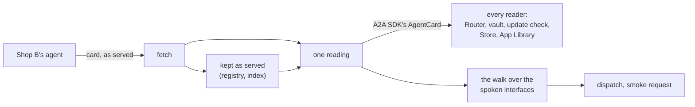
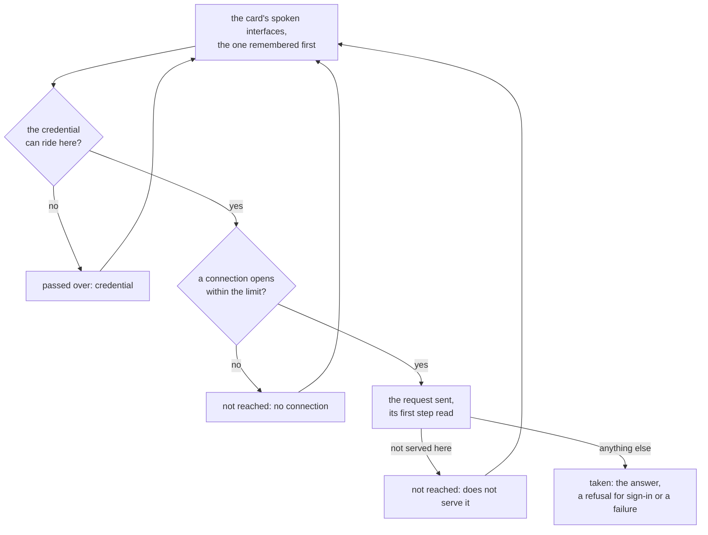

# Card: how A2UIVerse reads an agent's card and reaches its agent

This guide explains what A2UIVerse does with an **agent card**: the JSON file an agent publishes about itself. It is written for a frontend engineer meeting A2UIVerse for the first time. It starts with the ideas, follows one card from an agent's URL to a dispatch, then opens up the algorithms, and ends with the design decisions and where the code is.

One example runs through the whole guide: Shop B, a mock camera shop from the `a2uiverse-apps` repository. Its card is tracked in this repository, inside the Store recording [`apps/client/recordings/store/shop-b.json`](../../apps/client/recordings/store/shop-b.json), so you can read it beside this guide.

## Problem it solves

An app on A2UIVerse is an A2A agent, and the card is everything the platform knows about it: its name, its skills, how to sign in, which catalogs it paints in, and where it listens. Four processes read cards: the orchestrator, the marketplace, Stellify (the pack and publish tool) and the client.

A2A, the protocol the card belongs to, has two versions in use, and they write the same card differently. This is Shop B's card as its agent serves it today, written for A2A 0.3 (shortened):

```json
{
  "name": "Shop B",
  "version": "0.1.0",
  "protocolVersion": "0.3.0",
  "url": "http://localhost:12002",
  "preferredTransport": "JSONRPC",
  "security": [{"apiKey": []}],
  "securitySchemes": {
    "apiKey": {"type": "apiKey", "in": "header", "name": "X-Northlight-Key"}
  }
}
```

The same facts in A2A 1.0's shape:

```json
{
  "name": "Shop B",
  "version": "0.1.0",
  "supportedInterfaces": [
    {"url": "http://localhost:12002", "protocolBinding": "JSONRPC", "protocolVersion": "0.3.0"}
  ],
  "securityRequirements": [{"schemes": {"apiKey": {"list": []}}}],
  "securitySchemes": {
    "apiKey": {"apiKeySecurityScheme": {"location": "header", "name": "X-Northlight-Key"}}
  }
}
```

That raises four problems:

1. **Two shapes, many readers.** If each reader understood both shapes by itself, each would get one of them slightly wrong.
2. **A card can list several ways in.** A2A 1.0 lets an agent list several interfaces: more than one binding (JSON-RPC, HTTP+JSON, gRPC) and more than one A2A version. The platform has to choose one, and the one it chooses may not answer.
3. **An agent changes how it is reached without changing what it does.** When Shop B starts serving its card in A2A 1.0's shape, nothing about the app is new. Nobody should be asked to update it or to publish a new version.
4. **Some agents cannot be reached at all.** A card listing only a binding the platform does not speak describes an app that would fail on every question.

A2UIVerse's answer is one small package, [`@a2uiverse/card`](../../packages/card/README.md), that every process goes through.



## Five ideas to hold on to

### 1. A card is kept as its agent served it

The registry (the orchestrator's record of installed apps) and the marketplace's index store a card byte for byte as the agent's URL answered, in whichever shape it was written. Nothing is translated on the way in. In code a stored card has the type `ServedCard`, which is `object`: it names no field, so `card.name` on a stored card is a type error and the only way to a field is the reading.

### 2. One reading gives every reader the same card

`readCard(served)` returns the A2A SDK's own in-memory `AgentCard`, in A2A 1.0's shape, whichever shape the card was written in. It is built by two functions of `@a2a-js/sdk`: `parseLegacyAgentCard` for a card written for A2A 0.3, and `AgentCard.fromJSON` for every other. The platform has no card type of its own, and changes two things in what the SDK returns for a 0.3 card: every interface is at the A2A version the card names, and a sign-in scheme whose only flow is the device-code flow is read. Read, Shop B's card says the same thing as the second JSON above, with the SDK's defaults filled in.

### 3. An interface is one way in, and the platform walks the ones it speaks

Each entry of `supportedInterfaces` is an interface: a URL, a binding and an A2A version. `spokenInterfaces(card)` returns the ones the platform speaks, JSON-RPC, HTTP+JSON and gRPC on A2A 0.3 and 1.x, in the card's own order. A request goes to the first, and moves to the next only when the one it took was **never reached**: nothing there answered the request, so sending it elsewhere cannot deliver it twice. An agent is **reachable** when that list is not empty.

### 4. Two cards can be the same card

`sameCard(a, b)` compares two read cards with their interfaces and their signatures set aside. Shop B's card in A2A 0.3's shape and in 1.0's are the same card. A card with a changed skill is not.

### 5. An agent the platform cannot reach is turned away at every door

A card that lists no interface the platform speaks is refused at publish, at install and at Stellify's `preview`. An app already installed, whose agent later lists nothing the platform speaks, stays installed and its slot says so.

## One card, end to end

Shop B is published, installed and asked a question. Each step names the function that does it.

1. **Publish fetches the live card.** The marketplace calls `fetchLiveCard(cardUrl, {timeoutMs})`. The request carries `A2A-Version: 1.0`, and the answer is kept as served.
2. **Publish reads it.** `readCard` turns the answer into an `AgentCard`. If it does not read, the publisher gets one finding and nothing else runs.
3. **Publish judges reachability.** `spokenInterfaces` finds Shop B's one interface, JSON-RPC at A2A 0.3.0. The smoke request (the one question the marketplace asks an agent before listing it) goes to that interface.
4. **The entry stores the card as served.** The index entry's `card` is the 0.3 JSON, untouched.
5. **Install fetches and reads the same way.** The orchestrator's registry fetches the live card, reads it, and writes the served JSON into its record file.
6. **Every reader takes the read card.** The Router embeds its name and skills, the AuthVault (the orchestrator's credential store) reads that it asks for a key in the header `X-Northlight-Key`, the App Library shows its name.
7. **The dispatch walks the spoken interfaces.** When a question goes to Shop B, the dispatch takes the first spoken interface of the card this run holds, opens a connection to it, and hands the A2A SDK that card with that one interface listed. Shop B lists one, so the walk has nowhere else to go.

Later, Shop B's publisher moves the agent to A2A 1.0 and it serves the second JSON above with a 1.0 interface listed first. The next check fetches the new card, reads it, and finds the same catalog ids, the same version and the same sign-in: the app is up to date, and its dispatches now go to the 1.0 interface. The stored copies keep the older shape until Shop B is next published or installed over for another reason.

## Inside the machinery

### Reading a card

```ts
export function readCard(served: unknown): AgentCard {
  if (typeof served !== 'object' || served === null || Array.isArray(served)) {
    throw new Error('not an agent card');
  }
  if (typeof (served as {name?: unknown}).name !== 'string') {
    throw new Error('not an agent card: no name');
  }
  return isLegacyAgentCard(served) ? readLegacy(served) : AgentCard.fromJSON(served);
}
```

`isLegacyAgentCard` is the A2A SDK's own test. A card counts as written for A2A 0.3 when it has no non-empty `supportedInterfaces` and has a top-level `url`, a field only 0.3 has, or a `protocolVersion` below 1.0. A card carrying both shapes is read as A2A 1.0.

`readLegacy` makes the two changes for a 0.3 card.

A 0.3 card names its A2A version once, for the whole agent, and its `additionalInterfaces` name none. `parseLegacyAgentCard` gives the card's own URL that version and each further interface a fixed `0.3`, so Shop B serving gRPC at its own URL and JSON-RPC as a further interface would read as `0.3.0` and `0.3` (finding 12 in `_dev/a2a-findings.md`). `atCardVersion` gives every interface the version the first one has, so the journal and a publisher's notes spell the version as the card does.

A2A 0.3 names four OAuth flows: the authorization code, client credentials, implicit and password. The device-code flow, which A2A 1.0 adds, is not among them, so an agent still serving a 0.3 card that signs in by device code writes it under `flows.deviceCode` in A2A 1.0's field names:

```json
"securitySchemes": {
  "signIn": {
    "type": "oauth2",
    "oauth2MetadataUrl": "https://tv.example/.well-known/oauth-authorization-server",
    "flows": {
      "deviceCode": {
        "deviceAuthorizationUrl": "https://tv.example/device",
        "tokenUrl": "https://tv.example/token",
        "scopes": {"watch": "See what you watch"}
      }
    }
  }
}
```

`parseLegacyAgentCard` fails the whole card for that scheme (finding 13). `readLegacy` takes each scheme whose only flow is `deviceCode` out before the SDK reads the card, reads it with the SDK's own `SecurityScheme.fromJSON` in A2A 1.0's shape, and puts it back in its place. A scheme that names one of the four flows beside `deviceCode` is left to the SDK, which reads it with that flow.

Apart from those two, what the SDK's two functions drop, the reading drops, and what they refuse, the reading refuses. Three cases are known and each has a fixture under [`packages/card/test/fixtures`](../../packages/card/test/fixtures/README.md):

1. `parseLegacyAgentCard` throws on a 0.3 card with no `capabilities`, `defaultInputModes`, `defaultOutputModes` or `skills`, and on an OAuth scheme that holds none of A2A 0.3's four flows and no device-code flow (finding 14), though A2A 0.3's schema makes every flow optional.
2. The server of `@a2a-js/sdk` 1.3.0 serves its card in the SDK's in-memory form, where a sign-in scheme sits under `scheme.$case`. `AgentCard.fromJSON` does not read that form, so the scheme is dropped and the app reads as asking a sign-in the platform does not support.
3. The same server, with its A2A 0.3 layer on, answers a caller that names no A2A version with 1.0's interfaces beside 0.3's `security`. `AgentCard.fromJSON` reads no `security`, so that card reads as asking no sign-in. The platform's fetch names A2A 1.0 and gets the 1.0 form.

### Fetching the live card

`fetchLiveCard(cardUrl, {timeoutMs, fetchImpl})` is the one fetch for the orchestrator, the marketplace and Stellify. It sends `A2A-Version: 1.0` and `accept: application/json`, bounds the request with `AbortSignal.timeout`, and throws in the words of a finding: `HTTP 404`, `did not answer within 10 s`, `not JSON (…)`, `not an agent card`. It returns the parsed JSON object and does not read it: whether the object is a card is the reading's to say.

The time limits:

| Fetch                                                            | Limit |
| ---------------------------------------------------------------- | ----- |
| Marketplace: publish, the refresh at boot, a report              | 10 s  |
| Stellify: `preview`                                              | 10 s  |
| Orchestrator: boot, the update check, install                    | 10 s  |
| Orchestrator: a tile's Retry or Update, Publish's listings       | 5 s   |

The 10 s limits read the environment variable `A2UIVERSE_CARD_TIMEOUT_SECONDS`. The 5 s limits are fixed.

### Choosing the interface

```ts
export const SPOKEN_BINDINGS: readonly string[] = ['JSONRPC', 'HTTP+JSON', 'GRPC'];

export function spokenInterfaces(card: AgentCard): AgentInterface[] {
  return (card.supportedInterfaces ?? []).filter(
    agentInterface =>
      Boolean(agentInterface.url) &&
      isSpokenBinding(agentInterface.protocolBinding ?? '') &&
      isSpokenVersion(a2aVersionOf(agentInterface)),
  );
}
```

An interface is spoken when three things hold:

1. It names a URL. A 0.3 card with no `url` reads to an interface with none.
2. Its binding is on `SPOKEN_BINDINGS`, compared whatever its case, as the A2A SDK compares bindings.
3. Its A2A version is from 0.3 up to but not including 1.0, or is 1.x. An interface naming no version counts as 0.3, as the A2A SDK reads it. Every interface of a 0.3 card is at the card's own version.

| The card lists                          | Spoken | Tried first |
| --------------------------------------- | ------ | ----------- |
| JSON-RPC at 0.3.0                       | yes    | that one    |
| JSON-RPC at 1.0, then JSON-RPC at 0.3   | both   | 1.0         |
| JSON-RPC at 0.3, then JSON-RPC at 1.0   | both   | 0.3         |
| gRPC at 1.0, then JSON-RPC at 1.0       | both   | gRPC        |
| a binding of the agent's own, then gRPC | gRPC   | gRPC        |
| JSON-RPC at 2.0                         | none   | unreachable |
| a binding of the agent's own            | none   | unreachable |

### Walking the interfaces

The **dial** is how the platform reaches an agent, written once in [`@a2uiverse/smoke-transport`](../../packages/smoke-transport/README.md) and used by the orchestrator's dispatch and by the smoke request behind publish and `stellify preview`. Say Shop B's card listed gRPC at A2A 1.0 first and its JSON-RPC interface second:



An interface is **never reached** in three cases, and the walk moves on from those alone:

1. No connection could be opened: the name did not resolve, the connection was refused, the TLS handshake failed, or the time limit passed. The limit is 5 s at a dispatch, where a person waits on the canvas, and 10 s at publish and `preview`. It covers opening the connection and nothing after it.
2. What answered said the interface is not there: the A2A error for a version not supported, on any binding; the gRPC status `UNIMPLEMENTED`; an HTTP 404 or 405 carrying no A2A error, on JSON-RPC and HTTP+JSON; the JSON-RPC error -32601, "Method not found", which a server with no handler for the interface's A2A version answers, the two versions naming the send method differently.
3. The interface cannot carry the credential: on gRPC, an `apiKey` header whose name is no legal metadata key.

Everything else ends the walk where it stands: a refusal for sign-in, a stream that broke, a failed task, a timeout, the gRPC status `UNAVAILABLE`, HTTP 502, 503 and 504. The request may have reached the agent in each of those, so it is never sent to another interface.

The dial opens a connection of its own before it hands the A2A SDK the request: a TCP connection, with the TLS handshake for an interface dialed with TLS, offering HTTP/2 for gRPC and HTTP/1.1 otherwise. That is the one place a time limit on opening alone can be had on all three bindings without patching the SDK, whose gRPC transport takes no channel options. The connection is closed once it opens, and the SDK opens its own for the request.

The A2A SDK's client chooses an interface by itself when it is handed a whole card, and inside one binding it takes an A2A 1.0 interface over a 0.3 one whatever the card's order. So the dial hands it the read card listing the one interface it tries, through `cardToDial`. The SDK dials that interface, through its A2A 0.3 layer when the interface is on 0.3. The client factory is given a card resolver that resolves nothing and normalizes nothing: the SDK's own normalizing would read an in-memory card with sign-in schemes over again as JSON and drop the schemes.

A gRPC interface's URL comes in two spellings: a bare `host:port`, as the A2A SDK's own sample agent writes it, and a URL with a scheme, as the A2A specification's example card writes it (`https://georoute-agent.example.com/a2a/grpc`). `@grpc/grpc-js` cannot resolve the second, so the dial hands the SDK `host:port`, the path left out. `https://` dials with TLS and `http://` without; a bare `host:port` dials with TLS unless its host is the local machine. A certificate is checked against the authorities Node trusts.

The credential rides as the header the card's scheme names on JSON-RPC and HTTP+JSON. On gRPC it rides as one metadata entry under that name in lowercase: `authorization: Bearer <token>`, or the `apiKey` header's name with the key. The sign-in signal follows the binding: HTTP 401, or the gRPC status `UNAUTHENTICATED`, each treated as a 401 has always been.

The orchestrator remembers, for each app, the interface that last answered, and a dispatch starts there. The memory lasts while the run holds that live card: a fetch of the card again, changed or not, starts the walk over from the first spoken interface, and so does the remembered interface not being reached. A cancel goes to the interface its request went to.

The journal's record of a dispatch holds the A2A version and the binding of the interface used, `0.3.0` and `JSONRPC` for Shop B, and beside them each interface passed over: `notReached: [{binding: 'GRPC', a2aVersion: '1.0', why: 'connection'}]`. A publisher reads the same as a note on an accepted publish and on Stellify's terminal:

```
GRPC at A2A 1.0 (grpc.shop-b.example:443) was not reached: no connection could be opened; the request went to JSONRPC at A2A 0.3.0
```

When the walk reaches no interface, the slot fails as an agent that could not be reached, with Retry, and nothing new is said to the person. Publish is refused and `preview` captures nothing, with one finding:

```
no interface the card lists was reached: GRPC at A2A 1.0 (grpc.shop-b.example:443): no connection could be opened; JSONRPC at A2A 0.3.0 (http://localhost:12002): no connection could be opened
```

### Telling whether two cards are the same

`sameCard` writes each read card back to A2A 1.0's JSON with `AgentCard.toJSON`, its interfaces and signatures removed, sorts every key, and compares the two strings. `toJSON` leaves out defaults, so a description that is absent in one shape and empty in the other does not count as a difference.

It is used in two places:

1. The marketplace's card-version rule. A publish at an already published version is accepted when the live card is the same card as the stored one, and it stores the live card as served. A changed card at a published version is refused.
2. The install summary. An install over an app whose card is the same card and whose catalogs are at the same builds says "nothing changed".

The update check and the Store's drift test do not use `sameCard`. They compare what decides an update, through the reading: the catalog ids the card declares, its version, and the scopes each sign-in scheme asks.

A card that says in A2A 1.0's shape something its 0.3 card could not say, such as an OAuth flow that requires PKCE, is a changed card.

### Reading sign-in

`signInAlternatives(card)` returns the card's sign-in requirements as a list of alternatives, each a scheme's name mapped to the scopes asked of it: `[{apiKey: []}]` for Shop B. `asksSignIn(card)` is true when there is at least one alternative and none is empty. The vault, the App Library, Stellify's credential chooser and the update check's new-scopes list all start from these two.

Three readers choose one alternative to follow: the vault, Stellify's credential chooser and the trusted page's sign-in line. They choose alike through two more functions. `signInFlow(scheme)` says how a scheme signs a person in: `redirect` for OAuth's authorization-code flow and for OpenID Connect, `deviceCode` for OAuth's device-code flow, nothing for every other. `redirectFirst(alternatives, flowOf)` puts the alternatives a reader can follow in the order the platform follows them: the card's, except that each device-code alternative listed before the last redirect alternative moves to just after it. A card listing the device-code flow, then a key, then the authorization-code flow is followed by the key. The authority design record has why ([`authority.md`](authority.md)).

### Doors

| Door                    | What happens                                                                                              | Who reads what                                                                                   |
| ----------------------- | --------------------------------------------------------------------------------------------------------- | ------------------------------------------------------------------------------------------------ |
| Publish                 | Refused, nothing sent to the agent, the app never listed                                                  | The publisher reads the finding                                                                  |
| `stellify preview`      | Nothing captured, nothing sent                                                                            | The publisher reads the same finding on the terminal                                             |
| Install or update       | Refused under the cause `no-interface`, from a local copy and from the marketplace alike, with no press   | "Shop B can't be installed. It connects in a way A2UIVerse can't use, so nothing was installed." |
| An installed app's slot | The failure tile under the cause `interface`, the agent not called, Retry kept                            | "This app now connects in a way A2UIVerse can't use."                                            |

The finding names what the card lists and what the platform speaks:

```
the card lists no interface A2UIVerse speaks: it lists ACME-RPC at A2A 1.0; A2UIVerse speaks JSONRPC, HTTP+JSON and GRPC at A2A 0.3 and 1.x
```

A card with no interface at all reads `the card lists no interface`. Nothing drawn for a person names a binding or a protocol version: the finding is the publisher's.

An installed app that becomes unreachable stays routed. The Router still ranks it and a plan may dispatch it. The dispatch judges reachability before the agent is called, ahead of the update check and ahead of any sign-in, on the card it would dial from: the live card this run holds, or the stored one when the agent was down at startup. Its slot is out of the merged view as any failed source is. Retry fetches the app's live card again first, within five seconds, so an agent that lists a spoken interface again is called.

The installed list the orchestrator serves at `/registry/apps.json` carries `noInterface` beside `reachable`. In the App Library the app reads "Connects in a way A2UIVerse can't use" in place of its update state, and its view carries the notice "Shop B now connects in a way A2UIVerse can't use." The Planner's installed-apps reader hands the Planner the same words.

The marketplace does nothing new for a published app that becomes unreachable. Its listing stays, and its live card is judged for drift whatever interfaces it lists.

### Reading in the browser

The wire between the orchestrator and the client carries a card as its agent served it. [`orchestratorApi.ts`](../../apps/client/src/orchestratorApi.ts) reads each card where it arrives: the installed apps, the Store's listings, a publisher's listings. Everything past that file holds read cards. A listing whose card does not read is left out, as an entry that does not read is.

The reading adds about 32 kB to the client's bundle (7 kB gzipped), measured on the production build: 5,069.72 kB before and 5,102.10 kB after.

## When things go wrong

| What happens                                                     | What the platform does                                                                                                    |
| ---------------------------------------------------------------- | ------------------------------------------------------------------------------------------------------------------------- |
| The card URL does not answer in time                             | Publish and install are refused with "could not be fetched". At boot the app stays installed and unroutable               |
| The answer is not a card, or the A2A SDK refuses it              | One finding, "the card at … could not be read: …" with the SDK's own message, and nothing else runs                       |
| A live card stops reading after install                          | The app is treated as one whose card could not be fetched: installed, unroutable, until a check reaches a card that reads |
| A stored card does not read                                      | The orchestrator and the marketplace refuse to boot, naming the app and the reason                                        |
| The marketplace hands the orchestrator a card that does not read | The update state is unknown, and the Store's search leaves the entry out                                                  |
| The card lists nothing the platform speaks                       | The four doors above                                                                                                      |
| No interface the card lists is reached                           | The slot fails as an agent not reached, with Retry; publish is refused and `preview` captures nothing, with one finding   |

## Design decisions

| Decision                                                          | What it buys                                                                               | What it costs                                                                                                      |
| ----------------------------------------------------------------- | ------------------------------------------------------------------------------------------ | ------------------------------------------------------------------------------------------------------------------ |
| The reading returns the A2A SDK's `AgentCard`                     | No card type to keep in step with A2A, and one translation shared with the dispatch        | Readers handle the SDK's in-memory shape (`scheme.$case`), and the platform inherits what the SDK's functions drop |
| A stored card names no field                                      | The compiler stops a reader from reaching past the reading                                 | Every stored card is read at load and held twice in memory                                                         |
| The platform walks the interfaces and the SDK dials the one tried | The card's order holds inside one binding, with no patch to the SDK                        | The platform keeps its own list of spoken bindings beside the SDK's transports                                     |
| The walk moves on only from an interface never reached            | A request is never delivered twice                                                         | An interface that fails after the request went out is not tried elsewhere: the slot fails                          |
| The dial opens a connection itself before the SDK sends           | One time limit on opening, on all three bindings, with no patch to the SDK                 | One connection more than the request needs, for each interface tried                                               |
| The interface that answered is remembered while the card is held  | A later dispatch does not wait on an interface that was not reached                        | A refetch of the card, even an unchanged one, starts the walk over                                                 |
| Interfaces and signatures are set aside when comparing cards      | A change of A2A version or bindings alone is no update and needs no new version            | A signature is not compared, since it covers the interfaces                                                        |
| The fetch names A2A 1.0                                           | A server that answers both versions serves its 1.0 form, which keeps its sign-in when read | An agent that answers differently by that header is kept in the form it serves to A2A 1.0 callers                  |
| The client runs the same reading                                  | The wire carries cards unchanged, and the page and the orchestrator read one way           | About 32 kB more in the bundle                                                                                     |
| A device-code flow on a 0.3 card is read around the A2A SDK       | An agent still on A2A 0.3 can name the sign-in A2A 1.0 adds, and the vault signs in by it   | One place where the reading is not the SDK's own, kept until a release of the SDK reads the flow (finding 13)      |

## Known limits

1. Toward an agent on A2A 0.3 over HTTP+JSON or gRPC, the A2A SDK drops every part's `metadata`, both ways: a mark in `metadata.mimeType` does not arrive (`_dev/a2a-findings.md` 9). The platform reads a part by what it holds and carries no patch.
2. A gRPC channel the orchestrator opens stays open for the run, one for each interface it has sent to.
3. A card's signatures and its extended-card flag are read and kept, and nothing uses them.

## Trying it without a model

The package's tests run on real cards and need no model, no agent and no network:

```bash
pnpm --filter @a2uiverse/card test
```

To read a card yourself, build the package and run a snippet from its folder:

```bash
pnpm --filter @a2uiverse/card build
cd packages/card
node --input-type=module -e "
import {readFileSync} from 'node:fs';
import {readCard, spokenInterfaces, signInAlternatives} from './dist/index.js';
const served = JSON.parse(readFileSync('../../apps/client/recordings/store/shop-b.json', 'utf8')).entry.card;
const card = readCard(served);
console.log(spokenInterfaces(card), signInAlternatives(card));
"
```

The fake A2A 1.0 agent the tests dispatch to is in `@a2uiverse/smoke-transport/testing/v1`. It answers A2A 1.0 and 0.3 on JSON-RPC, HTTP+JSON and gRPC, and records which binding and which A2A version a request reached. The walk's own tests run against it and against the fake A2A 0.3 agent:

```bash
pnpm --filter @a2uiverse/smoke-transport test
```

## Where the code is

| What                                                | Where                                                                                                                                                                                                              |
| --------------------------------------------------- | ------------------------------------------------------------------------------------------------------------------------------------------------------------------------------------------------------------------ |
| The reading, a device-code flow on a 0.3 card among it | [`packages/card/src/readCard.ts`](../../packages/card/src/readCard.ts)                                                                                                                                          |
| The fetch                                           | [`packages/card/src/liveCard.ts`](../../packages/card/src/liveCard.ts)                                                                                                                                             |
| Spoken interfaces, the card to dial, the finding    | [`packages/card/src/interfaces.ts`](../../packages/card/src/interfaces.ts)                                                                                                                                         |
| The same-card test                                  | [`packages/card/src/sameCard.ts`](../../packages/card/src/sameCard.ts)                                                                                                                                             |
| Sign-in requirements and the order they are followed in | [`packages/card/src/requirements.ts`](../../packages/card/src/requirements.ts)                                                                                                                                 |
| The A2A 1.0 card fixtures and how they are captured | [`packages/card/test/fixtures`](../../packages/card/test/fixtures/README.md), [`packages/card/scripts`](../../packages/card/scripts)                                                                               |
| The registry: stored and live cards                 | [`apps/orchestrator/src/registry/registry.ts`](../../apps/orchestrator/src/registry/registry.ts)                                                                                                                   |
| The dispatch: reachability and the dial             | [`apps/orchestrator/src/agentsPool/agentsPool.ts`](../../apps/orchestrator/src/agentsPool/agentsPool.ts)                                                                                                           |
| The marketplace: publish and the card-version rule  | [`apps/marketplace/src/marketplace.ts`](../../apps/marketplace/src/marketplace.ts)                                                                                                                                 |
| The dial: the walk, never reached, the time limit   | [`packages/smoke-transport/src/dial.ts`](../../packages/smoke-transport/src/dial.ts), [`opening.ts`](../../packages/smoke-transport/src/opening.ts), [`answers.ts`](../../packages/smoke-transport/src/answers.ts) |
| A gRPC address and TLS; the credential on gRPC      | [`packages/smoke-transport/src/address.ts`](../../packages/smoke-transport/src/address.ts), [`credentialOnBinding.ts`](../../packages/smoke-transport/src/credentialOnBinding.ts)                                  |
| The smoke request                                   | [`packages/smoke-transport/src/smokeRunner.ts`](../../packages/smoke-transport/src/smokeRunner.ts)                                                                                                                 |
| Stellify's preview                                  | [`packages/stellify/src/preview.ts`](../../packages/stellify/src/preview.ts)                                                                                                                                       |
| The client's reading on arrival                     | [`apps/client/src/orchestratorApi.ts`](../../apps/client/src/orchestratorApi.ts)                                                                                                                                   |
| The slot's cause and its statement                  | [`packages/shell-catalog/src/components/slot`](../../packages/shell-catalog/src/components/slot)                                                                                                                   |
| The refusal's words, the App Library's words        | [`packages/sdk/js/src/marketplace.ts`](../../packages/sdk/js/src/marketplace.ts)                                                                                                                                   |

## Words used in this guide

| Word            | Meaning                                                                                                                   |
| --------------- | ------------------------------------------------------------------------------------------------------------------------- |
| Agent card      | The JSON an A2A agent publishes about itself, usually at `/.well-known/agent-card.json`                                   |
| Served card     | A card exactly as the agent's URL answered it, in the shape of the A2A version it was written in                          |
| Read card       | The same card as the A2A SDK's in-memory `AgentCard`, in A2A 1.0's shape                                                  |
| Live card       | The card an agent serves now, as opposed to the copy stored at publish or at install                                      |
| Binding         | The transport an interface speaks: JSON-RPC, HTTP+JSON or gRPC                                                            |
| Interface       | One way to reach an agent: a URL, a binding and an A2A version                                                            |
| Walk            | The order a request tries a card's spoken interfaces in: the card's own, the interface remembered first                   |
| Never reached   | Said of an interface the request did not get into: no connection, nothing served there, or no way to carry the credential |
| Interface taken | The interface a request went to: the first in the walk that was reached                                                   |
| Reachable       | Said of an agent whose card lists at least one interface the platform speaks                                              |
| Door            | A place an agent comes through: publish, install, Stellify's `preview`, or an installed app's slot                        |
| Finding         | One line saying why a publish, a preview or an install was refused, written for the publisher                             |
| Smoke request   | The one A2A request the marketplace and Stellify send an agent to check that it answers and paints                        |
