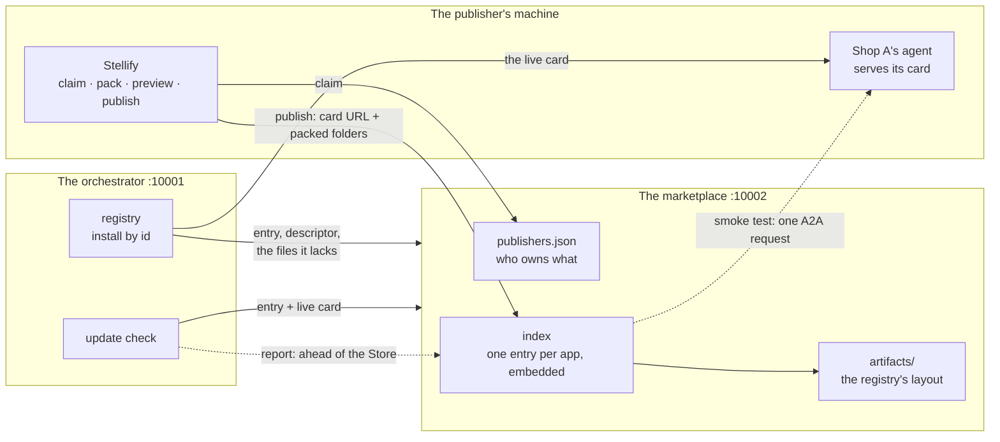
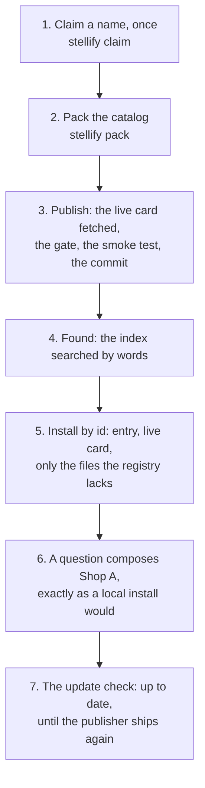
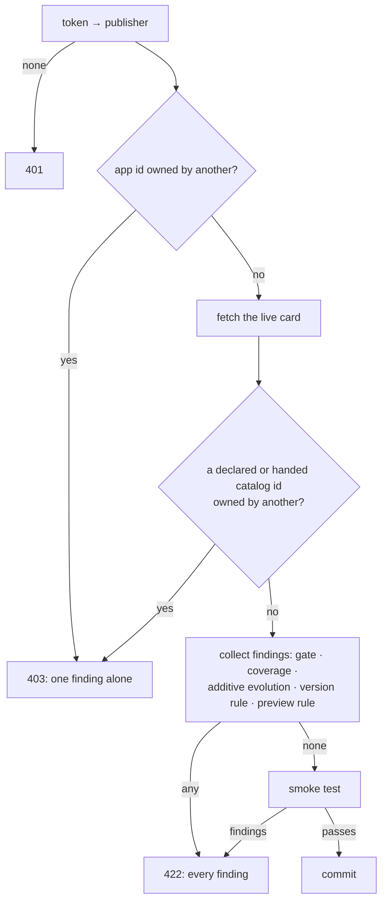
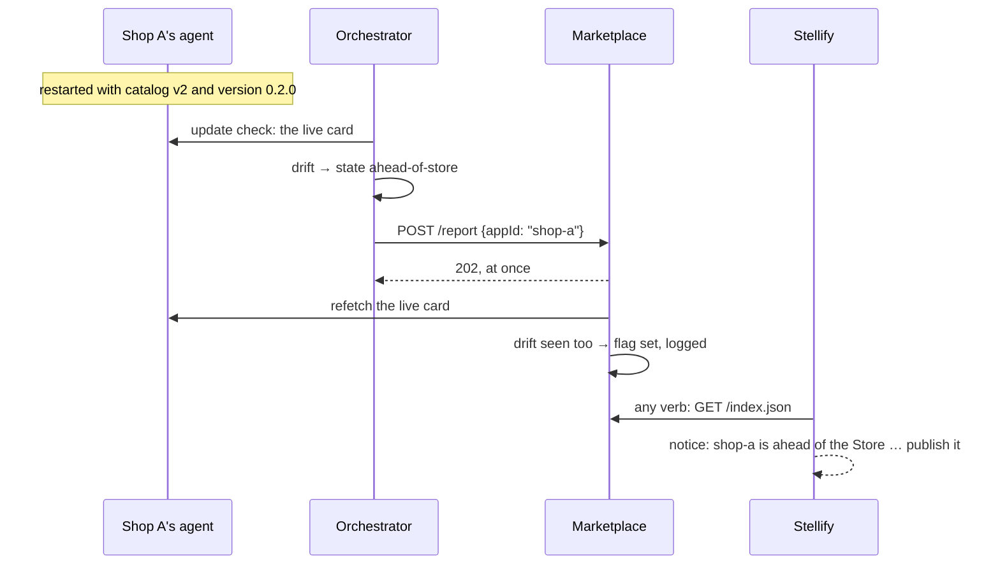

# Marketplace: how an app gets published, found and kept current

This guide explains the **marketplace**: the process where a vendor publishes an app so that any A2UIVerse can find it and install it by name alone, and the checks that keep an installed app in step with what its publisher ships next. It's written for a frontend engineer meeting A2UIVerse for the first time. It starts with the ideas, follows one app from its publisher's machine into a running A2UIVerse, then opens up the algorithms and data structures, and ends with the design decisions and where the code lives.

One example runs through the whole guide: **Shop A**, a mock camera dealer called Aperture & Co, published under the publisher name `a2uiverse-apps` and installed from the marketplace into an empty registry. It's a real publish on the deterministic apps, and every id, hash and line below is a real one. Where the guide reaches a state Shop A never showed, it borrows from **Linear**, which was pushed through the others in the same sitting. You can repeat all of it yourself (see [Trying it without a model](#trying-it-without-a-model)).

[`app-install.md`](app-install.md) is the chapter before this one: what a catalog artifact is, how Stellify packs it, and every check the orchestrator's **install** runs over a card and an artifact handed from disk. This guide assumes that and adds what comes after: who may publish what, how an app is checked before anyone sees it, how a registry installs it by id, and what "update" means when a catalog id is a version.

## Problem it solves

After `app-install.md`, an operator can install an app on their own machine: pack the catalog, point at the agent's card, done. That's a workshop, not an ecosystem. For a stranger's app to reach a stranger's canvas, three more things have to hold:

1. **Someone other than the operator puts the app somewhere, and no one else can replace it there.** A2UIVerse knows an app by its **app id** (`shop-a`) and its catalogs by their **catalog ids**. If anyone could publish anything under `shop-a`, or hand a new build for the catalog Shop A paints in, installing by name would mean nothing.
2. **The app is checked before it's listed, by behaviour as well as by files.** The install gate proves everything the files can prove and nothing about what the agent does: whether it answers, whether its first screen is in the catalog it declares, whether it paints a password box. Install can't run the agent — it isn't the operator's. Something at publish has to.
3. **"Update" has to mean something.** A2UI versions a catalog by its id and nothing else: `…/catalogs/v0.9.1/catalog.json` is the whole version. Yet a publisher fixes a colour, adds a component, changes what the agent asks for at sign-in, and the installed copy is silently behind. And the card lives at the agent's URL, so it changes with no one told: there are three copies of it — live, in the marketplace, in each registry — and only the live one says what the agent does now.

A2UIVerse answers with one more local process and a handful of rules:

- The **marketplace** (port 10002) keeps the **index** of published apps — each one's card, with its skills embedded so words can find it — hosts their catalog artifacts, and runs the **publish step**.
- A **publisher** is a name plus a secret. An app id and a catalog id belong to the publisher who first published them.
- **Publish** runs the registry's install gate over the artifacts, then a **smoke test**: one real request to the agent, judged like the hub would judge a paint. What the agent painted is kept as the listing's **preview**.
- **Install by id** is the registry's ordinary install with the card URL and the files resolved through the marketplace; the record remembers it came from there.
- The orchestrator computes each installed app's **update state** by reading three things — its record, the index entry, the live card — and installs a newer build of a catalog by itself when nothing else changed.



## Seven ideas to hold on to

### 1. A publisher is a name plus a secret

Before publishing anything, a publisher **claims** a name against the marketplace they'll publish to. The marketplace mints a **token** — 32 random bytes, spelled base64url — returns it exactly once, and stores only its SHA-256. Stellify keeps the token with the marketplace's address in the publisher's home directory, never in a checkout:

```bash
stellify claim a2uiverse-apps --marketplace http://localhost:10002
#   claimed a2uiverse-apps at http://localhost:10002 · token kept in ~/.config/stellify/publisher.json
```

From then on every publish carries that token as a bearer token, and the marketplace writes down what the publisher owns in its **ledger**, `publishers.json`:

```jsonc
// STATE_DIR/publishers.json, after the roster was published (the hash elided)
{
  "publishers": [
    {
      "name": "a2uiverse-apps",
      "tokenHash": "sha256-…",
      "claimedAt": "2026-10-11T04:18:13.294Z",
      "apps": ["shop-a", "shop-b", "github", "gmail", "circleci", "calendar", "linear"],
      "catalogs": [
        "https://github.com/retz8/a2uiverse-apps/blob/main/mocks/shop-a/shop-a-catalog/catalogs/v0.9.1/catalog.json"
        // …one per catalog this publisher first published an artifact for
      ]
    }
  ]
}
```

Two rules follow from the ledger, and they're the whole protection between publishers:

- **An app id belongs to the publisher who first published it.** Another publisher's publish of `shop-a` is refused before the marketplace fetches anything, and so is their unpublish.
- **A catalog id belongs to the publisher who first published an artifact for it**, and the marketplace keeps **one row per catalog id**. Another publisher's app naming Shop A's catalog on its card is refused whether or not it hands an artifact. The owner moves the row through any of their apps' publishes, and every app of theirs naming the id follows.

Who a publisher *is* isn't verified: that `a2uiverse-apps` is who it says is no more checked than a username. A lost token is a lost name — there's no recovery, only a new claim of a new name.

### 2. Index entry: one per app id

The marketplace serves one **entry** per published app, and lists them all in `index.json`. Here is Shop A's as published:

```jsonc
// GET /apps/shop-a/entry.json (the card trimmed)
{
  "appId": "shop-a",
  "publisher": "a2uiverse-apps",
  "cardUrl": "http://localhost:12001/.well-known/agent-card.json",
  "card": {
    "name": "Shop A",
    "description": "Aperture & Co, a boutique camera dealer stocking hand-picked bodies with condition notes and staff ratings.",
    "url": "http://localhost:12001",
    "version": "0.1.0",
    "capabilities": {"extensions": [{"uri": "https://a2ui.org/a2a-extension/a2ui/v0.9.1",
      "params": {"supportedCatalogIds": ["https://github.com/retz8/a2uiverse-apps/blob/main/mocks/shop-a/shop-a-catalog/catalogs/v0.9.1/catalog.json"]}}]},
    "skills": [{"id": "browse-cameras", "name": "Browse cameras", "examples": ["What cameras do you have?", "…"]}, {"id": "store-policy", "…": "…"}],
    "…": "the rest of the card, verbatim"
  },
  "catalogs": {
    "https://github.com/retz8/a2uiverse-apps/blob/main/mocks/shop-a/shop-a-catalog/catalogs/v0.9.1/catalog.json": "sha256-1E-0aZuqxTQPBXLthWC72x12Odzw4c71-KWbzmf4ApA"
  },
  "versions": ["0.1.0"],
  "publishedAt": "2026-10-11T04:18:13.751Z",
  "retired": []
}
```

| Field | What it holds |
| --- | --- |
| `card` | The agent card as the marketplace fetched it at publish, verbatim. Its `version` is the app's version |
| `catalogs` | Catalog id → artifact id: which **build** of each catalog this app is published with |
| `versions` | Every card version this app id has published, in order; the last is the card's |
| `retired` | Catalog ids this app once published and its card no longer names |
| `aheadOfStore` | Present only when the live card declares something the Store lacks (idea 7) |

Beside the entry sits the app's **preview**, `apps/shop-a/preview.json`, and under `artifacts/<artifactId>/` the catalog's files, in exactly the layout the orchestrator's registry serves: `artifact.json`, `index.js`, `catalog.json`, `dist/theme.css`. An install from the marketplace reads the same shapes it would read from its own disk.

### 3. Versions, at two levels

A2UI has one version for a catalog: its id. A2UIVerse keeps that and adds a level underneath:

```
catalog id      https://…/shop-a-catalog/catalogs/v0.9.1/catalog.json      the catalog's only version
  └ build       sha256-1E-0aZuq…                                           one artifact for that id
card version    0.1.0                                                       the agent's version, on the card
```

- **A build is an artifact for a held id.** A publisher who fixes a colour in Shop A's catalog packs again, gets a new artifact id, and publishes it under the same catalog id. The marketplace accepts the new build only when its schema is an **additive evolution** of the one held — nothing removed, no type changed, no constraint tightened. Removing a component is not a new build; it's a new catalog id. (The descriptor's `package.version`, `0.1.0` here, is shown and never enforced.)
- **The card's `version` is the agent's version.** A publish that changes anything on the card must carry a version this app id has never published. A publish at a version already published must leave the card exactly as it was — builds may still move. A version published before and moved past is refused.
- **An app's version, as the index and a registry see it,** is the card's version plus each catalog id at its build. That's what the update check compares.

Retirement has no verb. The publisher's duty is A2UI's migration rule: keep the agent painting in every catalog id it has published while the hub advertises it. When they publish a card that no longer names an id, that **retires the line** for the app — the marketplace records it under `retired`, and the row goes once no published app names the id.

### 4. Smoke test: the agent is asked its first screen

At publish the marketplace sends the agent one real A2A request, built the way the orchestrator will build them after install:

- It advertises exactly the **entitlement** the app will have — its declared catalog ids plus the basic catalog — as the message's `a2uiClientCapabilities`.
- Its words are the card's own: **the first skill's first example**, else "Hello! Show me what you can do.". Shop A was asked _"What cameras do you have?"_.
- It waits for the task to end (60 seconds by default) and collects every A2UI message the stream carried.

Then it judges the answer as the hub judges a paint: the task reached a terminal state; the answer **creates a surface**; every surface's catalog id is **inside the entitlement**; each surface's tree **validates against its catalog's schema**; and **no credential input** is painted. The paint is stored as the listing's preview:

```jsonc
// GET /apps/shop-a/preview.json (trimmed)
{
  "appId": "shop-a",
  "version": "0.1.0",
  "words": "What cameras do you have?",
  "messages": [
    {"version": "v0.9", "createSurface": {"surfaceId": "list", "catalogId": "https://…/shop-a-catalog/catalogs/v0.9.1/catalog.json", "sendDataModel": true}},
    {"version": "v0.9", "updateDataModel": {"surfaceId": "list", "path": "/", "value": {"items": [
      {"id": "lumen-z6", "name": "Lumen Z6", "price": 1899, "rating": 4.4},
      {"id": "kestrel-r5", "name": "Kestrel R5", "price": 3299, "rating": 4.9},
      {"id": "lumen-x100", "name": "Lumen X100", "price": 1449, "rating": 4.8},
      {"id": "verity-a7", "name": "Verity A7", "price": 2199, "rating": 4.6}]}}},
    {"version": "v0.9", "updateComponents": {"surfaceId": "list", "components": [{"id": "root", "component": "Card", "child": "body"}, "…"]}}
  ],
  "capturedBy": "marketplace",
  "capturedAt": "2026-10-11T04:18:13.432Z"
}
```

It's plain A2UI, kept so the Store page can render it through the client's ordinary loader. No render and no screenshot happen at publish.

**An agent that needs sign-in** can't be tried this way: the marketplace holds no credential, and never will. So its publish is in two halves. The marketplace still sends the request, with no credential, and the agent passes by answering as the contract says — **HTTP 401**, or a task in `auth-required` naming a scheme its card declares. The paint comes from the publisher instead: `stellify preview` runs the same smoke test on their machine, against their running agent, with a credential they supply in `STELLIFY_CREDENTIAL`, and writes a preview document marked `capturedBy: "publisher"`. Publish sends it beside the artifacts, and the marketplace checks it exactly as it checks a live paint — entitlement, schema, credential bar — before storing it. Linear's, GitHub's and the others' previews in the sitting were captured this way; Shop A's and Shop B's, which need no sign-in, by the marketplace itself.

### 5. Install by id: the same install, resolved through the marketplace

The orchestrator's install takes a card URL and packed folders, or **the app id alone**:

```bash
pnpm --filter @a2uiverse/orchestrator registry install shop-a
# installed shop-a · card 0.1.0 · catalog sha256-1E-0aZuq…
```

With the id alone the registry reads Shop A's entry from the marketplace, fetches the **live card** from the URL the entry names, reads each artifact's descriptor from the marketplace and fetches **only the files it doesn't already hold** — a file whose hash a held artifact lists is copied from disk. Then the ordinary install core runs: the same gate, the same coverage check, the same record, with one more field:

```jsonc
// registry.json, Shop A's record (the card trimmed)
{
  "id": "shop-a",
  "cardUrl": "http://localhost:12001/.well-known/agent-card.json",
  "card": {"name": "Shop A", "url": "http://localhost:12001", "version": "0.1.0", "…": "…"},
  "catalogs": {"https://…/shop-a-catalog/catalogs/v0.9.1/catalog.json": "sha256-1E-0aZuqxTQPBXLthWC72x12Odzw4c71-KWbzmf4ApA"},
  "entitlement": ["https://a2ui.org/specification/v0_9/catalogs/basic/catalog.json", "https://…/shop-a-catalog/catalogs/v0.9.1/catalog.json"],
  "installedAt": "2026-10-11T04:18:13.898Z",
  "source": "marketplace"
}
```

`source` says where the last install came by: `marketplace`, or `local` for a pack handed from disk. Only an app from the marketplace is ever moved by the index (idea 6). Install from the marketplace of an app already installed is the update: the same install-over as today, so composition over an app installed this way is unchanged from one installed by hand.

### 6. Update state: computed by the orchestrator from three things

Nothing pushes updates. The orchestrator **computes** each installed app's state whenever asked and at its boot, from the installed record, the marketplace's entry and the live card it fetches right then. There are eight states, decided in this order, the first that matches:

| State | When | Shop A or Linear showed it as |
| --- | --- | --- |
| `unknown` | the marketplace couldn't be reached, or its entry didn't parse | `shop-a  unknown  0.1.0` with the marketplace stopped |
| `not-published` | the marketplace answers 404 | `shop-b  not published  0.1.0` after `stellify unpublish shop-b` |
| `ahead-of-store` | the live card declares a catalog or a version the entry lacks | `shop-a  ahead of the Store  0.1.0  the Store lacks catalog …/v2/catalog.json and version 0.2.0` |
| `update-required` | a catalog id installed is no longer on the published card | `shop-a  update required  0.2.0 → 0.3.0  retired …/v0.9.1/catalog.json` |
| `major-update` | the published card names a catalog id the installed one doesn't, the installed ones kept | `shop-a  major update  0.1.0 → 0.2.0  new catalog …/v2/catalog.json` |
| `card-update` | the version moved with no id added or dropped; what it newly asks is read from `security` | `linear  card update  0.1.0 → 0.2.0  asks signIn: issues.write` |
| `newer-build` | only a build moved | `linear  newer build  0.1.0  catalog …/linear-catalog/catalogs/v0.9.1/catalog.json sha256-JvcQSoor… → sha256-zJbZyJNl…` |
| `up-to-date` | nothing differs | `shop-a  up to date  0.1.0` |

One state installs itself. A **newer build** of a held catalog, the card unchanged, is the publisher fixing their own code under the same contract, so the orchestrator installs it over at once — at boot before the client preloads, and whenever the check runs — journaled as `automatic`. It touches only apps whose `source` is `marketplace`, and never when the row's move would carry along an app installed from a local pack; that move is the person's, by an install by id, which carries the followers and names them. Every other state — a new catalog, a changed card, a retired line — is reported and waits for the person. (Phase 14's App Library is what shows them; until then `registry updates` prints them.)

### 7. Ahead of the Store: the live card is the only one that's true

The card exists in three copies: at the agent's URL, in the marketplace's entry, in each registry's record. Only the live one says what the agent does now, and it changes with no one told — a publisher restarts their agent with a new catalog id, or a new version asking a new scope, and hasn't published yet. A2UIVerse detects this from the live card and names it; it never prevents it.

An app is **ahead of the Store** when its live card names a catalog id the entry has no artifact for, or carries a version not among the published ones. Three parties see it:

- **The marketplace** refetches every published card at its own boot and sets the entry's `aheadOfStore` flag when it sees drift (`shop-a is ahead of the Store: catalogs …/v2/catalog.json and version 0.2.0`), clears it when the card is back in line (`shop-a is no longer ahead of the Store: its live card is covered`), and leaves it when the card can't be fetched.
- **The orchestrator** sees it from the live card in the update check and **reports** it — the app id and nothing else. The marketplace treats the report as a nudge: it refetches the card itself and sets its flag only when it sees the drift too. An install by id of such an app is refused in words that say the Store is behind, never that the app is broken. Publish's listings run the same test over each of the publisher's own apps, so the notice shows the first time Publish is opened, installed anywhere or not.
- **Stellify** tells the publisher at their next contact, on every verb, from the flag on their own entries: `notice: shop-a is ahead of the Store: its card declares catalog …/v2/catalog.json the Store has no artifact for, and version 0.2.0 the Store does not know; publish it`.

## One app, publish to install



**1. The publisher claims a name.** Once per marketplace. In the sitting the launcher did it for the roster — `dev:agents — claimed a2uiverse-apps at http://localhost:10002` — and the marketplace's log said `claimed a2uiverse-apps`. The token went into the launcher's own publisher file; a person's would go into `~/.config/stellify/publisher.json`.

**2. The publisher packs the catalog**, as in `app-install.md`: in `shop-a-catalog`, `pnpm build` then `stellify pack`, which writes `dist/artifact/` — the descriptor over `catalog.json`, `dist/theme.css` and `index.js`, whose id is `sha256-1E-0aZuq…`.

**3. Publish.** With Shop A's agent running on port 12001:

```bash
stellify publish shop-a http://localhost:12001/.well-known/agent-card.json ../shop-a-catalog/dist/artifact
# published shop-a · card 0.1.0 · catalog sha256-1E-0aZuq…
```

Stellify posts `{appId, cardUrl, catalogs: [{files}]}` to `POST /publish` with the token — the same body the registry's install takes, each file as base64. The marketplace, in order:

1. Looks up the publisher by the token's hash; refuses 401 when none matches.
2. Checks **who owns `shop-a`**: no one yet, so on. Another publisher's id would be refused here, alone, before anything is fetched.
3. **Fetches the live card** from the URL given (10 seconds), and requires a `version` and a `description` on it.
4. Reads the catalog ids the card declares and checks **who owns each**. Shop A's is unclaimed, so on.
5. Runs the **static gate** over the artifact — descriptor, every file at its hash, host interface `0.9.1`, the schema compiling under its own id — and checks **coverage both ways**: every declared id handed, public, or already held by the marketplace for this publisher; every artifact handed for a declared id.
6. Applies the **version rule**: a first publish, nothing to compare.
7. Applies the **preview rule**: Shop A's card requires no sign-in, so no preview may be handed — the marketplace will capture it.
8. Runs the **smoke test**: one request, _"What cameras do you have?"_, advertising `[basic, shop-a's catalog]`. The agent answers with the `list` surface above and completes. Every check over the paint passes.
9. **Commits**: the artifact written under its id; the ledger gaining `shop-a` and its catalog id for `a2uiverse-apps`; the entry and the preview written; the card **embedded** for search; `index.json` regenerated.

It answers with the summary line and the **notes** the commit produced — here `app id "shop-a" is now a2uiverse-apps's` and `catalog "…/shop-a-catalog/catalogs/v0.9.1/catalog.json" is now a2uiverse-apps's`. Stellify prints each under the summary as `note: …`, word for word. The marketplace's log: `published shop-a · card 0.1.0 · catalog sha256-1E-0aZuq… (by a2uiverse-apps)`.

Every finding after step 4 is collected and answered together, as install answers, so a publisher sees everything to fix in one go; a refusal prints `refused shop-a:` and each finding indented, and exits 1.

**4. Found.** The index is searchable by words, ranked the way the Router ranks installed apps:

```bash
pnpm --filter @a2uiverse/marketplace marketplace search "camera prices"
# shop-b  Shop B  0.411
# shop-a  Shop A  0.379
```

Every entry comes back with its score, in rank order. Phase 14's Store page and Phase 15's Router miss will call this route; today the command proves it.

**5. Install by id.** From any machine running an orchestrator pointed at this marketplace:

```bash
pnpm --filter @a2uiverse/orchestrator registry install shop-a
# installed shop-a · card 0.1.0 · catalog sha256-1E-0aZuq…
```

The command posts `{appId: "shop-a"}` and nothing else to `POST /registry/install` with the write token. The registry reads the entry, fetches the live card from `http://localhost:12001/.well-known/agent-card.json`, finds no drift between the two, fetches the artifact's descriptor and then each of its three files — none held yet in an empty registry — and runs the install core with `source: "marketplace"`. The journal gets its line:

```json
{"kind":"registry","at":"2026-10-11T04:18:13.900Z","operation":"install","appId":"shop-a","cardUrl":"http://localhost:12001/.well-known/agent-card.json","catalogs":[{"catalogId":"https://…/shop-a-catalog/catalogs/v0.9.1/catalog.json","artifact":"sha256-1E-0aZuqxTQPBXLthWC72x12Odzw4c71-KWbzmf4ApA"}],"outcome":"installed","source":"marketplace"}
```

Every byte of the artifact in the registry is identical to the marketplace's: the same hash tree, checked at both ends.

**6. Composed.** _"Compare camera prices across both shops"_ dispatches to Shop A and Shop B, each paints in its own catalog, and the merged view joins them — Lumen Z6 Shop A's alone, Orbit GM3 Shop B's alone, the rest matched across both. Nothing about composition knows where an app was installed from; that's the phase's invariant, and the sitting checked it on all three compositions.

**7. Kept current.** `registry updates` runs the check and prints `shop-a  up to date  0.1.0`. The next time the publisher ships, the line changes — the states and what moves by itself are idea 6, and [Update check](#update-check-eight-states-one-operation) below has the algorithm.

## Inside the machinery

### Claim, token and the ledger

`apps/marketplace/src/marketplace.ts` (`claim`, `publisherOf`) and `store.ts`.

- **The name** has the app id's grammar: lowercase letters, digits and hyphens, starting with a letter, `shell` reserved. A taken name answers `409`; one the grammar refuses, `422`.
- **The token** is minted with Web Crypto (`mintPublisherToken` in the sdk): 32 random bytes, base64url, no padding, so it's 43 characters and safe in a header. The marketplace stores `hashPublisherToken(token)` — SHA-256 in the artifact hashes' `sha256-<base64>` form — and never the token.
- **Checking a token** hashes what was presented and compares it against every publisher's hash with `timingSafeEqual`, so a wrong token costs the same time as a right one. The guard on `publish` and `unpublish` answers `401` when no publisher matches.
- **The ledger**, `publishers.json`, is written owner-only (`0600`), whole, through a temporary file and a rename. It holds, per publisher, the `apps` and `catalogs` they first published, and `unpublished`: for each app id they've taken down, the versions it published and its last card, so a later publish of that id still obeys the version rule ([Unpublish](#unpublish-the-names-stay) below).

Owner-only is checked at three points in a publish, each answering `403` with one finding and nothing else: the app id before the card is fetched; each catalog id the card declares after it's read; each catalog id an artifact was handed for after the gate. The ledger's owner of a catalog id is whoever first published an artifact for it, which is why a publish can be refused for a catalog id the card names even when no artifact was handed.

### Publish, in order

`Marketplace.#publish`. The order matters, because two kinds of answer come out of it:



**Forbidden answers alone.** Another publisher's name is a question of ownership, not of the app's quality; the publisher gets that one line and no more.

**Everything else is collected**, in this order, and answered as one `422` list:

1. The static gate over each handed artifact — the sdk's `gateArtifact`, the same function the registry's install runs, so both refuse the same files for the same reasons.
2. No two artifacts for one id; none for the basic or the shell catalog, which the client provides.
3. Coverage both ways — `checkCoverage(declared, handed, public ∪ ownedHeld)`. The third set is what makes a card-only publish possible: a catalog id the marketplace already holds a row for, owned by this publisher, counts as covered. A publish that changes the card alone hands nothing, and its note says `catalog "…": the held build counts as covered`.
4. For each handed artifact whose id already has a row at another build, `checkAdditiveEvolution(heldSchema, newSchema)` ([below](#additive-evolution-what-a-build-may-change)).
5. The version rule against this app id's history — its entry, or its `unpublished` record when it has none: same version, the card must be byte-equal as canonical JSON (`the card changed, but version "0.1.0" is already published: …`); a version in `versions` but not the last, refused (`version "0.1.0" was published before and moved past: …`); a new version, accepted.
6. The preview rule: a card that requires sign-in — an OR of ANDs under `security`, every alternative non-empty — must hand a preview, captured by the publisher, for this app id, at this card version; a card that doesn't must hand none.

**The smoke test** then runs ([below](#smoke-test-one-request-judged-like-a-paint)). For an open app its paint becomes the preview; for a sign-in app the handed preview is checked with `checkPaint` while the live answer is checked with `checkSignInAnswer`.

**The commit** writes in an order that leaves the marketplace consistent at every step: the card embedded first; each artifact written under its id (skipped if already there); the ledger updated; each catalog row resolved — the handed build, or the held build; every other entry of this publisher naming a moved id pointed at the new build (`catalog "…" moved to a new build, followed by: linear-admin`); the lines retired computed with the sdk's `retiredLines(previousIds, nowIds)` and noted (`catalog "…/v0.9.1/catalog.json" retired for shop-a`); the entry assembled — `versions` extended when the version is new — and written, then the followers' entries, the preview, the ledger; `index.json` regenerated; every artifact no entry names any more removed.

**The summary** (`publishSummary`) is a diff of the old entry and the new, joined by `·`: `published` or `republished`, the card version (`0.1.0 → 0.2.0` when it moved), each catalog's build (`old → new` when it moved, `<id> new at <build>`, `<id> gone`), or `basic catalog` for a card declaring none.

### Smoke test: one request, judged like a paint

Two pieces: a **transport** that sends the request and reports what it saw, and the sdk's **checks** that judge it. The split matters because Stellify's `preview` reuses the checks with its own transport.

**The transport** (`apps/marketplace/src/smoke.ts`) builds an `@a2a-js/sdk` client from the fetched card, and sends one streaming message: a text part with the words, `a2uiClientCapabilities` set to the entitlement, the A2UI extension (its v0.9.1 URI and the earlier v0.9 one) activated as the orchestrator activates it. It reads the stream to its end and reports one of four things:

| Observation | When |
| --- | --- |
| `unauthorized` | any HTTP response was 401 |
| `ended` with a state | a final `message`; a `status-update` marked final; or a `task` in a terminal state or `auth-required` — with every A2UI message collected, the status message's text, and its `auth-required` data part when it had one |
| `unfinished` | the stream closed with none of those |
| `error` | the request couldn't be made, or 60 seconds passed |

**The judgement** differs by the card. For an **open app**: `unauthorized` is a finding (`the agent answered 401, but its card requires no sign-in`), `unfinished` and `error` are findings, `ended` as `failed`, `canceled` or `rejected` is a finding carrying the agent's own words, and anything else hands its messages to `checkPaint`. For a **sign-in app**: `checkSignInAnswer` passes a 401, or an `auth-required` whose security requirement names only schemes the card declares, and refuses everything else with what it saw instead.

**`checkPaint`** (`packages/sdk/js/src/smoke.ts`) groups the messages by surface and refuses any of: no `createSurface` at all; a surface with no `catalogId`; a catalog id outside the entitlement; a catalog whose schema the checker doesn't hold; a tree that fails the sdk's A2UI validator against that schema; a credential input in any `updateComponents`, found by the same `credentialInputIn` the hub uses.

One detail makes the validator fair to a streaming agent. An agent on the kit streams its tree as it writes it: several `updateComponents`, each sending the whole tree so far, a component half-written until a later copy completes it. Validating each message alone would refuse every honest first copy. So `settled()` collapses a surface's `updateComponents` into one, keeping the **last copy of each component by id** and only those reachable from `root`, in place of the first update — the tree **as it stands when the answer ends**, which is what the client draws.

### Additive evolution: what a build may change

`packages/sdk/js/src/evolution.ts`, `checkAdditiveEvolution(held, next)`. It's a fixed structural walk of the held schema against the new one — the two files as the gate read them, a `$ref` compared as a string and never resolved — never a semantic subsumption of two JSON Schemas. That keeps it predictable: a publisher can read the list and know what will pass.

| Refused | Accepted |
| --- | --- |
| a component, a function or a `$defs` entry removed | a component, a function or a property added |
| a property removed, or a property becoming required | a property no longer required |
| an enum value removed; an enum added where there was none | an enum value added |
| `type`, `$ref` or `const` differing, added or removed at any node | annotations (`description`, `title`) changing freely |
| a constraint tightened: `minLength` up, `maxItems` down, a `pattern` changed, `additionalProperties` closed, `uniqueItems` added | a constraint loosened or dropped |
| an `anyOf`/`oneOf` added, or either losing an entry; an `allOf` gaining an entry | any other keyword, ignored |

Each finding names the component or function and the path, which is how the sitting's refusals read: `components/Video: removed`, `components/Avatar/properties/size/enum: "large" removed`, `components/PriorityIcon: removed`.

It runs at two places with two conditions. **At publish, always**, whenever a handed build moves a row held at another build — because the row is the marketplace's promise to every app of that publisher naming the id. **At install, when the move would carry another installed app with it** — an app alone on its row moves it freely, since its own install-over is the operator's act; the refusal then names the apps that render in the held build.

One consequence to know: an additive change, once published at a catalog id, can't be taken back by publishing the earlier schema again — to the marketplace that's a removal. The sitting hit this reverting Linear's probe build, and reset the marketplace instead.

### Index: embedding and search

Searching the marketplace and routing a question on the orchestrator are **one mechanism over two indexes**, and they share their code in `packages/embedder`:

- **The corpus document** (`corpusDoc`) turns a card into one text: its name, its description, then each skill's name, description, tags and examples, one per line. The Router embeds an installed card this way; the marketplace embeds a published one the same way, so a question ranks the same against both.
- **The embedder** is a small sentence-transformer (`Xenova/all-MiniLM-L6-v2`, about 23 MB) run in-process; the first boot downloads it into `STATE_DIR/models`. The orchestrator keeps its own copy.
- **Ranking** is cosine similarity against every entry's vector, highest first, every entry returned with its score. There's no threshold: `"failing builds"` ranks CircleCI first at 0.371 and still lists the other six.

Vectors live in memory only. The marketplace embeds every card at boot and each one again at its publish; nothing on disk holds an embedding, so a change of model is a restart, not a migration.

### Store on disk

`apps/marketplace/src/store.ts`. The served subtree **is** the truth: the process boots from it alone, and a plain directory in the same layout answers every read route with no marketplace running.

```
STATE_DIR/
  public/                           served at the root of the port
    index.json                      every entry, regenerated after each write
    apps/shop-a/entry.json
    apps/shop-a/preview.json
    artifacts/sha256-1E-0aZuq…/     artifact.json, index.js, catalog.json, dist/theme.css
  publishers.json                   the ledger, owner-only, never served
  models/                           the embedding model's cache
```

- **Every write is a temporary file or directory renamed into place**, and writes run one at a time through a promise chain (`#serial`), as the registry's do. A crash leaves the old state or the new, never half.
- **The boot verifies everything**: each entry and preview through the sdk's validators, the entry's `appId` against its directory name, every artifact's files re-hashed against its descriptor, the ledger's shape. A damaged file stops the boot naming its path. An empty directory is a valid, empty marketplace.
- **The card refresh runs after the port is up**, in the background, so a publisher's agent being down never delays a read.

### Ahead of the Store: detect, report, flag, tell

The drift test is one sdk function, `aheadOfStore(entry, liveCard)`: the live card's declared catalog ids that are neither in `entry.catalogs` nor public, and its version when it isn't in `entry.versions`. A live agent *behind* the index is not ahead of it. A malformed declaration is a finding, not drift.



**The marketplace's half** (`Marketplace.report`, `refreshCards`): a report is accepted at once (`202`) from anyone, carrying the app id and nothing about the person. One refetch is kept in flight per app id, so a burst of reports costs one fetch. `#verify` fetches the card, runs the drift test, and changes the flag only inside the serial queue: set, changed, cleared, or left — a card that can't be fetched, or has no version, leaves the flag as it was. The boot's refresh is the same call over every entry. What it did is logged as a line only when something is to say: the flag it stands at, or its clearing.

**The orchestrator's half** (`UpdateCheck`): an app whose live card shows drift is reported on every check. So is an app the Store still **flags** while this run's live card shows **no** drift — the agent moved back, or the publisher published from another machine — so the marketplace looks again and clears a flag it no longer bears out; the boot log says `the Store flags shop-a as ahead, its card no longer — reported to the marketplace to look again`. An install by id of a drifted app is refused on either half of the drift with `storeBehind`: `the Store is behind shop-a: its card now declares catalog … and version 0.2.0 that the Store does not have yet; the publisher is told at their next contact with the Store, and the install can be tried again once they have published`. The marketplace's flag alone never refuses an install — the orchestrator judges from the card it fetched itself. Publish reads its listings through `listings.json?publisher=<name>`: each of that publisher's entries has its app's live card fetched again, given five seconds, and the drift test run; the listing carries the drift as the card shows it now, and where that differs from the Store's flag the marketplace gets the report, so its own flag catches up for every reader. A card that doesn't answer in time leaves the Store's flag.

**Stellify's half** (`notices.ts`): every verb that reaches the marketplace first reads `index.json`, keeps the entries whose `publisher` is its own and whose `aheadOfStore` is set, and prints one notice per app to stderr before doing anything else. `list` prints the same inline.

### Install by id, inside the orchestrator

`Registry.installFromMarketplace` in `apps/orchestrator/src/registry/registry.ts`, over `MarketplaceClient` in `registry/marketplace.ts`. [`orchestrator.md`](orchestrator.md#registry-whats-installed) places it among the orchestrator's operations; here is its path:

1. The app id is checked (`checkAppId`), and a marketplace must be configured — `MARKETPLACE_URL`, `http://localhost:10002` by default, every request under `A2UIVERSE_MARKETPLACE_TIMEOUT_SECONDS`, 10 by default.
2. The **entry** is read. Four outcomes: `entry`; `not-published` (404 → `app "shop-b" is not published on the marketplace at http://localhost:10002`); `unreached` (no answer, a timeout, or an unexpected status → `the marketplace at http://localhost:10002 could not be reached: ECONNREFUSED`); `malformed` (not an entry by the sdk's schema, or another app's).
3. The **live card** is fetched from `entry.cardUrl` — the registry's own fetch, the same one install from disk uses.
4. **Drift** is tested; any refuses with the Store-behind words and posts a report.
5. Each artifact the entry names is **resolved**. One already held is read whole from disk. Otherwise its descriptor is fetched and parsed, and then file by file: the registry keeps a map from **file hash → a held artifact and path** (`#heldFiles`), so a file an earlier build also shipped is copied from disk and only the rest is fetched. A rebuilt `index.js` is fetched; an unchanged `catalog.json` or stylesheet is not.
6. The ordinary `#install` runs with the card already fetched, `source: 'marketplace'`, and `automatic` when the update check is the caller.

Every refusal along the way is journaled as a `registry` line with `outcome: "refused"` and `source: "marketplace"`, so a Store-behind refusal shows in the journal like any other.

The journal's registry line gained three fields in this phase: `source`, where the install came by; `followed`, the other installed apps whose row this install moved; and `automatic: true` when the update check did it. The install summary names followers too: `updated linear · card 0.1.0 · catalog sha256-JvcQSoor… → sha256-zJbZyJNl… · linear-admin followed`.

### Update check: eight states, one operation

`apps/orchestrator/src/registry/updates.ts`. Behind `GET /registry/updates.json` (no token) and the boot; concurrent calls join the one in flight. [`orchestrator.md`](orchestrator.md#registry-whats-installed) has the full account; the shape of one run:

1. **Fetch, in parallel**: one entry per installed app from the marketplace, and every app's live card again (`Registry.refetchLiveCards` — a card that answers replaces the one held and its search vector is recomputed when it changed; one that doesn't answer leaves the one held). The states are judged on the card the agent serves *now*, never one fetched at boot.
2. If any entry lookup was `unreached`, every state is `unknown` and the run says why. The boot prints it once: `marketplace at http://localhost:10002 unreached (ECONNREFUSED) — update states unknown until the next check`.
3. Per app, `updateStateOf(record, lookup, liveCard)` walks the precedence of idea 6. Two sdk functions do the comparing: `aheadOfStore` over the live card, and `retiredLines(installedIds, publishedIds)` — the installed card's declared ids as the earlier list, the published card's as the later — whose non-empty result is `update-required`. `major-update` is a published id not among the installed; `card-update` is a version that moved with neither; its `newScopes` are read from the two cards' `security`, per scheme, the way the vault reads consent — every scope of a scheme the installed card never named. `newer-build` is any catalog whose artifact id differs.
4. **Side effects**, each once per app: `ahead-of-store` posts a report; flagged-but-clear posts one too; `newer-build` on a `marketplace`-sourced record either installs over through `installFromMarketplace(id, {automatic: true})` — the state then recomputed over the new record — or, when `localFollowers` finds an app from a local pack on the moving row, is left in place and named (`automatic update of linear-admin left undone: it would move linear, installed from a local pack — install linear-admin by id to move them together`). A failed automatic install leaves the build and the state, named with its findings, tried again next time.
5. The states come back sorted by app id.

A GET with a side effect is deliberate: the one thing it does is converge the registry to where the next check would take it anyway, every move journaled, so the App Library can ask for fresh states from the browser with no token.

### Unpublish: the names stay

`Marketplace.unpublish`. The owner's token, the whole app: `404` when not published, `403` for another's. The app's directory goes — entry and preview — and so do its vector and any artifact no remaining entry names. The index is regenerated. Registries that installed the app keep it; their update check reads `not-published` from the 404.

What stays: the app id and the catalog ids remain the publisher's in the ledger, and the ledger's `unpublished` keeps the id's `versions` and its last `card`. A republish of the same card at the last version is accepted (`shop-b is listed again`); a changed card at that version is refused as a changed card always is; an earlier version is refused as moved past. Without this, an unpublish would reset the id's history and let a changed card reuse a version a registry already holds.

### Stellify's side

Stellify's four marketplace verbs and `list` are plain functions (`packages/stellify/src/verbs.ts`), each taking the marketplace's address and the token **explicitly** and returning the marketplace's answer or its findings, never throwing on a refusal. Only the command line reads the publisher file (`publisher.ts`): `publisher.json` under `stellify` in the XDG configuration directory, or wherever `STELLIFY_HOME` points, written `0600` through a rename, one publisher per machine, `--replace` to claim another name. The launcher uses the functions with a token of its own and never touches that file.

`preview` (`preview.ts`) is the smoke test moved to the publisher's machine: it fetches the live card, picks the header the credential rides in from the card's `security` and `securitySchemes` as the orchestrator will after install (a bearer `Authorization` header for OAuth, OpenID Connect and `http` bearer; the named header for `apiKey`), gates each handed artifact so a folder that would fail at publish fails here first, fetches from the marketplace the schema of any declared catalog it already holds for this publisher, sends the same request through the same kind of transport, judges it as the marketplace judges a live paint — a 401 or an `auth-required` with the credential sent is a finding — and runs `checkPaint`. The document it writes is the one `publish` hands over, `capturedBy: "publisher"`. For a card that needs no sign-in it still runs, with no credential, so a developer sees the screen the Store will show.

### Dev harness: the launcher under `--publish`

`scripts/dev-agents.mjs` with `launch-marketplace.mjs` and `launch-preview.mjs`. `pnpm dev:all --publish` (`--tier default,mocks` to run both tiers in one launch) puts every roster app through the marketplace instead of installing from the checkout:

- **The dev publisher** is one fixed name, `a2uiverse-apps`, kept in the launcher's own file, `scripts/.state/stellify/publisher.json`, in the shape of Stellify's. Before any publish it's **established**: no file, the name is claimed; a file, the token is probed with an unpublish of the reserved id `shell` — a `401` means the marketplace no longer knows the token (its state was wiped), so the name is claimed again and the file rewritten (`claimed a2uiverse-apps again … it no longer knew the token`); a `409` means the name is held under a token the launcher doesn't have, and the marketplace path stops with words saying so.
- **Each app**, once its card answers: a card that requires sign-in is previewed first, with a credential the launcher obtains from the kit's preview credential command — under `--mode live`, from a deterministic instance of the same checkout on a free port, since the kit issues no credential against a live agent; then published against the live card; then installed by id. A refused preview, publish or install leaves that app out, named with its reason.
- The launcher never unpublishes; the reconcile stays the registry's. The notices for the dev publisher's apps this launch didn't publish print at the end.

## When things go wrong

| What happened | What you see |
| --- | --- |
| Another publisher's app id or catalog id | `refused aperture-copy:` then one line, `catalog "…" belongs to publisher "a2uiverse-apps"`; `403`; nothing fetched or stored |
| The card can't be fetched at publish | `the card at … could not be fetched: …`, with everything else found, `422` |
| A sign-in app published with no preview | `the card requires sign-in: publish needs the preview `stellify preview` captures with your own credential` |
| A preview handed for an open app, or at another version | `a preview is only taken for an app whose card requires sign-in …`; `the preview was captured at version "0.1.0", the card is at "0.2.0"` |
| A build removes something | `catalog artifact 1 (…): components/Video: removed`; the row stays where it was |
| The card changed at a published version | `the card changed, but version "0.1.0" is already published: a changed card carries a version this app id has never published` |
| The agent never finishes, fails, or paints nothing | `the agent never finished: the stream ended without a final event`; `the agent ended the task as failed: …`; `the answer paints nothing: no createSurface` |
| The agent paints outside its entitlement | `surface "list" is painted in catalog "…", outside the entitlement` |
| The token isn't one the marketplace knows | `401`; Stellify says the name was claimed elsewhere or the marketplace was reset, and to claim again with `--replace` |
| The marketplace is down at install or check | `registry install` refused: `the marketplace at http://localhost:10002 could not be reached: ECONNREFUSED`; `registry updates` prints every app `unknown`; the boot says so once |
| The app isn't published | `app "shop-b" is not published on the marketplace at http://localhost:10002`; the check reads `not published` |
| The live card is ahead of the Store | The install refused in the Store-behind words; the report sent; the publisher sees the notice on their next verb |
| An automatic update would carry a local-pack app | Left undone, the boot naming the apps it would move; install by id moves them together |
| The marketplace's state directory is damaged | The boot stops, naming the file and the problem |

## Design decisions

| Decision | What it buys | What it costs |
| --- | --- | --- |
| **A publisher is a name plus a secret, claimed once** | Publishing needs no account system; owner-only follows from the ledger alone | Identity is not verified; a lost token is a lost name |
| **App ids and catalog ids are owner-only; one row per catalog id** | No publisher replaces another's app or the catalog it renders in; a shared catalog has one owner who moves it for all their apps | A second publisher can't build on another's catalog id; a name can't be transferred |
| **The gate is the sdk's, run at publish and at install** | The marketplace and every registry refuse the same files for the same reasons | A change to a check changes both processes at once |
| **Behaviour is checked at publish, with one real request** | An app that doesn't answer, paints outside its catalog, or paints a password box is never listed; the preview comes for free | One request proves one screen; the marketplace must reach the agent at publish |
| **A sign-in app's paint is captured by the publisher** | No credential ever reaches the marketplace; the paint passes every check a live one does | The paint is verified offline, so a publisher could capture one their agent never made |
| **A catalog id is the catalog's only version; a build within it must be additive** | A fix to a catalog is one publish, and nothing an installed app renders in is removed under it; the client refuses an invalid tree rather than degrading, so the rule must hold | A breaking change is a new catalog id and a migration; a published addition can't be taken back at the same id |
| **The card's `version` is the app's, and a changed card needs a new one** | A registry can tell a changed card from the same one by one string; an unpublished id's history still holds | A publisher must bump the version for any card change, a description's typo included |
| **Retirement by publish, no verb** | A2UI's migration rule becomes a recorded fact the update check reads as `update-required` | The marketplace records the line retired; it cannot make the agent keep painting in it |
| **Artifacts hosted in the registry's layout, immutable** | An install fetches only the files it lacks, and a plain directory stands in for the process | Every artifact lives twice, in the marketplace and in each registry |
| **One embedder and one corpus document for both indexes** | A question ranks the same against the Store and the registry; Phase 15's miss-to-hit needs no second tuning | A change of model re-ranks both at once; a 23 MB download per process |
| **The update state is computed by the orchestrator, from three things** | No push channel, no subscription; each registry judges on the card the agent serves now | A check costs one fetch per app at the marketplace and one at each agent |
| **A newer build installs itself; everything else waits for the person** | The publisher's own fix under the same contract lands with no one asked; a new catalog, a new scope or a retired line is never applied behind the person's back | A read with a side effect; an app from a local pack is never moved, nor carried |
| **Ahead of the Store is detected from the live card, reported, verified, and told — never prevented** | An agent that moved without a publish is named within one check, the Store refuses to hand a stale build, and the publisher is told where it matters | The listing waits on the publisher; nothing stops them changing the agent |
| **The marketplace's state is files, every write a rename, the served subtree the truth** | Nothing runs beside the process; the boot verifies all of it; a static directory answers the reads | One marketplace per state directory; embeddings are rebuilt at every boot |

## Known limits

- **Identity is not verified.** That the publisher `github` is GitHub is nobody's claim but theirs; lookalike review and publisher verification are out of scope ([SPEC.md](../../SPEC.md) §16, §17).
- **A sign-in app's preview is trusted.** The marketplace checks a publisher-captured paint as it checks a live one, but it can't know the agent painted it.
- **One request, one screen.** The smoke test proves the agent's first answer in its catalog; it says nothing about the second.
- **An agent on the kit can't keep an old line beside a new one.** The kit's card names one catalog id, from its one `catalog.json`, so every catalog-id change on the kit retires the line at once; the sitting's major update needed a temporary patch to name both. Recorded for Phase 15's migration window.
- **A published addition can't be undone at the same id**: the marketplace reads the earlier schema as a removal. The way back is a new catalog id, or a reset marketplace.
- **The flag can lag the agent.** The marketplace sees drift at its boot and on reports; an agent that moves while no registry checks is flagged only at the next check or boot.
- **No pagination, no threshold.** `index.json` lists every entry, and search returns all of them with their scores; fine for a roster, not for a thousand apps.
- **Unpublish takes the whole app.** One version alone can't be unpublished (SPEC §17).
- **The Store page and the canvas's part are later phases.** Today the states are read with `registry updates`, the notices with Stellify, the search with the `marketplace` command; Phase 14 draws the Store page and the App Library over them, Phase 15 the tile for an app ahead of the Store.

## Trying it without a model

Publishing and installing need no model; the roster's deterministic mode answers the smoke test from its scripted data. The embedding model (not a language model) is downloaded once per process.

- **The whole roster, through the marketplace.** `pnpm dev:marketplace` in one terminal, then `pnpm dev:all --publish --tier default,mocks`. Read: the claim, each app's `published … · card 0.1.0 · catalog …` and `installed … · card 0.1.0 · catalog …` at the same build, then `pnpm --filter @a2uiverse/orchestrator registry list` (every source `marketplace`) and `registry updates` (all `up to date`). For a fresh marketplace, stop it and wipe `apps/marketplace/.state` but keep its `models/`; the launcher's publisher file in `scripts/.state/stellify/` can stay — the launch claims the name again.
- **One app by hand.** With Shop A's agent up and `STELLIFY_HOME` pointed at the launcher's publisher directory (or a name of your own claimed first): in `../a2uiverse-apps/mocks/shop-a/shop-a-catalog`, `pnpm build && pnpm exec stellify pack`, then `pnpm exec stellify publish shop-a http://localhost:12001/.well-known/agent-card.json dist/artifact`; `pnpm exec stellify list`; `curl localhost:10002/apps/shop-a/entry.json` and `…/preview.json`; `pnpm --filter @a2uiverse/marketplace marketplace search "camera prices"`; `registry install shop-a`; `registry updates`.
- **Each update state.** Change Shop A's `version` in its agent config (`mocks/shop-a/agent/app/config.py`) and restart the agent: `registry updates` reads `ahead of the Store`, `registry install shop-a` is refused in the Store-behind words, `stellify list` prints the notice. Publish at the new version: `card update`. Install by id: `up to date`. A visible change to the catalog's implementation, packed and published at the same version: `newer build` for an app from a local pack, `up to date` with an automatic journal line for one from the marketplace. `stellify unpublish shop-b`: `not published`, and the search without it. Stop the marketplace: every app `unknown`.
- **The tests.** The marketplace's (`pnpm --filter @a2uiverse/marketplace test`) stand up a scripted A2A agent in-process (`test/fakeAgent.ts`) and drive every route and refusal through it — `marketplace.test.ts` for the publish order and its findings, `smoke.test.ts` for the transport, `store.test.ts` for the boot's verification. The orchestrator's `test/registryMarketplace.test.ts` and `test/updates.test.ts` install by id and compute every state against a fake marketplace (`test/fakeMarketplace.ts`). Stellify's `test/verbs.test.ts` and `test/preview.test.ts` drive the verbs against its own fakes and assert on the wire. The sdk's `evolution.test.ts`, `drift.test.ts`, `retirement.test.ts` and `smoke.test.ts` pin the rules, and `marketplace.contract.test.ts` holds the schemas equal to the JSON in `packages/sdk/contracts/`.

## Where the code is

| Concern | sdk (`packages/sdk`) | Marketplace (`apps/marketplace/src`) | Orchestrator (`apps/orchestrator/src`) | Stellify (`packages/stellify/src`) · scripts |
| --- | --- | --- | --- | --- |
| The contracts: routes, entry, preview, bodies, update states | `contracts/marketplace.json`, `marketplace-entry.schema.json`, `marketplace-preview.schema.json`; `js/src/marketplace.ts` | | | |
| Publisher name and token | `js/src/marketplace.ts` | `marketplace.ts` (`claim`, `publisherOf`), `store.ts` (`publishers.json`) | | `publisher.ts` · `scripts/launch-marketplace.mjs` |
| Publish, in order; the summary; unpublish | | `marketplace.ts` (`#publish`, `publishSummary`, `unpublish`) | | `verbs.ts`, `marketplace.ts` |
| The gate and coverage | `js/src/gate.ts`, `catalog.ts` | | | |
| Additive evolution | `js/src/evolution.ts` | | `registry/registry.ts` (`#install`) | |
| Retirement | `js/src/retirement.ts` | | `registry/updates.ts`, `registry/registry.ts` (`#commit`) | |
| Smoke test: words, paint check, sign-in check | `js/src/smoke.ts`, `credential.ts` | `smoke.ts` (transport), `marketplace.ts` (the judgement) | | `preview.ts`, `transport.ts`, `credential.ts` |
| Embedding and search | | `marketplace.ts` (`search`) | `router/router.ts` | |
| The embedder, the corpus document, cosine | `packages/embedder/src/` — shared with the orchestrator | | | |
| Ahead of the Store | `js/src/drift.ts` | `marketplace.ts` (`report`, `refreshCards`), `api.ts` (`reportLine`) | `registry/updates.ts`, `registry/registry.ts` (`storeBehind`) | `notices.ts` |
| Routes and the state directory | | `api.ts`, `store.ts`, `app.ts`, `config.ts`, `index.ts` | | |
| Install by id | | | `registry/marketplace.ts`, `registry/registry.ts` (`installFromMarketplace`), `registry/api.ts`, `registry/command.ts` | |
| The update check and the automatic build update | | | `registry/updates.ts`, `app.ts` (the boot's check), `index.ts` (its lines) | |
| The launcher under `--publish` | | | | `scripts/dev-agents.mjs`, `launch-marketplace.mjs`, `launch-preview.mjs` |
| Tests and fakes | `js/src/*.test.ts` | `../test/marketplace.test.ts`, `api.test.ts`, `smoke.test.ts`, `store.test.ts`, `fakeAgent.ts` | `../test/registryMarketplace.test.ts`, `updates.test.ts`, `fakeMarketplace.ts` | `../test/verbs.test.ts`, `preview.test.ts`, `fakeMarketplace.ts`, `fakeAgent.ts` |

## Words used in this guide

| Word | Meaning |
| --- | --- |
| **Marketplace** | The process that keeps the index, hosts the artifacts and runs the publish step; port 10002 |
| **Store** | What the person will browse (Phase 14); in the words the platform prints, the marketplace as seen from a registry |
| **Publisher** | A name plus a secret: the token minted at the claim, kept in the publisher's home directory |
| **Claim** | Registering a publisher name once; the token is returned once and stored as its hash |
| **Ledger** | `publishers.json`: each publisher's token hash and the app ids and catalog ids they own |
| **Owner-only** | An app id or a catalog id may be published over only by the publisher who first published it |
| **Index** | Every published app's entry; `index.json` lists them, each embedded for search |
| **Entry** | One app's listing: its card as published, each catalog at its build, its versions, its retired lines, its flag |
| **Build** | One artifact for a catalog id, named by its artifact id |
| **Additive evolution** | What a new build may change: nothing removed, no type changed, no constraint tightened |
| **Card version** | The card's `version`: the agent's version, which must move when the card changes |
| **Retired line** | A catalog id an app once published and its current card no longer names |
| **Row** | The marketplace's one build per catalog id; moved by its owner, followed by every app naming the id |
| **Smoke test** | The one A2A request sent at publish, with the app's entitlement and the card's own words, judged like a paint |
| **Preview** | The smoke test's paint, kept beside the entry for the Store page; captured by the marketplace or by the publisher |
| **Coverage** | Every catalog the card declares is handed, public or already held for this publisher; every artifact handed is declared |
| **Install by id** | The registry's install with the card URL and the files resolved through the marketplace |
| **Source** | On an installed record, where its last install came by: `marketplace` or `local` |
| **Update state** | One of eight, per installed app, computed from the record, the entry and the live card |
| **Automatic update** | The orchestrator installing a newer build over an app from the marketplace by itself, journaled |
| **Live card** | The card at the agent's URL now; the only copy that says what the agent does |
| **Ahead of the Store** | A live card declaring a catalog id or a version the entry lacks |
| **Report** | A registry telling the marketplace an app may be ahead; a nudge the marketplace verifies itself |
| **Flag** | `aheadOfStore` on an entry: what the Store lacks and when it saw it |
| **Notice** | What Stellify prints at every contact for the publisher's own flagged apps |
| **Dev publisher** | `a2uiverse-apps`, the name the launcher claims and publishes the roster under |
