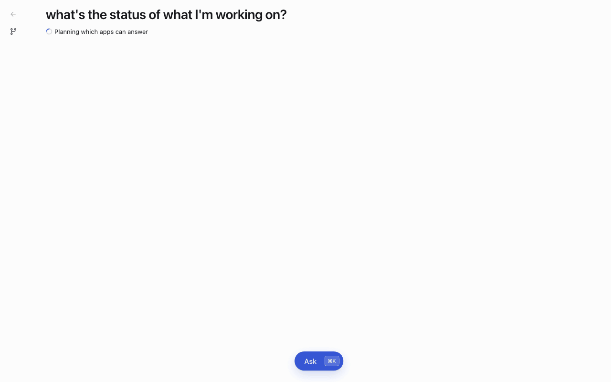
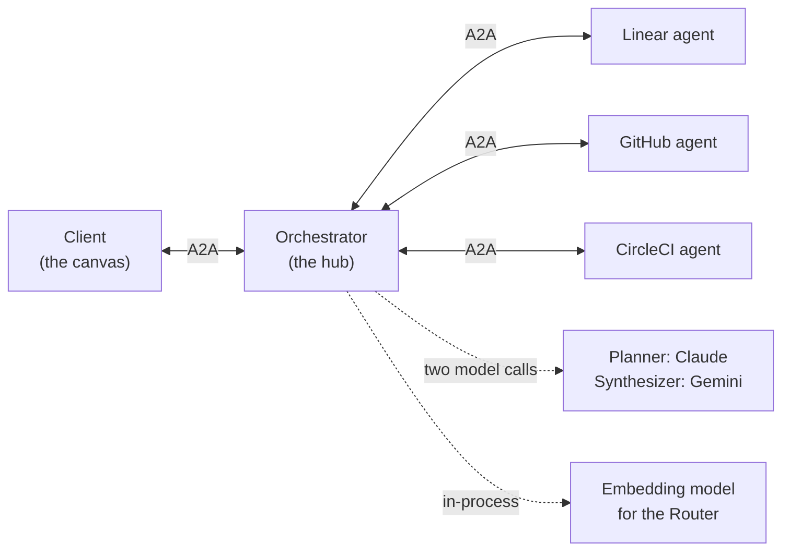
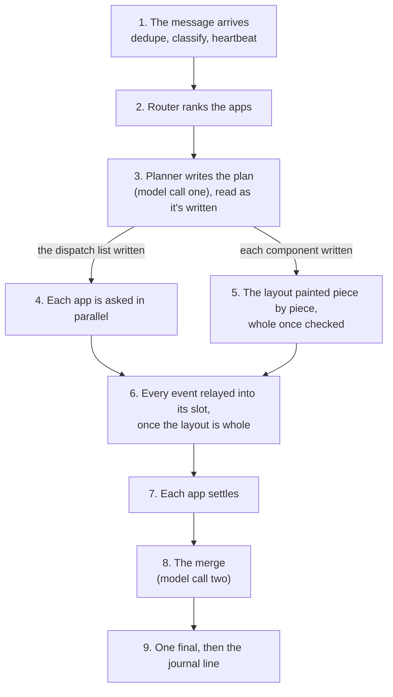
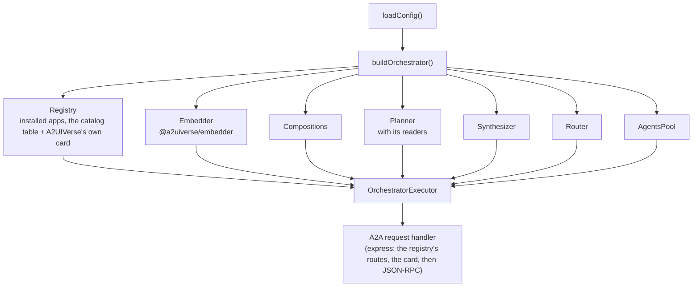
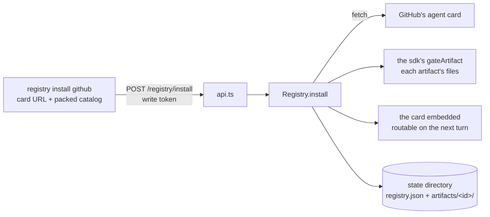
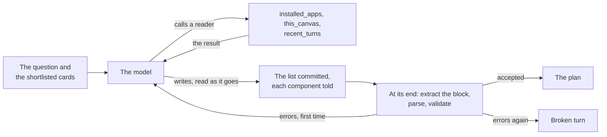
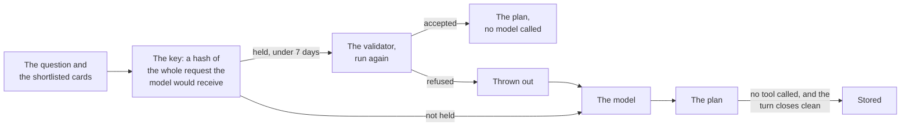
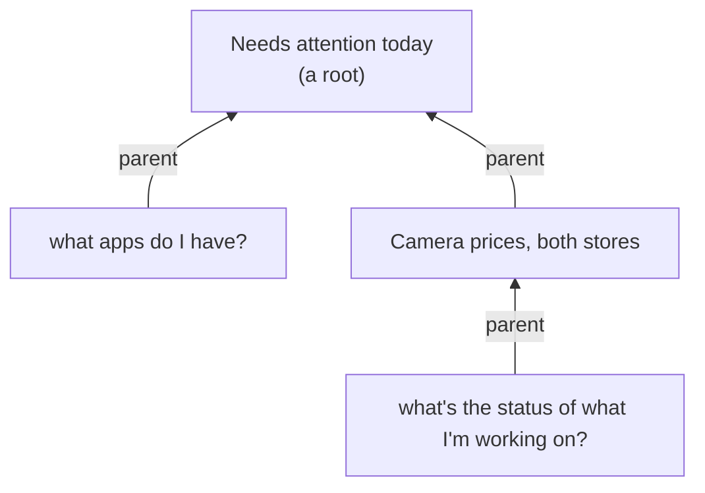
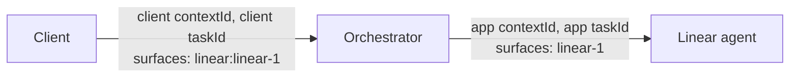

# Orchestrator: how a question becomes one screen

This guide explains the **orchestrator**, the server in the middle of A2UIVerse. The client talks only to it, and it talks to every app. It's written for a frontend engineer meeting A2UIVerse for the first time. It starts with the ideas, follows one question through the orchestrator from start to finish, then opens up the machinery: the data structures, the streams and the timers. It ends with the design decisions and where the code lives.

One example runs through the whole guide: the question _"what's the status of what I'm working on?"_, answered by Linear, GitHub and CircleCI. It's a real recorded session (you can replay it, see [Trying it without a model](#trying-it-without-a-model)), and the numbers below come from its recording and its line in the orchestrator's journal.

<p align="center">
  
  <br>
  <em>The recorded question as the client drew it, waits shortened. Planning took about 6 s; the layout landed at 6.05 s, the three apps' answers between 6.07 and 6.09 s, and the merged view at 17.47 s.</em>
</p>

## Problem it solves

The client wants one screen answering one question, built from several apps. The apps don't know about each other, and each speaks for itself. Something has to sit between them and do five jobs:

1. **Pick the apps.** Out of every installed app, which ones hold part of the answer? There's no list of question types to match against; apps are described only by their own agent cards.
2. **Lay out the screen before anyone answers.** The client should show something at once, not wait for the slowest app.
3. **Ask the apps in parallel and pass their UI through**, into the right slot, without changing what the apps painted.
4. **Stay honest when apps are slow or fail.** One app failing must not break the others, and a slow one must not hold the screen hostage.
5. **Keep every question's answer alive**, so an earlier answer still works after the next question is asked.

There's also a sixth job, merging the apps' answers into one table. It's big enough to have its own guide, [`synthesis.md`](synthesis.md).

The orchestrator does all of this as a **hub**. To the client it's one A2A agent that answers everything. To each app it's an A2A client with a request. Nothing else talks to an app.



## Six ideas to hold on to

### 1. A2A in two minutes

A2UIVerse's processes talk **A2A** (the Agent-to-Agent protocol, version 0.3 here). If you've used a streaming HTTP API, you know most of it already:

- An agent publishes an **agent card** at `/.well-known/agent-card.json`: its name, description, and **skills**, each with example questions.
- A client sends a **message** (JSON-RPC over HTTP) and gets back a **stream of events**: status updates, each carrying a message whose **parts** are text or JSON data.
- Every exchange is a **task** with an id. The stream ends with one event marked `final: true`, whose state says how it ended: `completed`, `failed`, `canceled`.
- Tasks belong to a **context**, a conversation id. Messages in one context share history.

A2UI rides inside A2A: an agent's UI arrives as JSON data parts like `{"version": "v0.9", "createSurface": {…}}`.

### 2. Hub speaks A2A on both sides

The orchestrator is an A2A **server** toward the client and an A2A **client** toward every app. That means every event an app sends travels app → orchestrator → client, and the orchestrator can do its work on the way: stamp where the event came from, keep a copy of the app's data, decide when to merge. The client never learns an app's address.

### 3. A turn is one client message and its stream

Every message the client sends starts a **turn**: one A2A task, one stream, one final. The orchestrator tells the kind of turn from the message's shape alone (`composition/classify.ts`):

| Turn          | The message carries                             | What happens                                               |
| ------------- | ----------------------------------------------- | ---------------------------------------------------------- |
| `utterance`   | text: a question from the palette               | the whole pipeline: route, plan, paint, ask, merge         |
| `action`      | an A2UI action on a surface, like "open run"    | only the app that owns that surface is asked               |
| `operation`   | a press: Retry, Include, Try again, a step, close | an operation on an existing answer                       |
| `clientError` | an error report, like a paint it couldn't draw  | that app's slot is marked failed                           |

An action names its surface as `circleci:circleci-1`, and the part before the colon is the **owner**: the only app that hears about it. A surface owned by `shell` is A2UIVerse's own UI, like the button that opens the Store; that action is only written to the journal.

### 4. Every question is a context, and each context has a composition

Each question the client asks opens a **new A2A context**. The client sends the question with no context id, and the orchestrator mints one. For that context the orchestrator holds a **composition**: everything about that one answer. That's the plan, each app's slot and its state, a copy of each app's data, the merged view, and each app's back-and-forward history.

Compositions stay in memory for the whole session, until the client closes one. A later message names its context, so a click on an older answer lands on that answer's composition.

A question asked while looking at an older answer names that answer's context as its **parent**. The compositions form a tree, the same tree the client draws as its trail.

### 5. Shell is a source too

The orchestrator paints its own UI, the **shell**, through the same path as any app. The layout is the surface `shell:main`, and the merged view is `shell:synthesis`. Every event carries a **stamp** in its metadata saying where it came from:

```jsonc
{"a2uiverse": {"source": "linear", "role": "fragment"}}   // an app's paint, for Linear's slot
{"a2uiverse": {"source": "shell", "role": "shell"}}       // the layout, or the turn's own status
{"a2uiverse": {"source": "shell", "role": "fragment"}}    // the merged view, for its reserved slot
```

`source` is how the client knows which slot a surface fills.

### 6. Two model calls, everything else deterministic

Only two steps ask a language model, through the Vercel AI SDK; by default the Planner asks Claude and the Synthesizer Gemini ([Model seam and the Planner's model](#model-seam-and-the-planners-model)):

- The **Planner** decides who answers and designs the layout. Every question runs it.
- The **Synthesizer** writes the merged view, when the plan reserved one.

Everything else is ordinary code: the Router's ranking (a small embedding model running in-process, no API key), the relay, the timers, the journal. A question answered by one app costs one model call; a merged answer costs two.

## One question, end to end



**1. The message arrives.** The A2A server hands the message to the orchestrator's executor, which publishes a `working` task first (so a cancel arriving early can find it) and then:

- **Refuses a repeat.** If this message id was seen recently, the turn fails at once with "This request was already received." (see [Refusing a repeat](#refusing-a-repeat)).
- **Classifies it** (idea 3). This one is text, so it's an `utterance`.
- **Checks the context.** A question must open a context of its own. One arriving in a context the session already holds is refused: "A question opens a context of its own."
- **Starts the heartbeat**, an empty event every 30 seconds of silence (see [The heartbeat](#heartbeat)).

**2. The Router ranks the apps.** The question is turned into a vector by a small embedding model and compared with a vector of every app's agent card, plus A2UIVerse's own card, which answers questions about the platform. The top five go on the **shortlist**. There's no cut-off score: ranking only narrows the field, and the Planner makes the real choice. When a question is asked from an older answer, that answer's apps stay on the shortlist regardless of rank, so "add GitHub to this" can still plan the apps already on screen.

**3. The Planner writes the plan.** This is the first model call. The Planner gets the question and the shortlisted cards, and answers with a **layout surface**: a title, which apps to ask and what to ask each, plus the screen's layout as a component tree in the shell catalog. Here is what it wrote for the example (trimmed), in the order it's asked to write it — title, dispatch list, data model, tree:

```jsonc
{
  "title": "Status of current work",
  "dispatch": [
    {"source": "linear",   "request": "Show the issues assigned to me or currently in progress as a compact list. For each issue, include its identifier, title, status, priority, linked branch or pull request, and the full date and time it was last updated."},
    {"source": "github",   "request": "Show my open pull requests and recent branches as a compact list. For each, include its title, number, branch name, review status, any linked issue identifier, and the full date and time it was last updated."},
    {"source": "circleci", "request": "Show recent pipeline runs for my active branches as a compact list. For each run, include the branch name, commit, workflow status (passed, failed, or running), and the full date and time."},
    {"source": "shell",    "request": "Where each work item stands: one row per Linear issue … with its priority, status, linked GitHub pull request, and CircleCI build status; most recently updated first. …",
     "columns": ["Issue", "Priority", "Status", "Pull request", "CI", "Updated"],
     "columnSources": ["linear", "linear", "linear", "github", "circleci", "linear"],
     "join": {"home": "linear", "nouns": {"linear": "issues", "github": "PRs", "circleci": "runs"}}}
  ],
  "dataModel": {},
  "tree": {"components": [
    {"id": "root",     "component": "Column", "children": ["status", "sources"]},
    {"id": "status",   "component": "Slot", "source": "shell"},
    {"id": "sources",  "component": "Row", "children": ["linear", "github", "circleci"]},
    {"id": "linear",   "component": "Slot", "source": "linear", "weight": 1},
    {"id": "github",   "component": "Slot", "source": "github", "weight": 1},
    {"id": "circleci", "component": "Slot", "source": "circleci", "weight": 1}
  ]}
}
```

Notice three things. Each app gets its **own request in its own words**, never your question as typed; each asks for exactly the fields a merge will need, like "the full date and time", without ever mentioning the merge. The `shell` entry is the merged view: its request is the brief for the Synthesizer. And the tree is just `Slot`s, one per entry: the Planner designs the frame, never the apps' contents.

**The answer is read as it's written.** The model's answer streams in, and the orchestrator acts on each part the moment it's finished instead of waiting for the end. Once the dispatch list is written and passes the checks it can pass on its own (each app on the shortlist, each gap in the words of a search this plan made), the list is **committed**: the apps are asked at once (step 4), and the list stands for the rest of the plan. Then each component of the tree goes to the client as soon as it's written and passes its own check against the shell catalog (step 5). The title, which names this answer in the client's trail, rides along; here it's "Status of current work".

The whole answer is still checked by a validator at its end. If it fails, the model gets one retry; once the list is committed, the retry rewrites only the layout, its data model and its title, against the list already sent. In the recorded run, which predates this reading, planning took 6.0 seconds from the question arriving to the plan accepted.

**4. Each app is asked, in parallel, the moment the list is committed.** For every app in the plan, the orchestrator builds an A2A message whose text is the Planner's request for that app, and hands it to the **AgentsPool**. The text ends with two sentences of the hub's own: the credential bar's advice (see [AgentsPool](#agentspool-one-handle-per-dispatch)), then the person's local time, from the clock the client sends on every message: "The person's local time is Friday 9 October 2026, 14:20 (Asia/Seoul)." An app reads "tomorrow" and "today" against it. A request re-sent for a press (a Retry, Allow's resume, an account chosen) says the press's own clock, any other the question's, and a message that carried no clock says no time. It's words in the request, so nothing A2UIVerse-specific rides the app's wire (`src/agentsPool/requestWords.ts`). The pool connects to the app, sends the message in that app's own conversation for this context, and streams back its events. The three requests went out within a millisecond of each other; in the recording, which predates the committed list, they went out once the whole plan was in.

**5. The layout, piece by piece.** The orchestrator paints each component into the `shell:main` surface as it arrives: the first goes out with the `createSurface`, each one after as a repaint of the tree so far, and a data model written after the first as its own update. On the way, the **shell painter** writes in what only the shell owns: every app's `Slot` is wrapped in an `Attribution` (the app's name above its slot, which the app can't hide), and every slot gets its state. A parent written before its slot names the slot until the slot arrives, and its wrapper from then on:

```jsonc
{"id": "status", "component": "Slot", "source": "shell", "state": "pending", "label": "Synthesis", "content": "shell",
 "columns": ["Issue", "Priority", "Status", "Pull request", "CI", "Updated"], "columnSources": ["…"], "join": {"home": "linear", "…": "…"}},
{"id": "attribution-linear", "component": "Attribution", "displayName": "Linear", "source": "linear", "child": "linear", "weight": 1},
{"id": "linear", "component": "Slot", "source": "linear", "weight": 1, "state": "pending", "label": "Linear", "noun": "Linear issues"}
```

The client draws the frame as it arrives: the merged view's column headers over skeleton rows, and a waiting slot per app. Once the whole answer is checked, the layout is painted whole once more; when a retry replaced it, the half-drawn layout is taken down and the retry's drawn in its place, in one event. **Nothing an app sends is shown before that**: its paint and any change to its slot wait, then go out in the order they came, so no app's answer ever lands without its frame. **The layout never waits on any app.** In the recording, which predates painting piece by piece, the whole layout reached the client 6.05 seconds after the question was sent.

**6. Every event is relayed into its slot.** As each event arrives, the orchestrator:

1. rewrites the envelope's task and context ids to the client's,
2. stamps it `{source: "linear", role: "fragment"}`,
3. **namespaces** every surface id, so Linear's `linear-1` becomes `linear:linear-1`, the one its `paintMeta` titles included,
4. **demotes** the app's final event to a plain `working` one, because the hub owns the turn's single final,
5. applies the app's data model changes to **its own copy of the partition** (needed later by the merge),
6. counts every `createSurface` as a paint in that app's history, the newest on screen (for its back arrow),
7. publishes the event to the client.

In the recording, GitHub's answer reached the client at 6.07 s, Linear's at 6.08 s and CircleCI's at 6.09 s. These apps ran in `deterministic` mode, answering from recordings in 24 to 36 milliseconds each.

**7. Each app settles.** When an app's stream ends, the orchestrator sends the client one more event for that app with no parts and the stamp `settled: true`, which tells the client that app's answer is complete. The app's slot state is decided: it **arrived** if it painted a surface, it **failed** if it ended in error, couldn't be reached, or hit the hard cap. Then the **trigger** is asked whether the merge can run: here, all three arrived, so it's released at once.

**8. The merge.** The Synthesizer, the second model call, writes the merged view as formulas over the apps' data, and the orchestrator checks it before painting it into the reserved slot. In the recorded run its first attempt was accepted, and the view landed 11.4 seconds after the merge was released. Since then the question's first merge is drawn as the model writes it: the tree painted once it and the sorts pass, each row on an event of its own as it passes its own check, the document as accepted landing whole over them; every later merge lands whole. How the merged view is written, checked, drawn as it's written and kept live is the whole of [`synthesis.md`](synthesis.md).

**9. One final, then the journal line.** Once every app has arrived, failed or hit the hard cap, and the merge released during the turn is done, the orchestrator sends the turn's one `final: true` event, `completed`. The client saw it 17.5 seconds after asking. The turn's line in the **intent journal** is written when the last app's stream has fully drained, so an answer arriving late still makes it onto the line. Here is the recorded line, trimmed:

```jsonc
{
  "turnId": "4922aa90-f685-4b23-b836-a1e2819bb594",          // the client's task id
  "clientContextId": "fc54e5d9-ec43-4456-9b53-ba6fd6a7d086", // the context: this answer's composition
  "at": "2026-09-27T08:41:23.612Z",
  "kind": "utterance",
  "descriptor": "what's the status of what I'm working on?",
  "plan": {"outcome": "planned", "planMs": 6038, "layoutSurface": {"…": "the plan above"}, "title": "Status of current work", "attempts": ["…one"], "toolCalls": []},
  "dispatch": [
    {"source": "github", "vendorContextId": "7a3c3416-…", "vendorTaskId": "3ab4822a-…", "startedAt": "2026-09-27T08:41:29.652Z", "endedAt": "2026-09-27T08:41:29.676Z", "outcome": "completed"},
    {"source": "linear",   "…": "…", "outcome": "completed"},
    {"source": "circleci", "…": "…", "outcome": "completed"}
  ],
  "synthesis": {"outcome": "synthesized", "attempts": ["…the accepted one"], "deadAirMs": 11382},
  "surfaces": {"created": ["shell:main", "github:notifications-1", "linear:linear-1", "circleci:circleci-1", "shell:synthesis"], "…": "…"},
  "outcome": "completed",
  "embedding": ["…384 numbers: the descriptor, embedded with the Router's model"]
}
```

The line also says what the turn's model calls cost. This recording predates that, so here are the fields by name:

- **On the plan:** `planMs`, the layout complete and checked; `firstPieceMs`, when its first piece left for the client, the whole layout's moment for a plan that arrives whole; `shortlistMs`, the Router's share of `planMs`; `effort`, the tier the Planner ran at; and `requests`, one record per model request. Each tool call on the plan carries its `ms` beside its words and its answer. `cache`, with the plan cache on and no tool called, holds the request's key, and `hit: true` when the plan cache served the plan, no request made.
- **On the synthesis:** its own `effort` and `requests`, and `firstRowMs`, when the first row of a first merge drawn as it's written left for the client, on the clock `deadAirMs` runs on.
- **`finalAt`:** when the final `completed` left, the moment the screen settled.

A request record:

```jsonc
{
  "attempt": 1, "step": 2,                                         // both from 1: a retry is attempt 2
  "model": {"provider": "google.generative-ai", "modelId": "gemini-3.8-flash"},
  "startMs": "…", "endMs": "…", "modelMs": "…",                     // the plan's from the question arriving, the synthesis's from its release
  "firstTokenMs": "…", "timeToFirstTokenMs": "…",                  // its first token on the clock, and from its start: every request is read as a stream
  "ended": "toolCall", "finish": "tool-calls", "tools": ["search_store"],
  "usage": {"promptTokens": "…", "outputTokens": "…", "reasoningTokens": "…", "cachedTokens": "…", "cacheWriteTokens": "…"}  // each absent when the provider gave none; Claude bills writes apart
}
```

Every number is the AI SDK's own, read off the step's result (`src/model/requests.ts`): `modelMs` is the time waiting on the model, `timeToFirstTokenMs` the time to its first output, a tool's `ms` its execution time, and the usage what the provider reported. The orchestrator only reads the clock when an attempt starts, and places each step after the one before it.

## Inside the machinery

### Server and its boot

`src/index.ts` loads the configuration and calls `buildOrchestrator` in `src/app.ts`, which wires everything together once:



The A2A SDK's `DefaultRequestHandler` serves the card and runs the executor for every message. CORS lets in only `localhost` and the orchestrator's own dev tunnel, on any port, read from its base URL (`writeGuard.ts`), the same list that lets the browser write. Each dependency is handed in as an interface, so the tests swap in a fake embedder, planner, synthesizer model or card fetcher, with no model download, no model call and no network.

Before it listens, `init()` does four things in order:

1. **Reads the registry** from the state directory (`registry.load`), hashing every artifact's files again. A record file that won't parse, or an artifact whose files are missing or changed, throws with the path and the problem, and the orchestrator doesn't start.
2. **Issues a fresh write token** into the state directory (next section).
3. **Fetches every installed app's card** in parallel, from the URL stored at install, and embeds each one (`registry.refreshCards`). That fetched card is the one this run uses until it's fetched again: by an update check, by the catch after a call, or by a Retry from the update tile ([AgentsPool](#agentspool-one-handle-per-dispatch)). A card that can't be fetched is `null`, and that app can't be routed to until a check or an install reaches it, though it stays installed. The boot log names every such app.
4. **Runs the update check once** (`updates.check`, below): each installed app's marketplace entry and live card are read, its state worked out, and a newer build of an app installed from the marketplace is installed over right here, before any client can preload the catalog table. The boot log says what moved, what was refused, what was left undone because it would move an app from a local pack, and what was reported. A marketplace that can't be reached is one line and every state unknown — the boot goes on.

### Registry: what's installed

`src/registry/` holds the installed apps and the **catalog table**, and it's the only thing that writes them, through three operations over HTTP: install, uninstall, and install-over, an install of an id already installed. [`app-install.md`](app-install.md) tells the whole story over GitHub's install: the catalog artifact Stellify packs, every check install runs, the files on disk, the routes and the write token, and how the client loads what's installed. Here is the shape of an install:



What the rest of the orchestrator relies on:

- **Install refuses the whole app on any finding**, answering every finding at once, and otherwise answers with one line saying what changed: `installed github · card 0.1.0 · catalog sha256-o0lcA0wt…`. The checks are the sdk's, so the marketplace will refuse the same artifacts for the same reasons.
- **A change is live at once.** Install embeds the card before it writes anything, so the Router ranks the app on the very next turn, and the Planner's `installed_apps` reader reads the registry as it stands. Operations run one at a time, through a promise chain.
- **Two cards per app.** The record keeps the card as it was installed, and it changes only through install-over. The run uses the live card it holds, fetched at startup and again as above, for the dispatch URL, the skills the Router ranks, and the name the Planner reads and the attribution shows. When the agent was down at startup, the Planner's reader shows the stored card, marked unreachable.
- **The routes** sit under `/registry` on the orchestrator's own port: `apps.json`, `catalogs.json`, an artifact's files under `artifacts/<id>/` served as immutable content, `updates.json`, and the two writes, `install` and `uninstall`. Every write is JSON; from the browser at an allowed origin it needs no token, and from anywhere else it takes the write token the orchestrator writes into its state directory at startup. Each write's journal line says which, `by: "page"` or `by: "token"`.
- **Install by id alone goes through the marketplace** (`Registry.installFromMarketplace`, the install body carrying `{appId}` and nothing else). The entry is read from `MARKETPLACE_URL` (`registry/marketplace.ts`, one timeout on every request), the live card fetched from the URL the entry names, and the sdk's drift function run over the two: a catalog id the entry has no artifact for, or a version the index doesn't know, refuses the whole install in words that say the Store is behind the app, and posts a report to the marketplace. Otherwise each artifact's descriptor is fetched and only the files whose hashes no held artifact already has — a file the previous build also shipped is copied from it. Then the ordinary core runs, the record marked as coming from the marketplace.
- **A catalog id is held at one build, and a row moves with its followers.** When an install hands a new build for a catalog id that other installed apps render in, the row moves and every one of them follows — their records pointed at the new build, nothing else about them changed — and the install's line names them (`… · gmail followed`). First the sdk's additive-evolution check runs the new build's schema against the one they render in; a component, a property or an enum value removed, a type changed, a constraint tightened refuses the whole install. An app alone on its row moves it freely: its own install-over is the operator's act. The old build's files go through the sdk's unnamed-rows function, as an uninstalled app's do.
- **The update check** (`registry/updates.ts`) reads one entry per installed app and fetches its live card again, all in parallel (`Registry.refetchLiveCards`: a card that answers replaces the one held, its vector recomputed when it changed; one that doesn't answer keeps the one held), and gives each app one of the sdk's eight states, the first match in order: `unknown` (the marketplace unreached, or that entry malformed), `not-published` (404), `ahead-of-store` (the live card declares a catalog or a version the entry lacks — reported to the marketplace), `update-required` (an installed line the published card dropped), `major-update` (a catalog id added, the installed ones kept), `card-update` (the version moved with no id added or dropped; what it newly asks is read from the card's `security`, as the vault reads consent), `newer-build` (only a build moved), `up-to-date`. The check is one operation: a `newer-build` of an app installed from the marketplace is installed over on the spot through the install by id, journaled as automatic, and the state answered is the one after — so `GET updates.json` has that one side effect, the registry converging to where it would get anyway, and Phase 14's App Library can ask for fresh states from the browser with no token. An app from a local pack is never moved; its newer build is reported. Nor is it carried: a marketplace app's newer build whose row move would take a local-pack app along is left at `newer-build`, the boot naming the apps it would move, and the person's install by id moves them together. An app the Store still flags as ahead while its live card shows no drift is reported too, so the marketplace refetches the card and clears the flag. Concurrent checks join the one in flight.

### Sources: an app and its account

Everything the orchestrator keeps per answer is keyed by **source**: the app, and the account it paints under. One app can have several accounts, two Gmail inboxes for instance, and each is its own source with its own slot, its own copy of the data, its own conversation with the agent and its own history. A source is one string:

| The app | Its sources |
| --- | --- |
| Asks no sign-in on its card (Shop A, one of the mock stores) | `shop-a`, the bare app id |
| Asks sign-in, two accounts signed in | `gmail.1`, `gmail.2` |
| Asks sign-in, none signed in yet | `linear.1`, named for the account its sign-in will create |

`src/accounts/accounts.ts` is the one place that turns an app into its sources and a source back into its app. `Sources.of(appId)` lists an app's sources; `appOf(source)` parses the app back out, for the few things that belong to the app: its card, its agent's URL, its entitlement and its display name. The accounts come from an `AccountStore`: the AuthVault in a running orchestrator, a list the tests hand in.

Each source has **one name in words**, `Sources.name(source)`: the app's display name, with the account's label beside it when the app has more than one account, `Gmail · alice@example.com`. The shell painter puts the label on the fragment's `Attribution` (as `account`) and the whole name on its `Slot` (as `label`); the Synthesizer's prompt names each partition the same way, `from: Gmail · alice@example.com (gmail.1)`, so the merged view can tell two inboxes apart.

The Planner names sources too. Its turn lists each shortlisted app with its sources, an account by its label and the next sign-in's as `not signed in yet`:

```
- appId: gmail
  sources:
    - gmail.1 · alice@example.com
    - gmail.2 · bob@example.com
```

Its shortlist check accepts every source of each shortlisted app, and "dispatched twice" compares sources, so `gmail.1` and `gmail.2` in one plan are two dispatches. A bare app id is forgiven when only one thing can be meant: an app with one source has `github` rewritten to `github.1` everywhere the plan names it, before the checks. With two accounts a bare id is refused, naming them. A question about state gathers from every account, a merged view included, each account a source of its own beside it. "My", "mine" and "I" name no account: every account is the person's, and a label only tells them apart, never a reason to leave one out. A command goes to the one the words name, or the one on the canvas it points at. A command that names none, for an app with two accounts, is an **account choice**: the plan's entry `{"chooseAccount": "gmail", "request": "…"}`, a slot the shell draws asking which account, one press per account by its label. The press, `useAccount` naming the account, makes that slot the account's and sends the plan's request to it, with no second plan. A click inside a fragment goes back to the source in its surface id, which is the account that painted it.

### Sign-in: the AuthVault

Sign-in is explained end to end in [`authority.md`](authority.md). The orchestrator's part in brief: `src/vault/` is the **AuthVault**, the one place a credential lives, one entry per (app, account) in an owner-only file in `STATE_DIR`, and a generic OAuth client that follows whatever server a card's scheme names. It is also the `AccountStore` above.

- **Before every dispatch** the executor asks the vault for the source's **standing**, from the card and the vault alone: open, ready, or what the slot needs. A slot that needs sign-in takes its authority at first paint, the full tile once per app per page load and the quiet line after, and its agent is never called.
- **The pool attaches the header** the card's scheme names, from the vault's `prepare`, which refreshes a token about to expire. A 401 is answered with one refresh, shared by every dispatch to that account, and one resend; a second refusal asks the slot to sign in again.
- **An in-task `auth-required`** is never relayed: the vault reads its scheme and scope keys against the installed card, and a valid one becomes a request for more access on the fragment's attribution row, the press that asked kept for Allow.
- **The sign-in routes** sit on `orchestratorApi` under `/auth`, reachable from the browser with no write token: the start route the window opens, the callback, the token page for a pasted key or token, the client document, and the attempt the client polls. Beside them sit the App Library's: the accounts read, and rename and sign-out, which are writes.

### Trusted page's hands

The Store, the App Library and Publish are explained end to end in [`trusted-page.md`](trusted-page.md). The orchestrator's part in brief: the page talks only to the orchestrator, and the orchestrator does what the page asks.

- **The Store's reads are relayed** under `/marketplace` (`marketplace/routes.ts`): the index, the search, an app's entry and its captured preview, each listing annotated with whether the app is installed and its update state as last computed, never a check run for the read. A preview's build files the registry doesn't hold are fetched from the marketplace and checked against their descriptor and the descriptor against its id before they're served (`marketplace/artifacts.ts`); nothing is written into the registry.
- **The publisher is held here** (`marketplace/publisher.ts`): one name and token, with the marketplace that issued them, in `<state>/publisher/publisher.json`, owner-only. The claim, the sign-in check, publish and unpublish are relayed with the token as the bearer; the token reaches the browser once, in the claim's answer. `listings.json` reads each of the publisher's live cards again before answering, so an app ahead of the Store says so at once, and reports a drift the marketplace's flag doesn't show yet.
- **Writes from the browser need no token** (`writeGuard.ts`): a JSON body from an allowed origin, localhost or 127.0.0.1 on any port or a host of the orchestrator's own tunnel. Install, update, uninstall, an account's rename and sign-out, and the publisher's calls each journal one line `by: "page"`.

### Store loop's hands

An app offered, installed and updated in the slot that needs it is explained end to end in [`store-loop.md`](store-loop.md). The orchestrator's part in brief:

- **The Planner searches the Store** through `search_store` (below), and a plan's **gap** offers the apps its own search returned, each with the request it would send.
- **The offer is painted from the marketplace's entries** (`composition/shellPainter.ts`): each offered app's id, name, publisher and description, never its request, which stays on the orchestrator; a gap with nothing to offer carries why, nothing found or the Store unreached, from the plan's record of its search.
- **`useApp`** naming the app and the gap turns the gap into the app's slot and sends it the request the plan offered it, with no second plan (`fillGap` in `composition/state.ts`); an offer that asked nothing paints the installed line instead. Until the app's first answer, the slot keeps the offer it came from.
- **The update tile** is a slot in state `update`, carrying the update state its line was drawn from and the publisher's name. Update is the install by id over the held app, then the slot's Retry; Check again is the same Retry with no install; the slot keeps its tile while the resend is pending. A Retry from the tile first fetches the app's live card again, given five seconds, so the check before dispatch judges the app as it is now: an agent moved back to what the Store holds is called.

### Refusing a repeat

Through a dev tunnel a request sometimes gets lost, so the client sends a request once more, under the **same message id**, when it hears nothing for 10 seconds. If the first had only been slow, running both would repeat an app's write, like merging a pull request twice.

So the executor keeps the ids it has taken in: a `Set` of at most 256. A JavaScript `Set` iterates in insertion order, so it works as a small **FIFO**: after each add, when the set is over 256, the oldest id (`set.values().next().value`) is deleted. A repeat within the last 256 messages fails at once, and nothing is dispatched. The bound is safe because a resend follows its original within seconds.

### Heartbeat

A dev tunnel's proxy closes a connection that's been idle for 100 seconds, and a turn can easily be idle that long, waiting for a slow app. So every request's stream has a heartbeat (`#heartbeat` in `src/executor.ts`):

1. It **wraps `bus.publish`** so every event sent records the time.
2. A `setInterval` checks every quarter of the interval (the interval is 30 seconds by default).
3. When nothing has gone out for a full interval, it publishes an empty `working` status event: no parts, no stamp, nothing the client draws.
4. When the stream ends, the interval is cleared and `publish` is put back.

Wrapping the function means no other code has to remember to reset the clock.

### Routing: embeddings and cosine similarity

The Router (`src/router/router.ts`) answers one question: which apps are most like this question? The pieces it ranks with — the embedder, the corpus document, cosine and the rank — come from the `@a2uiverse/embedder` package (`packages/embedder/`), which the marketplace's index ranks with too, so a question ranks the same against the local registry and the marketplace.

- **Each app is one document.** `corpusDoc(card)` joins the card's name, description, and every skill's name, description, tags and example questions.
- **Documents and questions become vectors.** The embedding model is `Xenova/all-MiniLM-L6-v2`, quantized to 8 bits, running in-process through transformers.js. It downloads once into `STATE_DIR/models` and then works offline. Each text becomes a vector of 384 numbers, **normalized** to length 1.
- **Similarity is a dot product.** For two unit vectors, cosine similarity (how closely they point the same way) is just the sum of the products of their numbers, which is all `cosine()` computes.
- **Rank, cap, keep.** The package's `rank()` scores every routable app and sorts highest first; the Router keeps the first five (`A2UIVERSE_SHORTLIST_CAP`), plus any app on screen in the answer the question was asked from.

The app vectors are computed at startup and at each install; each question costs one embedding and one pass over the apps, O(apps × 384). A2UIVerse's own card is ranked the same way, so "what apps do I have?" routes to the platform like any other question to any other app.

### Planner: a model with tools

`src/planner/planner.ts` makes the Planner's model call with the Vercel AI SDK's `streamText`, in a **tool-calling loop**:



- **The rule it plans by** is prose in its prompt (`src/planner/planner.md`): answer the question the person means. A question about where one kind of thing stands, or about what is waiting on the person (what needs them, what's on their plate), gathers from every app whose card shows it holds a part, named or not: a review asked of them, mail to answer, a meeting to attend, an issue assigned to them. An app not signed in yet is dispatched all the same, and the shell asks for the sign-in in its slot. A command or a lookup inside one app's object, or a question naming its app, goes to that app alone. An app whose card shows no part is left out: every app added lengthens the wait, so none joins to fill the screen.
- **The readers** are the Planner's only view of the platform: three tools with no input. `installed_apps` lists the apps, their skills with their example questions, whether each asks sign-in and its accounts by label, and each app's update state as last computed, in the App Library's words, with when that check ran ("checked 12 minutes ago"), so a plan never waits on the marketplace or a live card; `this_canvas` describes the canvas the question was asked from in the person's words, carrying what its screen doesn't say (what was asked; each app, an account by its name when it isn't the app's, what it was asked for, how its answer stands and what to do about one that isn't there; whether the merged view shows and why not, what it puts together, its columns and the order it was made in); `recent_turns` gives one line per question up that canvas's chain of parents, each app by its name. Each is a small projection of the orchestrator's own state, and the Planner writes it in the person's words, saying what the screen doesn't rather than restating it, and naming the canvas it describes by its question, since its answer opens a canvas of its own. None ever returns an app's data. The Planner can answer "what's on my screen?" without seeing what's on it.
- **The Store's search** is the one tool with input: `search_store`, with words of the Planner's own (`src/planner/storeSearch.ts`). It asks the marketplace's search through the orchestrator's marketplace client, within the limit every request to the Store has, and answers the apps found, the installed ones left out, each as its name, publisher, description and skills, or that the Store wasn't reached. The model sees the marketplace only through that answer. Each call is recorded on the plan with its words, its answer and how long the Store took, and that one record serves the plan check, the line with nothing to offer and the journal. [`store-loop.md`](store-loop.md) follows a search to an install.
- **A step budget.** Each attempt may take at most five steps (`stopWhen: stepCountIs(5)`): the three readers, the search and the answer.
- **One tagged block.** The model answers with its JSON inside `<layout-surface>…</layout-surface>`. `extractTaggedBlock` takes exactly one such block and tolerates text around it. The tag is the orchestrator's own and never `<a2ui-json>`, the tag the client extracts A2UI from, so model output meant for the orchestrator can never be mistaken for UI.
- **Read as it's written.** The prompt asks for the block's parts in one order: `title`, `dispatch`, `dataModel`, `tree`. `TaggedBlockReader` (`src/authoring/blockReader.ts`) follows the block as the text streams in, a small state machine over the JSON: a stack of the objects and arrays it's inside, whether it's inside a string, where the current value began. It hands over each member of the document, and each element or member of the containers it's told to watch — `tree.components` here — the moment its last character arrives, and knows nothing of plans; a container can be watched while it reads, which the Synthesizer's follower uses to watch the lists its tree repeats once the tree is written ([`synthesis.md`](synthesis.md#drawing-the-view-as-its-written)). The Planner's follower commits the list when `validateDispatchList` passes, and tells the turn each data model and component that passes `validateDataModel` or `validateComponent`: every check of the whole plan that reads that one piece, with the list and the components before it. Pieces written before the list wait for it. The first piece that fails stops the telling; the answer is still read to its end and checked whole.
- **The validator** (`src/planner/validate.ts`) checks, in order: the output schema; the tree, through the sdk's A2UI validator (`@a2ui/web_core`'s checks behind the sdk's own findings), against the shell catalog pruned to the layout's components (`Slot`, `Row`, `Column`, `Card`, `Text`, `Divider`, `DataList`, `DataListItem`, `Table`, `TableRow`, `Button`), so `Attribution` is simply not a word the Planner has; every dispatched source is on the shortlist, once, with a request; an account choice names an app with two accounts, once, not also dispatched; a merged view needs at least two sources; its columns, column marks and join name only dispatched sources; a gap names the words of one of the plan's searches and offers only apps they returned that aren't installed; exactly one `Slot` per dispatch entry; each `Slot` holding exactly one of `source`, `gap`, `chooseAccount` or `addAccount`; none of the painter's own props on a `Slot`; an add-account `Slot` names an app on the shortlist that asks sign-in, one per app; an `openAppLibrary` names an installed app; and a data model of plain values, never a formula or a ref.
- **One retry, in the same conversation.** The failed answer and every reader result stay in the message list, and the errors are appended as one more turn: fix this, don't start over. Once the list is committed, that turn says the list was already sent and stands: the retry rewrites the tree, the data model and the title against it, the list it writes is ignored, and nothing of it is told as it's written. A second failure makes the turn a **broken turn**, its final naming the findings.

The title the Planner writes is clipped to 48 characters before it's sent, and a clip is logged and journaled.

### Model seam and the Planner's model

Both model calls go through one seam, `src/model/getModel.ts`: the Vercel AI SDK's provider registry, with Google and Anthropic in it. A model is named by its provider, `provider/model`:

```bash
A2UIVERSE_PLANNER_MODEL=anthropic/claude-haiku-5-5    # any Claude model, read with ANTHROPIC_API_KEY
A2UIVERSE_SYNTHESIZER_MODEL=google/gemini-3.8-flash   # any Gemini model, read with GOOGLE_API_KEY; a bare name is Google's
```

The seam checks the provider alone, and an unknown one stops the boot naming the variable; the model is the provider's to judge, at the call. A seam whose provider has no key is named once at boot. A Planner model set alone moves the Synthesizer with it; `A2UIVERSE_SYNTHESIZER_MODEL` sets it apart.

Each seam also takes an **effort tier**, `low` or `default`. `default` sends nothing, and the model thinks as its provider has it. `low` sends the SDK's one reasoning word for the least thinking, which each provider's package turns into its own setting for the model named: on `gemini-3.8-flash`, Gemini's `low` thinking level, the least it takes, `minimal` being refused; on Claude, the least thinking the model accepts with effort `low` — `between_tools` on Sonnet 5.5, thinking off on Haiku 5.5 — which the seam reads from the Anthropic package's own table of the models, since left to the SDK's own reading `low` on Sonnet 5.5 kept the API's default effort, `high`.

| Seam | Default | Set by |
| --- | --- | --- |
| Planner | Claude Sonnet 5.5, `anthropic/claude-sonnet-5-5`, at `low` | `A2UIVERSE_PLANNER_MODEL`, `A2UIVERSE_PLANNER_EFFORT` |
| Synthesizer | `gemini-3.8-flash` at `low`; [why](synthesis.md#synthesizers-model-and-effort) | `A2UIVERSE_SYNTHESIZER_MODEL`, `A2UIVERSE_SYNTHESIZER_EFFORT` |

**The Planner on Claude Sonnet 5.5, at `low`.** Three Planners were run over the same six questions end to end, through the tunnel with the apps live, and Sonnet 5.5 was chosen on 2026-10-30, then run again on 2026-10-31 with everything else that changed landed ([the latency and token experiment results](../../_dev/docs/latency-and-token-experiment-results.md)):

| Planner, at `low` | Plan time | Plans accepted on the first try | Beside Gemini's plans |
| --- | --- | --- | --- |
| `gemini-3.8-flash`, 2026-10-29, median of three runs | 6.7–54.8 s | 18 of 18 | — |
| Claude Haiku 5.5, 2026-10-30, one run | 2.3–6.0 s | 3 of 6 | two questions refused twice, the turn failed; no merge planned on a third |
| Claude Sonnet 5.5, 2026-10-30, one run | 3.7–7.6 s | 6 of 6 | the same apps on all six, and the same join wherever Gemini planned a merge |
| Claude Sonnet 5.5, 2026-10-31, one run | 2.19–7.54 s | 6 of 6 | the same |

- **What it buys.** Gemini's plan time followed its output, about 4.4 s plus 7.5 ms an output token over its 21 requests, and at `low` it still reasoned a median 1,766 tokens before a median 506 of plan (2026-10-29). No request of Sonnet 5.5 at `low` reported a reasoning token, on either run, so a plan takes about as long as its writing. The apps are asked that much sooner, and every answer starts sooner with them.
- **What it costs.** A default boot needs a Claude key beside the Gemini one. The Planner's spend stays about where it was, $0.23 for the six questions on Claude on 2026-10-31 against $0.23 on Gemini a run on 2026-10-29, though Claude counts the same request at about 1.48 times Gemini's tokens, 30,388 against 20,484: every plan after the first read 30,474 tokens from Claude's one-hour cache. Sonnet 5.5 hands its JSON over in bursts, 10–12 pieces every 0.4–0.8 s, so its dispatch list is committed only 0.01–0.96 s ahead of the plan's end, against an estimated median 1.2 s on Gemini's; and it writes a paragraph of prose before its block, 169–433 characters on 2026-10-30, about 1.3–1.4 s on two questions.

### Plan cache and prompt caches

Two kinds of cache stand between a question and the models. Neither ever breaks a turn: a cache that can't be read, written, made or renewed leaves the turn to plan and merge as it would without it.

**The plan cache** (`src/planner/planCache.ts`) hands back a plan the Planner already wrote when the very same request comes again: the morning's "show my open pull requests", asked with the same apps and accounts.



- **The key is the whole request**: the fixed system prompt, the tools, the turn as built (the utterance, every shortlisted card with its accounts and sign-in state, the platform's card), the model and the effort, hashed. A hit is a request byte for byte the same, so an app update that changes its card, a new sign-in, an edited prompt or another model misses on its own, with no version to keep. Cloudflare's AI Gateway keys its cache the same way, a SHA-256 hash over the provider, the endpoint, the model and the full request body, its caching applying "only to identical requests" ([AI Gateway caching](https://developers.cloudflare.com/ai-gateway/features/caching/)).
- **Exact, never similar.** Another wording of the same question misses. Matching by similarity would hit more often, but static similarity thresholds "result in unexpected error rates" ([vCache](https://arxiv.org/abs/2502.03771), ICLR 2026), and pure semantic caching breaks down "when output validity depends on time, asset, or sensor parameters" ([Evaluating Temporal Semantic Caching and Workflow Optimization in Agentic Plan-Execute Pipelines](https://arxiv.org/abs/2605.20630), May 2026). How often a person asks the same thing word for word isn't measured on A2UIVerse; of 13,060 queries 114 people sent Yahoo's search engine over a year, 33% were an exact repeat of the same person's earlier query ([Teevan et al.](https://people.csail.mit.edu/teevan/work/publications/papers/sigir07.pdf), SIGIR 2007).
- **Stored after a clean turn.** A plan the model wrote is stored once its turn closes with every app it asked answered, or asking for a sign-in. What's stored is the plan as used: after a retry on the layout alone, the first answer's list with the retry's layout. A plan the cache serves arrives whole: its apps are asked and its layout painted at once. The journal hears each turn as it closes and hands it to the cache. A plan that called a tool, a reader or the Store's search, carries that moment's answer and is never stored. [Agentic Plan Caching](https://arxiv.org/abs/2506.14852) (NeurIPS 2025) reuses plans extracted "from completed agent executions"; this cache waits for a clean one.
- **Thrown out once it proves wrong.** A stored plan the validator refuses on reuse, against the apps installed now, or one an app it asked fails on, is dropped, and the next identical question is planned afresh. The AWS database blog's caching guide removes entries "when the underlying data changes" and deletes one once "an error in a cached response is rectified" ([Optimize LLM response costs and latency with effective caching](https://aws.amazon.com/blogs/database/optimize-llm-response-costs-and-latency-with-effective-caching/), February 2026).
- **On disk, 200 plans, 7 days.** `STATE_DIR/plan-cache.json` survives a restart; the least recently used plan leaves past 200, and none older than 7 days is reused. Both numbers are starting values with no source behind them. The same AWS guide sets an expiry by "the volatility of the underlying information", and a plan holds no app data, only the requests it sends. The journal's `cache` mark counts the hits to set them again.
- **Off for a measured pass.** `A2UIVERSE_PLAN_CACHE=off`: a pass that sends the same prompts three times would hit on the second and the third.

**The prompt caches** hold each model's fixed system prompt, the same on every turn, in its provider's cache, set up in the model seam (`src/model/getModel.ts`). Every JSON part of both fixed prompts, the catalog schema, the output schema and the examples, is written compact, with no indentation. Measured on 2026-10-30 ([the latency and token experiment results](../../_dev/docs/latency-and-token-experiment-results.md), 17.6's live check), a plan's request with one app shortlisted is 20,484 tokens on Gemini and 30,388 on Claude, and the Synthesizer's, with a one-line turn, 14,014 on Gemini.

- **Gemini: an explicit cache** (`src/model/geminiCache.ts`). Gemini caches by itself, implicitly, with "no cost saving guarantee" ([Context caching](https://ai.google.dev/gemini-api/docs/generate-content/caching)); in the Phase 17 baseline that served the Planner on 4 of 21 requests and the Synthesizer on none. An explicit cache holds the system prompt, the tools and their config, and a request names the cache in their place; Gemini refuses a request that sends them beside it ("CachedContent can not be used with GenerateContent request setting system_instruction, tools or tool_config"). The seam wraps the Google provider's fetch, so the cache holds exactly the JSON the provider would have sent. The first request goes whole and creates the cache beside it without waiting for it; each later one names it and pushes its expiry an hour out, without waiting either; an expired cache, or a refused or failed cache call, sends that request whole and makes a new one. Explicit caching is "currently in Beta". On Gemini the gain is price, a cached token at a tenth of an input token: the requests naming the cache took 3.7–4.5 s, the whole ones 3.4–4.2 s, three each.
- **Claude: one mark, an hour.** Claude caches only what a request marks. The seam marks the end of the system prompt, which covers the tools ahead of it, since the prefix runs "`tools`, `system`, then `messages`", with the one-hour lifetime, "refreshed for no additional cost each time the cached content is used" ([Prompt caching](https://platform.claude.com/docs/en/build-with-claude/prompt-caching)). A second request read 30,168 tokens from it on Haiku 5.5 and on Sonnet 5.5, 1.4 s against 1.7 s and 2.5 s against 3.0 s, one sample each.

### Painting the layout

`src/composition/shellPainter.ts` is a **pure function** from the composition's state to A2UI parts. It keeps the Planner's components and ids in order, and writes in what only the shell owns:

- **Every app's `Slot` is wrapped in an `Attribution`.** A first pass builds a `Map` from each app slot's id to its wrapper's id, `attribution-<slotId>`. A second pass copies every component, **rewiring** any `child` or `children` reference to a wrapped slot so it points at the wrapper instead. The parent now holds the Attribution, which holds the Slot.
- **The painter's props go on each slot:** `state` and `label`, plus, depending on the slot, the merged view's `columns` and `join`, a failed slot's `failure`, a collapsed merge's reason, the facts the Retry, Include and Try again lines are drawn from, a gap's `offer` drawn from the marketplace's entries, and an update tile's `update`. The Planner may not write any of these; the validator refuses them.

A **repaint** sends the whole `updateComponents` again from the current state. Slots are found by their `source` and every id stays put, so the client updates in place. The first paint has two more parts, ahead of the tree: the Planner's title as the shell's own `paintMeta`, and the plan's data model when it isn't empty.

While the Planner writes, the state's tree is the components told so far, so the first paint is the create with the first component, and each component after it is a repaint of the tree so far: the client takes the slots in order from every paint. A data model written after the first component goes as an `updateDataModel` of its own, a title written after it as a `paintMeta` beside the last paint. When a retry replaced the half-drawn layout, the last paint is a `deleteSurface` of `shell:main` followed by the whole create, in one event; when the plan breaks, the `deleteSurface` alone.

### Relay: three changes and no more

A2UIVerse promises that **an unmodified A2UI agent composes**. So the relay changes as little as it can, and in only two pure functions, `relayEvent` (`src/agentsPool/relay.ts`) and `composeFragment` (`src/composition/fragmentRelay.ts`). Both copy with object spread; the app's original event is never mutated.

| Change | What | Why |
| --- | --- | --- |
| **Stamp** | `metadata.a2uiverse = {source, role: "fragment", builds}`, `builds` the build of each of the app's catalogs the registry holds now (`Registry.builds`), on every event carrying A2UI | the client places the surface by `source`, and draws it in the build `builds` names |
| **Namespace** | `surfaceId` becomes `<source>:<surfaceId>` on the four A2UI operations and on the app's `paintMeta` | two apps can't collide on one screen, and a paint's title and question mark land on the surface the client sees |
| **Partition filter** | outbound: each app gets only its own surfaces' data, keys un-namespaced | an app never sees another app's data |

Those are the only changes to content. Two more touch only the **envelope**:

- **Ids.** The app's task and context ids are replaced with the client's on the way in; the client's are stripped and the app's own conversation id set on the way out.
- **Demoted finals.** Under fan-out, three apps end their tasks on one client task. Relaying an app's final would end the client's turn at the first app to answer, so every app's final becomes a plain `working` event, and the executor sends the turn's one real final itself.

One small extra: when an app fails with words ("rate limit exceeded"), those words are taken off the relayed event and put on the app's `Slot` as its `failure`, so the shell's failure tile is the one place they're shown.

### AgentsPool: one handle per dispatch

`src/agentsPool/agentsPool.ts` is pure transport: it knows nothing about plans or slots. `dispatch(source, turn)` returns a **handle** right away. The endpoint, the card and the entitlement are the source's app's:

```ts
interface DispatchHandle {
  events: AsyncIterable<VendorEvent>;  // the app's events, relayed, pulled with for await
  done: Promise<DispatchRecord>;       // how it ended; never rejects
  record: DispatchRecord;              // timings, ids, outcome, filled in as it runs
  capped: Promise<void>;               // resolves only if the hard cap fires first
  cancel(): void;                      // abort, and tell the app
}
```

The structures behind it:

- **An async generator.** `events` is an `async function*` that connects, sends, and `yield`s each event as the A2A client streams it. Nothing happens until someone iterates it.
- **An `AbortController` per dispatch**, linked to the turn's signal, so aborting the turn aborts every dispatch at once. `cancel()` aborts it and also sends the app A2A's `tasks/cancel` (fire and forget: a refusal is logged, never fatal), since closing the stream alone would leave the app working.
- **`#inflight: Map<clientTaskId, Set<handle>>`.** One question fans out to several apps under one client task id, so cancelling that task cancels every handle in its set.
- **`#clients: Map<url, Promise<Client>>`**, a cache of connections, each built from the app's card as the registry holds it, so a dispatch fetches no card of its own. It stores the **promise**, not the client, so two dispatches to the same app at once share one connection attempt; a failed attempt is removed so the next one tries again.
- **A vendor context map**, `clientContextId → source → vendorContextId` (two nested `Map`s). Each answer gets its own conversation with each source, so two accounts of one app are two conversations with its agent, and closing the answer drops them.

**Catalog entitlement** ([`app-install.md`](app-install.md#entitlement-at-the-hub) has it end to end). A dispatch reads the app from the registry once, as it starts, and keeps that snapshot to its end. The app's **entitlement** is the catalogs handed at its install plus the basic catalog. It goes out as the message's `a2uiClientCapabilities.supportedCatalogIds`, in place of whatever the client sent, so each app is told only what it may paint in. Every event coming back is checked: a `createSurface` in any other catalog is never relayed, the app is sent `tasks/cancel`, and the dispatch fails with the `catalog` cause, carrying the id.

**The update check before a dispatch.** An app is asked only if it can paint in what it's installed with. Before the sign-in, the pool reads the live card the run holds — for a Retry from the update tile, the executor fetches it again first, given five seconds — and when it names no catalog id in the app's entitlement, the dispatch stops, the agent not called. After the sign-in, the vault judges the account against the live card, where the card as installed was met: an account short of a permission the live card newly asks stops it too. Either way the pool reads that one app's Store entry, runs the update check's state for it, and puts the **update finding** on the dispatch record — the case, the update state, the publisher and the line it chooses (`registry/updateTile.ts`) — and the slot takes the update tile. Access is judged on the card as installed: the live card is read only to see that the app has changed.

**The catch after the call.** A paint refused outside the entitlement, or a call that ends with no surface, has the app's live card fetched again, given five seconds, and the fetched card replaces the one held. After a refused paint, a card naming a catalog id beyond the entitlement brings the update tile; after a call with no surface, a card naming one beyond it and none in it. Otherwise the refused paint fails as below, and the call with no surface stays completed. [`store-loop.md`](store-loop.md) follows one through to the update.

**The credential bar.** No password, code or card field is ever painted on the canvas. Every event coming back is checked before it is relayed, by whole words over each painted component's type, its property names and the values its catalog declares as fixed options, never labels, free text or the app's data. A paint with a match is refused whole: never relayed, what its answer already showed taken down, the reason sent back to the app once in the same conversation, and a repair that paints one again failing the dispatch with the `credential` cause and the app's own page. Every text request the hub writes to an app ends with the same advice. [`authority.md`](authority.md#credential-bar-no-password-field-on-the-canvas) has it in full; it lives in `src/agentsPool/credentialBar.ts`.

**How a dispatch ends.** `completed`; `cancelled` (aborted); or `failed` with a cause:
- `vendor` when the app ended its task as failed, its words kept.
- `unreachable` when the connection failed or the stream ended with no final.
- `catalog` when the app painted outside its entitlement.
- `credential` when the app painted a credential field and painted one again when asked not to, carrying its own page as `continueUrl`.
- `uninstalled` when the app isn't installed at dispatch time, so it isn't asked at all.

A dispatch the update check stopped, or the catch after the call found the app changed, fails with no cause and the update finding on its record.

**The hard cap** is a `setTimeout` for 300 seconds. When it fires first, `capped` resolves, but the stream is **not** ended: the slot fails as `timeout` right away, and whatever arrives after that is **held**, undrawn, until you press Retry. If the app is still running when you retry, the old dispatch and the new one **race**: the first to answer is drawn and the other is cancelled.

### Pump: two promises per dispatch

`#pump` in `src/executor.ts` drains one handle onto the client's stream. It returns **two** promises, because two different parts of the code are waiting for two different moments:

- **`settled`** resolves when the outcome is known: arrived, failed, cancelled, or the hard cap reached. The merge trigger waits for this.
- **`drained`** resolves when the app's stream is completely finished, even past the hard cap. The journal line waits for this, so a late answer still makes it onto the line.

Inside, an async IIFE loops over `handle.events`. Each event is composed (the relay above) and then either relayed at once, **held** if the hard cap has passed, or **buffered** during a Retry race (so the race's winner can be drawn whole). When the stream ends: the `settled` marker goes out, the slot's state is decided, and `settled` resolves.

A dispatch from the plan also carries the **layout's promise**, settled when the layout is painted whole, or the plan broke. Until then every composed event waits in a queue and the stream's end decides nothing; once it's painted, the queue goes out in order and the end is taken in; once the plan broke, the queue is dropped. The app is asked from the start all the same: the pool's stream only begins when it's read, so the pump reads at once and holds back what it relays, never what it reads. A press on the composition waits for the same promise.

### Waiting for the turn to end

The question's turn can't end until every app has arrived, failed or been capped, and the merge released during the turn is done. `#utteranceTurn` waits for this in two layers:

1. `await Promise.all(runs.map(run => run.settled))`: every dispatch settled.
2. A `while` loop for one special case: an app you pressed Retry on before the merge was decided rejoins the group, so the turn waits for it too. The loop waits on a set of **wakers** (callbacks that resolve the current wait), and anything that could change the answer calls `wake()`.

Around this runs the **trigger** (`src/composition/trigger.ts`), a pure decision function the executor asks after every settle: wait, arm the soft deadline, release the merge, or collapse it. The soft deadline is a `setTimeout` restarted on every settle, like a debounce. The rules and a diagram are in [`synthesis.md`](synthesis.md#deciding-when-to-merge).

### Compositions, the trail, and closing

`src/composition/compositions.ts` holds the session's answers in two maps:

- **`#open: Map<contextId, CompositionState>`**, every live answer with its full state.
- **`#closed: Map<contextId, ClosedComposition>`**, a **light record** of each closed one: the question, its title, its parent, when it was opened and closed, which apps had answered, what became of the merged view. It's kept so the chain of parents stays whole through a closed answer.

`ancestry(contextId)` walks **up the parent links**, oldest first, at most five deep, with a `seen` set so a bad link can never loop forever. It's what the Planner's `recent_turns` reader reads.



These are the four questions of the client's trail replay (`?beat=trail`): each is a context with its own composition, and each arrow points to the answer it was asked from.

**Closing** an answer (`#closeComposition`) ends everything about it: the running turn's `AbortController` (a Planner or Synthesizer call in flight aborts with it), every dispatch (each app sent `tasks/cancel`), every press running on it. Its state is let go, its light record kept, and its app conversations forgotten. Later messages in that context are refused: "This context is closed."

### One merge at a time

Several things can ask for a new merge while one is already being made: a Retry landing, an Include press, a click inside an app whose answer changed what the view reads. Letting each start its own model call could paint two merged views racing each other. So each composition allows **one merge in the making**:

- **`state.making`** holds the promise of the merge currently being made, like a lock.
- **`#owe`** records what a request needs (apps to fold in, a fresh merge, a check after a click) in **`state.owed`** and returns a promise that settles when that work is done.
- **`#kick`** starts a call for everything owed, unless a merge is already in the making. When a merge finishes, `#making` calls `#kick` again.

So however many requests pile up while the model is writing, they're answered by **one** next call, and each request's promise settles with how it went: `landed`, `kept`, `collapsed`, `none` or `abandoned`.

A merge also waits for **quiet**. `Presses` (`src/composition/presses.ts`) counts the clicks in flight per source in a `Map<source, count>`. `quiet()` loops until none of the apps the merge reads has a click in flight, waking each time one ends. A merge whose apps' data changes while the model is writing is thrown away and made again.

The same count keeps **one press at a time** in a fragment. A click into an app's fragment while a click there, Allow's resume of one, or a Retry of that app is still in flight would send the same write twice, two calendar events for one Create event. So the action turn checks `presses.running(source)` and the composition's `redispatching` set, the sources a Retry is sending again, first, and refuses the click, journaled as refused, with the app sent nothing. A Retry is kept apart from the press count, so it doesn't hold the merge.

### Journal

`src/journal/intentJournal.ts` writes **one JSON line per turn** to `STATE_DIR/intent-journal.jsonl`, appended when the turn closes:

- `open()` returns a small recorder object; the executor calls its methods as the turn runs (`plan`, `dispatched`, `synthesis`, `step`, `refused`…), filling in one entry.
- `close()` writes it **once**: a second call does nothing. It also embeds the turn's **descriptor** (the question verbatim, or "open-run on surface circleci:circleci-1 in circleci" for an action) with the Router's model, for later analysis.
- **It never throws.** A failed embedding writes `null`; a failed file write is logged. The journal must never break a turn.
- **Registry changes get lines of their own**, `kind: "registry"`, beside the turns. Each install, install-over, uninstall and refusal gets one, with the app, the card URL, the catalogs and their artifact ids, the outcome, a refusal's findings, and where the install came by (`source`: `marketplace` or `local`); an install that moved a row names the apps that `followed`, and one the update check ran by itself says `automatic`. There's no utterance behind one, so it has no embedding.
- **Sign-in facts get lines of their own**, `kind: "signIn"`: a sign-in started, signed in, failed or expired, a refresh, a revocation, a request for more access (valid or not), Not now, and a request superseded by a later press, each naming the app, the source and the scope keys, never a token ([`authority.md`](authority.md#journal-and-the-secret-sweep)).

Separately, every request leaves short lines on stdout (`src/log.ts`) as it runs, the trace of a turn that hasn't closed yet:

```
← utterance task=4922aa90-… ctx=fc54e5d9-… 952 bytes
plan task=4922aa90-… planned 6038 ms
→ linear task=4922aa90-…
← linear task=4922aa90-… completed 28 ms
merge task=4922aa90-… released (settled)
✓ utterance task=4922aa90-… completed 17458 ms
```

(The recorded run's lines, Linear's alone of the three apps. It predates the plan read as it's written, which adds `plan task=<task> list committed <ms> ms` when the apps are asked and `plan task=<task> first piece painted <ms> ms` ahead of the plan's own line, and the merge drawn as it's written, which adds `merge task=<task> first row painted <ms> ms` after the release, and `merge task=<task> half-drawn view taken down` when a view begun lands nothing.)

Each model request of the Planner and the Synthesizer adds a line of its own as it ends, the kit's agents logging theirs the same way: the seam, the task, the attempt and the step, the model, the time waiting on it and where the request started on its clock, its first token, how it ended with each tool's time, then the usage. A searching plan's step reads `Planner request task=<task> 1.2 on gemini-3.8-flash: model <ms> ms at <ms> ms, first token <ms> ms, ended in toolCall (search_store <ms> ms), <n> prompt / <n> output / <n> reasoning / <n> cached tokens`; every request of both is read as a stream, so each carries its first token; a request that wrote to Claude's cache adds `/ <n> cache-written`. A plan the plan cache served makes no request; its line reads `plan task=<task> planned <ms> ms from the plan cache`.

### Id spaces

Three kinds of id cross the orchestrator, and each is rewritten at the boundary:



- **Contexts and tasks.** Relayed events carry only the orchestrator's ids; messages to an app carry only that app's. The vendor context map joins the two.
- **Surfaces.** An app's own id (`linear-1`) on the app's side, the namespaced id (`linear:linear-1`) toward the client, and changed back when the client acts on it.

Set `A2UIVERSE_DEBUG_IDS=1` to see the app's own ids under the stamp while debugging.

## When things go wrong

| What happened | What the client sees |
| --- | --- |
| The Planner's answer failed validation twice | A broken turn: a `failed` final naming the findings. When the apps were already asked, the half-drawn layout is taken down, each app is sent `tasks/cancel`, and nothing of theirs is shown |
| The Planner's model call failed once the apps were asked | The same: a broken turn, the layout taken down, the apps cancelled |
| No key for a seam's model: `ANTHROPIC_API_KEY` for the Planner, `GOOGLE_API_KEY` for the Synthesizer, by default | Said once at boot. Without the Planner's, questions are broken turns; without the Synthesizer's, the merged view couldn't be made; clicks inside apps still work |
| An app failed, couldn't be reached, or hit the hard cap | That app's slot shows the failure tile with Retry; the others carry on |
| An app's live card names no catalog id it's installed with | The app isn't asked: its slot takes the update tile, its line from the Store's entry read then |
| An app painted in a catalog outside its entitlement | The paint is dropped and the live card fetched again: a card naming the change takes the update tile; otherwise that app's slot fails with the `catalog` cause and the id, with no Retry |
| An app answered with no UI, its live card fetched again naming nothing it's installed with | Its slot takes the update tile |
| An app painted a password, code or card field | The paint is never shown; what its answer already showed is taken down and the app is asked once to answer without it. If it paints one again, its slot fails with the `credential` cause and "Continue on <App>", with no Retry |
| A dispatch (a Retry, a click inside its answer) to an app uninstalled since | That app's slot fails with the `uninstalled` cause, with Retry |
| The registry on disk is damaged | The orchestrator doesn't start; the error names the file and the problem |
| An install fails a check | Nothing changes; every finding is answered at once, `422` |
| An app answered after the hard cap | The answer is held until you press Retry, then drawn at once |
| The client couldn't draw an app's paint | It reports it; that app's slot fails as `invalid` and its data leaves the merge |
| The client couldn't load the catalog an app's paint is in | It reports a catalog load failure; that app's slot fails with the `load` cause and the catalog id, and its data leaves the merge |
| A message id seen within the last 256 | Refused: "This request was already received." |
| A question inside a context the session holds | Refused: "A question opens a context of its own." |
| Anything else in a closed context | Refused: "This context is closed." |
| A press the answer can't take (Retry on an app whose answer is on screen or still coming, nothing to Include) | Refused with a `failed` final saying why |
| A click inside an app's fragment while an earlier click there, or Allow's resume of one, still runs | Refused, and journaled as refused: "Google Calendar is still working on that. Try again once it has finished." The app is sent nothing. The client holds such a click back itself and says the same |
| An app arrives, through Retry or the resume after a sign-in, over a merge that collapsed because too few answered, and the merge still can't be made | The collapse is painted afresh from the apps arrived: its line names who answered now, and its Retry covers only the apps still missing |
| An app that answered leaves, its slot failed, waiting on sign-in or needing an update, under a merge that collapsed because too few answered | The collapse is painted afresh from the apps still arrived: its line no longer names that app, and its Retry covers it |
| An unknown message or shell action | A broken turn |

**One app failing never fails a turn.** Only a turn whose every dispatch was cancelled, or whose answer was closed, ends `canceled`.

**Retry sends again what failed.** A click inside an app's answer that fails is kept on its slot (`failedPress` in `composition/state.ts`), as it was sent, and that slot's Retry sends it again under a fresh message id. A Retry that fails again keeps it for the next, and a click or a Retry there that completes lets it go. A slot whose turn's dispatch failed retries the plan's request, and so does a slot whose app answered in words alone, with no surface: the merged view's line offers Retry over every app that didn't arrive, and Retry takes each of them. So after an app is uninstalled and installed again, Retry on a click that failed shows what the click opened, not the app's first answer. The one exception is a click made on a surface drawn in a catalog the app no longer paints in, one an update dropped: the pool keeps each surface's catalog, `drawnInDropped` in `agentsPool/agentsPool.ts` says so, and the Retry, or Show it here after the update, sends the plan's request instead, so the app paints afresh in what it now holds. Sent again, the click would update the old surface in place, still drawn in the old catalog.

For testing failures on purpose, `A2UIVERSE_FAULTS` makes a chosen source `delay`, `hang`, `break` mid-stream, `refuse` the connection, `fail` with a message, paint something `invalid`, or paint a `credential` field (a surface of its own in the basic catalog, an obscured `TextField`, added to the app's paint: on the plan's dispatch alone the repair goes through clean, with `"every": true` it's refused again), for example `{"github": {"fault": "delay", "seconds": 40}}`. A key is a source: `gmail.2` hits that account alone, and a bare app id like `gmail` hits every account of the app. It's for development only, and the boot log says loudly when it's on.

## Design decisions

| Decision | What it buys | What it costs |
| --- | --- | --- |
| **Hub and spoke: the client talks only to the orchestrator** | One place to plan, relay, filter data, merge and journal; apps need no knowledge of each other | Every byte passes through one process |
| **The apps asked as soon as the dispatch list is written; the layout painted piece by piece, no app's answer shown before it's whole** | The apps start while the Planner still writes the layout, and the frame appears as it's written, never waiting on the slowest app; no answer lands without its frame | The layout is designed without seeing the answers; a layout that fails its checks is retried against a list it can no longer change, and a broken plan cancels apps already working |
| **Routing by ranking, with no threshold** | No list of intents to maintain; a new app is routable by its card alone | The Planner reads up to five cards every question |
| **The relay changes three things, nothing else** | An unmodified A2UI agent composes; apps are written for their own product, never for A2UIVerse | The shell can't fix an app's paint; it can only trim or fail it |
| **Apps' finals demoted; the hub sends the one final** | Under fan-out, the turn ends once, after everyone | The client learns an app is done from the `settled` marker instead |
| **Model output in the orchestrator's own tag, validated, one retry** | The Planner and the Synthesizer share one shape; bad output never reaches the screen; cost is bounded | A second failure is a broken turn |
| **The marketplace reached through a Planner tool, not folded into the Router** | The Router stays over the installed apps; a plan that never searches never waits on the marketplace; the model sees the Store only through the tool's answer | A plan that searches makes one more model request before its own: on 2026-10-31 the camera comparison's search request took 2.07 s and its plan 5.36 s. A published app's card text reaches the Planner whenever it searches |
| **The update check before every dispatch, on the live card the run holds** | An app that can't paint in what it's installed with says so before it's asked; the line is chosen from the Store as it stands | A change made while the orchestrator runs shows only once the card is fetched again: by the App Library's check, a refused paint, a call that ends with no UI, or a Retry from the update tile |
| **Readers: a closed set of tools, never app data** | The Planner answers questions about the platform without seeing anyone's data; a new question kind is a new reader | Each reader is written by hand |
| **The registry is files in the state directory** | Nothing to run beside the orchestrator; a copy of the directory is a snapshot | No concurrent writers; a damaged file stops the boot |
| **Install refuses the whole app, every finding at once** | An app is never half installed; the publisher sees everything to fix in one go | A single bad file keeps out every catalog handed with it |
| **Agent cards fetched at startup and again at each update check, the installed one kept on disk** | Routing is stable between checks, and the agent owns its own description | An app started later can't be routed to until a check fetches its card, a restart or an install-over |
| **One build per catalog id; a new build moves the row and the other apps follow, checked as an additive evolution** | One operation on every install path; a shared catalog upgrades in one install, and nothing another app renders in is removed or retyped under it | A hand install can move the build another hand-installed app renders in — the summary names it; the check is skipped for an app alone on its row |
| **The update check is one operation behind a GET** | The App Library asks for fresh states with no token; a newer build of a marketplace app lands as soon as anything asks | A read with a side effect — an idempotent one, every move journaled |
| **Install by id refuses on either half of drift, from the live card** | The Store never hands a build for a card it hasn't checked; the marketplace is told at once | A publisher who changed their agent and hasn't published yet sees the install refused |
| **The hub checks each paint's catalog against the app's entitlement** | No app paints in another app's catalog, whatever the client advertised | One check per relayed event |
| **Writes from the browser by origin and a JSON body; the token for the rest** | The trusted page installs and signs out with no secret in the browser; a page on a stranger's tunnel, or a form the tunnel rewrites to `localhost`, can't write | Anything that reaches the port outside a browser can set its own `Origin`: the port's reach is the boundary, as it is for A2A |
| **A composition per context, in memory for the session** | Every answer keeps working after the next question; nothing to store or migrate | A reload or restart starts from nothing |
| **One merge in the making, requests batched** | No two merges race to paint; many presses cost one model call | A press may wait for the merge in the making |
| **The first merge drawn as the model writes it, every later one landing whole** | The reader sees rows filling the reserved slot while the Synthesizer still writes; a landed view is never half re-written under them | Each row is checked and sent on its own; a view begun that lands nothing is taken down behind the collapse line |
| **The hard cap fails the slot but keeps listening** | A slow app doesn't hold the screen, and its late answer isn't lost | The held answer waits for a Retry |
| **Refuse repeated message ids, 256 kept** | A resent request never repeats an app's write | A repeat older than 256 messages would run again |
| **A heartbeat on every stream** | A proxy never cuts a turn waiting on a slow app | An empty event every 30 seconds of silence |
| **Retry sends again the click that failed, unless an update dropped the catalog its surface was drawn in** | Retry after a failed click shows what the click opened; after such an update, the app paints afresh instead of in a catalog it no longer holds | A slot keeps the failed click until something there completes; after such an update, what the click opened is lost and the app's first answer shows |
| **One press at a time into a fragment** | A second click never sends a write twice | A click made while another runs is refused, and has to be made again once it ends |
| **The person's local time said in words in every request** | An app works out "tomorrow" on the person's own day, and nothing A2UIVerse-specific rides its wire | A click's own message carries no sentence, so an app must keep the exact times it drafted rather than work a relative date out again |
| **The plan cache matches the whole request, exactly** | A repeated question skips the plan; a hit is the very request the model answered before, checked again | Another wording misses |
| **Any Gemini or Claude model, named by its provider, at one of two effort tiers** | A seam moves to another model or tier by one variable, with no code; the plan cache's key and the journal carry both | Each provider's least thinking is reached its own way, Claude's read from its package's table of the models; a third provider is its package and a line in the seam |
| **The Planner on Claude Sonnet 5.5 at `low`** | Plans in 2.19–7.54 s where Gemini took a median 6.7–54.8 s, with no reasoning token, the same apps and joins on all six questions measured | A default boot needs two keys; its JSON arrives in bursts, so the dispatch list commits less ahead of the plan's end |
| **Each provider's prompt cache on the fixed prompt, Gemini's made and kept by the seam** | Gemini's cached tokens guaranteed at a tenth of the price, Claude's read at a twentieth on Sonnet 5.5; no turn waits on a cache | Gemini's cache stored by the hour while used, on a Beta API, its expiry pushed out by one more call a turn |
| **Everything keyed by source, the app parsed out only where the app is meant** | Two accounts of one app are two slots, two conversations and two copies of the data with no special case | Each lookup of the card, URL or name parses the source first |

## Trying it without a model

- **Replay the example.** Start the client (`pnpm dev:client`) and open `?beat=9`. The recording was made through the orchestrator, so the replay shows exactly the events it relayed; see the [client README](../../apps/client/README.md#working-without-a-model).
- **Read the journal.** Every turn you run leaves a line in `apps/orchestrator/.state/intent-journal.jsonl`, with the plan, each dispatch's timings and the merge's attempts.
- **The tests** (`pnpm --filter @a2uiverse/orchestrator test`) run the whole orchestrator with no model and no network. `test/fakeVendor.ts` is a real in-process A2A app, scripted per turn. `FakeEmbedder`, from `@a2uiverse/embedder`, hashes words into a vector, so texts sharing words rank higher. `FakePlanner` returns a fixed or derived layout, `StreamingPlanner` commits a list and tells the layout piece by piece where the test says, and `FakeSynthesizer` sits behind the Synthesizer's text-in, text-out seam; `StreamingSynthesizer` writes its answer in the pieces a model streams it in, holding where the test says; `HeldSynthesizer` holds each call until the test lets it go, to test what happens meanwhile.
- **Live model tests** run only when asked: `A2UIVERSE_EMBEDDER_LIVE=1` (in `@a2uiverse/embedder`, where the model lives), `A2UIVERSE_PLANNER_LIVE=1` or `A2UIVERSE_SYNTHESIZER_LIVE=1`, the last two with the key of the seam's model.
- **The fault map** (above) plays slow and failing apps against a real run.

Configuration (ports, models, deadlines) is listed in the [orchestrator README](../../apps/orchestrator/README.md).

## Where the code is

All paths are under `apps/orchestrator/src/`.

| Concern | Where |
| --- | --- |
| Boot and wiring | `index.ts`, `app.ts`, `config.ts`, `agentCard.ts` (A2UIVerse's own card) |
| The turn: every message, the pump, the merge in the making | `executor.ts` |
| Classifying a message | `composition/classify.ts` |
| Installed apps, the catalog table, install and uninstall (see [`app-install.md`](app-install.md)) | `registry/` (`registry.ts`, `store.ts`, `api.ts`, `token.ts`, `command.ts`, `cli.ts`, `types.ts`); who may write, `writeGuard.ts`; the static gate is the sdk's `gate.ts` |
| The marketplace client, install by id, the update check and the automatic build update | `registry/marketplace.ts`, `registry/registry.ts` (`installFromMarketplace`), `registry/updates.ts` |
| The update tile's finding, the check before a dispatch and the catch after the call | `registry/updateTile.ts`, `agentsPool/agentsPool.ts`; the tile's Retry fetching the live card again, `executor.ts` |
| The shell catalog's schema face: its names, keep-sets, relation functions and update lines | `@a2uiverse/shell-catalog/schema`, which loads `@a2ui/web_core`; the orchestrator depends on web_core at `0.14.0` exactly, the version the shell catalog names as its peer |
| Embeddings, the corpus document, cosine and rank | `packages/embedder/` — the `@a2uiverse/embedder` package, shared with the marketplace |
| Routing | `router/router.ts` |
| The Planner | `planner/` (`planner.ts`, `validate.ts`, `prompt.ts`, `planner.md`, `examples.ts`, `readers.ts`, `platformReaders.ts`, `storeSearch.ts`, `planCache.ts`, `document.ts`) |
| The model seam, the prompt caches and Claude's least effort | `model/getModel.ts`, `model/geminiCache.ts` |
| The Synthesizer | `synthesizer/` (see [`synthesis.md`](synthesis.md)) |
| Sign-in: the AuthVault, its routes and pages (see [`authority.md`](authority.md)) | `vault/` (`vault.ts`, `store.ts`, `schemes.ts`, `oauth.ts`, `routes.ts`, `pages.ts`) |
| The trusted page's relay, the publisher and the write guard (see [`trusted-page.md`](trusted-page.md)) | `marketplace/` (`routes.ts`, `publisher.ts`, `artifacts.ts`), `writeGuard.ts` |
| One model answer, one tag; the block followed as it's written | `authoring/taggedBlock.ts`, `authoring/blockReader.ts` |
| An app's sources and each source's name | `accounts/accounts.ts` |
| Talking to apps | `agentsPool/` (`agentsPool.ts`, `relay.ts`, `contextMap.ts`, `faults.ts`, `credentialBar.ts`, `requestWords.ts`) |
| The composition's state and store | `composition/state.ts`, `composition/compositions.ts` |
| Painting the shell | `composition/shellPainter.ts`, `composition/synthesisPainter.ts`, `composition/constants.ts` |
| The relay's composition half and the partition filter | `composition/fragmentRelay.ts`, `composition/partition.ts` |
| The apps' data copies | `composition/partitions.ts` |
| When to merge, presses, what changed, going back | `composition/trigger.ts`, `composition/presses.ts`, `composition/integrity.ts`, `composition/relations.ts`, `composition/history.ts` |
| The journal and the log | `journal/`, `log.ts` |
| What each model request cost | `model/requests.ts` |
| Tests and fakes | `../test/` |

## Words used in this guide

| Word | Meaning |
| --- | --- |
| **Hub** | The orchestrator: the one process the client and every app talk to |
| **Agent card** | An A2A agent's public description: name, description, skills with example questions |
| **Registry** | The installed apps and the catalog table, persisted in the state directory, written only by install, uninstall and install-over |
| **Catalog artifact** | A catalog's code, schema and styles as files under one id, packed by Stellify |
| **Catalog table** | Each catalog id and where it comes from: the client itself, or an installed artifact |
| **Entitlement** | The catalogs an app may paint in: those handed at its install, plus the basic catalog |
| **Write token** | The secret install and uninstall require, written into the state directory at startup |
| **Task** | One A2A exchange: a message and the stream of events that answers it, ending in one final |
| **Context** | An A2A conversation id. Each question opens a new one |
| **Turn** | One client message and its stream: an utterance, action, operation or client error |
| **Composition** | Everything the orchestrator holds about one question's answer; one per context |
| **Parent** | The context a question was asked from, when it was asked from an older answer |
| **Shell** | A2UIVerse's own UI, painted by the orchestrator: the layout (`shell:main`) and the merged view (`shell:synthesis`) |
| **Plan cache** | Plans the Planner wrote, handed back when the very same request comes again, kept beside the journal |
| **Prompt cache** | A provider's own cache of a model's fixed system prompt: Gemini's explicit cache, Claude's cache mark |
| **Effort tier** | `low` or `default`: the least thinking a seam's model accepts, or its provider's own |
| **Source** | An app and the account it paints under: `gmail.2`, or the bare app id for an app that needs no sign-in. What every slot, partition and conversation is keyed by |
| **Stamp** | `metadata.a2uiverse` on every event: the `source` it came from and its `role` |
| **Router** | Ranks the apps' cards against a question with an embedding model |
| **Shortlist** | The Router's top apps, handed to the Planner |
| **Planner** | The first model call: which apps to ask, what to ask each, and the layout |
| **Layout surface** | The Planner's answer: its title, the dispatch list, the data model and the layout tree |
| **Committed list** | The Planner's dispatch list once written and passing its own checks: its apps are asked at once, and it stands for the rest of the plan |
| **Reader** | One of the Planner's three tools over the platform's own state |
| **Dispatch** | Asking one source, through the AgentsPool |
| **Relay** | Passing an app's events to the client: stamped, namespaced, final demoted |
| **Partition** | One source's surface data model; the orchestrator keeps a copy of each |
| **Settled** | An app's answer ended: arrived, failed, cancelled, or at the hard cap |
| **Hard cap** | 300 seconds: after it an app's slot fails, and a later answer is held for Retry |
| **Soft deadline** | 10 seconds of quiet after enough apps arrived: the merge goes ahead without the rest |
| **Press** | A reader's Retry, Include or Try again, sent as an operation |
| **Broken turn** | A turn that ends `failed` as a whole, like a plan refused twice |
| **Intent journal** | One JSON line per turn, and one per install, uninstall or refusal, in `STATE_DIR/intent-journal.jsonl` |
