# Store loop: from a missing app to an answer, and an app that has changed

This guide explains the **store loop**: what happens when a question needs an app you don't have, and when an app you have can no longer show its answer in the look it was installed with. Both are answered in the slot the question reserved, on the canvas, without leaving it. It's written for a frontend engineer meeting A2UIVerse for the first time. It starts with the ideas, follows one canvas through an install and an update, then opens up the machinery, and ends with the design decisions and where the code lives.

One example runs through the whole guide: **"Compare camera prices at Shop A and Shop B."**, asked with Shop A installed and Shop B in the Store but not installed. Shop B is installed in its slot, and then Shop A ships a breaking change to its look and is updated in its slot. It's a real run on the two mock shops through the tunnel, on a fresh marketplace and orchestrator state: the dev publisher `a2uiverse-apps` published both shops and installed Shop A alone. Every id, version and line below is a real one. You can repeat it yourself (see [Trying it](#trying-it)).

<p align="center">
  
  <br>
  <em>The install in place: the offer, the consent card over the slot, connecting as the second step, the slot filled and the merged view taking Shop B in.</em>
</p>

## Problem it solves

The Router ranks only the apps you have installed, so a question that needs another one used to end in a tile saying no installed app could do it, with a button into the Store. You left the canvas, installed the app on the Store page, came back, and asked again. And an app whose agent moved on to a new look before your install did simply failed in its slot. The store loop answers four problems.

1. **Who chooses the app?** A model has to judge which app in the Store fits the question, but a model must never draw an Install button or decide what an app may do. So the model chooses apps and writes the words they'll be asked; every pixel of the offer, the consent card and the update tile is the shell's own, drawn from the marketplace's entries and the card as installed.
2. **Where does the install happen?** In the slot that needed it. Nothing else on the canvas moves, and once the app is in, the slot fills with its answer, with no second question and no second plan.
3. **What if an app has moved on?** An app's agent can start painting in a catalog the person's install doesn't hold, before or after the Store has the version that brings it. The slot says which, in plain words, and offers the update where there is one.
4. **What stays on screen?** An update must never change the look of a surface already on screen. A paint is drawn in the build the registry holds when it arrives, and a surface keeps the build it was drawn in.

The answer, in one line: **the Planner searches the Store and offers apps; the shell draws the offer and the update in the slot; the slot fills in place, and what's already on screen keeps its look.**

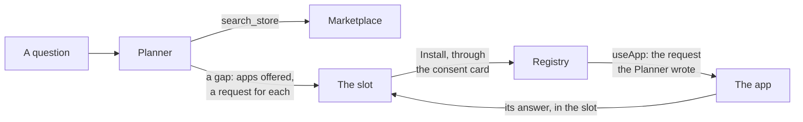

## Six ideas to hold on to

### 1. The Planner reaches the Store through a tool

The Router still ranks only the installed apps; the marketplace isn't folded into it. The Planner, which already calls the platform's readers as tools, has one more: `search_store`, which asks the marketplace's search with the words the Planner chooses. The model sees the Store only through that tool's answer, never its index. A plan that doesn't call the tool never waits on the marketplace; one that does waits within the limit every request to the Store has.

### 2. A gap names the apps it offers, and the request for each

Where a question needs something no installed app can do, the plan has a **gap**: a slot named by its search words, offering the apps the Planner chose from the tool's answer, each with the request it would send that app once installed. The plan check accepts an offered app only when this plan's own tool call returned it and it isn't installed. The shell draws the offer from the marketplace's entries — name, publisher, description — never from the model's words.

### 3. Install happens in the slot, and only that slot fills

Install opens the consent card the Store uses, floating over the slot. Once the app is in, the slot sends the request the Planner wrote, painted in that slot: no second plan. Every other slot offering the same app, on any canvas, turns its row to **Show it here**, one press with no second consent. An app that needs sign-in takes it as a second step: the install's consent and the sign-in stay two consents.

### 4. Nothing to offer is one quiet line

When the tool's answer is empty, nothing in it fits, or the marketplace can't be reached, the slot is one line in the shell's words — "Nothing in the Store can do this yet." or "Couldn't reach the Store." — with "Search the Store". The orchestrator chooses the line from its own record of the tool call, never from the model.

### 5. One update tile, its line chosen by what the Store holds

An app that can't paint in what it's installed with takes one **update tile**, in the shell's words. It's caught before the call, when the live card names no catalog id the app is entitled to, or after it, from the live card fetched again. Its line follows what the Store holds: "Shop A needs an update to show this." with Update; "Shop A has changed, and the Store is waiting on its publisher, a2uiverse-apps." with Check again; "…and the Store couldn't be reached." with Retry; "…and the Store has no update for it." Access is judged on the card as installed: a new permission on a live card is asked only through the update's consent card, once the Store has that card.

### 6. A paint is drawn in the build the registry holds when it arrives

Every paint is drawn in the build of its catalog that the registry holds at the moment it arrives, and a surface on screen keeps the build it was drawn in, as does a paint the way back returns to. So an update changes the next paint, never the one you're looking at.

## One canvas, an install and an update

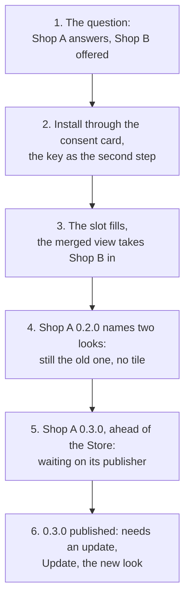

**1. The question, and the offer.** "Compare camera prices at Shop A and Shop B." The Router shortlists the one installed shop. The Planner calls `search_store` once, with the words `"Shop B"`, and the marketplace answers Shop B's entry: its name, its publisher `a2uiverse-apps`, its description and its skills. The plan, in 23.7 seconds:

```jsonc
{
  "title": "Camera prices at Shop A and Shop B",
  "dispatch": [
    {"source": "shop-a", "request": "Show the camera bodies you have in stock with their prices; for each, include its full model name and its price."},
    {"source": "shell", "request": "One row per camera across the shops, the same model at both shops merged into one row, with each shop’s price and the lowest of them.",
     "columns": ["Camera", "Shop A", "Lowest price"], "columnSources": [null, "shop-a", null],
     "join": {"home": null, "entity": "cameras", "nouns": {"shop-a": "cameras"}}},
    {"gap": "Shop B", "offers": [{"app": "shop-b", "request": "Show the camera bodies you have in stock with their prices; for each, include its full model name and its price."}]}
  ],
  "tree": {"components": [
    {"id": "root", "component": "Column", "children": ["merged", "sources"]},
    {"id": "merged", "component": "Slot", "source": "shell"},
    {"id": "sources", "component": "Row", "children": ["shop-a", "shop-b"]},
    {"id": "shop-a", "component": "Slot", "source": "shop-a"},
    {"id": "shop-b", "component": "Slot", "gap": "Shop B"}
  ]}
}
```

The gap is a `Slot` like any other, named by its words, and the request it offers Shop B is the one Shop A gets. Shop A answers its list in its own brown look. The merged view has one source, so it collapses to "Only Shop A answered, so there's nothing to combine." Shop B's slot is the offer, drawn by the shell from Shop B's entry: "None of your apps can do this. From the Store:", Shop B by a2uiverse-apps with its description and Install, and "More in the Store".

<p align="center">
  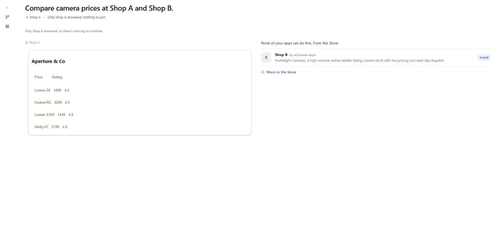
  <br>
  <em>The first paint: Shop A's answer, and Shop B offered in its slot.</em>
</p>

**2. Install, through the consent card in the slot.** Install reads Shop B's Store entry again and opens the consent card floating over the slot, anchored to the press: "Install Shop B?", its description, and "The first time you use it, Shop B will ask you to connect with a key."

<p align="center">
  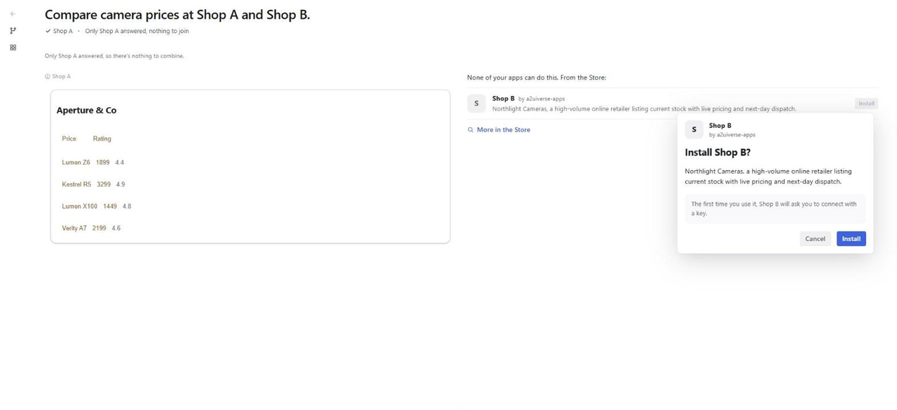
  <br>
  <em>The consent card over the slot. The Store's own card, in a frame anchored to the press.</em>
</p>

Install posts the install by id to the orchestrator; the row reads "From the Store:", Shop B "Installed" with Loading…. The journal:

```json
{"kind":"registry","operation":"install","appId":"shop-b","cardUrl":"http://localhost:12002/.well-known/agent-card.json","catalogs":[{"catalogId":"https://github.com/retz8/a2uiverse-apps/blob/main/mocks/shop-b/shop-b-catalog/catalogs/v0.9.1/catalog.json","artifact":"sha256-_TCD3fq4YuIEIkQUXick5spwJggpnchxEq4Fx3I8GWE"}],"outcome":"installed","source":"marketplace","by":"page"}
```

Then the client presses `useApp` naming Shop B and the gap `"Shop B"`, and the orchestrator turns the gap into Shop B's slot and sends it the request the plan offered it, with no second plan. Shop B asks you to connect with a key, so the dispatch stops before the call, the way any slot needing sign-in does, and the slot says "Connect Shop B to show it here." with Connect, "Opens a page to paste your Shop B key". The progress line reads "Shop B not connected".

**3. The slot fills, and the merged view takes Shop B in.** The key is pasted on the orchestrator's own Connect Shop B page, and the sign-in's completion sends the request again. Shop B's slot fills with its stock in its own teal look, and the merged view, collapsed until now, is made over both shops on arrival: "Camera Price Comparison", Camera, Shop A, Shop B and Lowest price, Orbit GM3 at US$899 from Shop B alone and Lumen X100 at US$1,379.

<p align="center">
  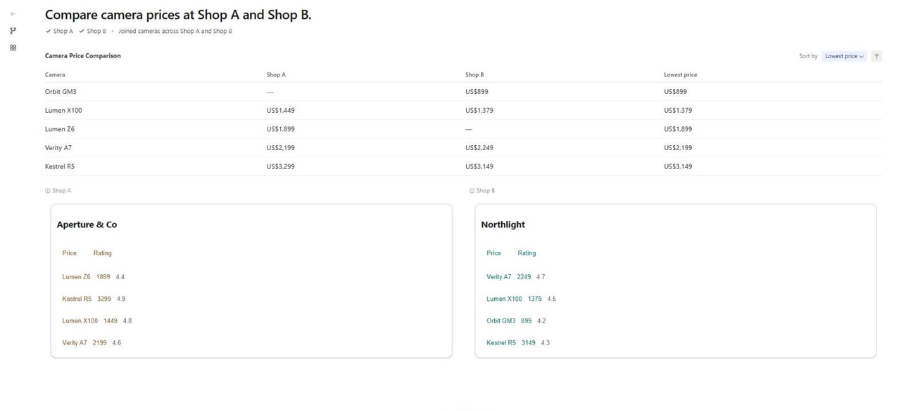
  <br>
  <em>Shop B's slot filled, and the merged view made over both shops.</em>
</p>

**4. Shop A names two looks.** Shop A's publisher ships a breaking change: a new catalog id, with the Video component removed and its accent turned from brown to purple. Shop A's 0.2.0 card names the new id beside the old one, the kit's **old catalog line** ([`agent-kit.md`](agent-kit.md)), and is published:

```text
republished shop-a · card 0.1.0 → 0.2.0 · catalog sha256-g_rV6uea… · catalog https://github.com/retz8/a2uiverse-apps/blob/main/mocks/shop-a/shop-a-catalog/catalogs/v2/catalog.json new at sha256-IQ7jeqeT…
```

Your install still holds the old line, and the live card still names it, so nothing stops: a press on Lumen Z6 in Shop A's list is answered in the old id, its detail in the old brown look, no tile.

<p align="center">
  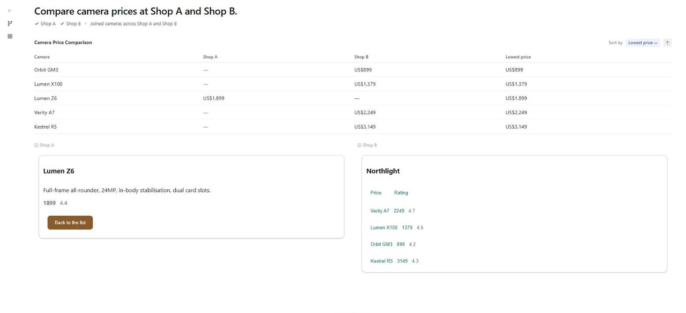
  <br>
  <em>Shop A at 0.2.0, answering in the old line. The merged view now reads one camera from Shop A, its detail.</em>
</p>

The App Library reads Shop A "A new version is available", with Update, a suggested update left unpressed.

<p align="center">
  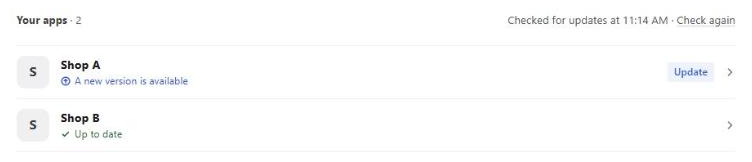
  <br>
  <em>The change offered as a suggested update.</em>
</p>

**5. Ahead of the Store.** Shop A's 0.3.0 drops the old line and isn't published yet; its agent restarts naming the new id alone. On the canvas, "Back to the list" in Shop A's detail goes to the agent, which offers you nothing you can draw and paints no surface. The call ended with no surface, so the orchestrator fetches Shop A's live card again, given five seconds: it names no catalog id Shop A is entitled to. Shop A's entry in the Store is still 0.2.0, which doesn't have 0.3.0's card, so the slot reads:

<p align="center">
  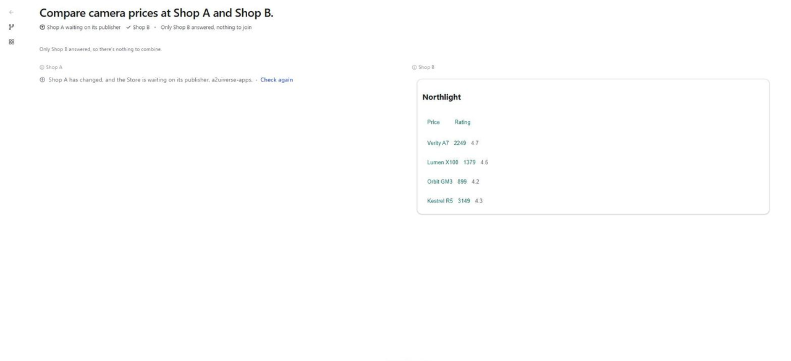
  <br>
  <em>Ahead of the Store: the waiting line, with Check again.</em>
</p>

The journal's dispatch records `failed (answered with no UI, its live card naming nothing it is installed with)`, and the orchestrator reports the change to the marketplace as the update check does. Check again judges Shop A afresh, its live card fetched again and its entry read again, and lands on the same line. A second question, "Which cameras can I buy, and where?", opens a canvas of its own: Shop A's slot takes the same line before the call, the agent never asked.

**6. Published: the update, and the new look.** 0.3.0 is published, retiring the old line:

```text
republished shop-a · card 0.2.0 → 0.3.0 · catalog sha256-IQ7jeqeT… · catalog https://github.com/retz8/a2uiverse-apps/blob/main/mocks/shop-a/shop-a-catalog/catalogs/v0.9.1/catalog.json gone
```

Back on the camera canvas, now a past canvas, which stays actable, Check again reads Shop A's entry again and finds the installed line retired, `update-required` from 0.1.0 to 0.3.0:

<p align="center">
  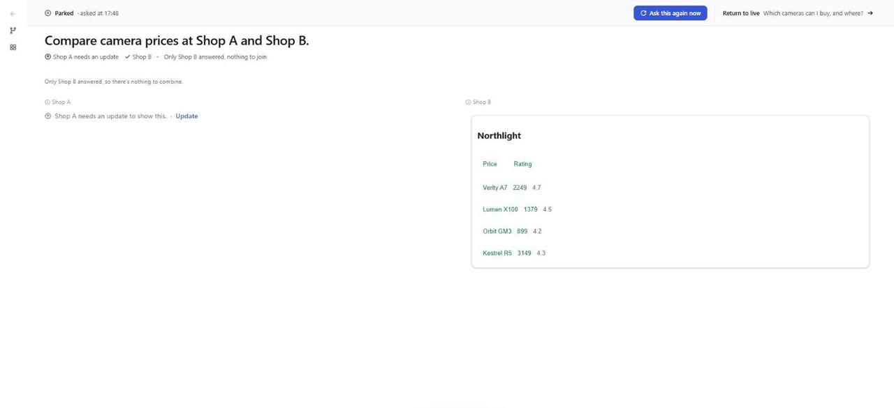
  <br>
  <em>The Store has the update: needs an update, with Update.</em>
</p>

Update asks for nothing new, so it goes straight through: the install by id over the held app, journaled `install-over` with the new id at `sha256-IQ7jeqeTE1IA5PLXubeDRKyKQcKlBJUUMHrCUI0EtO0`. The tile reads "Shop A is updated." with Loading… while its request goes again. The press the slot had kept, "Back to the list", was made on a surface drawn in the old id, which the update dropped, so the slot sends the plan's request instead, and Shop A paints its list afresh in the new purple look. The merged view comes back over both shops.

<p align="center">
  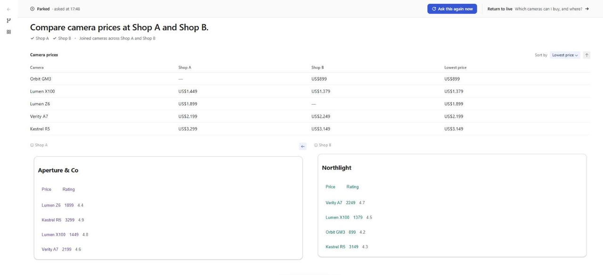
  <br>
  <em>Shop A in its new build. Shop B's answer, and Shop A's earlier screens, keep the look they were drawn in.</em>
</p>

Shop A's back arrow returns to its Lumen Z6 screen, still brown: a paint the way back returns to keeps its build. And on the second canvas, whose slot was waiting on the same update, the line has turned:

<p align="center">
  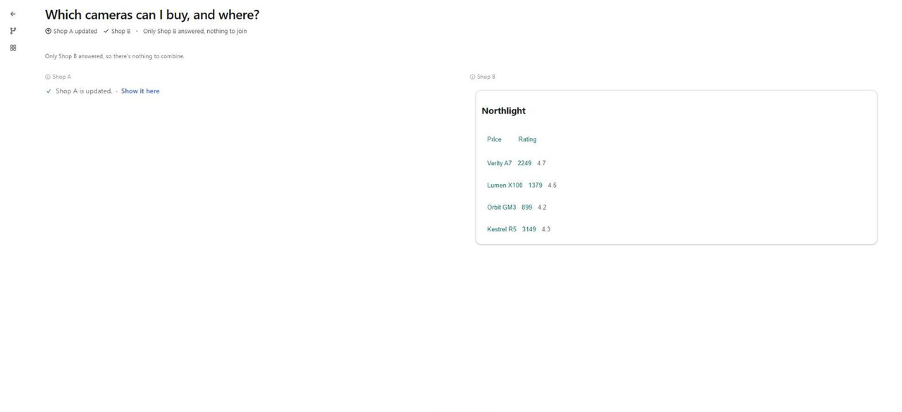
  <br>
  <em>Every other slot waiting on the same update turns to Show it here once it lands, with no second consent.</em>
</p>

## Beyond the example

### A sign-in app offered

An app that asks you to sign in is offered and installed the same way. Once it's in, the slot is checked before the dispatch like any slot and takes the sign-in tile, or its quiet line once the full tile has shown this page load; signing in sends the request then. The install's consent card and the sign-in are two consents, never one. Shop B's key above is this case: "Connect Shop B to show it here." is the second step.

### More in the Store, and Show it here

"More in the Store" opens the Store page on the gap's words, tied to the slot it came from ([`trusted-page.md`](trusted-page.md#opened-from-a-slot)). An install there of an app the slot offered fills that slot beneath the page, "Shop B is installed. It's answering on your canvas.", with Back to your canvas. Every other slot offering the same app, on any canvas, turns its row to Show it here, "Installed" beside it, under "From the Store:" alone: one press, no second consent, the slot sending the request its own plan wrote. An installed app the slot didn't offer leaves the slot as it is.

### Nothing to offer, and the install ask

When the search answers nothing, nothing it answers fits, or the marketplace can't be reached, the plan names a gap that offers no app, and the slot is one quiet line: "Nothing in the Store can do this yet." or "Couldn't reach the Store.", with Search the Store opening the page on the words. The orchestrator picks the line from the plan's own record of its search — reached or not — never from the model. Nothing resumes, no request having been written.

"Install Shop B." gets the same offer, the Planner calling the search and writing no request. Painted as asking nothing, it opens with "From the Store:" alone, and once Shop B is installed the slot reads "Shop B is installed. Try asking “What cameras do you have?”", the card's first example, nothing sent to Shop B. "Install Shop B and show me its cameras." writes a request, and fills like the example. "Install Shop A.", asked with Shop A installed, names no gap: the Planner answers in one line, "Shop A is already installed. Try asking “What cameras do you have?”", with Manage Shop A into the App Library.

### The update that asks for more

An app ahead of the Store whose live card asks a new permission takes the waiting line, not the needs-more-access tile: access is judged on the card as installed, and the live card is read only to see that the app has changed. Once the Store has the card, the line is "CircleCI needs an update to show this.", and Update opens the consent card over the slot, saying only what's new: "This version asks for more. The next time you use it, CircleCI will also ask to be able to" over the permission in the card's words. After the update, the slot sends its request again; an account that lacks the new permission takes the needs-more-access tile, and Allow's sign-in fills the slot. Two steps, as an install and its sign-in are.

### The slot's refusals

- **No Store answer.** The tile's line with the Store unreached is "Shop B has changed, and the Store couldn't be reached." with Retry, which judges the app again; an app no longer in the Store, or installed from your computer, reads "Shop B has changed, and the Store has no update for it.", with nothing to press.
- **Uninstalled.** A slot whose app was uninstalled keeps "This app isn't installed anymore." with Retry, and offers no reinstall.
- **An install refused** says why on its own row, in the Store's words, with that cause's press: the Store behind the app, the app or the Store unreached, the checks failed, the app no longer in the Store ("Google Calendar isn't in the Store anymore, so nothing was installed.", nothing to press), or a request that got no answer ("That didn't go through, so nothing was installed.", Try again). The refusal stays on its slot until the next press there, or until the app is installed elsewhere. Try again goes with no second consent card only after a press that passed the card.

### A past canvas, and the way back, after a new build

A paint is drawn in the build the registry holds when it arrives, wherever it arrives. When Linear's catalog moves to a newer build at the same card, the App Library's check installs it, and the list already on screen keeps its look. A press inside Linear's answer paints its new surface in the new build; Linear's back arrow returns to the list in the old one. A press on a past canvas, which stays actable, is answered in the new build too. A surface on screen moves to the new build only when its app changes its components, re-created there with its tree and data; a change to its data alone moves nothing.

## Inside the machinery

### The search, and the plan check

`search_store` is the one Planner tool with input (`apps/orchestrator/src/planner/storeSearch.ts`). It asks the marketplace's search route, `search?q=<words>`, through the orchestrator's marketplace client, within `A2UIVERSE_MARKETPLACE_TIMEOUT_SECONDS` (10 by default), and answers the model:

```ts
type StoreAnswer = {apps: StoreApp[]} | {unreached: string};
interface StoreApp {appId: string; name: string; publisher: string; description: string;
  skills: {name: string; description: string; examples: string[]}[]}
```

Installed apps are left out of the answer. An attempt takes at most five steps (`MAX_STEPS`): the three readers, the search, and the answer. Each call goes on the plan's record as `{name: "search_store", args: {words}, result}`, and `searchesOf` reads that record back as `{words, reached, apps}`, the one record behind the plan check, the line with nothing to offer and the journal.

The gap in the plan is `{gap: "<words>", offers: [{app, request?}]}` beside the dispatch entries, and a `Slot` holding `gap: "<words>"` in the tree. The validator's `offerErrors` refuses a gap whose words aren't one of this plan's searches, an app offered twice or under two gaps, an installed app ("dispatch to it, never offer it"), an app no search of this plan returned, and a blank request. A refused plan goes back to the model once with the findings, in the same conversation; a second refusal is a broken turn. A gap with an offer counts toward a merged view's two sources.

### Painting the offer

`compositionFrom` builds a `GapEntry` per gap from the plan and its searches: each offered app's id, name, publisher and description from the entry the search answered, and the request kept on the orchestrator; with no offers, `none: "unreached"` when the search with those words didn't reach the Store, else `"nothing"`. The shell painter writes the `Slot`'s `offer`:

```jsonc
{"id": "shop-b", "component": "Slot", "gap": "Shop B",
 "offer": {"apps": [{"appId": "shop-b", "name": "Shop B", "publisher": "a2uiverse-apps",
   "description": "Northlight Cameras, a high-volume online retailer listing current stock with live pricing and next-day dispatch."}]}}
```

`asksNothing: true` when no offered app has a request. The shell catalog draws every word ([`shell-catalog.md`](shell-catalog.md#store-loop-surfaces)).

### The fill

`useApp` is a press on the composition, like Retry, carried by the A2UIVerse extension: `{kind: "useApp", sources: ["shop-b"], gap: "Shop B"}`. The executor refuses it when the gap isn't there or is already filled, when it doesn't offer the app, or when the app isn't installed. Otherwise `fillGap` turns the gap into one of three things:

| The offer | The gap becomes | Then |
| --- | --- | --- |
| asked nothing of the app | `installed`, with the card's first example | the installed line; nothing dispatched, no sign-in checked |
| a request, the app holding two accounts or more | an account choice | one press per account |
| a request | the app's source slot, its plan the offer's request | the slot's Retry: the checks before dispatch, then the request |

Until the app's first answer, the slot keeps the offer it came from (`keeps: {gap}`), painted as `offered`, and its `Attribution` `fromOffer`, so it changes once. Before the merge is decided, the new source rejoins the pack; after, its arrival is folded in or brings a collapsed merge back, by the same rule as any Retry ([`synthesis.md`](synthesis.md#deciding-when-to-merge)).

### The client's half

- **`installedApps.ts`** holds each installed app's version and name, and the apps a press holds. A press anywhere — a slot, the Store, the App Library — holds its app until it lands, is refused or is cancelled, and every other press for that app waits.
- **`slotActs.ts`** takes the shell catalog's Install, Update and Show it here. Install reads the app's entry again (a read finding it unpublished refuses as no longer in the Store), then opens `SlotConsentCard`, the Store's card in a popover anchored to the press; while it's open, a paint that would move the press is scrolled back by the same distance. Confirmed, it installs over `orchestratorApi`, reads the installed apps and the catalog table again, names any app that followed onto a new build in the notice line, and sends the fill: `useApp` on an offer, the slot's Retry on an update tile. Show it here is the fill alone.
- **The trail store's `openedFrom`** ties a Store page to the unfilled offer it was opened from; `fillFromPage` sends that slot's `useApp` when an install on the page lands one of its apps, and unties.

### The update check, and its finding

The pool runs two checks before every dispatch (`agentsPool/agentsPool.ts`): `catalogsChanged`, before the sign-in, true when the live card the run holds names catalog ids and none of them is in the app's entitlement; and `permissionChanged`, after it, the vault's judgement that the account meets the installed card but falls short of the live one. Either stops the dispatch, the agent not called, with an **update finding** on its record (`registry/updateTile.ts`):

```ts
interface UpdateFinding {case: 'catalogs' | 'permission'; state: UpdateState; publisher?: string; line: UpdateLine}
```

`state` is the update check's state for that one app, its Store entry read then; `updateLineOf` picks the line from it:

| Update state | Line | Press |
| --- | --- | --- |
| `update-required`, `major-update`, `card-update` | needs an update | Update, through the consent card when it asks for more |
| `ahead-of-store`, `up-to-date`, `newer-build` | waiting on its publisher | Check again |
| `unknown` | the Store couldn't be reached | Retry |
| `not-published`, or installed from your computer | the Store has no update for it | none |

The catch after the call is the same finding, reached from the live card fetched again, given five seconds: after a paint refused outside the entitlement, a card naming a catalog id beyond it; after a call that ended with no surface, one beyond it and none in it. The executor's `#settleUpdate` puts the slot in state `update`, out of the merge as a slot waiting on sign-in is, and the painter writes its `update`: `{state, installedVersion, publishedVersion?, newScopes?, publisher?}`.

### Update, and what it sends again

Update is the install by id over the held app, journaled `install-over`; landed, the client sends the slot's Retry. The executor keeps the tile on the slot while the resend is pending (`keeps: {update}`), and the check before dispatch runs again. The resend is what failed — the press kept from inside the fragment — unless that press was made on a surface drawn in a catalog the update dropped: the pool keeps each surface's catalog, and `drawnInDropped` sends the plan's request instead, so the app paints afresh in what it now holds rather than updating an old surface in the old look. Check again is the same Retry with no install. A Retry from the tile — Update's or Check again — first fetches the app's live card again, given five seconds, so the check before dispatch judges the app as it is now: an agent moved back to what the Store holds is called. On the client, the tile reads "Shop A is updated." once the page holds the app past the version its line was drawn from, with Loading… while its own request is on the way, or Show it here.

### A paint in the build of its arrival

Every event carrying A2UI is stamped with `builds`, the app's catalogs at the builds the registry holds when it's relayed (`Registry.builds`). The client's gate loads that build and assigns it to the message; the canvas's processor draws a create in it, and a change to an existing surface's components in a newer build moves the surface there. A copy the way back keeps carries its build and is restored in it. [`app-install.md`](app-install.md#loading-in-the-client) has the structures.

### The kit's two catalog ids

A kit app ships a breaking catalog change as a suggested update by naming its old catalog id beside the new one, newest first (`old_catalog_line` in its config). The orchestrator tells each app the ids it's installed with, so an install on the old line is answered in it; one on neither gets "Shop A has changed and can't show this here." and no UI, which is the call with no surface the catch after the call reads. [`agent-kit.md`](agent-kit.md#an-old-catalog-line-beside-the-new-one) has the kit's side.

### Journal

The loop adds no entry kind. The search is a tool call on the plan's record; the gap rides in the plan's layout; `useApp` is an operation line, `"useApp shop-b on gap 'Shop B'"`; the install is a `registry` line `by: "page"`; a dispatch the update check stopped is a dispatch record, failed with no cause, carrying the update finding and, after the call, `refetched: "changed" | "unchanged" | "unanswered"`.

## When things go wrong

| What you see | What happened | What to do |
| --- | --- | --- |
| "Couldn't reach the Store." where an offer would be | The plan's search didn't reach the marketplace | Start the marketplace; ask again — nothing resumes on its own |
| "Nothing in the Store can do this yet." for an app you know is published | The search's cut didn't reach it, or the Planner judged it didn't fit | Search the Store on the words; a later question offers it if it fits |
| A row's "Shop B can't be installed yet." | Shop B's live card is ahead of the Store | The publisher publishes; Try again later |
| "…and the Store is waiting on its publisher" that doesn't move | The app changed and the Store hasn't the version yet | Check again once it's published, or once the app is back on what the Store holds |
| "Shop A is updated." with Show it here on the slot you pressed Update in | The update landed, and its resend got no answer | Show it here sends it again |
| A slot on "Loading…" after Install | The app's first answer, or its sign-in, hasn't landed | It changes once, when one does |

## Design decisions

| Decision | What it buys | What it costs |
| --- | --- | --- |
| **The install happens in the slot** | The question that needed the app gets its answer where it was asked; nothing else moves | The slot carries the offer's whole life: offered, installing, installed, filled, refused |
| **The marketplace reached through a Planner tool** | The Router stays over the installed apps; a plan that never searches never waits | A plan that searches takes about 30 s; a published app's card text reaches the Planner, and the marketplace learns the words of the missing capability (SPEC §16) |
| **The model chooses the apps and writes the words; the shell draws every pixel** | No model-written Install button; the offer is the Store's own entries | The model can only offer what its own search returned |
| **The line with nothing to offer chosen from the search's record** | The quiet line is true to what happened, whatever the model says | A search the Planner ran under other words than the gap's can't speak for it |
| **Only the slot the install came from fills** | An install never rearranges another canvas | Every other slot turns to Show it here, one press each |
| **One update tile, its line from what the Store holds** | A version mismatch is said as what it is, never as a broken app; the update is the person's press | A check of the app's entry runs before the line shows |
| **Access judged on the card as installed** | A permission is granted only on the words the person agreed to | A new permission waits for the Store to have the card |
| **A paint drawn in the build the registry holds when it arrives** | Nothing on screen changes its look under an update; the next paint is current | A canvas can show two builds of one catalog side by side |
| **A kept press whose look an update dropped is not sent again** | The app paints afresh in what it now holds | The press is lost; the plan's request goes instead |

## Known limits

- **A plan that searches is slow.** About 30 seconds for the example, up to 66 when the Planner searches several times.
- **The search can't tell a search nothing fits from a match.** "flight booking" scores Google Calendar above the weakest right match in the labelled searches, so the Planner judges fit itself ([`marketplace.md`](marketplace.md#index-embedding-and-search)).
- **A change made while the orchestrator runs** shows only once the live card is fetched again: by the App Library's check, a Retry from the update tile, a refused paint, or a call that ends with no surface.
- **A question changes no canvas but its own.** Every question opens a canvas of its own, so an install asked for answers on the new canvas, not the one you were looking at.

## Trying it

- **Without a model or a stack.** `pnpm --filter @a2uiverse/client preview:snapshot`, then `http://localhost:4173/?beat=31&instant&byhand`: the camera comparison recorded with Shop B offered, its presses left to you. Shop B is installed in the snapshot's fixed world, so its row reads Show it here. Beats 32 to 34 are both shops offered and the install ask; `?beat=gap-unreached`, `update-needed`, `update-waiting`, `update-asks-more` and `update-uninstalled` are the lines the recordings don't show.
- **The example.** On a scratch state for the marketplace and the orchestrator (`STATE_DIR` on each), launch the two shops with Shop B published and left uninstalled: `pnpm dev:agents --tier mocks --mode deterministic --publish --leave-uninstalled shop-b --publisher-file <scratch>/publisher.json`. Ask "Compare camera prices at Shop A and Shop B." Shop A's two lines are a temporary change in `a2uiverse-apps`: a copy of its catalog under a new id with Video removed and a new accent, packed with Stellify, and `old_catalog_line` in its agent's config ([`agent-kit.md`](agent-kit.md#an-old-catalog-line-beside-the-new-one)), published with `stellify publish` against the scratch marketplace.
- **The tests.** The replay suite draws the offer and the update tile over the fixed world (`apps/client/e2e/store-loop.spec.ts`, `update-tile.spec.ts`, `per-paint-builds.spec.ts`); the live suite installs Calendar from a slot and from the Store page opened from one (`e2e-live/store-loop.spec.ts`). The orchestrator's are in `test/orchestrator.test.ts` (the offer and the fill), `test/plannerValidate.test.ts` (the plan check) and `test/updateOnCanvas.test.ts`, the client's `slotActs.test.ts` and `installedApps.test.ts`, the shell catalog's `offer.test.tsx` and `update-tile.test.tsx`.

## Where the code is

| Concern | Orchestrator (`apps/orchestrator/src`) | Client (`apps/client/src`) | Elsewhere |
| --- | --- | --- | --- |
| The search | `planner/storeSearch.ts`, `planner/readers.ts`, `registry/marketplace.ts` | | `apps/marketplace/src/marketplace.ts` (the search) |
| The gap and the plan check | `planner/document.ts`, `planner/validate.ts` (`offerErrors`) | | |
| The offer, painted | `composition/state.ts` (`gapEntry`, `fillGap`), `composition/shellPainter.ts` | | `packages/shell-catalog/src/components/slot/offer.tsx` |
| `useApp` and the fill | `executor.ts` | `canvas/slotActs.ts`, `canvas/installedApps.ts` | `packages/sdk/js/src/a2uiverse.ts` (`useApp`) |
| The consent card over a slot | | `canvas/trustedPage/ConsentCard.tsx`, `canvas/CanvasApp.tsx` | |
| The Store page tied to a slot | | `canvas/trail/trailStore.ts` (`openedFrom`), `canvas/trustedPage/useAppAct.ts` | |
| The update check and the catch | `agentsPool/agentsPool.ts`, `registry/updateTile.ts`, `registry/updates.ts` | | `packages/shell-catalog/src/components/slot/update-tile.tsx` |
| Update and its resend | `executor.ts` (`#retry`, `#redispatch`), `agentsPool/agentsPool.ts` (`drawnInDropped`) | `canvas/turnProgress.ts` | |
| Builds per paint | `composition/fragmentRelay.ts`, `registry/registry.ts` (`builds`) | `catalogs/catalogGate.ts`, `catalogs/paintBuilds.ts` | |
| The kit's two ids | | | `a2uiverse-apps/agent-kit/src/a2ui_agent_kit/catalog_lines.py` |

## Words used in this guide

| Word | Meaning |
| --- | --- |
| **Store loop** | A question needing an app you don't have, offered and installed in its slot; an app that has changed, updated there |
| **Gap** | A slot for what no installed app can do, named by the words of the Planner's search |
| **Offer** | What a gap's slot shows: the apps the Planner chose from the Store, each with Install |
| **`useApp`** | The press that turns a gap into the installed app's slot and sends it the request the plan offered it |
| **Show it here** | The one press that fills a slot offering an app installed elsewhere, or updated elsewhere |
| **Update tile** | The one line a slot shows when its app can't paint in what it's installed with |
| **Update finding** | What the update tile is drawn from: why, the update state, the publisher and the line |
| **Entitlement** | The catalogs an app may paint in: those handed at its install, plus the basic catalog |
| **Catch after the call** | The live card fetched again after a refused paint or a call that ended with no surface |
| **Old catalog line** | A kit app's old catalog id kept beside its new one, so a breaking change ships as a suggested update |
| **Build** | One packed version of a catalog, named by its artifact id |
