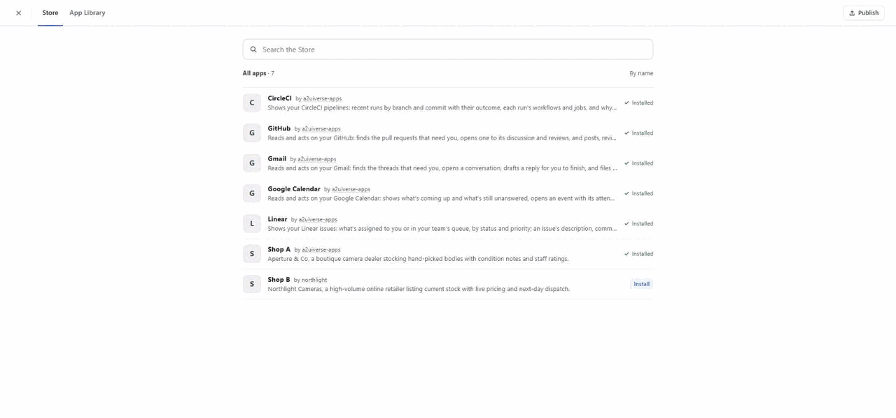
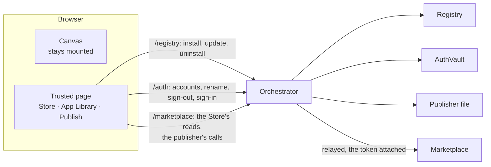
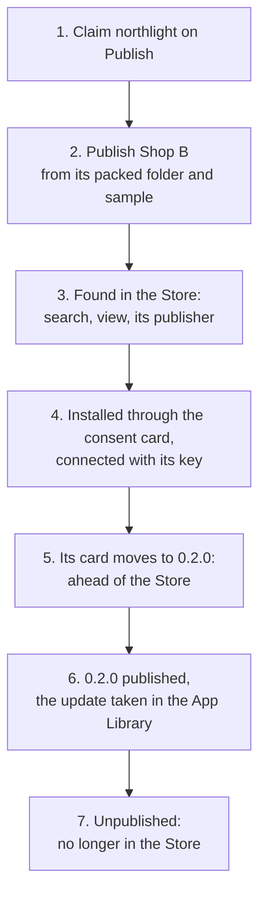
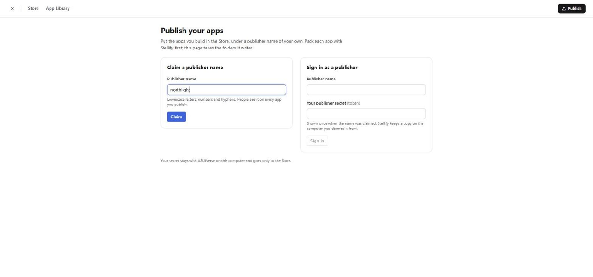
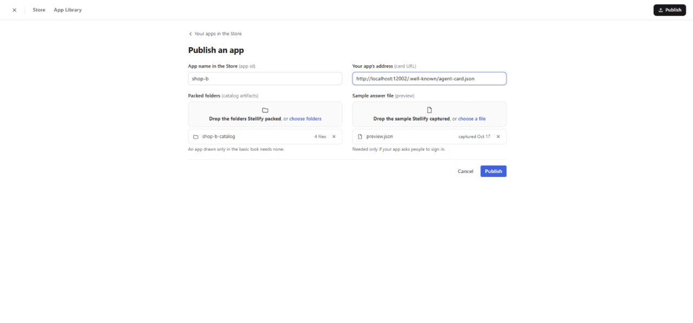
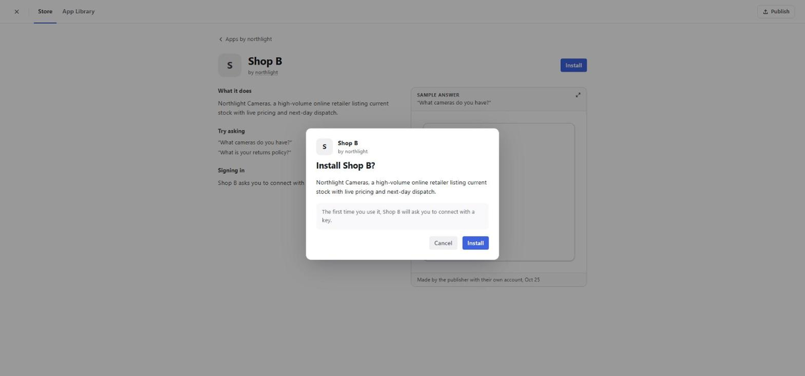
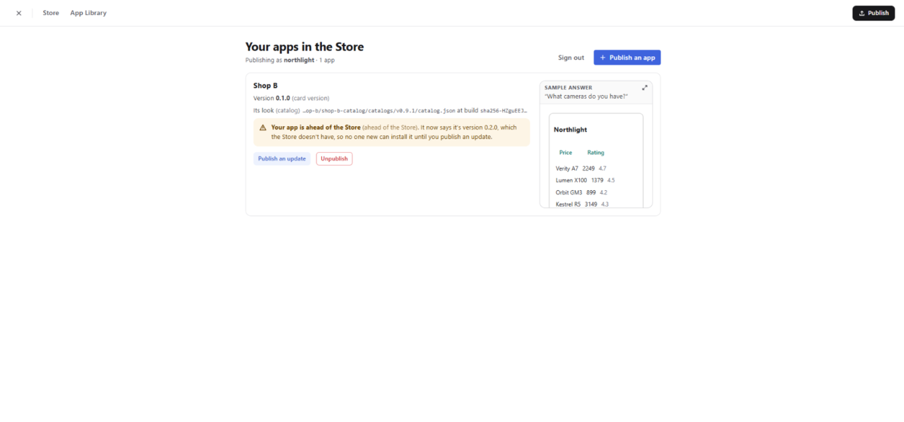
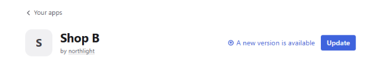
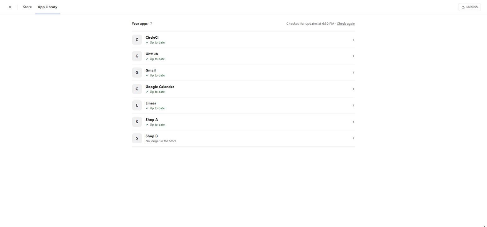

# Trusted page: the Store, the App Library and Publish

This guide explains the **trusted page**: the one page A2UIVerse draws over the canvas, where you find apps in the Store, look after the ones you have in the App Library, and, if you build apps yourself, put them in the Store from Publish. It's written for a frontend engineer meeting A2UIVerse for the first time. It starts with the ideas, follows one app through all three destinations, then opens up the machinery, and ends with the design decisions and where the code lives.

One example runs through the whole guide: **Shop B**, a mock camera retailer from Northlight, put in the Store by a publisher who also uses A2UIVerse, then found, installed, updated and taken out again, all on the page. It's a real run on the deterministic apps: GitHub, Gmail, Google Calendar, CircleCI, Linear and Shop A were published by the dev publisher `a2uiverse-apps` and installed; Shop B's agent was running, neither published nor installed. Every id, hash and line below is a real one. You can repeat it yourself (see [Trying it](#trying-it)).

<p align="center">
  
  <br>
  <em>The Store: a search, Shop B's view with its sample answer drawn live in Shop B's own look, and the apps of its publisher.</em>
</p>

## Problem it solves

Apps come into A2UIVerse from anyone, through the marketplace. Someone has to find one, install it, keep it current, look after the accounts it signs in to and take it away again; and someone who builds an app has to put it in the Store. Doing that inside A2UIVerse raises four problems.

1. **Who draws it?** The canvas is composed by a model and painted by apps. A page that installs code and grants an app access can be neither: if an app or a model could draw it, it could draw an Install button that installs something else. So the page is the shell's own, drawn by the client from what the orchestrator says, and the model only paints a button into it.
2. **Where does it go?** Not in place of the canvas. You open the Store because of something you were looking at; closing the Store has to put you back in front of exactly that, untouched.
3. **Who holds the secrets?** An app's account lives in the orchestrator's vault ([`authority.md`](authority.md)). A publisher has a secret too, the token the marketplace issued for their name. Neither may sit in the browser, where every app's UI runs on the same page.
4. **The network loses answers.** Through a dev tunnel a request can go unanswered for minutes. A page that waits forever says "Updating" until you reload; a page that sends again may install twice. Both are wrong.

The answer, in one line: **one page over the canvas, drawn by the shell; the orchestrator its hands; nothing in the browser worth stealing.**



## Seven ideas to hold on to

### 1. One page over the canvas, never instead of it

The trusted page is an overlay (`TrustedPageOverlay`), a dialog drawn over the canvas while the canvas stays mounted beneath it. Nothing in the canvas is torn down when it opens, so closing it shows the canvas as you left it: its slots, its scroll, its answers. There are two ways in. **Apps**, the button under Back and Trail, opens it by hand. The Planner's shell actions open it from an answer: `openStore` with an optional query, `openAppLibrary` with an optional app, and `openPublish`. The model paints only the button; the page it opens is the shell's.

### 2. Three destinations, one address

The page has three **destinations**: the **Store** over the marketplace, the **App Library** over what's installed, and **Publish**, the publisher's side of the Store. The header holds the way back to the canvas, Store and App Library as two tabs, and Publish at its right edge. Where you are lives in the address: `?page=store&q=camera+prices&app=shop-b` is Shop B's view in the Store, opened from a search. So a link opens the page there, a reload lands back on it, and browser Back closes it. The canvas itself is never in the address: a reload starts a fresh session.

### 3. The browser knows one address

The client talks only to the orchestrator. The Store's reads go to the orchestrator under `/marketplace`, which relays them to the marketplace it already knows, and **annotates** each listing with what only it holds: whether the app is installed here, and its update state as last computed. The marketplace never sees the browser.

### 4. The orchestrator is the publisher's hands

A publisher who also uses A2UIVerse claims their name on Publish. The orchestrator keeps the name, the token and the marketplace that issued it in an owner-only file of its state directory, and relays every publisher call to that marketplace with the token attached. The browser sees the token once, in the claim's answer, so the person can save it, and never again.

### 5. A sample is a picture of an answer

Every listing carries the app's **sample**: the captured preview, an answer the app painted at publish, drawn live in the app's own catalog build, apart from every canvas. It's a picture: nothing in it takes focus or a press. To draw it, the client loads the build the listing names, so a vendor's code runs in the browser before the app is installed. That's a known consequence (SPEC §16).

### 6. Words are the person's

The page never shows a scheme, a scope key, a catalog id or a host. An update state is a plain sentence ("A new version is available"); an app's permissions are its card's own words; Publish puts the plain word first and Stellify's term beside it in grey ("Version 0.1.0 (card version)"). The consent card appears only when there's something to agree to: installing, or an update that asks for more.

### 7. Every write is guarded, bounded and read back

A write from the page — install, update, uninstall, sign-out, rename, claim, publish — carries no token. The orchestrator takes it because it comes from an allowed browser origin with a JSON body. Each write gets a time limit, and one the network swallows is never sent again: the page reads back what it was changing and answers as the write would have.

## Shop B's life on the page



**1. Claim a name.** Signed out, Publish shows two cards side by side: **Claim a publisher name** and **Sign in as a publisher**, over the line "Your secret stays with A2UIVerse on this computer and goes only to the Store." The name is checked before anything is sent: lowercase letters, numbers and hyphens.

<p align="center">
  
  <br>
  <em>Publish, signed out. The name typed, before Claim.</em>
</p>

Claim posts `{"publisher": "northlight"}` to the orchestrator's `/marketplace/claim`, which relays it to the marketplace's own `claim`. The marketplace answers with the token, once, and logs `claimed northlight`. The orchestrator writes the name, the token and the marketplace's address into `<state>/publisher/publisher.json`, owner-only, and answers the page with the token so it can be shown: "“northlight” is yours", the token with Copy, and "I've saved it somewhere safe", which unlocks Continue. Continue lands on the listings, "Your apps in the Store", "Publishing as northlight · 0 apps", and "Nothing of yours in the Store right now." The journal says:

```json
{"kind":"publisher","at":"2026-10-17T07:08:29.241Z","act":"claim","publisher":"northlight","outcome":"done","by":"page"}
```

**2. Publish from the packed folder.** Pack and preview stay in Stellify, on the publisher's terminal, in Shop B's catalog package. `stellify pack` writes the artifact folder (`shop-b-catalog 0.2.2 — 3 files written to …/dist/artifact`), and `stellify preview` asks the running agent its first screen with the publisher's own credential, Shop B's demo key: `preview of shop-b at 0.1.0 — 1 surface painted`. Shop B asks you to connect with a key, so the Store can't ask it a question itself; the sample has to come from the publisher.

Publish an app opens the form: the app's id, its card URL, the folders Stellify packed, and the sample answer file.

<p align="center">
  
  <br>
  <em>The form filled: the folder read in the browser and labelled from its descriptor, the sample file read and checked.</em>
</p>

The folder is read in the browser, every file by its path inside it, and refused on the spot if no descriptor sits at its top; it's labelled from the descriptor, `shop-b-catalog`, 4 files. The sample file is held to the same preview check Stellify's `publish` applies. Publish sends the body the command line sends, `{appId, cardUrl, catalogs: [{files}], preview}`, each file base64-encoded only now. The orchestrator relays it with the token as the bearer and gives the marketplace 180 seconds; the marketplace runs its publish step ([`marketplace.md`](marketplace.md#publish-in-order)) and lists the app: `published shop-b · card 0.1.0 · catalog sha256-_TCD3fq4… (by northlight)`.

The page lands on the listings, with the outcome on top: "**Shop B 0.1.0 is in the Store.** People can now find Shop B in the Store." The Store's own summary folds under Details:

```text
published shop-b · card 0.1.0 · catalog sha256-_TCD3fq4…
app id "shop-b" is now northlight's
catalog "https://github.com/retz8/a2uiverse-apps/blob/main/mocks/shop-b/shop-b-catalog/catalogs/v0.9.1/catalog.json" is now northlight's
```

The listing reads as Stellify's `list` prints it: "Version 0.1.0 (card version)", "Its look (catalog) …/shop-b-catalog/catalogs/v0.9.1/catalog.json at build sha256-_TCD3fq…", Publish an update, Unpublish, and the sample drawn live beside it.

**3. Found in the Store.** The Store opens on every published app by name, "All apps · 7", Shop B "by northlight" with Install and every other app with ✓ Installed. A search runs on Enter: "camera prices" asks the orchestrator's `/marketplace/search`, which relays the marketplace's matches and annotates each one.

```json
// GET /marketplace/search?q=camera%20prices (each entry trimmed)
{"results": [
  {"entry": {"appId": "shop-b", "publisher": "northlight", …}, "score": 0.411, "installed": false},
  {"entry": {"appId": "shop-a", "publisher": "a2uiverse-apps", …}, "score": 0.379, "installed": true}
]}
```

"Closest matches · 2" lists the two shops; the other five apps score under the cut. The heading says closest, not best: the cut can't tell a search nothing fits from a match, so a search like "flight booking" lists the nearest apps too. Opening Shop B shows its view: **What it does**, the card's description; **Try asking**, its skills' examples, "What cameras do you have?" and "What is your returns policy?"; **Signing in**, "Shop B asks you to connect with a key the first time you use it."; and the sample, headed by the question it answered, a table of Northlight's cameras with their prices and ratings, and the caption "Made by the publisher with their own account, Oct 17".

The sample needs Shop B's build, `sha256-_TCD3fq4YuIEIkQUXick5spwJggpnchxEq4Fx3I8GWE`, which the registry doesn't hold. The loader asks the orchestrator for it under `/marketplace/artifacts/sha256-_TCD3fq4…/`, and the orchestrator fetches each file from the marketplace and checks it before serving: the descriptor's bytes against the id, each file against the hash the descriptor lists. Nothing is written into the registry. The sample then draws in a renderer of its own, over the client's own catalogs and that build.

"by northlight" is a link: it opens `?page=store&publisher=northlight`, "Apps by northlight · 1", the public index filtered on the name. No secret is needed to see a publisher's apps.

**4. Installed, and connected.** Install on Shop B's view opens the consent card in the authority tile's shape: Shop B by northlight, "Install Shop B?", what it is, and what it will ask: "The first time you use it, Shop B will ask you to connect with a key."

<p align="center">
  
  <br>
  <em>The consent card. One press confirms.</em>
</p>

Install posts `{"appId": "shop-b"}` to the orchestrator's `/registry/install`: the install by id ([`app-install.md`](app-install.md), [`marketplace.md`](marketplace.md#install-by-id-inside-the-orchestrator)), the same operation every path takes.

```json
{"kind":"registry","at":"2026-10-17T07:11:49.573Z","operation":"install","appId":"shop-b","cardUrl":"http://localhost:12002/.well-known/agent-card.json","catalogs":[{"catalogId":"https://github.com/retz8/a2uiverse-apps/blob/main/mocks/shop-b/shop-b-catalog/catalogs/v0.9.1/catalog.json","artifact":"sha256-_TCD3fq4YuIEIkQUXick5spwJggpnchxEq4Fx3I8GWE"}],"outcome":"installed","source":"marketplace","by":"page"}
```

The view says "**Shop B is installed.** Try asking “What cameras do you have?” on your canvas.", and its press reads ✓ Installed. Nothing opens Shop B from the Store; asking does.

Shop B's view in the App Library says "No accounts." beside **Add account**, "Opens a page to connect Shop B with its key, in a new window". The window opens the orchestrator's start route naming no canvas, which sends it to the **token page**: "Connect Shop B", "From Shop B:" over the card's description of the key, a link to its help page, "Paste your key", and "Name this account (optional)", its hint the name the account gets left blank, "Shop B". The page polls the attempt as a canvas does, and nothing resumes: the account appears on the page.

**5. Ahead of the Store.** The publisher moves Shop B's card to 0.2.0 and restarts its agent. Publish reads its listings through the orchestrator's `listings.json?publisher=northlight`, which fetches each of the publisher's live cards again, given five seconds, and runs the sdk's drift test on it. Shop B's card names a version the Store doesn't have, so the listing says so the first time Publish is opened:

<p align="center">
  
  <br>
  <em>The notice on Publish, read from the live card.</em>
</p>

The orchestrator reports the drift to the marketplace, which looks at the card itself and sets its own flag: `shop-b is ahead of the Store: version 0.2.0`. In the App Library, the update check runs on entering, and Shop B's row says "A newer version is on its way from the publisher", with nothing to press.

**6. The update, published and taken.** The publisher captures the sample again at 0.2.0 and presses Publish an update on the listing. The form opens with the app's id and card URL filled in, and the sample file "Needed because Shop B asks people to sign in: the Store can't ask it a question without your account." No folder is handed: the marketplace already holds Shop B's build. The outcome: "**Shop B 0.2.0 is in the Store.** People who have Shop B installed see the update in their App Library.", and under Details, `republished shop-b · card 0.1.0 → 0.2.0 · catalog sha256-_TCD3fq4…` and `the held build counts as covered`. The notice is gone.

<p align="center">
  
  <br>
  <em>A card update that asks for nothing new reads as a new version.</em>
</p>

In the App Library, Shop B reads "A new version is available". It's a card update, but its card names no new permission, so Update goes straight through, with no consent card. Update is the install by id again, over the held app, journaled `"operation":"install-over"`. The view says "Updated to the newest version." and its state "Up to date".

**7. No longer in the Store.** Unpublish on the listing asks once: "Unpublish Shop B?", "Shop B leaves the Store. People who installed it keep it, and the name “shop-b” stays yours." Then "**Shop B left the Store.** People who installed it keep it.", over "Nothing of yours in the Store right now." The marketplace logs `unpublished shop-b (by northlight)`, and the Store's search no longer finds Shop B under "Northlight".

<p align="center">
  
  <br>
  <em>The App Library after the unpublish. Shop B stays installed.</em>
</p>

Shop B's view in the App Library says "Its publisher took Shop B out of the Store. It stays installed here until you uninstall it."

## Inside the machinery

### Overlay

`CanvasApp` mounts the overlay beside the canvas, never in its place. It takes the page's state from the trail store: `null` when closed, otherwise `{page, query?, publisher?, app?, form?}`. Opening it moves focus onto it, so the keyboard starts there, not on the canvas underneath; every move inside it scrolls back to its top. The header's tabs and Publish are links to their own addresses, so a modifier-click opens a destination in a new tab, and a plain press moves the page in place. Three things open it: the Apps button (back to the destination you last had open), a shell action from an answer, and an address carrying `page`.

### Reads through the orchestrator

| Route on the orchestrator | What it answers |
| --- | --- |
| `GET /marketplace/index.json` | Every published app: `[{entry, installed, update?}]` |
| `GET /marketplace/search?q=<words>` | `{results: [{entry, score, installed, update?}]}`, the marketplace's matches in its order |
| `GET /marketplace/apps/<appId>/entry.json` | One app, annotated the same way |
| `GET /marketplace/apps/<appId>/preview.json` | Its captured preview |
| `GET /marketplace/artifacts/<id>/<path>` | A preview's build files: from the registry when it holds them, else from the marketplace, checked first |
| `GET /marketplace/publisher.json` | Who is signed in to Publish, the held token asked about each time |
| `GET /marketplace/listings.json?publisher=<name>` | That publisher's apps, each one's live card read again first |
| `GET /registry/apps.json`, `GET /registry/updates.json` | The installed apps; the update check, run and answered |
| `GET /auth/accounts.json` | Every installed app's accounts |

`installed` is the registry's at the moment of the read. `update` is the state the orchestrator last computed, never a check run for this read. A read the marketplace can't answer says why: `503` unreached, `404` not published, `502` an answer that doesn't read. An index entry or a search result that doesn't read is left out and logged, the rest kept.

### Search and the lists the Store holds

The marketplace answers only the apps that match: first an app whose name every searched word starts, in any case ("goog" finds Google Calendar), then the apps scoring at least 0.15 and within 0.095 of the best score, in rank order. The two numbers were fitted on labelled searches over the roster's cards; [`marketplace.md`](marketplace.md#index-embedding-and-search) has the search itself.

While the Store is open it **holds** each list it has shown: every app, and each search's matches. A cleared search, a way back from an app's view or the same search again shows the held list with no read. A list is read again only when the registry changes (an install, update or uninstall from the Store), on Try again, or after you leave the Store.

### Sample: one build per artifact id, drawn apart

A sample needs a `MessageProcessor` over the catalogs it paints in. `SampleFrame` builds one of its own: the client's basic and shell catalogs, plus each build the listing names, loaded through the page's loader by artifact id with the orchestrator's `/marketplace` as the source. The loader keeps one load per artifact id for the whole page, so a build the registry already holds, or another sample already loaded, is loaded once and shared. A sample never joins a canvas's processor, so a canvas never meets a build it didn't load. Each build's stylesheets stay on that build's own surfaces ([`app-install.md`](app-install.md#loading-in-the-client)), so a sample's look can't restyle the canvas beneath. **Enlarge**, at the end of the "Sample answer" line, opens the same picture at full width in a dialog of its own.

### Install and update: one press

`useAppAct` is the one press behind Install and Update, in the Store and the App Library alike. An update is the same install by id over the held app. Its outcome shows where it was pressed: running; done, naming any other installed apps that moved onto the new build with it; or refused with a cause, each in plain words:

| Cause | What the page says |
| --- | --- |
| The Store is behind the app | "Shop B can't be installed yet." "Its publisher has changed the app, and the Store hasn't caught up. Try again later." |
| The app unreached | "Shop B couldn't be reached," "so nothing was installed." |
| The checks failed | "Shop B can't be installed." "Its files didn't pass the checks on this computer, so nothing changed." |
| The Store unreached | "The Store can't be reached right now," |
| The app no longer in the Store | "Shop B isn't in the Store anymore," "so nothing was installed.", with nothing to press |
| No answer, or one naming no cause the page knows | "That didn't go through," "so nothing was installed.", with Try again |

A slot's Install on the canvas reads the app's Store entry again before its consent card, so it can be refused before the card opens. Try again then asks on the card; it goes with no second card only after a press that passed the card, or needed none.

The **consent card** (`ConsentCard`) has two shapes. Installing, it says what the app is, who publishes it, and what it will ask to sign in to, in its own words. Updating, it says only what's new: the new permissions in the app's words, and a new look when a catalog it paints in moves. An update passes it only when it asks for more (`asksForMore` in the sdk): a card update naming a new permission.

### Publisher held by the orchestrator

`marketplace/publisher.ts` keeps one publisher: `{publisher, token, marketplace}` in `<state>/publisher/publisher.json`, written owner-only as the vault's file is. The token goes only to the marketplace that issued it. A file naming another marketplace is shown on Publish by its name alone, "a publisher held for another Store", its token never sent. A claim or a sign-in waits for sign-out while any publisher is held, and sign-out is the only way the token is forgotten: the file is deleted, and the token stays the marketplace's.

Sign-in with a name and a pasted token is checked first, through the marketplace's `publisher` route, which answers whose a token is; nothing is kept for a token it doesn't know. `publisher.json` on the orchestrator asks the same route each time Publish opens, so a token the marketplace no longer takes reads "The Store no longer accepts your publisher secret for northlight." with a way out.

### Publishing from the page

`packedFiles.ts` reads what's dropped or chosen. A folder is every file under it by its path inside it, as Stellify's `publish` reads one; the first segment of the path names the folder. Bytes are read and base64-encoded only when the publish is sent. The request is Stellify's body, so the marketplace can't tell the two apart, and the answer comes back as it came. A publish the Store takes moves Publish to its listings, the address theirs; a publish running or refused stays in the form's place, the Store's findings verbatim under a plain lead such as "The Store didn't take this version."

### Publish's listings and the live card

`listings.json?publisher=<name>` keeps the index entries whose publisher is the name, then fetches each app's live card again, given five seconds, and runs the sdk's drift test against the entry: a catalog id the Store has no artifact for, or a version it doesn't know. The listing carries the drift as the card shows it now. Where that differs from the marketplace's own flag, the orchestrator sends the marketplace a report, the app id and nothing else, and the marketplace checks the card itself before it changes its flag ([`marketplace.md`](marketplace.md#ahead-of-the-store-detect-report-flag-tell)). A card that doesn't answer in time leaves the marketplace's flag as it is.

### Journal

Every act on the page is one journal line, `"by":"page"`: install, update and uninstall as `registry` lines; claim, sign-in, sign-out, publish and unpublish as `publisher` lines; an account's sign-out and rename as `signIn` lines, `signedOut` and `renamed`. No line carries a token or a key.

## Beyond the example

### Opened from a slot

An offer on the canvas opens the Store too: More in the Store on the offer's words, Search the Store on the line with nothing to offer, and an offered app's name on its view. The page stays tied to the slot it was opened from for as long as it's open, wherever you go in it, and the tie is never written into the address. An install there of an app the slot offered fills that slot beneath the page while it's still an unfilled offer: "Shop B is installed. It's answering on your canvas.", with Back to your canvas. Any other install keeps "Try asking … on your canvas." [`store-loop.md`](store-loop.md) has the loop end to end.

### Ways in, and Back

The Planner's shell actions land on the page from an answer: "Is anything out of date?" is answered with a button into the App Library, "How do I publish my app?" with one landing on Publish, and asking to manage an app's accounts with one opening the App Library on that app. The answer to "Is anything out of date?" comes from the installed-apps reader, which hands the Planner each app's update state **as last computed**, with when the check ran ("All of your installed apps are up to date — checked 11 minutes ago"). A plan never waits on the marketplace or a live card.

`history.ts` binds the page to the browser's history. Each entry it pushes carries `{binding, depth, under?}`: the binding that pushed it, so an entry from an earlier load isn't taken for one of this load's; how many entries this binding has pushed up to it; and, for an app's view, the list it was opened over.

| Move | History | Back from there |
| --- | --- | --- |
| The page opens over the canvas | push, depth 1 | closes the page to the canvas |
| A tab, a search, Publish, the form | replace | closes the page |
| An app's view from its list (the Store's results or apps, the App Library's "Your apps") | push, depth 2, `under` the list | returns to the list |
| The view's own way back to that list | back over the view's entry | — |
| Closing the page with ✕ | back by the depth pushed | — |

A page the address landed on (a reload, a link) has nothing of this binding's behind it, so closing it takes `page` out of the address in place.

### Gmail's accounts

Gmail signs in with OAuth and can hold several accounts. Its view in the App Library lists each by its label, with three buttons:

- **Permissions** reads the scopes the account holds, in the card's own words, as the authority tile says them. It's read-only: a token's scopes can't be trimmed, so a permission goes only by signing out and in again. A key account says "Connected with a key".
- **Rename** changes the label in the vault (`POST /auth/rename`). New paints and the Planner read the new name; canvases already painted keep the old one. A rename sticks: no later sign-in on that account replaces it.
- **Sign out** asks once, then `POST /auth/sign-out` revokes the account's tokens where the server advertises revocation and drops the account. It answers what became of the access: "Signed out of" the account's label when its access was cancelled or there was nowhere to cancel it, and, when Gmail couldn't be reached to cancel it, a sentence saying where to remove the access by hand. Canvases already composed keep what they hold; the next question to that account asks for sign-in again.

**Add account** opens the same sign-in window as the canvas's, on the start route with the bare app id and no canvas, and polls the attempt the same way (`usePageSignIn`). Nothing resumes: the new account appears in the list. [`authority.md`](authority.md#app-library) has the routes from the vault's side.

A key account is named when it's connected: the token page asks for an optional name. Left blank, the first key account takes the app's name ("Shop B"); a later one adds the day it was connected ("Shop B · connected Oct 17"), and its number only if that's taken too. A typed name another of the app's accounts already holds, ignoring case, falls back to that default.

### Update states Shop B never showed

The App Library runs the update check each time it's entered, on Check again, and after an update. Each state reads as one sentence, from `UPDATE_WORDS` in the sdk:

| State | What the App Library says | Its press |
| --- | --- | --- |
| up to date | "Up to date" | none |
| a newer build of a held catalog | installs itself during the check for an app from the marketplace, the next canvas drawing it; otherwise "A small update is ready" | Update, when it didn't install itself |
| a major update | "A new version is available" | Update |
| a card update naming no new permission | "A new version is available" | Update, straight through |
| a card update naming a new permission | "An update that asks for more" | Update, through the consent card |
| the installed line retired | "Needs an update to keep working", with "Shop A no longer answers in the look you have. Update it to keep seeing its answers." | Update, primary |
| ahead of the Store | "A newer version is on its way from the publisher" | none |
| no longer published | "No longer in the Store" | none |
| the Store unreached | "Couldn't check for updates" | Check again |

An app installed from a local copy that the Store doesn't list reads "Installed from your computer". An app no check has seen since it was installed reads "Not checked yet". In the Store, an installed app's listing shows its state in place of Install: ✓ Installed, or the update waiting.

### Reads and writes bounded

Every read the page makes of the orchestrator gets 10 seconds and is asked once more, as the catalog loader's reads are; no answer to that either counts as the orchestrator unreached, each in the page's own words for it.

A write gets 60 seconds, a publish 190: above the orchestrator's own limits (10 seconds for each request to the Store and each account's access cancelled at its app, 180 for relaying a publish), so the orchestrator's answer always comes first when there is one. With no answer the write is **never sent again**. The page reads back what it was changing and answers as the write would have:

| The write | Done when the read-back finds |
| --- | --- |
| Install, update | the app installed at the card version and builds the Store lists now |
| Uninstall | the app gone |
| Rename | the account holding the new name |
| Sign-out | the account gone |
| Claim, a publisher's sign-in or sign-out | who is signed in to Publish |
| Publish | the publisher's listing carrying the builds it handed, no longer ahead of the Store |
| Unpublish | the listing gone |

What only the lost answer knew stays unsaid: the apps that followed an update, whether an account's access was cancelled at its app. A claim read back has no secret to show, so the page says the name is theirs and kept on this computer, and that the secret didn't reach the page. A read-back that can't reach the orchestrator answers as not reached.

### Browser writes' origin check

`writeGuard.ts` lets a write through with no token when it comes from an allowed origin: localhost or 127.0.0.1 on any port, or a host of the orchestrator's own dev tunnel, read from its base URL. That's the same list CORS admits. Every write, with a token or without, must carry the JSON content type. A foreign page can't send that without the browser asking the orchestrator first, and the answer is checked against the page's real origin, so a tunnel rewriting a form's `Origin` lets nothing through. Every other caller, the launcher and the registry command, takes the write token the orchestrator puts in its state directory at startup. Probed through the tunnel, a JSON write from a foreign origin is refused `403`, one with no origin and no token `401`, and a form-encoded post `415`.

## When things go wrong

| What you see | What happened | What to do |
| --- | --- | --- |
| "The Store can't be reached right now." on the Store or Publish | The orchestrator's relay got no answer from the marketplace (`503`) | Start the marketplace (`pnpm dev:marketplace`), or check `MARKETPLACE_URL`; Try again |
| A read in its unreached state, everywhere on the page | The orchestrator itself didn't answer twice in 10 seconds | In the tunnel, check the orchestrator's port is forwarded and public |
| "The Store no longer accepts your publisher secret for northlight." | The marketplace's state was wiped or the name claimed again elsewhere | Sign out on Publish, then claim again or sign in with the current token |
| A publisher shown by name only, nothing to publish with | The publisher file names another marketplace than the one this orchestrator talks to | Sign out on Publish; the file is forgotten |
| "Shop B can't be installed yet." | The app's live card is ahead of the Store | The publisher publishes the new version; Try again after |
| "The Store didn't answer, so this version may or may not be in the Store." | A publish whose answer was lost and whose read-back found no match | Read the listings again; publish again only if the version isn't there |
| A sample that won't draw | The preview or one of its builds couldn't be read, or failed its hash check | Try again on the sample |

## Design decisions

| Decision | What it buys | What it costs |
| --- | --- | --- |
| **An overlay over the canvas, not a route** | The canvas you came from is there, untouched, when the page closes; an install can come back to the composition that needed it | The page and the canvas share one document, so the page takes focus while it's open |
| **The page in the address, the canvas not** | A link opens the Store on a query or one app; a reload lands on the page; Back closes it | A reload loses the canvas beneath, as any reload does |
| **Only a view over its list is pushed** | Back from an app's view returns to its list; tabs and searches don't pile up entries | Two kinds of moves to keep apart, and a close that must go back by the depth it pushed |
| **The client talks only to the orchestrator** | The browser knows one address; each listing carries what only the orchestrator knows | Every Store read is one more hop |
| **The orchestrator holds the publisher's secret** | The browser never keeps a token; one owner-only file, beside the vault's | One publisher per orchestrator; a second waits for sign-out |
| **Writes from the browser by origin and a JSON body** | The page installs and signs out with no secret in the browser | A write is as safe as the origin list; the tunnel's hosts are on it |
| **A write bounded and never sent twice** | No page stuck on "Updating"; no install made twice | What only the lost answer knew stays unsaid |
| **A sample drawn live, apart from every canvas** | The Store shows the app in its own look, the real paint, not a picture of one | A vendor's code runs in the browser before the app is installed |
| **The Planner reads the update state as last computed** | A plan never waits on the marketplace or a live card | The answer can be behind; it says when it checked |
| **The consent card only when an update asks for more** | The card always has something in it to agree to | A card update newly asking for a key, or a sign-in with no named scope, passes an empty card |
| **The Store holds the lists it has shown** | A cleared search or Back shows its list at once | A list can be behind until the registry changes or Try again |

## Known limits

- **One publisher per orchestrator.** A second publisher on the same computer signs the first out first.
- **Pack and preview stay on the terminal.** Publish takes Stellify's folders and sample file; it doesn't build or pack anything.
- **The consent card has words only for scopes.** A card update that newly asks for a key, or for a sign-in with no named scope, passes the consent card with nothing in it.

## Trying it

- **Without a model or a stack.** `pnpm --filter @a2uiverse/client preview:snapshot` serves the client over a fixed world shipped with the registry snapshot: the seven apps in the Store with their samples, six installed in six update states, a publisher signed in. Open `http://localhost:4173/?page=store`, `?page=library` and `?page=publish`.
- **The example.** On a scratch marketplace and orchestrator state (`STATE_DIR` on each), launch the roster but Shop B under the launcher's publish flag (`pnpm dev:agents --mode deterministic --tier default,mocks --only github,gmail,calendar,circleci,linear,shop-a --publish --publisher-file <scratch>/publisher.json --agent-state <scratch>/agents`), and Shop B's agent alone with `--only shop-b --no-install`. Then claim a name on Publish and follow the steps. Pack and preview Shop B in `a2uiverse-apps/mocks/shop-b/shop-b-catalog` with its demo key as the credential (the `previewKey` on Shop B's roster entry in `scripts/dev-roster.mjs`). Through the tunnel, `_dev/docs/tunnel-environment.md` has the addresses.
- **Read the journal.** `<state>/intent-journal.jsonl`: every line with `"by":"page"`.
- **The tests.** The replay suite draws every destination over the fixed world: `apps/client/e2e/trusted-store.spec.ts`, `trusted-library.spec.ts`, `trusted-publish.spec.ts`, `trusted-ways-in.spec.ts` and `trusted-world.spec.ts`, every update state's words, the consent card, the key account's line, the ahead-of-the-Store notice and every outcome. The live suite, `pnpm --filter @a2uiverse/client test:e2e:live`, drives each flow once on a stack of its own: the Store, an update, the accounts, Publish and a sign-in. The unit tests sit beside the code: `history.test.ts`, `address.test.ts`, `appCard.test.ts`, `LibraryPage.test.tsx`, `StorePage.test.tsx`, `PublishPage.test.tsx`; `apps/orchestrator/test/marketplaceRoutes.test.ts` and `vault.test.ts` on the orchestrator's side.

## Where the code is

| Concern | Client (`apps/client/src`) | Orchestrator (`apps/orchestrator/src`) | Elsewhere |
| --- | --- | --- | --- |
| The overlay | `canvas/components/TrustedPageOverlay.tsx`, `canvas/CanvasApp.tsx` | | |
| The address and the history | `canvas/trustedPage/address.ts`, `history.ts`, `pageLink.ts` | | |
| The ways in | `canvas/createCanvasWiring.ts` (`onShellAction`) | `planner/platformReaders.ts` (the reader) | `packages/shell-catalog/src/functions/shell-actions.ts` |
| Every request of the page | `orchestratorApi.ts` | | |
| The Store | `canvas/trustedPage/store/StorePage.tsx`, `useStoreReads.ts`, `SampleFrame.tsx` | `marketplace/routes.ts`, `marketplace/artifacts.ts` | `apps/marketplace/src/marketplace.ts` (search) |
| A build loaded by artifact id | `catalogs/loader.ts`, `catalogs/host.ts` | | |
| Install, update, the consent card | `canvas/trustedPage/useAppAct.ts`, `ConsentCard.tsx`, `appCard.ts` | `registry/api.ts`, `registry/updates.ts` | `packages/sdk/js/src/marketplace.ts` (`UPDATE_WORDS`, `asksForMore`) |
| The App Library and the accounts | `canvas/trustedPage/library/LibraryPage.tsx`, `useLibrary.ts`, `Accounts.tsx`, `usePageSignIn.ts`, `libraryWords.ts` | `vault/routes.ts`, `vault/pages.ts`, `vault/vault.ts` | |
| Publish | `canvas/trustedPage/publish/PublishPage.tsx`, `SignedOut.tsx`, `Listings.tsx`, `PublishForm.tsx`, `packedFiles.ts`, `usePublisher.ts`, `publishWords.ts` | `marketplace/publisher.ts`, `marketplace/routes.ts` | |
| The write guard | | `writeGuard.ts` | |

## Words used in this guide

| Word | Meaning |
| --- | --- |
| **Trusted page** | The one page the shell draws over the canvas, never a model or an app |
| **Destination** | One of the page's three places: the Store, the App Library, Publish |
| **View** | One app's page inside the Store or the App Library |
| **Listing** | An app as the Store shows it: its index entry, annotated with whether it's installed and its update state |
| **Annotation** | What the orchestrator adds to a listing that only it knows |
| **Sample** | The captured preview, an answer the app painted at publish, drawn live in its own look |
| **Build** | One packed version of a catalog, named by its artifact id |
| **Update state** | What the update check says of an installed app, against the Store and its live card |
| **Consent card** | The card that asks once before an install, or an update that asks for more |
| **Publisher** | A name plus a secret, its token, claimed at the marketplace |
| **Publisher file** | Where the orchestrator keeps the one publisher it holds: name, token, marketplace |
| **Ahead of the Store** | An app whose live card names a catalog or a version the Store doesn't have yet |
| **Read-back** | What the page reads after a write got no answer, to learn whether it landed |
| **Held list** | A list the Store has shown, kept while it's open and shown again with no read |
